<div align="center">

# ☁️ Azure Virtual Machine Deployment & Administration

**Project 01 of 6 — Cloud Infrastructure Engineering**

Linux VM Lifecycle on Microsoft Azure


One Ubuntu virtual machine taken through its full lifecycle on Azure: key-based SSH access, system checks from inside the guest, a 4 GB data disk mounted by UUID, a resize, the stopped and deallocated power states, and boot diagnostics. Each result is backed by a screenshot.

### [📑 Visual Index](VM-INDEX.md) &nbsp;·&nbsp; [⌨️ Commands](commands/commands.md) &nbsp;·&nbsp; [🧹 Cleanup](commands/cleanup.md)

</div>

---

## 📑 Table of Contents

1. [At a Glance](#at-a-glance)
2. [Project Background](#project-background)
3. [Environment](#environment)
4. [Project Flow](#project-flow)
5. [Setup — Checks, Resource Group and SSH Key](#setup)
6. [Deployment — Create the Virtual Machine](#deployment)
7. [Verification — Inside the VM](#verification)
8. [Data Disk — Attach, Format and Mount](#data-disk)
9. [Resize the Virtual Machine](#resize)
10. [Power States — Stop, Deallocate, Start](#power-states)
11. [Boot Diagnostics](#boot-diagnostics)
12. [Key Findings](#key-findings)
13. [Challenges & Fixes](#challenges-fixes)
14. [Scope & Notes](#scope-limitations)
15. [What I Learned](#what-i-learned)
16. [Skills Demonstrated](#skills-demonstrated)
17. [Cleanup](#cleanup)
18. [Screenshot Index](#screenshot-index)
19. [Repo Structure](#repo-structure)

---

<a id="at-a-glance"></a>
## 📊 At a Glance

| 🧩 Lab Phases | 🖼️ Screenshots | 🧱 Resources | 💾 Data Disk | 🔁 VM Sizes Used |
|:---:|:---:|:---:|:---:|:---:|
| **8** | **31** | **8** | **4 GB** | **2** |

---

<a id="project-background"></a>
## 📖 Project Background

A single Linux server has to be created, reached safely over SSH, given its own storage, resized when capacity changes, and shut down without leaving billable compute running. This project does that on one VM and records the evidence for each stage.

- **Deploy:** Create an Ubuntu 24.04 LTS VM with SSH public key authentication and default networking.
- **Verify:** Check identity, network, the SSH service and the login log from inside the VM.
- **Storage:** Attach a managed data disk, partition it, format it as ext4 and mount it by UUID in `/etc/fstab`.
- **Change:** Resize the VM and prove the new size from inside the guest.
- **Operate:** Compare the stopped and deallocated states, then start the VM again and review boot diagnostics.

> [!NOTE]
> This is a self-learning lab on a student subscription. Commands marked 📝 were run in Cloud Shell but are not visible in a kept screenshot. Their results are proven by later screenshots, and each one says which.

<div align="center">

### 🧩 Lab Setup at a Glance

<table>
<tr>
<td align="center" valign="top" width="42%">


**Admin Laptop**<br>
<sub>SSH key pair<br>Built-in OpenSSH client</sub>

</td>
<td align="center" valign="middle" width="16%">

**➜**<br>
<sub>SSH 22</sub>

</td>
<td align="center" valign="top" width="42%">


**vm-cie-p01**<br>
<sub>India South Central<br>Standard_B2ls_v2, then Standard_B2s_v2</sub>

</td>
</tr>
<tr>
<td colspan="3" align="center">

**Azure Cloud Shell (Bash)** with Azure CLI<br>
<sub>Used for the resource group, tags, disk, resize and power-state commands</sub>

</td>
</tr>
</table>

</div>

---

<a id="environment"></a>
## 🖧 Environment

| Item | Value |
|---|---|
| **Cloud** | Microsoft Azure, Azure for Students subscription |
| **Region** | India South Central (`indiasouthcentral`) |
| **Resource Group** | `rg-cie-p01-vm` |
| **Tags** | `project=cie-p01`, `owner=malaika`, `env=lab` |
| **Virtual Machine** | `vm-cie-p01`, created 23 Oct 2026, 18:24 UTC |
| **Image** | Ubuntu Server 24.04 LTS, x64, Gen2 (guest reports 24.04.5 LTS, kernel `7.0.0-1017-azure`) |
| **VM Sizes** | `Standard_B2ls_v2`, resized to `Standard_B2s_v2` |
| **Network** | `vnet-indiasouthcentral-3` / `snet-indiasouthcentral-1`, private IP `172.16.0.4/24`, Standard public IP `vm-cie-p01-ip` |
| **Disks** | OS disk (Standard SSD, LRS) and data disk `disk-cie-p01-data` (4 GB, LUN 0) |
| **Admin User** | `azureuser`, SSH public key only |
| **Client** | Windows PowerShell with the built-in OpenSSH client |
| **Work Dates** | 23 to 24 Oct 2026 (UTC) |

> [!IMPORTANT]
> The public IP address, subscription ID, tenant ID, account e-mail and machine identifiers are blurred in the screenshots. In this document the public IP is written as `<public-ip>`.

### 🗺️ Architecture

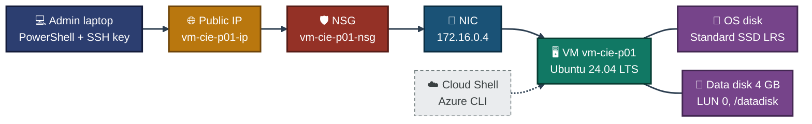
<p align="center"><em>All eight resources sit in <code>rg-cie-p01-vm</code> (Exhibit 13). The NIC, VNet and subnet names come from Exhibits 8 and 13. The diagram shows the layout, it is not a screenshot.</em></p>

---

<a id="project-flow"></a>
## ⏱️ Project Flow

```mermaid
%%{init: {'theme': 'base', 'themeVariables': {'fontSize': '14px'}, 'flowchart': {'nodeSpacing': 22, 'rankSpacing': 30, 'padding': 8}}}%%
flowchart LR
    A["1 Checks<br/>and RG"]:::a --> B["2 SSH key"]:::b --> C["3 Deploy VM"]:::c --> D["4 Verify<br/>inside VM"]:::d --> E["5 Data disk"]:::e --> F["6 Resize"]:::f --> G["7 Power<br/>states"]:::g --> H["8 Boot<br/>diagnostics"]:::h
    classDef a fill:#2C3E70,stroke:#131B3A,stroke-width:2px,color:#FFFFFF
    classDef b fill:#4A3FA6,stroke:#2A2270,stroke-width:2px,color:#FFFFFF
    classDef c fill:#1A5276,stroke:#0B2E43,stroke-width:2px,color:#FFFFFF
    classDef d fill:#117864,stroke:#083D33,stroke-width:2px,color:#FFFFFF
    classDef e fill:#76448A,stroke:#432752,stroke-width:2px,color:#FFFFFF
    classDef f fill:#B9770E,stroke:#6E4409,stroke-width:2px,color:#FFFFFF
    classDef g fill:#B7950B,stroke:#6B5807,stroke-width:2px,color:#FFFFFF
    classDef h fill:#1E8449,stroke:#0E4A28,stroke-width:2px,color:#FFFFFF
    linkStyle default stroke:#2C3E50,stroke-width:2px
```
<p align="center"><em>The eight phases in the order they were done. Clock times are left out because most screenshots do not show them.</em></p>

---

<a id="setup"></a>
## 🔵 Setup — Checks, Resource Group and SSH Key

**Objective:** Confirm the subscription and VM size are usable before building, put every resource in one tagged group, and create the SSH key pair on the laptop.

### Step 1 — Check the subscription ✅

**Run in: Cloud Shell**

```bash
az account show --output table
```

<p align="center">
  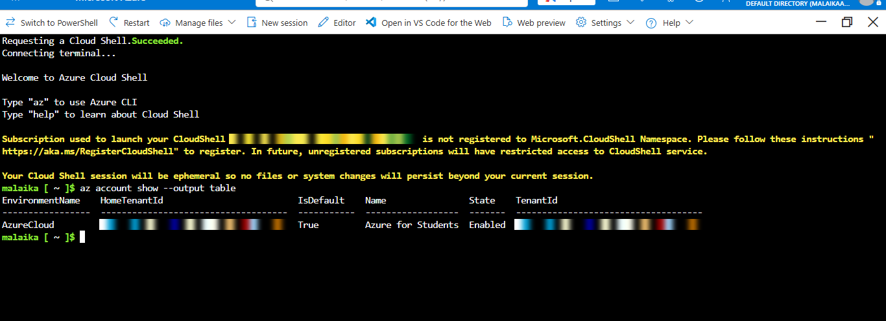<br>
  <em>Exhibit 1 — The subscription is <code>Azure for Students</code>, state <code>Enabled</code>. Cloud Shell also prints a yellow notice that the subscription is not registered to the <code>Microsoft.CloudShell</code> namespace. Tenant IDs are blurred</em>
</p>

### Step 2 — Check that the VM size is available ✅

**Run in: Cloud Shell**

```bash
az vm list-skus --location indiasouthcentral --size Standard_B2 --output table
```

<p align="center">
  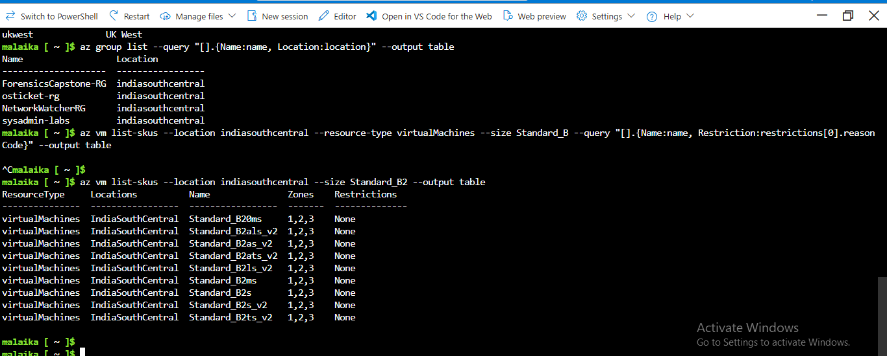<br>
  <em>Exhibit 2 — Every <code>Standard_B2*</code> size listed for IndiaSouthCentral shows <code>Restrictions: None</code> and zones 1, 2 and 3. The earlier filtered query above it was cancelled with Ctrl+C</em>
</p>

### Step 3 — Create the resource group ✅

**Run in: Cloud Shell**

```bash
az group create --name rg-cie-p01-vm --location indiasouthcentral --tags project=cie-p01 owner=malaika env=lab
az group show --name rg-cie-p01-vm --output json
```

📝 The `create` output is not in a kept screenshot. Exhibit 3 shows the `show` command.

<p align="center">
  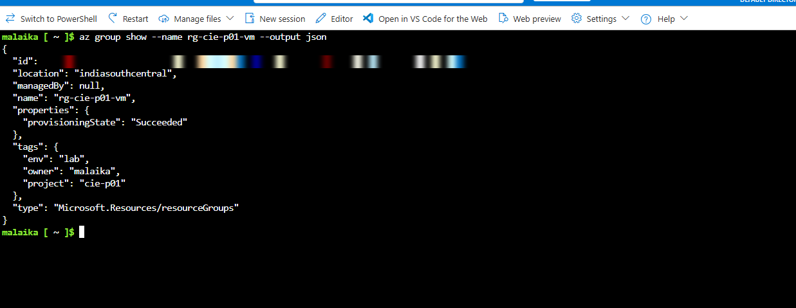<br>
  <em>Exhibit 3 — <code>rg-cie-p01-vm</code> in <code>indiasouthcentral</code>, <code>provisioningState: Succeeded</code>, with the three tags</em>
</p>

### Step 4 — Create the SSH key pair ✅

The key is created on the laptop, because Cloud Shell sessions are ephemeral and a key made there would be lost.

**Run in: Laptop PowerShell**

```powershell
ssh-keygen -t rsa -b 4096 -f $HOME\.ssh\cie_p01_key2 -C "cie-p01" -N '""'
Get-Content $HOME\.ssh\cie_p01_key2.pub | Set-Clipboard
```

<p align="center">
  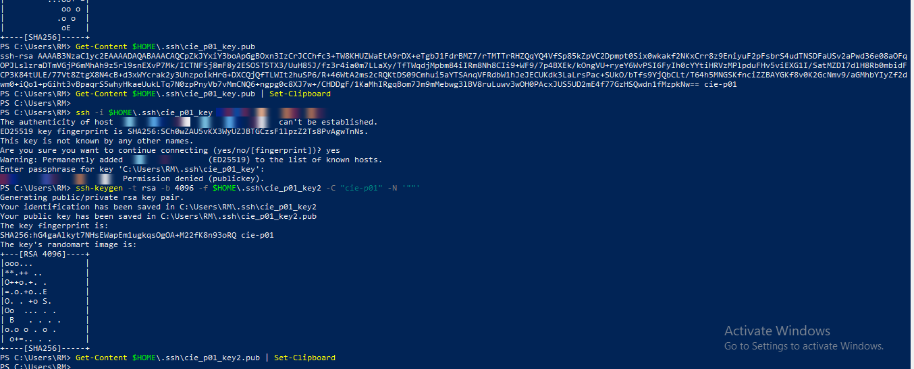<br>
  <em>Exhibit 4 — Second key pair <code>cie_p01_key2</code>, 4096-bit RSA, created with no passphrase. The failed first attempt is still visible higher on this screen; see Exhibit 31</em>
</p>

🎯 **Result:** Only the public key (`.pub`) is pasted into Azure. The private key stays on the laptop.

---

<a id="deployment"></a>
## 🟢 Deployment — Create the Virtual Machine

**Objective:** Create the VM in the existing resource group with SSH key authentication and default networking.

### Step 5 — Fill in the Basics tab ✅

**Run in: Azure Portal, Virtual machines, Create**

<p align="center">
  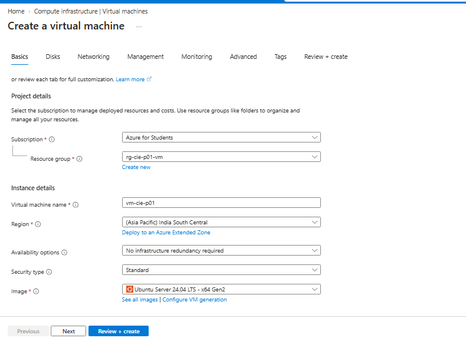<br>
  <em>Exhibit 5 — Subscription <code>Azure for Students</code>, existing group <code>rg-cie-p01-vm</code>, name <code>vm-cie-p01</code>, region India South Central, no infrastructure redundancy, security type Standard, Ubuntu Server 24.04 LTS x64 Gen2</em>
</p>

<p align="center">
  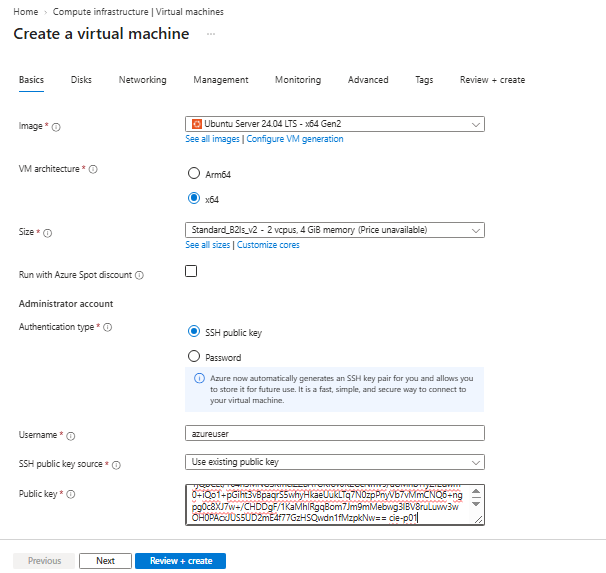<br>
  <em>Exhibit 6 — x64, size <code>Standard_B2ls_v2</code> (2 vCPUs, 4 GiB, "Price unavailable"), SSH public key, user <code>azureuser</code>, "Use existing public key", key ending in <code>cie-p01</code></em>
</p>

### Step 6 — Open SSH on the Networking tab ✅

<p align="center">
  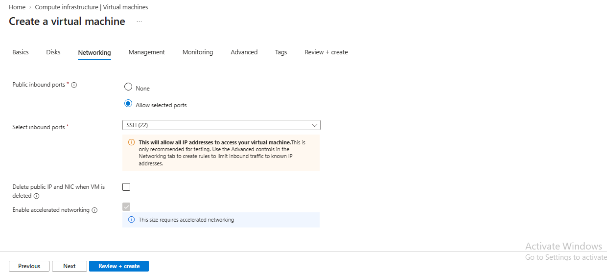<br>
  <em>Exhibit 7 — "Allow selected ports" with SSH (22). The portal warns that this allows all IP addresses and is only recommended for testing. Accelerated networking is ticked because this size requires it</em>
</p>

### Step 7 — Confirm the VM is running ✅

<p align="center">
  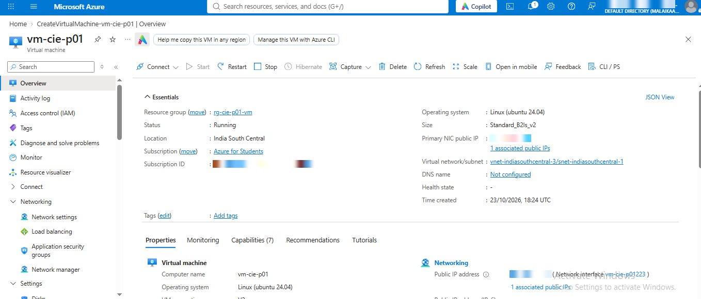<br>
  <em>Exhibit 8 — <code>vm-cie-p01</code> is <code>Running</code> in <code>rg-cie-p01-vm</code>, India South Central, <code>Standard_B2ls_v2</code>, on <code>vnet-indiasouthcentral-3/snet-indiasouthcentral-1</code>, created 23/10/2026 18:24 UTC. The network interface is <code>vm-cie-p01223</code>. The Tags row reads "Add tags", so the VM has no tags yet</em>
</p>

🎯 **Result:** The wizard created the VM together with a virtual network, subnet, public IP, network interface and NSG in the same resource group.

---

<a id="verification"></a>
## 🟣 Verification — Inside the VM

**Objective:** Prove that key login works and check the system from inside the guest.

### Step 8 — Log in with the key ✅

**Run in: Laptop PowerShell**

```powershell
ssh -i $HOME\.ssh\cie_p01_key2 azureuser@<public-ip>
```

Then, **in the SSH session (VM)**:

```bash
whoami
```

<p align="center">
  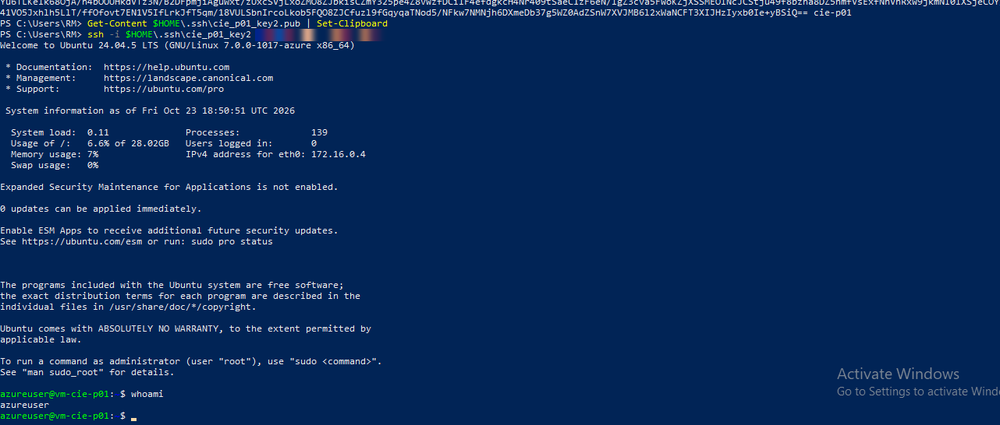<br>
  <em>Exhibit 9 — Login with <code>cie_p01_key2</code>, no password prompt. Banner: Ubuntu 24.04.5 LTS, kernel <code>7.0.0-1017-azure</code>, 6.6% of 28.02GB used, <code>eth0</code> address <code>172.16.0.4</code></em>
</p>

### Step 9 — Check identity and network ✅

**Run in: SSH session (VM)**

```bash
hostnamectl | cat
ip -br addr
```

<p align="center">
  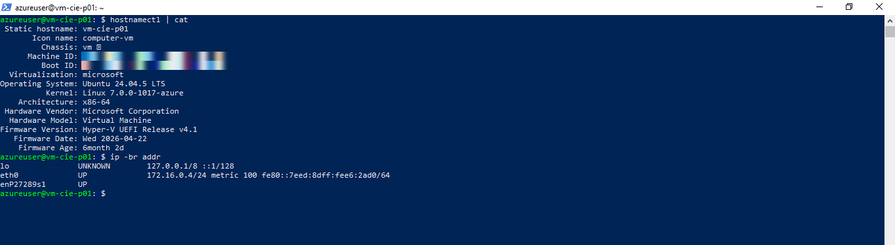<br>
  <em>Exhibit 10 — Hostname <code>vm-cie-p01</code>, Ubuntu 24.04.5 LTS, x86-64, virtualization <code>microsoft</code>. <code>eth0</code> is UP at <code>172.16.0.4/24</code>; <code>enP27289s1</code> is the accelerated networking adapter</em>
</p>

### Step 10 — Check the SSH service and listening ports ✅

**Run in: SSH session (VM)**

```bash
systemctl status ssh --no-pager
sudo ss -tulpn
```

<p align="center">
  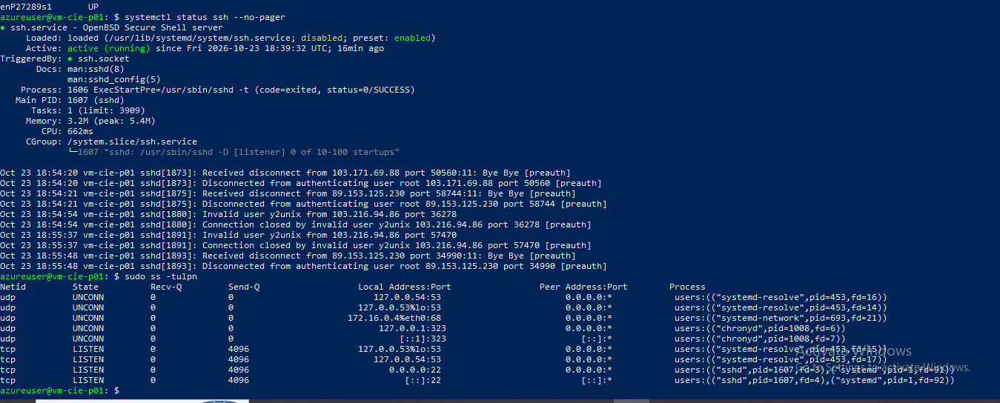<br>
  <em>Exhibit 11 — <code>ssh.service</code> is <code>active (running)</code> and triggered by <code>ssh.socket</code>. <code>sshd</code> listens on port 22 for IPv4 and IPv6. The log lines at the bottom show failed logins from other addresses</em>
</p>

### Step 11 — Find my own login in the log ✅

**Run in: SSH session (VM)**

```bash
sudo journalctl -u ssh --no-pager | grep "Accepted publickey"
```

<p align="center">
  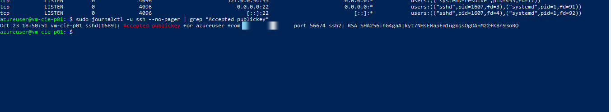<br>
  <em>Exhibit 12 — <code>Accepted publickey for azureuser</code> at 18:50:51. The key fingerprint matches the one printed when <code>cie_p01_key2</code> was created (Exhibit 4). My own address is blurred</em>
</p>

### Step 12 — Tag every resource ✅

Tags on the resource group are not inherited by its resources, so the tag set was applied to each one. The tag table in Exhibit 13 includes the data disk, so this was run after the disk was attached (Step 13). 📝 The loop is not visible in a kept screenshot; Exhibit 13 shows its result.

**Run in: Cloud Shell**

```bash
for id in $(az resource list -g rg-cie-p01-vm --query "[].id" -o tsv); do
  az resource tag --tags project=cie-p01 owner=malaika env=lab --ids $id --is-incremental
done

az resource list -g rg-cie-p01-vm \
  --query "[].{Name:name, Project:tags.project, Owner:tags.owner, Env:tags.env}" -o table
```

<p align="center">
  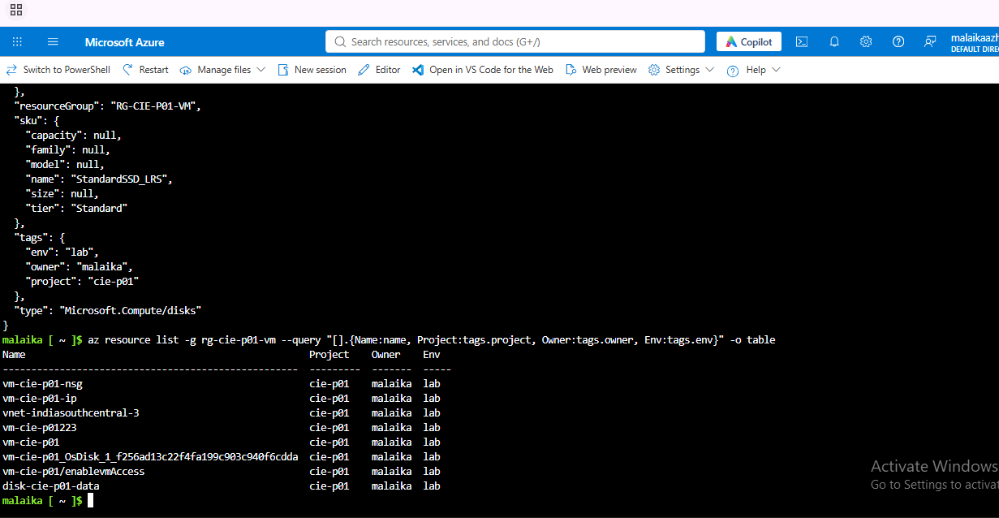<br>
  <em>Exhibit 13 — All eight resources carry <code>cie-p01</code>, <code>malaika</code> and <code>lab</code>: NSG, public IP, VNet, NIC, VM, OS disk, the <code>enablevmAccess</code> extension and <code>disk-cie-p01-data</code></em>
</p>

🎯 **Result:** Key-based login works, the SSH service is running, and the login is recorded in the server log.

---

<a id="data-disk"></a>
## 🟠 Data Disk — Attach, Format and Mount

**Objective:** Add a separate managed disk and make the mount survive a reboot.

```mermaid
%%{init: {'theme': 'base', 'themeVariables': {'fontSize': '14px'}, 'flowchart': {'nodeSpacing': 22, 'rankSpacing': 30, 'padding': 8}}}%%
flowchart LR
    A["📎 Attach<br/>LUN 0"]:::a --> B["🔎 lsblk<br/>raw 4G"]:::b --> C["✂️ parted<br/>GPT + sdb1"]:::c --> D["🧱 mkfs.ext4<br/>UUID"]:::d --> E["📂 mount<br/>/datadisk"]:::e --> F["📝 fstab<br/>by UUID"]:::f --> G["🧪 umount +<br/>mount -a"]:::g
    classDef a fill:#2C3E70,stroke:#131B3A,stroke-width:2px,color:#FFFFFF
    classDef b fill:#1A5276,stroke:#0B2E43,stroke-width:2px,color:#FFFFFF
    classDef c fill:#117864,stroke:#083D33,stroke-width:2px,color:#FFFFFF
    classDef d fill:#76448A,stroke:#432752,stroke-width:2px,color:#FFFFFF
    classDef e fill:#B9770E,stroke:#6E4409,stroke-width:2px,color:#FFFFFF
    classDef f fill:#B7950B,stroke:#6B5807,stroke-width:2px,color:#FFFFFF
    classDef g fill:#1E8449,stroke:#0E4A28,stroke-width:2px,color:#FFFFFF
    linkStyle default stroke:#2C3E50,stroke-width:2px
```

### Step 13 — Attach the disk ✅

📝 The attach command is not visible in a kept screenshot; Exhibit 14 shows the attached disk.

**Run in: Cloud Shell**

```bash
az vm disk attach --resource-group rg-cie-p01-vm --vm-name vm-cie-p01 \
  --name disk-cie-p01-data --new --size-gb 4 --sku StandardSSD_LRS --lun 0

az vm show -g rg-cie-p01-vm -n vm-cie-p01 \
  --query "storageProfile.dataDisks[].{Name:name, SizeGB:diskSizeGb, LUN:lun, Type:managedDisk.storageAccountType}" -o table
```

<p align="center">
  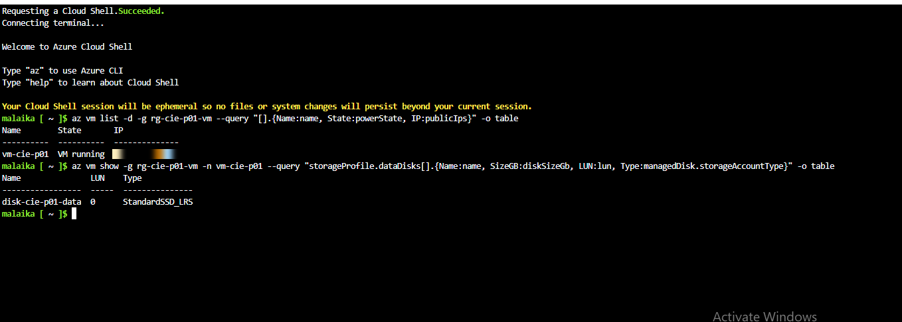<br>
  <em>Exhibit 14 — <code>disk-cie-p01-data</code> at LUN 0, type <code>StandardSSD_LRS</code>. The size column did not appear in the table, so the size is proven from inside the VM in Exhibit 15</em>
</p>

### Step 14 — Find the new disk in Linux ✅

**Run in: SSH session (VM)**

```bash
lsblk
```

<p align="center">
  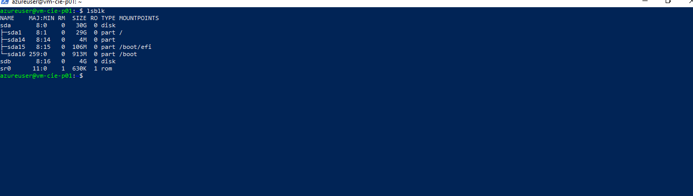<br>
  <em>Exhibit 15 — <code>sdb</code> is a 4G disk with no partition or mountpoint. The 30G OS disk <code>sda</code> has <code>sda1</code> on <code>/</code>, <code>sda15</code> on <code>/boot/efi</code> and <code>sda16</code> on <code>/boot</code></em>
</p>

### Step 15 — Create a partition ✅

**Run in: SSH session (VM)**

```bash
sudo parted /dev/sdb --script mklabel gpt mkpart primary ext4 0% 100%
lsblk /dev/sdb
```

<p align="center">
  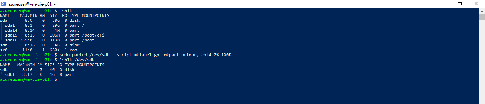<br>
  <em>Exhibit 16 — <code>parted</code> printed nothing, and <code>sdb</code> now has one partition, <code>sdb1</code>, 4G. The earlier <code>lsblk</code> above it gives a before and after</em>
</p>

### Step 16 — Format as ext4 ✅

**Run in: SSH session (VM)**

```bash
sudo mkfs.ext4 /dev/sdb1
lsblk -f /dev/sdb
```

<p align="center">
  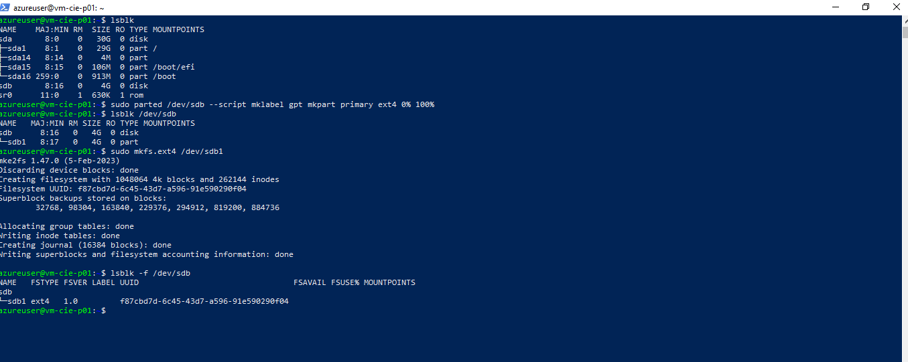<br>
  <em>Exhibit 17 — <code>mkfs.ext4</code> created 1,048,064 4k blocks and ended with "done". <code>sdb1</code> shows <code>ext4</code> and UUID <code>f87cbd7d-6c45-43d7-a596-91e590290f04</code></em>
</p>

### Step 17 — Mount it and make it permanent ✅

**Run in: SSH session (VM)**

```bash
sudo mkdir /datadisk
sudo mount /dev/sdb1 /datadisk
df -h /datadisk
echo 'UUID=f87cbd7d-6c45-43d7-a596-91e590290f04 /datadisk ext4 defaults,nofail 0 2' | sudo tee -a /etc/fstab
sudo umount /datadisk
sudo mount -a
findmnt /datadisk
```

<p align="center">
  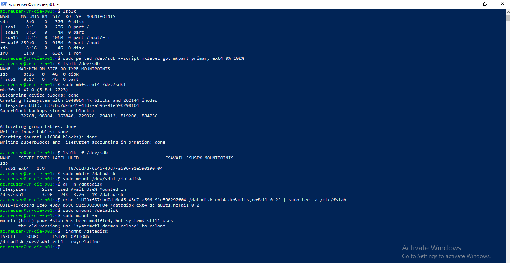<br>
  <em>Exhibit 18 — <code>df -h</code> shows 3.9G on <code>/dev/sdb1</code>. After <code>umount</code>, <code>mount -a</code> remounted the disk from <code>/etc/fstab</code>, so the entry is valid. It printed a hint that systemd still held the old fstab</em>
</p>

### Step 18 — Write a test file ✅

**Run in: SSH session (VM)**

```bash
sudo systemctl daemon-reload
echo "cie-p01 data disk test" | sudo tee /datadisk/test.txt
cat /datadisk/test.txt
ls -l /datadisk
```

<p align="center">
  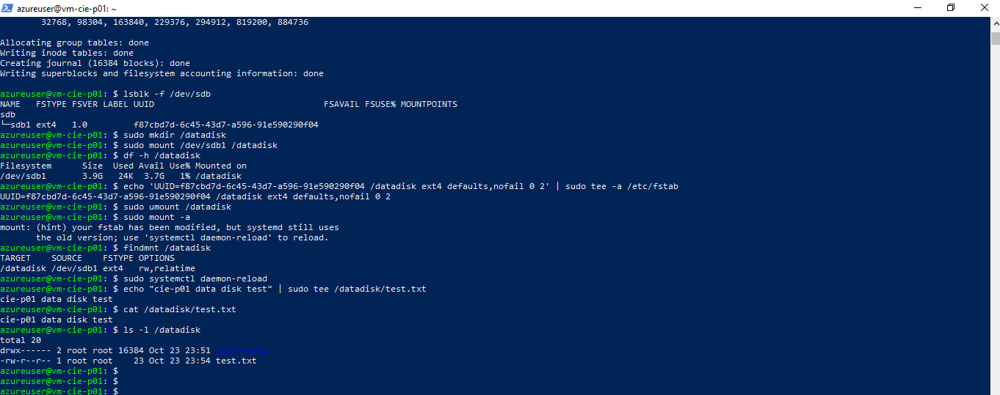<br>
  <em>Exhibit 19 — <code>daemon-reload</code> cleared the hint. <code>test.txt</code> was written and read back. <code>lost+found</code> and <code>test.txt</code> are both owned by <code>root</code>, because the filesystem was created with <code>sudo</code></em>
</p>

### Step 19 — Reboot and check the mount ✅

**Run in: SSH session (VM), then after reconnecting**

```bash
sudo reboot
```

```bash
uptime -p
findmnt /datadisk
cat /datadisk/test.txt
```

<p align="center">
  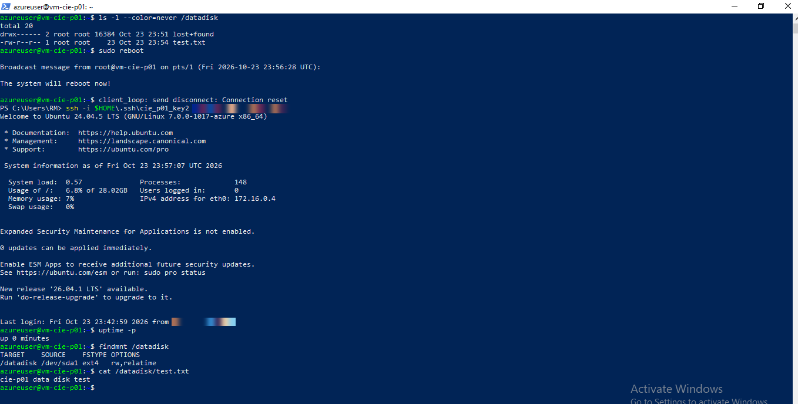<br>
  <em>Exhibit 20 — After the reboot (<code>up 0 minutes</code>) <code>/datadisk</code> was mounted without running <code>mount</code>, and <code>test.txt</code> was intact. The source is now <code>/dev/sda1</code></em>
</p>

### Step 20 — Check which disk is which ✅

**Run in: SSH session (VM)**

```bash
lsblk -f
findmnt /datadisk
findmnt /
```

<p align="center">
  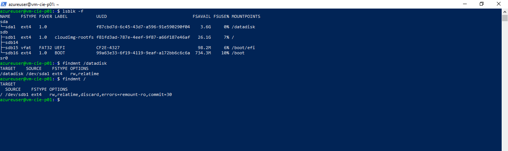<br>
  <em>Exhibit 21 — The data disk (UUID <code>f87cbd7d-…</code>) is now <code>sda1</code>, mounted on <code>/datadisk</code>. The OS disk (label <code>cloudimg-rootfs</code>) is now <code>sdb1</code>, mounted on <code>/</code></em>
</p>

### 🗺️ Why the UUID Matters

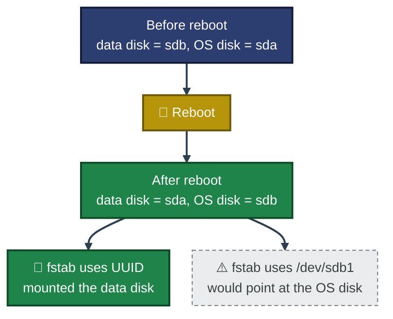
<p align="center"><em>Green is what the screenshots showed (Exhibits 20 and 21). The dashed box is what a device-name entry would have done. It was not tried.</em></p>

🎯 **Result:** The disk was partitioned, formatted, mounted and persisted across a reboot. The names of the two disks changed, and the mount still worked because the entry uses the UUID.

---

<a id="resize"></a>
## 🟡 Resize the Virtual Machine

**Objective:** Change the VM size and prove the change from inside the guest.

### Step 21 — See which sizes are allowed ✅

**Run in: Cloud Shell**

```bash
az vm list-vm-resize-options -g rg-cie-p01-vm -n vm-cie-p01 \
  --query "[?contains(name, 'Standard_B')].{Name:name, vCPU:numberOfCores, MemoryMB:memoryInMb}" -o table
```

<p align="center">
  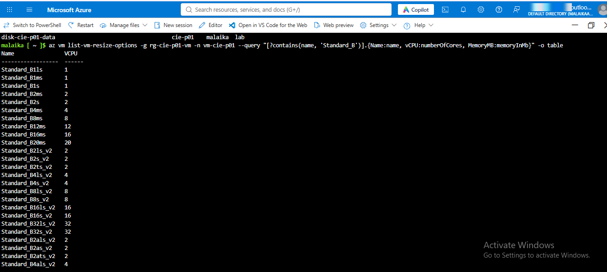<br>
  <em>Exhibit 22 — Many <code>Standard_B</code> sizes are open to this VM, including <code>Standard_B2ls_v2</code> (current), <code>Standard_B2s_v2</code> and <code>Standard_B4ls_v2</code>. The memory column came back empty</em>
</p>

### Step 22 — Record the "before" state ✅

**Run in: SSH session (VM)**

```bash
nproc
free -h
```

<p align="center">
  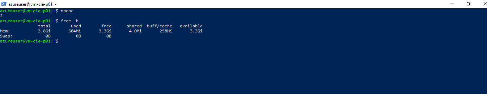<br>
  <em>Exhibit 23 — Before: 2 vCPUs, 3.8Gi total memory</em>
</p>

### Step 23 — Resize ✅

📝 The resize ran in Cloud Shell while the VM was running. Exhibit 24 shows the new size, and Exhibit 25 shows the restart.

**Run in: Cloud Shell**

```bash
az vm resize -g rg-cie-p01-vm -n vm-cie-p01 --size Standard_B2s_v2
az vm list -d -g rg-cie-p01-vm \
  --query "[].{Name:name, Size:hardwareProfile.vmSize, State:powerState, IP:publicIps}" -o table
```

<p align="center">
  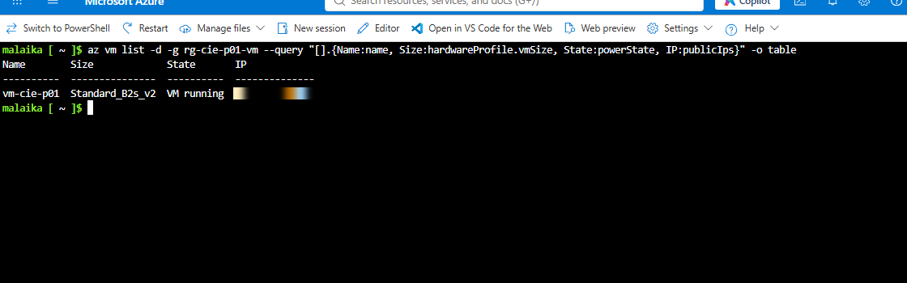<br>
  <em>Exhibit 24 — <code>vm-cie-p01</code> now reports <code>Standard_B2s_v2</code> and <code>VM running</code></em>
</p>

### Step 24 — Record the "after" state ✅

**Run in: SSH session (VM)**

```bash
uptime -p
nproc
free -h
findmnt /datadisk
```

<p align="center">
  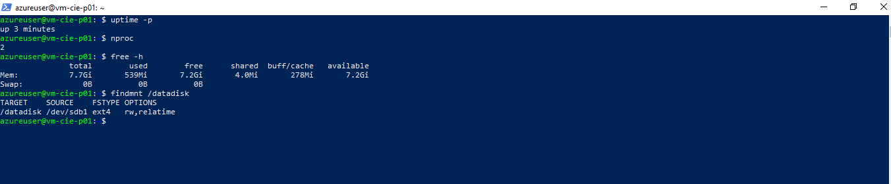<br>
  <em>Exhibit 25 — After: <code>up 3 minutes</code> (the VM restarted), 2 vCPUs, 7.7Gi total memory, and the data disk still mounted on <code>/dev/sdb1</code></em>
</p>

| | Before (`Standard_B2ls_v2`) | After (`Standard_B2s_v2`) |
|---|:---:|:---:|
| vCPUs (`nproc`) | 2 | 2 |
| Memory (`free -h`, total) | 3.8Gi | 7.7Gi |
| Data disk | mounted | mounted |

🎯 **Result:** The resize doubled the memory and kept the vCPU count at 2. The data disk and its contents were not affected.

---

<a id="power-states"></a>
## 🔴 Power States — Stop, Deallocate, Start

**Objective:** Observe the stopped and deallocated states one after the other, then bring the VM back.

```mermaid
%%{init: {'theme': 'base', 'themeVariables': {'fontSize': '14px'}, 'flowchart': {'nodeSpacing': 26, 'rankSpacing': 34, 'padding': 8}}}%%
flowchart LR
    R["🟢 VM running"]:::run -->|"az vm stop"| S["🟡 VM stopped"]:::stop
    S -->|"az vm deallocate"| D["🔴 VM deallocated"]:::dealloc
    D -->|"az vm start"| R2["🟢 VM running"]:::run
    classDef run fill:#1E8449,stroke:#0E4A28,stroke-width:2px,color:#FFFFFF
    classDef stop fill:#B7950B,stroke:#6B5807,stroke-width:2px,color:#FFFFFF
    classDef dealloc fill:#943126,stroke:#571C16,stroke-width:2px,color:#FFFFFF
    linkStyle default stroke:#2C3E50,stroke-width:2px
```
<p align="center"><em>The three states come from Exhibits 26 to 28. The diagram shows the order they were observed in.</em></p>

### Step 25 — Stop the VM ✅

📝 The stop, deallocate and start commands ran in Cloud Shell and are not visible in a kept screenshot. The state after each one is.

**Run in: Cloud Shell**

```bash
az vm stop -g rg-cie-p01-vm -n vm-cie-p01
az vm list -d -g rg-cie-p01-vm --query "[].{Name:name, Size:hardwareProfile.vmSize, State:powerState}" -o table
```

<p align="center">
  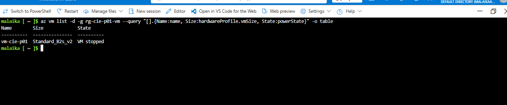<br>
  <em>Exhibit 26 — State <code>VM stopped</code>, size <code>Standard_B2s_v2</code></em>
</p>

### Step 26 — Deallocate the VM ✅

**Run in: Cloud Shell**

```bash
az vm deallocate -g rg-cie-p01-vm -n vm-cie-p01
az vm list -d -g rg-cie-p01-vm \
  --query "[].{Name:name, Size:hardwareProfile.vmSize, State:powerState, IP:publicIps}" -o table
```

<p align="center">
  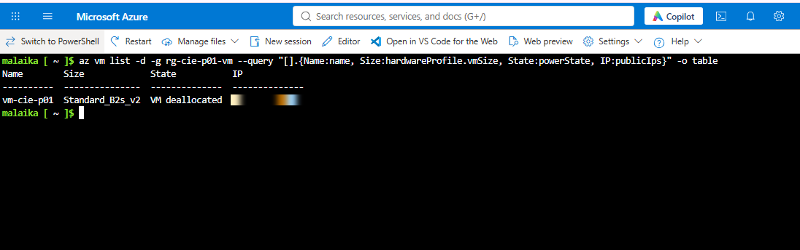<br>
  <em>Exhibit 27 — State <code>VM deallocated</code>. The public IP column still shows an address (blurred) that looks the same as in Exhibit 24</em>
</p>

### Step 27 — Start the VM again ✅

**Run in: Cloud Shell**

```bash
az vm start -g rg-cie-p01-vm -n vm-cie-p01
az vm list -d -g rg-cie-p01-vm \
  --query "[].{Name:name, Size:hardwareProfile.vmSize, State:powerState, IP:publicIps}" -o table
```

<p align="center">
  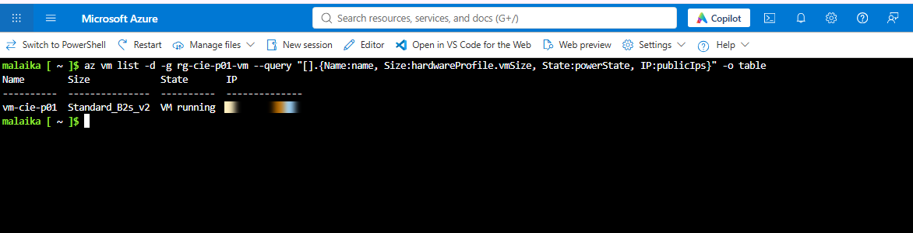<br>
  <em>Exhibit 28 — State <code>VM running</code> again, same size, public IP column shown (blurred)</em>
</p>

### Step 28 — Check the data disk after the restart ✅

**Run in: SSH session (VM)**

```bash
uptime -p
findmnt /datadisk
cat /datadisk/test.txt
```

<p align="center">
  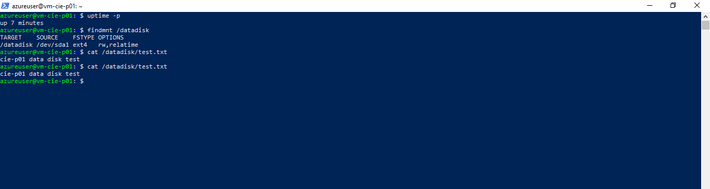<br>
  <em>Exhibit 29 — <code>up 7 minutes</code>, <code>/datadisk</code> mounted on <code>/dev/sda1</code>, and <code>test.txt</code> still reads <code>cie-p01 data disk test</code>. The <code>cat</code> command was run twice, so the line appears twice</em>
</p>

🎯 **Result:** The VM went from running to stopped to deallocated and back to running. The public IP column showed an address in every state, and the data disk and its file survived.

---

<a id="boot-diagnostics"></a>
## 🖥️ Boot Diagnostics

### Step 29 — Open Boot diagnostics ✅

**Run in: Azure Portal, `vm-cie-p01`, Help, Boot diagnostics**

<p align="center">
  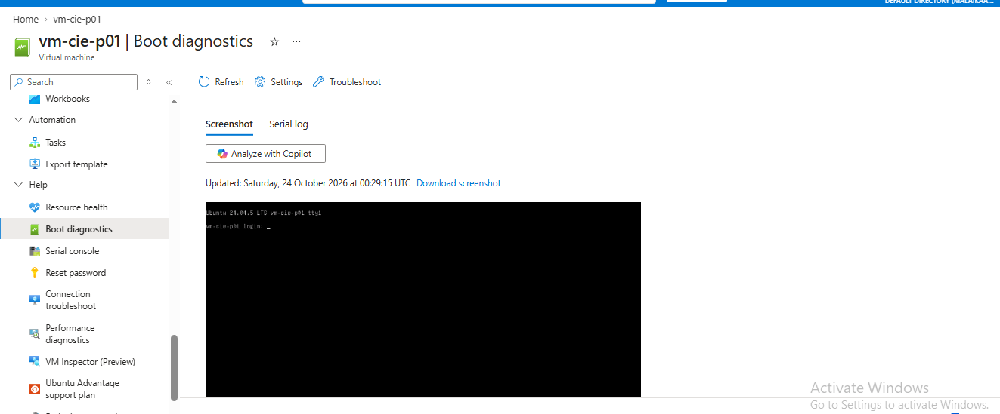<br>
  <em>Exhibit 30 — Console screenshot updated 24 October 2026 at 00:29:15 UTC. It shows <code>Ubuntu 24.04.5 LTS vm-cie-p01 tty1</code> and the <code>vm-cie-p01 login:</code> prompt</em>
</p>

🎯 **Result:** The platform console shows the VM booted to the login prompt after the restart.

---

<a id="key-findings"></a>
## 🔎 Key Findings

- **Device names are not stable.** After the first reboot the data disk was `sda` and the OS disk was `sdb` (Exhibit 21). After the later resize the data disk was `sdb1` again (Exhibit 25). Both times the mount worked, because `/etc/fstab` uses the UUID.
- **Internet-facing SSH is probed quickly.** The SSH log in Exhibit 11 shows failed attempts from other addresses (`root` and an invalid user), about 30 minutes after the VM was created. The lines visible there are pre-authentication disconnects and invalid-user rejections. None of them is a successful login.
- **The resize changed memory, not vCPUs.** Both sizes have 2 vCPUs. The guest reported 3.8Gi before and 7.7Gi after (Exhibits 23 and 25).
- **An address stayed on the VM through deallocation.** The public IP column showed an address in the deallocated and restarted states (Exhibits 27 and 28), and it looks the same as before. The address is blurred.
- **Tags are not inherited.** The resource group had tags, and the VM did not (Exhibit 8) until each resource was tagged (Exhibit 13).

---

<a id="challenges-fixes"></a>
## ⚠️ Challenges & Fixes

| ❌ Challenge | ✅ Fix |
|---|---|
| The first SSH key pair asked for a passphrase at login and then failed with `Permission denied (publickey)` (Exhibit 31) | Created a second key pair with an empty passphrase, then added its public key from the portal (Help, Reset password, "Add SSH public key"). Login then worked (Exhibit 9) |
| The Reset password form defaulted to "Generate new key pair", which would not have used my key | Changed the source to use the existing public key before pressing Update |
| The portal showed `NotAvailableForSubscription` for the size it first displayed | Chose `Standard_B2ls_v2`, which Exhibit 2 had shown as unrestricted |
| Creating a new resource group with the same name gave "already exists" | Picked the existing `rg-cie-p01-vm` from the dropdown (Exhibit 5) |
| The first `list-skus` query with a long `--query` filter printed nothing and was cancelled (Exhibit 2) | Ran the shorter command in Step 2. I did not find the cause of the empty output |
| The VM had no tags although its resource group did (Exhibit 8) | Tagged every resource with `az resource tag --is-incremental` (Exhibit 13) |
| Linux commands typed in laptop PowerShell, and `ssh -i` typed inside the VM, failed with errors | Each command now has a "Run in" label. The key only exists on the laptop, and `az` is run in Cloud Shell |
| The data disk size column did not appear in the CLI output | Confirmed 4G from `lsblk` inside the VM (Exhibit 15) |

<p align="center">
  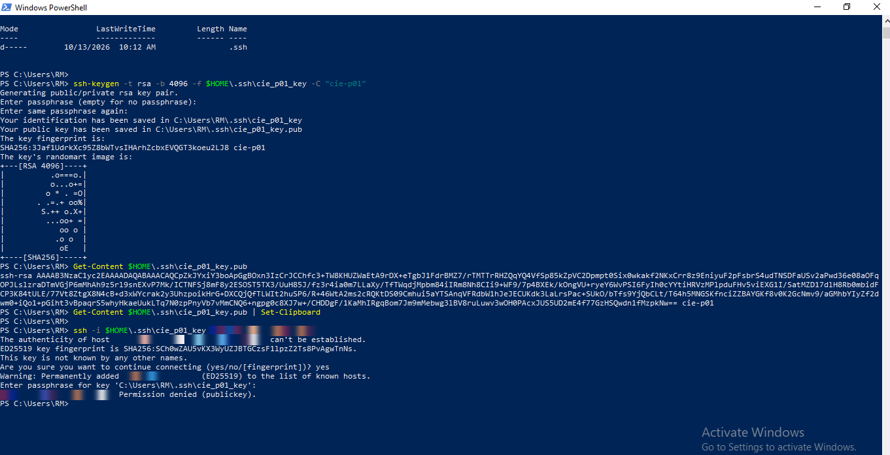<br>
  <em>Exhibit 31 — First key pair <code>cie_p01_key</code> created, then <code>Enter passphrase for key</code> and <code>Permission denied (publickey)</code> at login</em>
</p>

---

<a id="scope-limitations"></a>
## 🚧 Scope & Notes

- **SSH was open to all addresses.** Port 22 allowed every source address for the whole lab (Exhibit 7).
- **Some commands are not on screen.** The commands marked 📝 (group create output, tagging loop, disk attach, resize, stop, deallocate, start, delete) ran in Cloud Shell. Their results are shown, the commands themselves are not.
- **The first key pair is documented through its failure.** It was replaced by the second pair (Exhibit 31).
- **Log lines show only part of the picture.** Exhibit 11 shows a few failed login lines. The log was not searched for a full count.
- **Cleanup has no screenshot.** The resource group was deleted, but the output of the check was not kept (see [Cleanup](#cleanup)).
- **Single region, one subscription type.** The results come from an Azure for Students subscription in India South Central.

---

<a id="what-i-learned"></a>
## 🧠 What I Learned

- **Check availability first.** A short SKU check showed which sizes this subscription could use before anything was built.
- **Use the right shell.** Azure commands run in Cloud Shell, key and SSH commands run on the laptop, and Linux commands run inside the VM. Mixing them up gives errors that look like real faults.
- **Keep the private key on the laptop.** Only the public key goes to Azure.
- **Use the UUID in fstab.** The disk names changed after a reboot, and the UUID entry kept the right disk mounted.
- **Test fstab before rebooting.** `umount` followed by `mount -a` proves the entry works.
- **A resize is proven from inside the guest.** The CLI showed the new size, and `free -h` showed what the VM actually received.
- **Tags are applied per resource.** A tagged resource group does not tag what is inside it.
- **A screenshot must show the claim.** If a screenshot does not show a result, it does not go into the results.

---

<a id="skills-demonstrated"></a>
## 🛠️ Skills Demonstrated

- Deploying an Ubuntu VM on Azure with SSH key authentication
- Using Azure Cloud Shell and the Azure CLI for groups, tags, disks, resizing and power states
- Checking VM size availability and restrictions before deployment
- Verifying a Linux system with `hostnamectl`, `ip`, `systemctl`, `ss` and `journalctl`
- Partitioning, formatting and mounting a managed disk with `parted`, `mkfs.ext4` and `/etc/fstab`
- Writing UUID-based fstab entries and testing them with `mount -a`
- Resizing a VM and proving the change with `nproc` and `free`
- Comparing the stopped and deallocated power states
- Reading boot diagnostics
- Applying a naming and tagging standard
- Recovering SSH access after a failed first login
- Separating proven results from notes in project documentation

---

<a id="cleanup"></a>
## 🧹 Cleanup

The group `rg-cie-p01-vm` was deleted with one command (`az group delete`). No screenshot of the delete or the check was kept, so the result is stated, not shown. Details: [`commands/cleanup.md`](commands/cleanup.md).

---

<a id="screenshot-index"></a>
## 🖼️ Screenshot Index

| # | File | Shows |
|:---:|---|---|
| 1 | `ss-01-subscription-check.png` | Azure for Students subscription, Enabled |
| 2 | `ss-02-vm-size-availability.png` | `Standard_B2*` sizes with no restrictions |
| 3 | `ss-03-resource-group-created.png` | Resource group and tags |
| 4 | `ss-04-ssh-key-generated.png` | Second SSH key pair |
| 5 | `ss-05-vm-basics-project-instance.png` | Basics tab: project and instance details |
| 6 | `ss-06-vm-basics-size-auth-key.png` | Basics tab: size, user and public key |
| 7 | `ss-07-networking-ssh-port.png` | SSH (22) selected on the Networking tab |
| 8 | `ss-08-vm-overview-running.png` | VM overview, running |
| 9 | `ss-09-ssh-login-whoami.png` | SSH login and `whoami` |
| 10 | `ss-10-system-info.png` | `hostnamectl` and `ip -br addr` |
| 11 | `ss-11-ssh-service-ports.png` | SSH service status and listening ports |
| 12 | `ss-12-ssh-accepted-publickey.png` | Accepted publickey entry |
| 13 | `ss-13-resource-tags.png` | Tags on all eight resources |
| 14 | `ss-14-data-disk-attached.png` | Data disk at LUN 0 |
| 15 | `ss-15-lsblk-new-disk.png` | New 4G disk in `lsblk` |
| 16 | `ss-16-disk-partitioned.png` | Partition `sdb1` created |
| 17 | `ss-17-disk-formatted.png` | ext4 filesystem and UUID |
| 18 | `ss-18-mount-and-fstab.png` | Mount, fstab entry and `mount -a` test |
| 19 | `ss-19-disk-write-test.png` | Test file on the data disk |
| 20 | `ss-20-reboot-persistence.png` | Mount and data after reboot |
| 21 | `ss-21-device-name-swap.png` | Data disk and OS disk swapped names |
| 22 | `ss-22-resize-options.png` | Allowed resize options |
| 23 | `ss-23-before-resize.png` | 2 vCPUs, 3.8Gi before resize |
| 24 | `ss-24-vm-resized.png` | `Standard_B2s_v2`, running |
| 25 | `ss-25-after-resize.png` | 2 vCPUs, 7.7Gi after resize |
| 26 | `ss-26-vm-stopped.png` | `VM stopped` |
| 27 | `ss-27-vm-deallocated.png` | `VM deallocated` |
| 28 | `ss-28-vm-started.png` | `VM running` after start |
| 29 | `ss-29-disk-after-restart.png` | Data disk after the restart |
| 30 | `ss-30-boot-diagnostics.png` | Boot diagnostics console |
| 31 | `ss-31-first-key-passphrase-denied.png` | First key rejected at login |

---

<a id="repo-structure"></a>
## 📁 Repo Structure

```text
01-vm-deployment-administration/
|-- README.md
|-- VM-INDEX.md
|-- commands/
|   |-- commands.md
|   `-- cleanup.md
`-- Screenshots/
    |-- ss-01-subscription-check.png
    |-- ss-02-vm-size-availability.png
    |-- ss-03-resource-group-created.png
    |-- ss-04-ssh-key-generated.png
    |-- ss-05-vm-basics-project-instance.png
    |-- ss-06-vm-basics-size-auth-key.png
    |-- ss-07-networking-ssh-port.png
    |-- ss-08-vm-overview-running.png
    |-- ss-09-ssh-login-whoami.png
    |-- ss-10-system-info.png
    |-- ss-11-ssh-service-ports.png
    |-- ss-12-ssh-accepted-publickey.png
    |-- ss-13-resource-tags.png
    |-- ss-14-data-disk-attached.png
    |-- ss-15-lsblk-new-disk.png
    |-- ss-16-disk-partitioned.png
    |-- ss-17-disk-formatted.png
    |-- ss-18-mount-and-fstab.png
    |-- ss-19-disk-write-test.png
    |-- ss-20-reboot-persistence.png
    |-- ss-21-device-name-swap.png
    |-- ss-22-resize-options.png
    |-- ss-23-before-resize.png
    |-- ss-24-vm-resized.png
    |-- ss-25-after-resize.png
    |-- ss-26-vm-stopped.png
    |-- ss-27-vm-deallocated.png
    |-- ss-28-vm-started.png
    |-- ss-29-disk-after-restart.png
    |-- ss-30-boot-diagnostics.png
    `-- ss-31-first-key-passphrase-denied.png
```

<div align="center">

☁️ **[Microsoft Azure](https://azure.microsoft.com)** · 🐧 **[Ubuntu](https://ubuntu.com)** · 📚 **[Azure CLI documentation](https://learn.microsoft.com/cli/azure/)** · 🧭 **[Back to top](#azure-virtual-machine-deployment--administration)**

</div>
