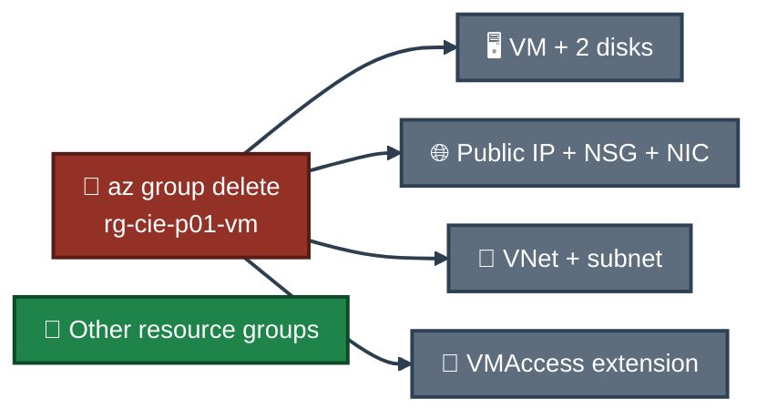

<a id="top"></a>
<div align="center">

# 🧹 Project 01 — Cleanup
### Azure Virtual Machine Deployment & Administration
**Project 01 of 6 — Cloud Infrastructure Engineering**


**Cleanup was the last step. Only this project's resource group was deleted. Older groups were not part of the command.**

### [📖 README](../README.md) &nbsp;·&nbsp; [📑 Visual Index](../VM-INDEX.md) &nbsp;·&nbsp; [⌨️ Commands](commands.md)

</div>

---

## ⌨️ Commands

| 📍 Where | 🖼️ Proof | Result |
|:---:|:---:|---|
| ☁️ Cloud Shell (Bash) | none, no screenshot was kept | group deletion run, result not shown in this repo |

**1. Delete the group** &nbsp; 📝 (the command prints nothing, so there is no screenshot of it)

```bash
az group delete --name rg-cie-p01-vm --yes --no-wait
```

**2. Check that it is gone** &nbsp; 📝 (not captured)

```bash
az group exists --name rg-cie-p01-vm
```

The output `false` means the group no longer exists. This output is not in the repo.

---

## 🗑️ What This Removed

Everything inside `rg-cie-p01-vm`:

| Resource | Includes |
|---|---|
| 🖥️ VM `vm-cie-p01` | the virtual machine |
| 💽 Disks | OS disk and data disk `disk-cie-p01-data` (4 GB) |
| 🔌 Network interface | `vm-cie-p01223` |
| 🌐 Public IP `vm-cie-p01-ip` | the Standard address |
| 🛡️ NSG `vm-cie-p01-nsg` | the rules created by the portal wizard, including SSH (22) |
| 🔗 VNet `vnet-indiasouthcentral-3` | the subnet `snet-indiasouthcentral-1` |
| 🧩 Extension `enablevmAccess` | added when the SSH key was reset |

The eight resources are the ones listed in Exhibit 13.


<p align="center"><em>Only the project group is in the command. Other groups are not named in it.</em></p>

---

## ✅ What Proves It

| Claim | Proof |
|---|---|
| The delete command was run | My own record. No screenshot, because the command prints nothing |
| The group no longer exists | Not proven in this repo. The check output was not captured |
| The eight resources were in the group | **Exhibit 13** |

---

## 🧳 Left on My Laptop &nbsp; 📝

- `cie_p01_key` and `cie_p01_key.pub` in `~/.ssh`. This is the first key pair, created and rejected at login (Exhibit 31).
- `cie_p01_key2` and `cie_p01_key2.pub` in `~/.ssh`. No resource uses the public key any more. The private key stays on the laptop.
- A `known_hosts` entry for the VM, added when I first connected with the first key (Exhibit 31).

---

## 🚧 Note

The check output for the delete was not kept, so the result is stated, not shown.

---

<div align="center">

[⬆️ Back to top](#top) &nbsp;·&nbsp; [📖 README](../README.md) &nbsp;·&nbsp; [⌨️ Commands](commands.md)

</div>
