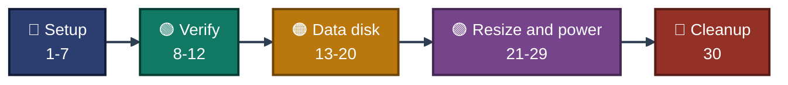

<a id="top"></a>
<div align="center">

# ⌨️ Project 01 — Commands
### Azure Virtual Machine Deployment & Administration
**Project 01 of 6 — Cloud Infrastructure Engineering**


**Every command used in this project, in order, with where it ran and which exhibit proves it.**

### [📖 README](../README.md) &nbsp;·&nbsp; [📑 Visual Index](../VM-INDEX.md) &nbsp;·&nbsp; [🧹 Cleanup](cleanup.md)

</div>

---

## 🧭 How to Read This File

| Mark | Meaning |
|:---:|---|
| ✅ | Ran, and a screenshot in `../Screenshots/` proves the result. The exhibit number is given. |
| 📝 | Ran, but there is no screenshot of it in the repo. The text says which exhibit proves the result, or that nothing proves it. |
| `<...>` | A value that is not kept in the repo (IP address). |

| 📍 Where it ran | Shown as |
|---|:---:|
| Azure Cloud Shell (Bash), prompt `malaika [ ~ ]` | ☁️ **Cloud Shell** |
| Windows PowerShell on my laptop, prompt `PS C:\Users\RM>` | 💻 **Laptop** |
| SSH session on the VM, prompt `azureuser@vm-cie-p01` | 🖥️ **VM** |
| Azure Portal, no command | 🌐 **Portal** |

Step numbers match the README. The exhibit number is given in each step, because the two numbers are not the same.

---

## 📊 At a Glance

| 🔵 Setup and Deployment | 🟢 Access and Verification | 🟠 Data Disk | 🟣 Resize, Power, Boot | 🧹 Cleanup |
|:---:|:---:|:---:|:---:|:---:|
| **Steps 1-7** | **Steps 8-12** | **Steps 13-20** | **Steps 21-29** | **Step 30** |
| checks, group, key, VM | SSH, system, log, tags | attach, format, mount | resize, stop, start | delete group |


<p align="center"><em>Order of the command groups. Step numbers match the README.</em></p>

### 🧰 Commands by Area

| Area | Main commands |
|---|---|
| Checks | `az account show`, `az vm list-skus` |
| Resource group | `az group create / show / delete / exists` |
| Tags | `az resource list`, `az resource tag` |
| Data disk (Azure) | `az vm disk attach`, `az vm show` |
| Resize and power | `az vm list-vm-resize-options / resize / stop / deallocate / start`, `az vm list -d` |
| Laptop | `ssh-keygen`, `ssh` |
| Inside the VM | `hostnamectl`, `ip`, `systemctl`, `ss`, `journalctl`, `lsblk`, `parted`, `mkfs.ext4`, `mount`, `findmnt`, `free`, `nproc` |

### 🔁 Placeholders

| Placeholder | What it stands for |
|---|---|
| `<public-ip>` | Public IP of `vm-cie-p01`. Blurred in the screenshots, not stored in the repo. |

---

## 🔵 Module 1 — Setup and Deployment &nbsp;·&nbsp; Steps 1-7

### Step 1 — Subscription check &nbsp; ✅

| 📍 Where | 🖼️ Proof | Result |
|:---:|:---:|---|
| ☁️ Cloud Shell | **Exhibit 1** | Azure for Students, Enabled |

```bash
az account show --output table
```

### Step 2 — VM size availability &nbsp; ✅

| 📍 Where | 🖼️ Proof | Result |
|:---:|:---:|---|
| ☁️ Cloud Shell | **Exhibit 2** | `Standard_B2*` sizes, `Restrictions: None` |

```bash
az vm list-skus --location indiasouthcentral --size Standard_B2 --output table
```

> [!NOTE]
> An earlier version of this query with a long `--query` filter printed nothing and was cancelled with Ctrl+C. It is visible above the proof in Exhibit 2. The cause was not found.

### Step 3 — Resource group &nbsp; ✅

| 📍 Where | 🖼️ Proof | Result |
|:---:|:---:|---|
| ☁️ Cloud Shell | **Exhibit 3** (the `show` command; the `create` output is 📝) | State `Succeeded`, three tags |

```bash
az group create --name rg-cie-p01-vm --location indiasouthcentral --tags project=cie-p01 owner=malaika env=lab
az group show --name rg-cie-p01-vm --output json
```

> [!NOTE]
> Exhibit 3 shows only the `az group show` output. The `create` output is not in the repo. `show` is the proof.

### Step 4 — SSH key pair &nbsp; ✅

| 📍 Where | 🖼️ Proof | Result |
|:---:|:---:|---|
| 💻 Laptop | **Exhibit 4** (second key). **Exhibit 31** (first key, rejected) | 4096-bit RSA key, no passphrase |

```powershell
New-Item -ItemType Directory -Force $HOME\.ssh
ssh-keygen -t rsa -b 4096 -f $HOME\.ssh\cie_p01_key2 -C "cie-p01" -N '""'
Get-Content $HOME\.ssh\cie_p01_key2.pub | Set-Clipboard
```

> [!NOTE]
> Only the `.pub` file is pasted into Azure. The private key (`cie_p01_key2`, no extension) stays on the laptop.

**First key pair (replaced)** &nbsp; ✅

| 📍 Where | 🖼️ Proof | Result |
|:---:|:---:|---|
| 💻 Laptop | **Exhibit 31** | key created, then `Permission denied (publickey)` at login |

```powershell
ssh-keygen -t rsa -b 4096 -f $HOME\.ssh\cie_p01_key -C "cie-p01"
Get-Content $HOME\.ssh\cie_p01_key.pub
Get-Content $HOME\.ssh\cie_p01_key.pub | Set-Clipboard
ssh -i $HOME\.ssh\cie_p01_key azureuser@<public-ip>
```

The passphrase prompt appeared at login and the key was rejected. The second key pair replaced it. Its public key was added from the portal (Help, Reset password, "Add SSH public key").

### Steps 5, 6 and 7 — Create the VM &nbsp; ✅

| 📍 Where | 🖼️ Proof | Result |
|:---:|:---:|---|
| 🌐 Portal | **Exhibits 5, 6, 7, 8** | VM created and running |

Done in the portal, Virtual machines, Create. No command. The settings are in the README.

---

## 🟢 Module 2 — Access and Verification &nbsp;·&nbsp; Steps 8-12

### Step 8 — SSH login &nbsp; ✅

| 📍 Where | 🖼️ Proof | Result |
|:---:|:---:|---|
| 💻 Laptop, then 🖥️ VM | **Exhibit 9** | Key login, `azureuser` |

```powershell
ssh -i $HOME\.ssh\cie_p01_key2 azureuser@<public-ip>
```

```bash
whoami
```

### Step 9 — Identity and network &nbsp; ✅

| 📍 Where | 🖼️ Proof | Result |
|:---:|:---:|---|
| 🖥️ VM | **Exhibit 10** | Hostname, Ubuntu 24.04.5 LTS, `eth0` `172.16.0.4/24` |

```bash
hostnamectl | cat
ip -br addr
```

### Step 10 — SSH service and ports &nbsp; ✅

| 📍 Where | 🖼️ Proof | Result |
|:---:|:---:|---|
| 🖥️ VM | **Exhibit 11** | `ssh.service` active, port 22 listening |

```bash
systemctl status ssh --no-pager
sudo ss -tulpn
```

### Step 11 — Own login in the log &nbsp; ✅

| 📍 Where | 🖼️ Proof | Result |
|:---:|:---:|---|
| 🖥️ VM | **Exhibit 12** | `Accepted publickey` at 18:50:51 |

```bash
sudo journalctl -u ssh --no-pager | grep "Accepted publickey"
```

### Step 12 — Tag every resource

**12a. Tag loop** &nbsp; 📝

| 📍 Where | 🖼️ Proof | Result |
|:---:|:---:|---|
| ☁️ Cloud Shell | none, **Exhibit 13** proves the result | eight resources tagged |

```bash
for id in $(az resource list -g rg-cie-p01-vm --query "[].id" -o tsv); do
  az resource tag --tags project=cie-p01 owner=malaika env=lab --ids $id --is-incremental
done
```

> [!NOTE]
> The tag table in Exhibit 13 includes `disk-cie-p01-data`, so this tagging was run after the data disk was attached (Step 13).

**12b. Tag check** &nbsp; ✅

| 📍 Where | 🖼️ Proof | Result |
|:---:|:---:|---|
| ☁️ Cloud Shell | **Exhibit 13** | All eight resources carry the three tags |

```bash
az resource list -g rg-cie-p01-vm \
  --query "[].{Name:name, Project:tags.project, Owner:tags.owner, Env:tags.env}" -o table
```

---

## 🟠 Module 3 — Data Disk &nbsp;·&nbsp; Steps 13-20

### Step 13 — Attach the disk

**13a. Attach** &nbsp; 📝

| 📍 Where | 🖼️ Proof | Result |
|:---:|:---:|---|
| ☁️ Cloud Shell | none, **Exhibit 14** proves the result | disk attached |

```bash
az vm disk attach --resource-group rg-cie-p01-vm --vm-name vm-cie-p01 \
  --name disk-cie-p01-data --new --size-gb 4 --sku StandardSSD_LRS --lun 0
```

**13b. Check** &nbsp; ✅

| 📍 Where | 🖼️ Proof | Result |
|:---:|:---:|---|
| ☁️ Cloud Shell | **Exhibit 14** | LUN 0, `StandardSSD_LRS` |

```bash
az vm show -g rg-cie-p01-vm -n vm-cie-p01 \
  --query "storageProfile.dataDisks[].{Name:name, SizeGB:diskSizeGb, LUN:lun, Type:managedDisk.storageAccountType}" -o table
```

> [!NOTE]
> The size column did not appear in the table. The 4G size is proven by `lsblk` in Exhibit 15.

### Step 14 — Find the new disk &nbsp; ✅

| 📍 Where | 🖼️ Proof | Result |
|:---:|:---:|---|
| 🖥️ VM | **Exhibit 15** | `sdb`, 4G, no partition |

```bash
lsblk
```

> [!WARNING]
> Check the device name with `lsblk` before running `parted` or `mkfs.ext4`. Pointing them at the OS disk would destroy the VM.

### Step 15 — Partition &nbsp; ✅

| 📍 Where | 🖼️ Proof | Result |
|:---:|:---:|---|
| 🖥️ VM | **Exhibit 16** | `sdb1`, 4G |

```bash
sudo parted /dev/sdb --script mklabel gpt mkpart primary ext4 0% 100%
lsblk /dev/sdb
```

### Step 16 — Format as ext4 &nbsp; ✅

| 📍 Where | 🖼️ Proof | Result |
|:---:|:---:|---|
| 🖥️ VM | **Exhibit 17** | ext4, UUID shown |

```bash
sudo mkfs.ext4 /dev/sdb1
lsblk -f /dev/sdb
```

### Step 17 — Mount and add to fstab &nbsp; ✅

| 📍 Where | 🖼️ Proof | Result |
|:---:|:---:|---|
| 🖥️ VM | **Exhibit 18** | `mount -a` remounted the disk from fstab |

```bash
sudo mkdir /datadisk
sudo mount /dev/sdb1 /datadisk
df -h /datadisk
echo 'UUID=f87cbd7d-6c45-43d7-a596-91e590290f04 /datadisk ext4 defaults,nofail 0 2' | sudo tee -a /etc/fstab
sudo umount /datadisk
sudo mount -a
findmnt /datadisk
```

> [!NOTE]
> The UUID belongs to this lab's disk. A new disk gets a different UUID. Read it from `lsblk -f`.

### Step 18 — Test file &nbsp; ✅

| 📍 Where | 🖼️ Proof | Result |
|:---:|:---:|---|
| 🖥️ VM | **Exhibit 19** | `test.txt` written and read back |

```bash
sudo systemctl daemon-reload
echo "cie-p01 data disk test" | sudo tee /datadisk/test.txt
cat /datadisk/test.txt
ls -l /datadisk
```

### Step 19 — Reboot test &nbsp; ✅

| 📍 Where | 🖼️ Proof | Result |
|:---:|:---:|---|
| 🖥️ VM | **Exhibit 20** | Mounted without running `mount`, file intact |

```bash
sudo reboot
```

After reconnecting from the laptop:

```bash
uptime -p
findmnt /datadisk
cat /datadisk/test.txt
```

### Step 20 — Device names after reboot &nbsp; ✅

| 📍 Where | 🖼️ Proof | Result |
|:---:|:---:|---|
| 🖥️ VM | **Exhibit 21** | Data disk is now `sda`, OS disk is `sdb` |

```bash
lsblk -f
findmnt /datadisk
findmnt /
```

---

## 🟣 Module 4 — Resize, Power States and Boot &nbsp;·&nbsp; Steps 21-29

### Step 21 — Resize options &nbsp; ✅

| 📍 Where | 🖼️ Proof | Result |
|:---:|:---:|---|
| ☁️ Cloud Shell | **Exhibit 22** | `Standard_B2s_v2` is allowed. The memory column came back empty |

```bash
az vm list-vm-resize-options -g rg-cie-p01-vm -n vm-cie-p01 \
  --query "[?contains(name, 'Standard_B')].{Name:name, vCPU:numberOfCores, MemoryMB:memoryInMb}" -o table
```

### Step 22 — Before resize &nbsp; ✅

| 📍 Where | 🖼️ Proof | Result |
|:---:|:---:|---|
| 🖥️ VM | **Exhibit 23** | 2 vCPUs, 3.8Gi |

```bash
nproc
free -h
```

### Step 23 — Resize

**23a. Resize** &nbsp; 📝

| 📍 Where | 🖼️ Proof | Result |
|:---:|:---:|---|
| ☁️ Cloud Shell | none, **Exhibit 24** proves the result | size changed while the VM was running |

```bash
az vm resize -g rg-cie-p01-vm -n vm-cie-p01 --size Standard_B2s_v2
```

**23b. State check** &nbsp; ✅

| 📍 Where | 🖼️ Proof | Result |
|:---:|:---:|---|
| ☁️ Cloud Shell | **Exhibit 24** | `Standard_B2s_v2`, `VM running` |

```bash
az vm list -d -g rg-cie-p01-vm \
  --query "[].{Name:name, Size:hardwareProfile.vmSize, State:powerState, IP:publicIps}" -o table
```

### Step 24 — After resize &nbsp; ✅

| 📍 Where | 🖼️ Proof | Result |
|:---:|:---:|---|
| 🖥️ VM | **Exhibit 25** | `up 3 minutes`, 2 vCPUs, 7.7Gi, disk still mounted |

```bash
uptime -p
nproc
free -h
findmnt /datadisk
```

### Steps 25, 26 and 27 — Stop, deallocate, start

**Stop, deallocate and start commands** &nbsp; 📝

| 📍 Where | 🖼️ Proof | Result |
|:---:|:---:|---|
| ☁️ Cloud Shell | none, **Exhibits 26, 27 and 28** prove the states | three state changes |

```bash
az vm stop -g rg-cie-p01-vm -n vm-cie-p01
az vm deallocate -g rg-cie-p01-vm -n vm-cie-p01
az vm start -g rg-cie-p01-vm -n vm-cie-p01
```

**State check after each command** &nbsp; ✅

| 📍 Where | 🖼️ Proof | Result |
|:---:|:---:|---|
| ☁️ Cloud Shell | **Exhibit 26** (stopped), **27** (deallocated), **28** (running) | the IP column is shown in 27 and 28 |

Exhibit 26 (no IP column):

```bash
az vm list -d -g rg-cie-p01-vm --query "[].{Name:name, Size:hardwareProfile.vmSize, State:powerState}" -o table
```

Exhibits 27 and 28:

```bash
az vm list -d -g rg-cie-p01-vm \
  --query "[].{Name:name, Size:hardwareProfile.vmSize, State:powerState, IP:publicIps}" -o table
```

> [!NOTE]
> The address is blurred in the screenshots. It looks the same as in Exhibit 24, but the address itself is hidden.

### Step 28 — Disk after restart &nbsp; ✅

| 📍 Where | 🖼️ Proof | Result |
|:---:|:---:|---|
| 🖥️ VM | **Exhibit 29** | `up 7 minutes`, mounted, file intact |

```bash
uptime -p
findmnt /datadisk
cat /datadisk/test.txt
```

### Step 29 — Boot diagnostics &nbsp; ✅

| 📍 Where | 🖼️ Proof | Result |
|:---:|:---:|---|
| 🌐 Portal | **Exhibit 30** | Console shows the login prompt |

Portal step: `vm-cie-p01`, Help, Boot diagnostics. No command.

---

## 🧹 Cleanup &nbsp;·&nbsp; Step 30

### Step 30 — Delete the project's resource group

**30a. Delete** &nbsp; 📝

| 📍 Where | 🖼️ Proof | Result |
|:---:|:---:|---|
| ☁️ Cloud Shell | none, the command prints nothing | group deletion started |

```bash
az group delete --name rg-cie-p01-vm --yes --no-wait
```

**30b. Check** &nbsp; 📝

| 📍 Where | 🖼️ Proof | Result |
|:---:|:---:|---|
| ☁️ Cloud Shell | none, no screenshot was kept | not proven in this repo |

```bash
az group exists --name rg-cie-p01-vm
```

Full cleanup notes: [`cleanup.md`](cleanup.md).

---

<div align="center">

[⬆️ Back to top](#top) &nbsp;·&nbsp; [📖 README](../README.md) &nbsp;·&nbsp; [📑 Visual Index](../VM-INDEX.md) &nbsp;·&nbsp; [🧹 Cleanup](cleanup.md)

☁️ **[Microsoft Azure](https://azure.microsoft.com)** · 📚 **[Azure CLI documentation](https://learn.microsoft.com/cli/azure/)**

</div>
