<div align="center">

# 🌐 Azure Virtual Networking

**Project 02 of 06 — Cloud Infrastructure Engineering**

VNet, Subnets, NSGs, Public and Private IP, Peering, Network Watcher


A custom VNet with two subnets and one NSG per subnet, two Ubuntu VMs (one public, one private only), SSH limited to my own address, an NSG rule that blocks and then allows the same traffic, Network Watcher IP flow verify, and a VNet peering. Every result has a screenshot. The peering test VM failed on a core quota, and that gap is written down.

### [📑 Open the visual index](Virtual-Networking-INDEX.md)

</div>

---

## 📑 Table of Contents

1. [At a Glance](#at-a-glance)
2. [Project Background](#project-background)
3. [Environment](#environment)
4. [Project Flow](#project-flow)
5. [Module 1 — Checks and Resource Group](#module-1)
6. [Module 2 — VNet, Subnets and NSGs](#module-2)
7. [Module 3 — VMs and Private Connectivity](#module-3)
8. [Module 4 — NSG Block Test and IP Flow Verify](#module-4)
9. [Module 5 — Peering, Limits and Cleanup](#module-5)
10. [Coverage Snapshot](#coverage-snapshot)
11. [Project Summary](#project-summary)
12. [Challenges & Fixes](#challenges-fixes)
13. [Scope & Limitations](#scope-limitations)
14. [What I Learned](#what-i-learned)
15. [Skills Demonstrated](#skills-demonstrated)
16. [Cleanup](#cleanup)
17. [Screenshot Index](#screenshot-index)
18. [Repo Structure](#repo-structure)

---

<a id="at-a-glance"></a>
## 📊 At a Glance

| 🧩 Modules | 🖼️ Screenshots | 🖥️ VMs Built | 🛡️ NSGs | 🔗 Peering Links | 🧹 Resource Group |
|:---:|:---:|:---:|:---:|:---:|:---:|
| **5** | **36** | **2** | **2** | **2** | **Deleted** |

---

<a id="project-background"></a>
## 📖 Project Background

Most cloud problems that look like "the server is down" are network rules: a subnet that cannot reach another one, a port that an NSG drops, or an SSH port open to the whole internet. This project builds a small network on Azure and proves each rule with a command and its output.

- **Network layout:** One VNet with two subnets, and a second VNet for peering.
- **Filtering:** One NSG per subnet, with rules I can explain.
- **IP addresses:** One VM with a public IP and one with a private IP only.
- **Access control:** SSH allowed only from my own address. Project 01 left SSH open to all addresses, and this closes that gap.
- **Proof:** Ping and curl over private IPs, a deny rule and the same traffic after the rule changes, and Network Watcher IP flow verify.

VM creation and SSH key basics are covered in Project 01 of this repo, so they are not explained again here.

> [!NOTE]
> The peering was created and both links were reported, but **no traffic was sent across it**. The VM that would have tested it failed on a regional core quota (Exhibits 31 to 33). Items taken from my own notes, with no screenshot behind them, are marked 📝.

<div align="center">

### 🧩 Lab Layout at a Glance

```mermaid
%%{init: {'theme': 'base', 'themeVariables': {'fontSize': '14px'}, 'flowchart': {'nodeSpacing': 26, 'rankSpacing': 40, 'padding': 8}}}%%
flowchart LR
    L["💻 My laptop<br/>allowed source /32"]:::pc -->|"SSH 22 allowed"| PIP["🌐 pip-vm-web<br/>Standard, Static"]:::net
    subgraph MAIN["vnet-cie-p02-main 10.10.0.0/16"]
        direction LR
        subgraph WEB["snet-web 10.10.1.0/24<br/>nsg-snet-web"]
            VW["🖥️ vm-web<br/>10.10.1.4"]:::vm
        end
        subgraph APP["snet-app 10.10.2.0/24<br/>nsg-snet-app"]
            VA["🖥️ vm-app<br/>10.10.2.4, no public IP"]:::vm
        end
    end
    PIP --> VW
    VW -->|"ping, curl 8080"| VA
    subgraph PEER["vnet-cie-p02-peer 10.20.0.0/16"]
        SP["📭 snet-peer 10.20.1.0/24<br/>vm-peer not created"]:::bad
    end
    MAIN <-.->|"peering, traffic not tested"| PEER
    classDef pc fill:#2C3E70,stroke:#131B3A,stroke-width:2px,color:#FFFFFF
    classDef net fill:#B9770E,stroke:#6E4409,stroke-width:2px,color:#FFFFFF
    classDef vm fill:#117864,stroke:#083D33,stroke-width:2px,color:#FFFFFF
    classDef bad fill:#943126,stroke:#571C16,stroke-width:2px,color:#FFFFFF
    linkStyle default stroke:#2C3E50,stroke-width:2px
```
<em>Addresses come from Exhibits 4, 5, 14, 15 and 28. The diagram shows the design, it is not a screenshot.</em>

</div>

---

<a id="environment"></a>
## 🖧 Environment

| Item | Value |
|---|---|
| **Subscription** | Azure for Students (Exhibit 1) |
| **Region** | `indiasouthcentral` |
| **Resource Group** | `rg-cie-p02-network` (deleted at the end) |
| **VM Size** | `Standard_B2ls_v2` (2 cores each) |
| **OS Image** | Ubuntu 22.04.5 LTS (Exhibit 16) |
| **Admin User** | `azureuser`, SSH key only |
| **Tools** | Azure Cloud Shell (Bash), Windows PowerShell with OpenSSH |
| **Tags (every resource)** | `project=cie-p02`, `owner=malaika`, `env=lab` |
| **Work Date** | Oct 24, 2026 (VM clock, Exhibits 16 and 18) |

### 🗺️ Address Plan

| Resource | Address | Notes |
|---|---|---|
| `vnet-cie-p02-main` | `10.10.0.0/16` | Exhibit 4 |
| `snet-web` + `nsg-snet-web` | `10.10.1.0/24` | `vm-web` is `10.10.1.4` with a public IP |
| `snet-app` + `nsg-snet-app` | `10.10.2.0/24` | `vm-app` is `10.10.2.4`, no public IP |
| `vnet-cie-p02-peer` | `10.20.0.0/16` | Exhibit 28, no overlap with the main VNet |
| `snet-peer` | `10.20.1.0/24` | `vm-peer` was never created |

> [!IMPORTANT]
> The SSH rule uses my home public IP, which can change. Public IPs are blurred in the screenshots and written as placeholders in `commands/commands.md`. Existing groups from older labs (`sysadmin-labs`, `osticket-rg`, `ForensicsCapstone-RG`, `NetworkWatcherRG`) were not touched.

---

<a id="project-flow"></a>
## ⏱️ Project Flow

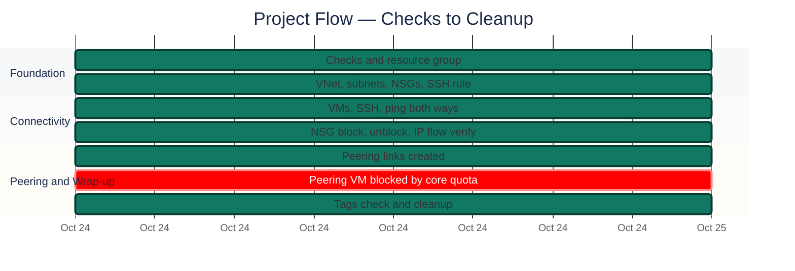
<p align="center"><em>All work was done on one day. The red bar marks the part that did not complete. Clock times are left out because the screenshots do not show them.</em></p>

---
<a id="module-1"></a>
## 🔵 Module 1 — Checks and Resource Group

**Objective:** Confirm the subscription, provider, VM size and Network Watcher are usable before building, then create the tagged resource group.

### Step 1 — Subscription, provider and VM size checks ✅

**Run in:** Cloud Shell (Bash)

```
az account show --query "{Name:name, State:state, User:user.type}" -o table
az provider show --namespace Microsoft.Network --query "{Namespace:namespace, State:registrationState}" -o table
az vm list-skus --location indiasouthcentral --size Standard_B2ls_v2 --query "[].{Size:name, Restrictions:restrictions[0].reasonCode}" -o table
```

Three checks before building anything: the subscription is usable, the network provider is registered, and the VM size is offered in the region. The size query printed only the Size column, so no restriction reason was returned. The final proof is that two VMs of this size were created later (Exhibits 14 and 15).

<p align="center">
  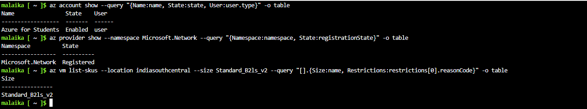<br>
  <em>Exhibit 1 — <code>az account show</code>: Azure for Students, Enabled. <code>Microsoft.Network</code> is Registered. <code>Standard_B2ls_v2</code> is returned for <code>indiasouthcentral</code> and no Restrictions column was printed</em>
</p>

### Step 2 — Network Watcher check ✅

**Run in:** Cloud Shell (Bash)

```
az network watcher list --query "[].{Name:name, Location:location, State:provisioningState, RG:resourceGroup}" -o table
```

Network Watcher is needed for IP flow verify. It already exists in <code>NetworkWatcherRG</code>, a group from older labs. It is used here and never modified or deleted.

<p align="center">
  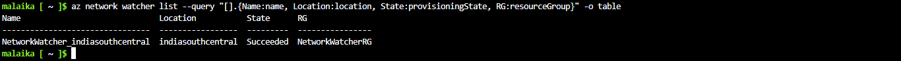<br>
  <em>Exhibit 2 — <code>NetworkWatcher_indiasouthcentral</code> already exists in <code>NetworkWatcherRG</code>, state Succeeded</em>
</p>

### Step 3 — Resource group state and tags ✅

**Run in:** Cloud Shell (Bash)

```
az group create --name rg-cie-p02-network --location indiasouthcentral --tags project=cie-p02 owner=malaika env=lab -o table
az group show --name rg-cie-p02-network --query "{Name:name, State:properties.provisioningState, Tags:tags}" -o json
```

The group is created with the project tags. The table output of <code>group create</code> does not show State or tags, so the JSON query is the proof (see Challenges).

<p align="center">
  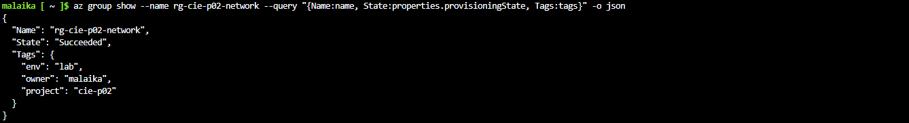<br>
  <em>Exhibit 3 — <code>rg-cie-p02-network</code>: State Succeeded, tags <code>env=lab</code>, <code>owner=malaika</code>, <code>project=cie-p02</code></em>
</p>

---

<a id="module-2"></a>
## 🟠 Module 2 — VNet, Subnets and NSGs

**Objective:** Build the VNet with two subnets, create one NSG per subnet, attach them, and add the SSH rule that allows only my own address.

### Step 4 — Main VNet and first subnet ✅

**Run in:** Cloud Shell (Bash)

```
az network vnet create --resource-group rg-cie-p02-network --name vnet-cie-p02-main --location indiasouthcentral --address-prefixes 10.10.0.0/16 --subnet-name snet-web --subnet-prefixes 10.10.1.0/24 --tags project=cie-p02 owner=malaika env=lab --query "newVNet.{Name:name, State:provisioningState, Space:addressSpace.addressPrefixes, Subnets:subnets[].{Name:name, Prefix:addressPrefix}}" -o json
```

One VNet with a /16 address space and the first /24 subnet for the web tier. Tags are not in this query output; tag proof for every resource is in Exhibit 35.

<p align="center">
  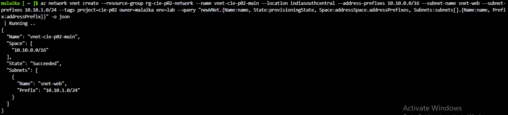<br>
  <em>Exhibit 4 — <code>vnet-cie-p02-main</code> with space <code>10.10.0.0/16</code> and subnet <code>snet-web</code> <code>10.10.1.0/24</code>, State Succeeded</em>
</p>

### Step 5 — Second subnet ✅

**Run in:** Cloud Shell (Bash)

```
az network vnet subnet create --resource-group rg-cie-p02-network --vnet-name vnet-cie-p02-main --name snet-app --address-prefixes 10.10.2.0/24 --query "{Name:name, Prefix:addressPrefix, State:provisioningState}" -o json
```

The second subnet, for the app tier.

<p align="center">
  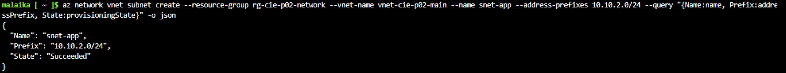<br>
  <em>Exhibit 5 — <code>snet-app</code> <code>10.10.2.0/24</code>, State Succeeded</em>
</p>

### Step 6 — NSG for snet-web ✅

**Run in:** Cloud Shell (Bash)

```
az network nsg create --resource-group rg-cie-p02-network --name nsg-snet-web --location indiasouthcentral --tags project=cie-p02 owner=malaika env=lab --query "NewNSG.{Name:name, State:provisioningState, Location:location, Tags:tags}" -o json
```

One NSG per subnet. This one is for the web subnet.

<p align="center">
  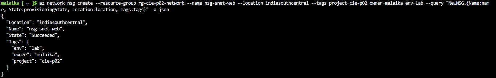<br>
  <em>Exhibit 6 — <code>nsg-snet-web</code> created with all three tags</em>
</p>

### Step 7 — NSG for snet-app ✅

**Run in:** Cloud Shell (Bash)

```
az network nsg create --resource-group rg-cie-p02-network --name nsg-snet-app --location indiasouthcentral --tags project=cie-p02 owner=malaika env=lab --query "NewNSG.{Name:name, State:provisioningState, Location:location, Tags:tags}" -o json
```

The NSG for the app subnet. Neither NSG filters anything until it is attached to a subnet.

<p align="center">
  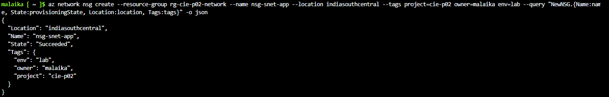<br>
  <em>Exhibit 7 — <code>nsg-snet-app</code> created with all three tags</em>
</p>

### Step 8 — Attach NSG to snet-web ✅

**Run in:** Cloud Shell (Bash)

```
az network vnet subnet update --resource-group rg-cie-p02-network --vnet-name vnet-cie-p02-main --name snet-web --network-security-group nsg-snet-web --query "{Name:name, Prefix:addressPrefix, State:provisioningState, AttachedNSG:contains(networkSecurityGroup.id, 'nsg-snet-web')}" -o json
```

The NSG is attached to the subnet. The query returns only true or false, so no subscription ID is printed.

<p align="center">
  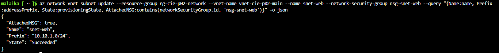<br>
  <em>Exhibit 8 — <code>AttachedNSG: true</code> for <code>snet-web</code> (<code>10.10.1.0/24</code>)</em>
</p>

### Step 9 — Attach NSG to snet-app ✅

**Run in:** Cloud Shell (Bash)

```
az network vnet subnet update --resource-group rg-cie-p02-network --vnet-name vnet-cie-p02-main --name snet-app --network-security-group nsg-snet-app --query "{Name:name, Prefix:addressPrefix, State:provisioningState, AttachedNSG:contains(networkSecurityGroup.id, 'nsg-snet-app')}" -o json
```

Same step for the app subnet.

<p align="center">
  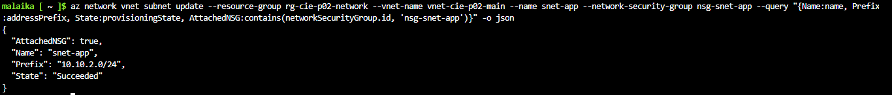<br>
  <em>Exhibit 9 — <code>AttachedNSG: true</code> for <code>snet-app</code> (<code>10.10.2.0/24</code>)</em>
</p>

### Step 10 — Default NSG rules ✅

**Run in:** Cloud Shell (Bash)

```
az network nsg rule list --resource-group rg-cie-p02-network --nsg-name nsg-snet-web --include-default --query "[].{Name:name, Priority:priority, Dir:direction, Access:access, Src:sourceAddressPrefix, Port:destinationPortRange}" -o table
```

What an NSG does before any custom rule exists. <code>AllowVnetInBound</code> (65000) lets traffic inside the VNet, and <code>DenyAllInBound</code> (65500) drops everything else from outside. Only <code>nsg-snet-web</code> was listed; the defaults of <code>nsg-snet-app</code> were not listed separately.

<p align="center">
  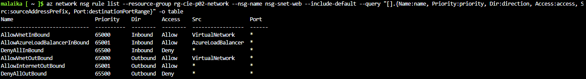<br>
  <em>Exhibit 10 — Default rules of <code>nsg-snet-web</code>: three inbound (65000, 65001, 65500) and three outbound</em>
</p>

### Step 11 — SSH allowed only from my IP ✅

**Run in:** Cloud Shell (Bash)

```
az network nsg rule create --resource-group rg-cie-p02-network --nsg-name nsg-snet-web --name allow-ssh-from-my-ip --priority 100 --direction Inbound --access Allow --protocol Tcp --source-address-prefixes <MY_PUBLIC_IP>/32 --source-port-ranges "*" --destination-address-prefixes "*" --destination-port-ranges 22 --query "{Name:name, Priority:priority, Access:access, Proto:protocol, Port:destinationPortRange, Src:sourceAddressPrefix, State:provisioningState}" -o json
```

SSH is allowed only from one address (<code>/32</code>), my current home public IP. This closes the gap from Project 01, where SSH was open to all addresses. The IP was looked up in the browser (not screenshotted) and is blurred here.

<p align="center">
  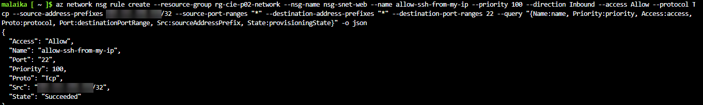<br>
  <em>Exhibit 11 — <code>allow-ssh-from-my-ip</code>: priority 100, Allow, Tcp, port 22, source one address with <code>/32</code> (blurred)</em>
</p>

---

<a id="module-3"></a>
## 🟢 Module 3 — VMs and Private Connectivity

**Objective:** Create the two VMs, one with a public IP and one without, and prove private-IP connectivity in both directions.

### Step 12 — SSH key pair on the laptop ✅

**Run in:** Laptop PowerShell

```
New-Item -ItemType Directory -Force "$HOME\.ssh" | Out-Null; ssh-keygen -t ed25519 -f "$HOME\.ssh\cie_p02_key" -N '""' -C "cie-p02"
```

The key pair is created on the laptop, because Cloud Shell is ephemeral. The private key never leaves the laptop. Only the public key text goes into <code>az vm create</code>. 📝 The two commands that copied and printed the public key were not screenshotted on purpose.

<p align="center">
  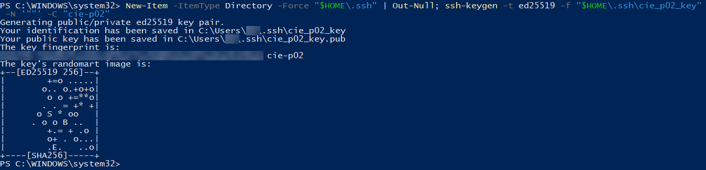<br>
  <em>Exhibit 12 — <code>ssh-keygen -t ed25519</code> on the laptop. No passphrase prompt appeared. Username in the path and the fingerprint are blurred</em>
</p>

### Step 13 — Public IP for vm-web ✅

**Run in:** Cloud Shell (Bash)

```
az network public-ip create --resource-group rg-cie-p02-network --name pip-vm-web --location indiasouthcentral --sku Standard --allocation-method Static --tags project=cie-p02 owner=malaika env=lab --query "publicIp.{Name:name, Sku:sku.name, Allocation:publicIPAllocationMethod, State:provisioningState, Tags:tags}" -o json
```

Only <code>vm-web</code> gets a public IP. The query leaves out the address itself.

<p align="center">
  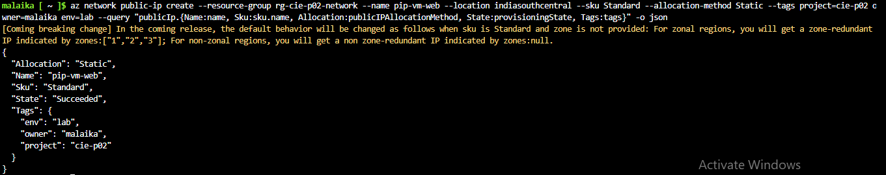<br>
  <em>Exhibit 13 — <code>pip-vm-web</code>: Sku Standard, Allocation Static, State Succeeded, three tags. The orange line is an Azure CLI notice, not an error</em>
</p>

### Step 14 — vm-web created ✅

**Run in:** Cloud Shell (Bash)

```
az vm create --resource-group rg-cie-p02-network --name vm-web --location indiasouthcentral --size Standard_B2ls_v2 --image Ubuntu2204 --admin-username azureuser --authentication-type ssh --ssh-key-values "<PUBLIC_KEY_TEXT>" --vnet-name vnet-cie-p02-main --subnet snet-web --public-ip-address pip-vm-web --nsg "" --tags project=cie-p02 owner=malaika env=lab --query "{PowerState:powerState, PrivateIP:privateIpAddress, Location:location}" -o json
```

<code>--nsg ""</code> tells Azure not to create an NSG on the network card, so the subnet NSG is the only one in this lab. The private IP is inside <code>snet-web</code>.

<p align="center">
  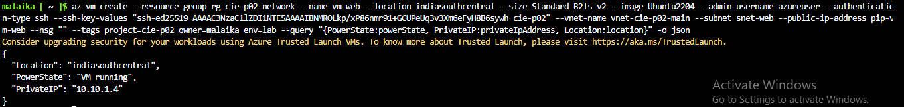<br>
  <em>Exhibit 14 — <code>vm-web</code> in <code>snet-web</code>: VM running, PrivateIP <code>10.10.1.4</code>, created with <code>--nsg ""</code></em>
</p>

### Step 15 — vm-app created without public IP ✅

**Run in:** Cloud Shell (Bash)

```
az vm create --resource-group rg-cie-p02-network --name vm-app --location indiasouthcentral --size Standard_B2ls_v2 --image Ubuntu2204 --admin-username azureuser --authentication-type ssh --ssh-key-values "<PUBLIC_KEY_TEXT>" --vnet-name vnet-cie-p02-main --subnet snet-app --public-ip-address "" --nsg "" --tags project=cie-p02 owner=malaika env=lab --query "{PowerState:powerState, PrivateIP:privateIpAddress, PublicIP:publicIpAddress, Location:location}" -o json
```

Public versus private IP: this VM has only a private address, so it cannot be reached from the internet.

<p align="center">
  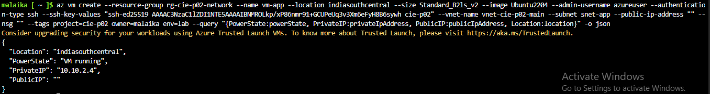<br>
  <em>Exhibit 15 — <code>vm-app</code> in <code>snet-app</code>: VM running, PrivateIP <code>10.10.2.4</code>, <code>PublicIP</code> empty</em>
</p>

### Step 16 — SSH from the laptop to vm-web ✅

**Run in:** Laptop PowerShell

```
ssh -i "$HOME\.ssh\cie_p02_key" azureuser@<VM_WEB_PUBLIC_IP>
```

SSH over the public IP works from my laptop, whose address is the one allowed in Exhibit 11. The key had no passphrase and no passphrase prompt appeared. 📝 The public IP was read with <code>az network public-ip show</code> and not screenshotted.

<p align="center">
  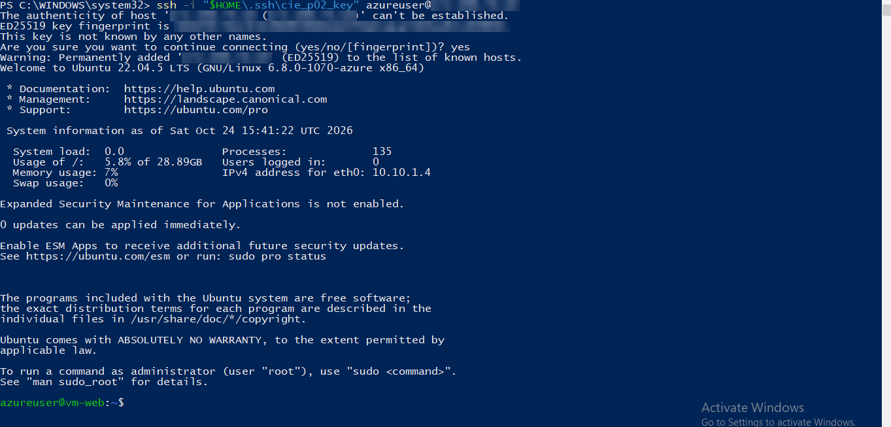<br>
  <em>Exhibit 16 — Login as <code>azureuser</code> over the public IP (blurred). Prompt <code>azureuser@vm-web</code> and <code>eth0</code> <code>10.10.1.4</code>, Ubuntu 22.04.5 LTS</em>
</p>

### Step 17 — Ping from vm-web to vm-app ✅

**Run in:** SSH session (vm-web)

```
ping -c 4 10.10.2.4
```

Private-IP traffic from <code>snet-web</code> to <code>snet-app</code> passes. The default rule <code>AllowVnetInBound</code> (listed for <code>nsg-snet-web</code> in Exhibit 10) is what normally allows traffic inside a VNet.

<p align="center">
  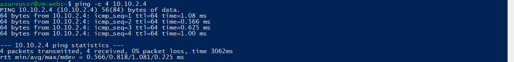<br>
  <em>Exhibit 17 — From <code>vm-web</code>: <code>ping -c 4 10.10.2.4</code>, 4 sent, 4 received, 0% packet loss</em>
</p>

### Step 18 — SSH to vm-app through vm-web ✅

**Run in:** Laptop PowerShell

```
ssh -i "$HOME\.ssh\cie_p02_key" -J azureuser@<VM_WEB_PUBLIC_IP> azureuser@10.10.2.4
ssh -i "$HOME\.ssh\cie_p02_key" -o "ProxyCommand=ssh -i $HOME\.ssh\cie_p02_key -W %h:%p azureuser@<VM_WEB_PUBLIC_IP>" azureuser@10.10.2.4
```

<code>vm-app</code> has no public IP, so <code>vm-web</code> is used as a jump host. The first command fails because the key was not used for the first hop. The second command gives the key to both hops and works. The private key was not copied to any VM.

<p align="center">
  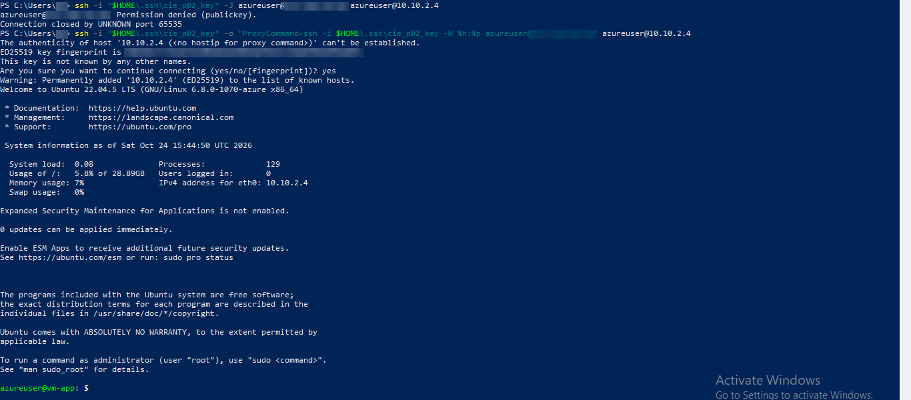<br>
  <em>Exhibit 18 — First try with <code>-J</code> fails with <code>Permission denied (publickey)</code>. Second try with <code>ProxyCommand</code> works: prompt <code>azureuser@vm-app</code>, <code>eth0</code> <code>10.10.2.4</code></em>
</p>

### Step 19 — Ping from vm-app to vm-web ✅

**Run in:** SSH session (vm-app)

```
ping -c 4 10.10.1.4
```

The return direction: <code>snet-app</code> to <code>snet-web</code>.

<p align="center">
  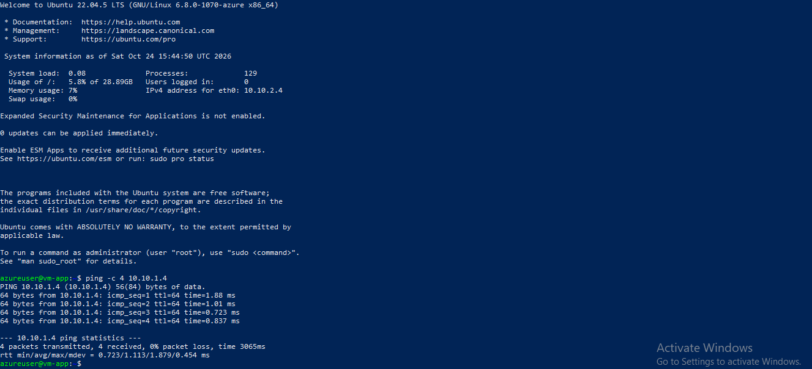<br>
  <em>Exhibit 19 — From <code>vm-app</code>: <code>ping -c 4 10.10.1.4</code>, 4 sent, 4 received, 0% packet loss</em>
</p>

### Step 20 — Test web server on vm-app ✅

**Run in:** SSH session (vm-app)

```
mkdir -p ~/site && echo "hello from vm-app" > ~/site/index.html && (nohup python3 -m http.server 8080 --directory ~/site >/dev/null 2>&1 &) ; sleep 1; curl -s localhost:8080
```

A tiny web server on port 8080 gives the NSG test something to block. This call is local to <code>vm-app</code>, so it proves the server runs, not that it is reachable from the other subnet.

<p align="center">
  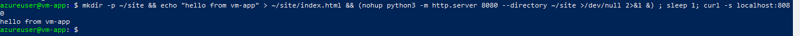<br>
  <em>Exhibit 20 — Python HTTP server on port 8080; <code>curl localhost:8080</code> on <code>vm-app</code> returns <code>hello from vm-app</code></em>
</p>

---

<a id="module-4"></a>
## 🟣 Module 4 — NSG Block Test and IP Flow Verify

**Objective:** Show an NSG rule blocking traffic and the same traffic passing after the rule is changed, with Network Watcher confirming both states.

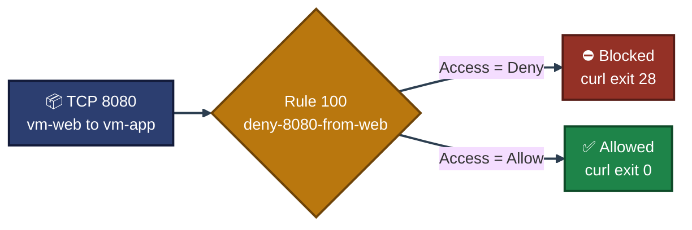
<p align="center"><em>One rule, two access values. If no custom rule matches, the default rules (65000 and up) decide.</em></p>

### Step 21 — curl before any deny rule ✅

**Run in:** SSH session (vm-web)

```
curl -s --max-time 5 http://10.10.2.4:8080
```

The "before" proof: from <code>vm-web</code>, port 8080 on <code>vm-app</code> answers.

<p align="center">
  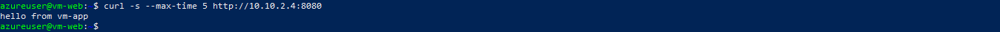<br>
  <em>Exhibit 21 — From <code>vm-web</code>: <code>curl http://10.10.2.4:8080</code> returns <code>hello from vm-app</code></em>
</p>

### Step 22 — Deny rule on nsg-snet-app ✅

**Run in:** Cloud Shell (Bash)

```
az network nsg rule create --resource-group rg-cie-p02-network --nsg-name nsg-snet-app --name deny-8080-from-web --priority 100 --direction Inbound --access Deny --protocol Tcp --source-address-prefixes 10.10.1.0/24 --source-port-ranges "*" --destination-address-prefixes "*" --destination-port-ranges 8080 --query "{Name:name, Priority:priority, Access:access, Proto:protocol, Port:destinationPortRange, Src:sourceAddressPrefix, State:provisioningState}" -o json
```

Priority 100 is a lower number than the default 65000, so this rule is checked first.

<p align="center">
  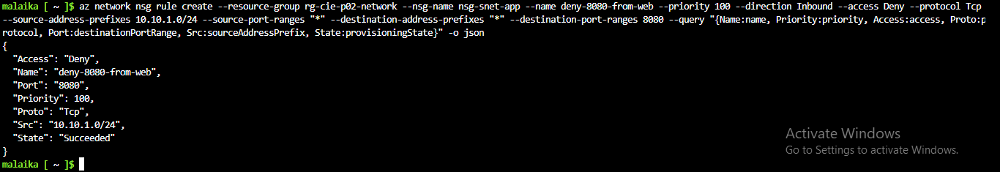<br>
  <em>Exhibit 22 — <code>deny-8080-from-web</code>: priority 100, Deny, Tcp, port 8080, source <code>10.10.1.0/24</code></em>
</p>

### Step 23 — curl after the deny rule ✅

**Run in:** SSH session (vm-web)

```
curl -s --max-time 5 http://10.10.2.4:8080; echo "exit code: $?"
```

Blocked traffic gives a timeout, not a refusal: <code>curl</code> exit code 28.

<p align="center">
  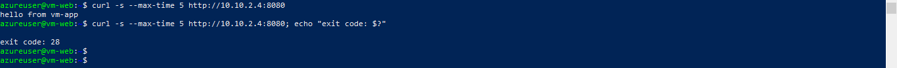<br>
  <em>Exhibit 23 — Same <code>curl</code> now prints nothing and <code>exit code: 28</code> (timeout after 5 s). The earlier successful call is visible above it</em>
</p>

### Step 24 — Network Watcher IP flow verify (Deny) ✅

**Run in:** Cloud Shell (Bash)

```
az network watcher test-ip-flow --resource-group rg-cie-p02-network --vm vm-app --direction Inbound --protocol TCP --local 10.10.2.4:8080 --remote 10.10.1.4:50000 --query "{Access:access, Rule:ruleName}" -o json
```

The timeout alone does not say which rule dropped the packet. IP flow verify names it.

<p align="center">
  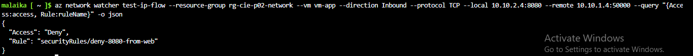<br>
  <em>Exhibit 24 — Inbound TCP to <code>vm-app</code> <code>10.10.2.4:8080</code> from <code>10.10.1.4:50000</code>: <code>Access: Deny</code>, rule <code>securityRules/deny-8080-from-web</code></em>
</p>

### Step 25 — Rule changed from Deny to Allow ✅

**Run in:** Cloud Shell (Bash)

```
az network nsg rule update --resource-group rg-cie-p02-network --nsg-name nsg-snet-app --name deny-8080-from-web --access Allow --query "{Name:name, Priority:priority, Access:access, Port:destinationPortRange, Src:sourceAddressPrefix, State:provisioningState}" -o json
```

Only the access value changes. The rule keeps its old name <code>deny-8080-from-web</code>, which is now misleading. The name was left as is so the exhibits stay consistent.

<p align="center">
  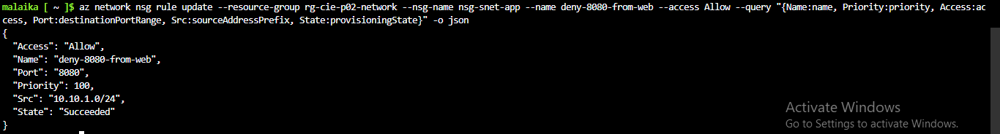<br>
  <em>Exhibit 25 — Same rule, <code>Access</code> now <code>Allow</code>, priority 100, State Succeeded. The rule name was not changed</em>
</p>

### Step 26 — curl after the rule change ✅

**Run in:** SSH session (vm-web)

```
curl -s --max-time 5 http://10.10.2.4:8080; echo "exit code: $?"
```

The "after" proof. This frame shows the whole sequence.

<p align="center">
  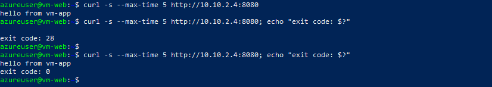<br>
  <em>Exhibit 26 — The sequence in one frame: allowed, <code>exit code: 28</code> while denied, then <code>hello from vm-app</code> and <code>exit code: 0</code> after the change</em>
</p>

### Step 27 — Network Watcher IP flow verify (Allow) ✅

**Run in:** Cloud Shell (Bash)

```
az network watcher test-ip-flow --resource-group rg-cie-p02-network --vm vm-app --direction Inbound --protocol TCP --local 10.10.2.4:8080 --remote 10.10.1.4:50000 --query "{Access:access, Rule:ruleName}" -o json
```

Same query, opposite answer, and it names the same rule.

<p align="center">
  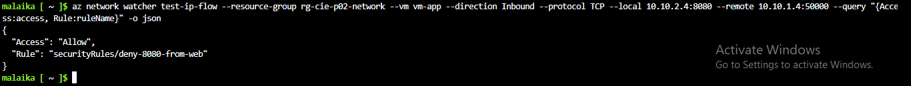<br>
  <em>Exhibit 27 — Same flow now returns <code>Access: Allow</code> with the same rule name</em>
</p>

---

<a id="module-5"></a>
## 🟡 Module 5 — Peering, Limits and Cleanup

**Objective:** Create the peering, record where it stopped (core quota), check SSH from another source, confirm tags and delete the resource group.

### Step 28 — Second VNet for peering ✅

**Run in:** Cloud Shell (Bash)

```
az network vnet create --resource-group rg-cie-p02-network --name vnet-cie-p02-peer --location indiasouthcentral --address-prefixes 10.20.0.0/16 --subnet-name snet-peer --subnet-prefixes 10.20.1.0/24 --tags project=cie-p02 owner=malaika env=lab --query "newVNet.{Name:name, State:provisioningState, Space:addressSpace.addressPrefixes, Subnets:subnets[].{Name:name, Prefix:addressPrefix}}" -o json
```

A second VNet with a different address range, so the two can be peered.

<p align="center">
  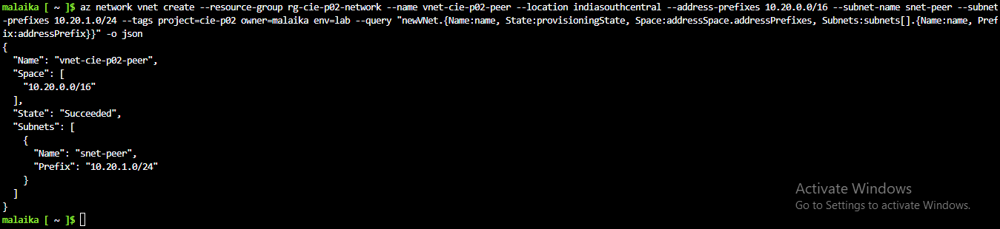<br>
  <em>Exhibit 28 — <code>vnet-cie-p02-peer</code> <code>10.20.0.0/16</code> with <code>snet-peer</code> <code>10.20.1.0/24</code>; no overlap with <code>10.10.0.0/16</code></em>
</p>

### Step 29 — Peering, first direction ✅

**Run in:** Cloud Shell (Bash)

```
az network vnet peering create --resource-group rg-cie-p02-network --name peer-main-to-peer --vnet-name vnet-cie-p02-main --remote-vnet vnet-cie-p02-peer --allow-vnet-access --query "{Name:name, State:peeringState}" -o json
```

A peering needs a link in each direction. With only one side, the state is Initiated.

<p align="center">
  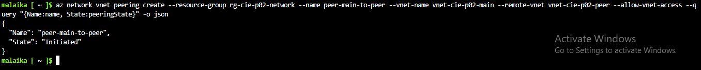<br>
  <em>Exhibit 29 — <code>peer-main-to-peer</code> created, State <code>Initiated</code></em>
</p>

### Step 30 — Peering, second direction ✅

**Run in:** Cloud Shell (Bash)

```
az network vnet peering create --resource-group rg-cie-p02-network --name peer-peer-to-main --vnet-name vnet-cie-p02-peer --remote-vnet vnet-cie-p02-main --allow-vnet-access --query "{Name:name, State:peeringState}" -o json
```

The second link reports Connected. 📝 The state of the first link after pairing was not queried again.

<p align="center">
  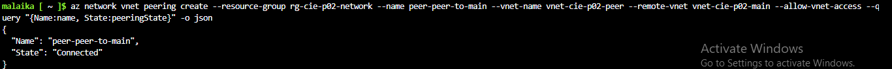<br>
  <em>Exhibit 30 — <code>peer-peer-to-main</code> created, State <code>Connected</code></em>
</p>

### Step 31 — vm-peer fails on quota ✅

**Run in:** Cloud Shell (Bash)

```
az vm create --resource-group rg-cie-p02-network --name vm-peer --location indiasouthcentral --size Standard_B2ls_v2 --image Ubuntu2204 --admin-username azureuser --authentication-type ssh --ssh-key-values "<PUBLIC_KEY_TEXT>" --vnet-name vnet-cie-p02-peer --subnet snet-peer --public-ip-address "" --nsg "" --tags project=cie-p02 owner=malaika env=lab 2>&1 | grep -m1 -o "QuotaExceeded.*Additional Required: [0-9]*"
```

The test VM for the peering could not be created. The regional core limit was 6 and 6 were already in use, and this size needs 2. The output is filtered to the error line, because the full error contains a link with the subscription ID.

<p align="center">
  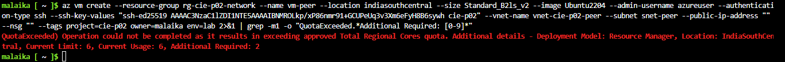<br>
  <em>Exhibit 31 — <code>QuotaExceeded</code>: Total Regional Cores, <code>IndiaSouthCentral</code>, Current Limit 6, Current Usage 6, Additional Required 2</em>
</p>

### Step 32 — vm-app deallocated ✅

**Run in:** Cloud Shell (Bash)

```
az vm deallocate --resource-group rg-cie-p02-network --name vm-app && az vm get-instance-view --resource-group rg-cie-p02-network --name vm-app --query "{Name:name, State:instanceView.statuses[1].displayStatus}" -o json
```

<code>vm-app</code> was deallocated to try to free 2 cores. Its work was already captured in Exhibits 17 to 27.

<p align="center">
  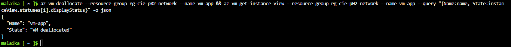<br>
  <em>Exhibit 32 — <code>vm-app</code> State <code>VM deallocated</code>, done to try to free its cores</em>
</p>

### Step 33 — Quota error after deallocating ✅

**Run in:** Cloud Shell (Bash)

```
az vm create ... --name vm-peer ... 2>&1 | grep -o "Code: [A-Za-z]*\|Current Limit: [0-9]*, Current Usage: [0-9]*, Additional Required: [0-9]*" | sort -u
```

The same limit appeared again with usage still at 6. I did not find out why. Other cores in the subscription, which was not checked, may count toward the same limit. This project stops here for the peering VM.

<p align="center">
  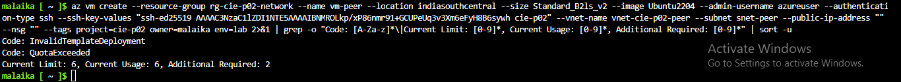<br>
  <em>Exhibit 33 — Retry: <code>QuotaExceeded</code>, Current Limit 6, Current Usage 6, Additional Required 2. Usage did not change</em>
</p>

### Step 34 — SSH from a different address ✅

**Run in:** Cloud Shell (Bash)

```
ssh -o ConnectTimeout=8 azureuser@<VM_WEB_PUBLIC_IP>; echo "exit code: $?"
```

Cloud Shell is a different source than my laptop. Its connection to port 22 times out and no <code>Permission denied</code> appears, which fits the rule from Exhibit 11. Cloud Shell's own outbound address was not recorded.

<p align="center">
  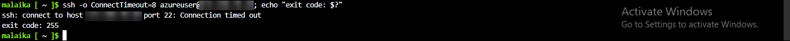<br>
  <em>Exhibit 34 — SSH to the <code>vm-web</code> public IP (blurred) from Cloud Shell: <code>Connection timed out</code>, <code>exit code: 255</code></em>
</p>

### Step 35 — Tag check on all resources ✅

**Run in:** Cloud Shell (Bash)

```
az resource list --resource-group rg-cie-p02-network --query "[].{Name:name, Project:tags.project, Owner:tags.owner, Env:tags.env}" -o table
```

Tags are applied per resource, so every resource is listed. The network cards and OS disks are tagged too.

<p align="center">
  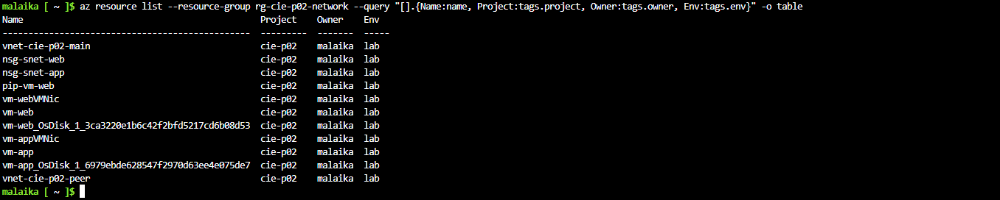<br>
  <em>Exhibit 35 — 11 resources in the group, each with <code>project=cie-p02</code>, <code>owner=malaika</code>, <code>env=lab</code></em>
</p>

### Step 36 — Cleanup check ✅

**Run in:** Cloud Shell (Bash)

```
az group delete --name rg-cie-p02-network --yes --no-wait
az group exists --name rg-cie-p02-network; az group list --query "[].name" -o table
```

Only this project's resource group was deleted. 📝 The delete command prints nothing, so it was not screenshotted. The check shows <code>false</code> and the four older groups still exist.

<p align="center">
  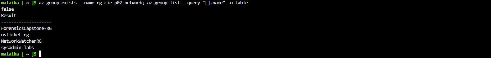<br>
  <em>Exhibit 36 — <code>az group exists</code> prints <code>false</code>; the four older groups are still listed</em>
</p>

---

<a id="coverage-snapshot"></a>
## 🌟 Coverage Snapshot

| 🛡️ Area | ✅ Status | 📌 Detail |
|---|---|---|
| VNet and subnets | Tested | Two subnets in one VNet, address plan in Exhibits 4 and 5 |
| NSG per subnet | Tested | Both attached (Exhibits 8, 9), defaults listed for `nsg-snet-web` only |
| SSH limited to my IP | Partly tested | Works from my laptop, times out from Cloud Shell; one other source only |
| Public vs private IP | Tested | `vm-web` public, `vm-app` private only (Exhibits 14, 15) |
| Private connectivity | Tested | Ping both ways, curl on 8080 |
| NSG block and unblock | Tested | Deny, then Allow, for inbound TCP 8080 only |
| Network Watcher IP flow verify | Tested | Deny and Allow, same rule named |
| VNet peering | Partly tested | Both links created; **no traffic sent across** |

### 🧾 What the Evidence Proves

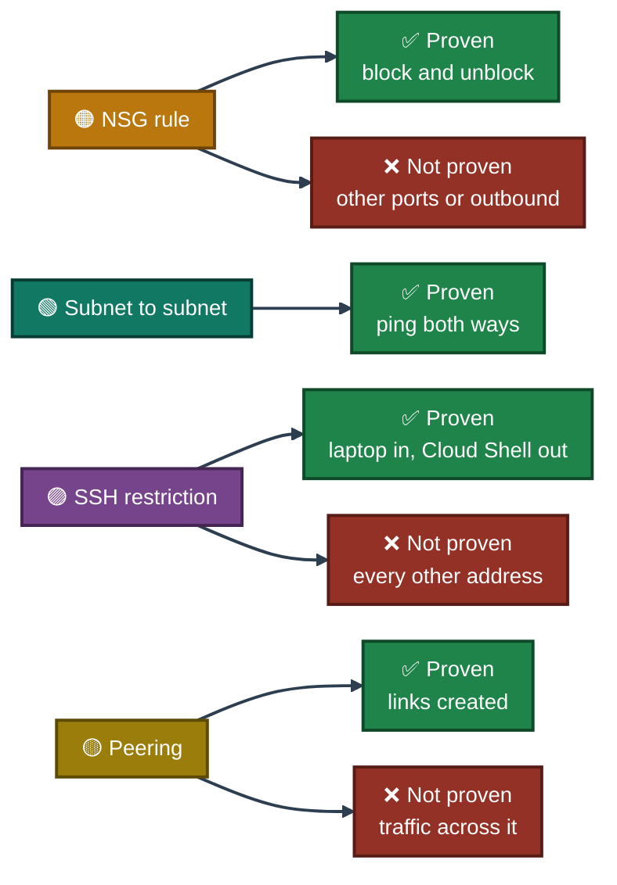

---

<a id="project-summary"></a>
## 📝 Project Summary

| Area | Tooling | Key Finding |
|---|---|---|
| Network build | `az network vnet`, `subnet`, `nsg` | Two subnets, one NSG each, both attached |
| Access control | NSG rule, OpenSSH | SSH allowed from one `/32`; timed out from Cloud Shell |
| Connectivity | `ping`, `curl`, SSH jump host | Private traffic passes both ways; `vm-app` reached only through `vm-web` |
| Filtering | NSG rule priority 100, `curl` | Deny gives exit 28, Allow gives exit 0 |
| Verification | Network Watcher `test-ip-flow` | Azure names the rule behind each result |
| Peering | `az network vnet peering` | Both links created; traffic not tested |

---

<a id="challenges-fixes"></a>
## ⚠️ Challenges & Fixes

| ❌ Challenge | ✅ Fix |
|---|---|
| `az group create -o table` showed no State or tags (the first creation output was replaced, so no screenshot is kept) 📝 | Checked with `az group show` and a JSON query (Exhibit 3) |
| SSH with `-J` and `-i` failed with `Permission denied (publickey)` (Exhibit 18) | The key was not used for the first hop. Used `ProxyCommand` so both hops get the key |
| Some of my screenshots came from the wrong VM, for example a `curl` run on `vm-app` against its own IP 📝 | The shell prompt shows the machine. Those frames were rejected and redone on `vm-web`, because a self-call never passes through the NSG |
| The Azure portal token expired after my laptop slept, and Cloud Shell stopped working 📝 | Signed in again in a new browser tab; the resources were not affected |
| `vm-peer` failed with `QuotaExceeded`: limit 6, usage 6, 2 more needed (Exhibits 31, 33) | Deallocated `vm-app` (Exhibit 32). Usage stayed 6. Not solved, so the peering traffic test was dropped and recorded as a limit |

<sub>📝 = taken from my notes, no screenshot shows it.</sub>

---

<a id="scope-limitations"></a>
## 🚧 Scope & Limitations

- **No traffic across the peering:** `vm-peer` was never created, so there is no ping, curl or SSH over the peering. Only the creation of both links is shown.
- **First peering link state:** Exhibit 29 shows `Initiated`. After the second link was created, only the second link's `Connected` was captured.
- **Quota cause unknown:** The limit was 6 cores with 6 in use, and deallocating `vm-app` did not change it. I did not check what else counted toward it.
- **SSH restriction tested from one other source:** Cloud Shell timed out. Its outbound address was not recorded, and no other network was tried.
- **NSG test covers one flow:** Inbound TCP 8080 from `snet-web` to `snet-app`, with IP flow verify run for that flow only. Outbound rules and other ports were not tested.
- **Default rules shown for one NSG:** Exhibit 10 lists the defaults of `nsg-snet-web`. The defaults of `nsg-snet-app` were not listed.
- **Rule name:** `deny-8080-from-web` has `Access: Allow` in the later exhibits.
- **Allowed IP can change:** The SSH rule is tied to my home IP at the time. Updating it after a change was not exercised.
- **By design, not built:** Load balancer, Bastion and VM backup are outside this project.

These gaps are marked instead of hidden, so the results show what was actually proven.

---

<a id="what-i-learned"></a>
## 🧠 What I Learned

- **An NSG does nothing until it is attached.** Creating `nsg-snet-web` and `nsg-snet-app` changed no traffic. The subnet association did (Exhibits 8 and 9).
- **Lower priority number wins.** Rule 100 is checked before the default rules at 65000 and above.
- **A blocked port shows up as a timeout.** `curl` exit code 28 means no answer, not a refusal. IP flow verify then names the rule that caused it.
- **Test from the right machine.** A call from a VM to its own IP never touches an NSG. The prompt in the screenshot is the evidence.
- **Peering has two sides.** One link stays `Initiated` until the other exists. The two address ranges must not overlap.
- **Private-only VMs need a jump host.** `vm-app` has no public IP, so `vm-web` carries the SSH hop, with the key given to each hop.
- **Check the core quota first.** The regional vCPU limit stopped a VM that the size and region checks had both allowed.
- **Make the evidence safe to publish.** Public IPs, fingerprints, usernames and the subscription ID stay out of screenshots, and queries are written to avoid printing them.

---

<a id="skills-demonstrated"></a>
## 🛠️ Skills Demonstrated

- Designing an address plan and building a VNet with subnets using Azure CLI
- Writing and attaching Network Security Groups, and reading rule priority
- Limiting SSH to one source address
- Using public and private IPs, and a jump host for a private-only VM
- Proving connectivity with `ping` and `curl` over private IPs
- Using Network Watcher IP flow verify to name the rule behind an allow or deny
- Creating a two-way VNet peering
- Reading an Azure quota error and recording it as a limit
- Tagging every resource and cleaning up only this project's resource group

---

<a id="cleanup"></a>
## 🧹 Cleanup

Only `rg-cie-p02-network` was deleted, which removes the VMs, disks, network cards, public IP, NSGs and both VNets together. Exhibit 36 shows the group is gone and `sysadmin-labs`, `osticket-rg`, `ForensicsCapstone-RG` and `NetworkWatcherRG` remain. The exact commands are in [`commands/cleanup.md`](commands/cleanup.md).

---

<a id="screenshot-index"></a>
## 🖼️ Screenshot Index

| # | File | Shows |
|:---:|---|---|
| 1 | `ss-01-subscription-provider-vmsize-checks.png` | Subscription Enabled, provider Registered, VM size listed |
| 2 | `ss-02-network-watcher-check.png` | Network Watcher present, Succeeded |
| 3 | `ss-03-resource-group-state-tags.png` | RG Succeeded with 3 tags |
| 4 | `ss-04-vnet-main-snet-web.png` | VNet and snet-web created |
| 5 | `ss-05-subnet-snet-app.png` | snet-app created |
| 6 | `ss-06-nsg-snet-web.png` | NSG and tags confirmed |
| 7 | `ss-07-nsg-snet-app.png` | NSG and tags confirmed |
| 8 | `ss-08-attach-nsg-snet-web.png` | NSG attached to snet-web |
| 9 | `ss-09-attach-nsg-snet-app.png` | NSG attached to snet-app |
| 10 | `ss-10-nsg-default-rules.png` | 6 default rules listed |
| 11 | `ss-11-nsg-ssh-rule-my-ip.png` | SSH rule limited to one /32 |
| 12 | `ss-12-ssh-keygen-no-passphrase.png` | Key created, no passphrase prompt |
| 13 | `ss-13-public-ip-vm-web.png` | Static Standard public IP |
| 14 | `ss-14-vm-web-created.png` | vm-web running, 10.10.1.4 |
| 15 | `ss-15-vm-app-no-public-ip.png` | vm-app running, no public IP |
| 16 | `ss-16-ssh-to-vm-web.png` | SSH to vm-web works |
| 17 | `ss-17-ping-web-to-app.png` | web to app ping, 0% loss |
| 18 | `ss-18-ssh-jump-host-vm-app.png` | Jump host login to vm-app |
| 19 | `ss-19-ping-app-to-web.png` | app to web ping, 0% loss |
| 20 | `ss-20-vm-app-web-server.png` | Local web server on 8080 |
| 21 | `ss-21-curl-allowed-before.png` | curl works (before) |
| 22 | `ss-22-nsg-deny-rule-8080.png` | Deny rule created |
| 23 | `ss-23-curl-blocked.png` | curl blocked, exit 28 |
| 24 | `ss-24-ipflow-verify-deny.png` | IP flow verify says Deny |
| 25 | `ss-25-nsg-rule-changed-allow.png` | Rule set to Allow |
| 26 | `ss-26-curl-allowed-after.png` | curl works again, exit 0 |
| 27 | `ss-27-ipflow-verify-allow.png` | IP flow verify says Allow |
| 28 | `ss-28-vnet-peer-created.png` | Peer VNet created |
| 29 | `ss-29-peering-main-to-peer.png` | First link Initiated |
| 30 | `ss-30-peering-peer-to-main-connected.png` | Second link Connected |
| 31 | `ss-31-vm-peer-quota-error.png` | vm-peer blocked by core quota |
| 32 | `ss-32-vm-app-deallocated.png` | vm-app deallocated |
| 33 | `ss-33-quota-error-code-check.png` | Same quota error |
| 34 | `ss-34-ssh-blocked-other-ip.png` | SSH from other source times out |
| 35 | `ss-35-tags-check.png` | All 11 resources tagged |
| 36 | `ss-36-cleanup-check.png` | RG deleted, older RGs intact |

---

<a id="repo-structure"></a>
## 📁 Repo Structure

```text
Cloud-Infrastructure-Engineering/
`-- Azure/
    `-- 02-azure-virtual-networking/
        |-- README.md
        |-- Virtual-Networking-INDEX.md
        |-- commands/
        |   |-- commands.md
        |   `-- cleanup.md
        `-- Screenshots/
            |-- ss-01-subscription-provider-vmsize-checks.png
            |-- ss-02-network-watcher-check.png
            |-- ss-03-resource-group-state-tags.png
            |-- ss-04-vnet-main-snet-web.png
            |-- ss-05-subnet-snet-app.png
            |-- ss-06-nsg-snet-web.png
            |-- ss-07-nsg-snet-app.png
            |-- ss-08-attach-nsg-snet-web.png
            |-- ss-09-attach-nsg-snet-app.png
            |-- ss-10-nsg-default-rules.png
            |-- ss-11-nsg-ssh-rule-my-ip.png
            |-- ss-12-ssh-keygen-no-passphrase.png
            |-- ss-13-public-ip-vm-web.png
            |-- ss-14-vm-web-created.png
            |-- ss-15-vm-app-no-public-ip.png
            |-- ss-16-ssh-to-vm-web.png
            |-- ss-17-ping-web-to-app.png
            |-- ss-18-ssh-jump-host-vm-app.png
            |-- ss-19-ping-app-to-web.png
            |-- ss-20-vm-app-web-server.png
            |-- ss-21-curl-allowed-before.png
            |-- ss-22-nsg-deny-rule-8080.png
            |-- ss-23-curl-blocked.png
            |-- ss-24-ipflow-verify-deny.png
            |-- ss-25-nsg-rule-changed-allow.png
            |-- ss-26-curl-allowed-after.png
            |-- ss-27-ipflow-verify-allow.png
            |-- ss-28-vnet-peer-created.png
            |-- ss-29-peering-main-to-peer.png
            |-- ss-30-peering-peer-to-main-connected.png
            |-- ss-31-vm-peer-quota-error.png
            |-- ss-32-vm-app-deallocated.png
            |-- ss-33-quota-error-code-check.png
            |-- ss-34-ssh-blocked-other-ip.png
            |-- ss-35-tags-check.png
            `-- ss-36-cleanup-check.png
```

<div align="center">

☁️ **[Microsoft Azure](https://azure.microsoft.com)** · 📚 **[Network security groups](https://learn.microsoft.com/azure/virtual-network/network-security-groups-overview)** · 🔗 **[VNet peering](https://learn.microsoft.com/azure/virtual-network/virtual-network-peering-overview)** · 🔎 **[IP flow verify](https://learn.microsoft.com/azure/network-watcher/ip-flow-verify-overview)**

</div>
