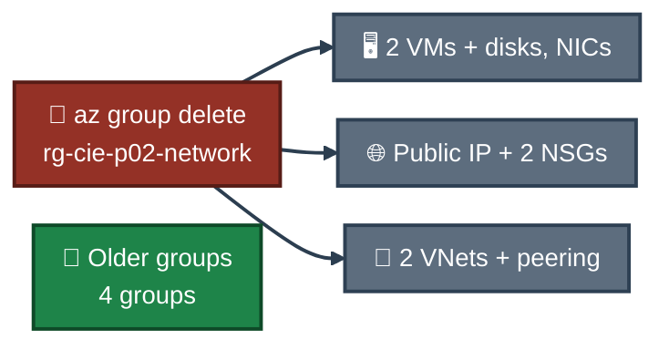

<a id="top"></a>
<div align="center">

# 🧹 Project 02 — Cleanup
### Azure Virtual Networking
**Project 02 of 6 — Cloud Infrastructure Engineering**


**Cleanup was the last step. Only this project's resource group was deleted. The older groups were not touched.**

### [📖 README](../README.md) &nbsp;·&nbsp; [📑 Visual Index](../Virtual-Networking-INDEX.md) &nbsp;·&nbsp; [⌨️ Commands](commands.md)

</div>

---

## ⌨️ Commands

| 📍 Where | 🖼️ Proof | Result |
|:---:|:---:|---|
| ☁️ Cloud Shell (Bash) | **Exhibit 36** — `Screenshots/ss-36-cleanup-check.png` | `false`, four older groups remain |

**1. Delete the group** &nbsp; 📝 (the command prints nothing, so there is no screenshot of it)

```bash
az group delete --name rg-cie-p02-network --yes --no-wait
```

**2. Check that it is gone** &nbsp; ✅

```bash
az group exists --name rg-cie-p02-network; az group list --query "[].name" -o table
```

---

## 🗑️ What This Removed

Everything inside `rg-cie-p02-network`:

| Resource | Includes |
|---|---|
| 🖥️ VM `vm-web` | OS disk and network card `vm-webVMNic` |
| 🖥️ VM `vm-app` | OS disk and network card `vm-appVMNic` |
| 🌐 Public IP `pip-vm-web` | the static Standard address |
| 🛡️ NSGs `nsg-snet-web`, `nsg-snet-app` | both custom rules, including the SSH rule and `deny-8080-from-web` |
| 🔗 VNets `vnet-cie-p02-main`, `vnet-cie-p02-peer` | all three subnets and both peering links |

The 11 resources are the ones listed in Exhibit 35. `vm-app` was already deallocated before the delete (Exhibit 32). The state of `vm-web` at delete time was not checked.


<p align="center"><em>Only the project group is deleted. The older groups are not in the command.</em></p>

---

## ✅ What Proves It

Exhibit 36 shows the check after the delete:

| Resource group | After cleanup |
|---|:---:|
| `rg-cie-p02-network` | ❌ `az group exists` prints `false`, and it is not in the list |
| `ForensicsCapstone-RG` | ✅ Still listed |
| `osticket-rg` | ✅ Still listed |
| `NetworkWatcherRG` | ✅ Still listed (Network Watcher was used, never changed) |
| `sysadmin-labs` | ✅ Still listed |

---

## 🧳 Left on My Laptop &nbsp; 📝

- `cie_p02_key` and `cie_p02_key.pub` in `~/.ssh`. No resource uses the public key any more. The private key stays on the laptop.
- `known_hosts` entries for the two VMs, added when I first connected (Exhibits 16 and 18).

---

## 🚧 Not Checked

- Whether the core usage dropped after the delete. It stayed at 6 earlier (Exhibit 33) and the cause was never found, so no claim is made about it.
- Whether any resource was left outside the group. Only the group list was checked.

---

<div align="center">

[⬆️ Back to top](#top) &nbsp;·&nbsp; [📖 README](../README.md) &nbsp;·&nbsp; [⌨️ Commands](commands.md)

</div>
