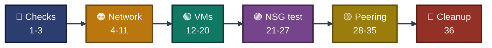

<a id="top"></a>
<div align="center">

# ⌨️ Project 02 — Commands
### Azure Virtual Networking
**Project 02 of 6 — Cloud Infrastructure Engineering**


**Every command used in this project, in order, with where it ran and which exhibit proves it.**

### [📖 README](../README.md) &nbsp;·&nbsp; [📑 Visual Index](../Virtual-Networking-INDEX.md) &nbsp;·&nbsp; [🧹 Cleanup](cleanup.md)

</div>

---

## 🧭 How to Read This File

| Mark | Meaning |
|:---:|---|
| ✅ | Ran, and a screenshot in `../Screenshots/` proves the result. The exhibit number is given. |
| 📝 | Ran, but there is no screenshot of it in the repo. The text says which exhibit proves the result, or that nothing proves it. |
| `<...>` | A value that is not kept in the repo (IP address, key text). |

| 📍 Where it ran | Shown as |
|---|:---:|
| Azure Cloud Shell (Bash), prompt `malaika [ ~ ]` | ☁️ **Cloud Shell** |
| Windows PowerShell on my laptop | 💻 **Laptop** |
| SSH session on `vm-web` or `vm-app`, prompt `azureuser@vm-web` or `azureuser@vm-app` | 🖥️ **VM** |

Step numbers match the exhibit numbers and the README.

---

## 📊 At a Glance

| 🔵 Checks | 🟠 Network Build | 🟢 VMs and Connectivity | 🟣 NSG Test | 🟡 Peering and Limits | 🧹 Cleanup |
|:---:|:---:|:---:|:---:|:---:|:---:|
| **Steps 1-3** | **Steps 4-11** | **Steps 12-20** | **Steps 21-27** | **Steps 28-35** | **Step 36** |
| provider, size, group | VNet, subnets, NSGs | SSH, ping, jump host | deny, allow, IP flow | peering, quota | delete group |


<p align="center"><em>Order of the command groups. Step numbers match the README.</em></p>

### 🧰 Commands by Azure Area

| Area | Main commands |
|---|---|
| Resource group | `az group create / show / delete / exists / list` |
| VNet and subnets | `az network vnet create`, `az network vnet subnet create / update` |
| Peering | `az network vnet peering create` |
| NSG | `az network nsg create`, `az network nsg rule create / update / list` |
| Public IP | `az network public-ip create / show` |
| VM | `az vm create / deallocate / get-instance-view / list-skus` |
| Network Watcher | `az network watcher list / test-ip-flow` |
| Checks | `az account show`, `az provider show`, `az resource list` |
| Laptop and VM | `ssh-keygen`, `ssh`, `ping`, `curl`, `python3 -m http.server` |

### 🔁 Placeholders

| Placeholder | What it stands for |
|---|---|
| `<PUBLIC_KEY_TEXT>` | Text of my SSH **public** key (`cie_p02_key.pub`). The private key never left my laptop. |
| `<MY_PUBLIC_IP>` | My home public IP at that moment. Not stored in the repo. |
| `<VM_WEB_PUBLIC_IP>` | Public IP of `vm-web`. Not stored in the repo. |

---

## 🔵 Module 1 — Checks and Resource Group &nbsp;·&nbsp; Steps 1-3

### Step 1 — Subscription, provider and VM size checks &nbsp; ✅

| 📍 Where | 🖼️ Proof | Result |
|:---:|:---:|---|
| ☁️ Cloud Shell | **Exhibit 1** | Subscription Enabled, provider Registered, VM size listed |

```bash
az account show --query "{Name:name, State:state, User:user.type}" -o table
az provider show --namespace Microsoft.Network --query "{Namespace:namespace, State:registrationState}" -o table
az vm list-skus --location indiasouthcentral --size Standard_B2ls_v2 --query "[].{Size:name, Restrictions:restrictions[0].reasonCode}" -o table
```

### Step 2 — Network Watcher check &nbsp; ✅

| 📍 Where | 🖼️ Proof | Result |
|:---:|:---:|---|
| ☁️ Cloud Shell | **Exhibit 2** | Network Watcher present, Succeeded |

```bash
az network watcher list --query "[].{Name:name, Location:location, State:provisioningState, RG:resourceGroup}" -o table
```

### Step 3 — Resource group state and tags &nbsp; ✅

| 📍 Where | 🖼️ Proof | Result |
|:---:|:---:|---|
| ☁️ Cloud Shell | **Exhibit 3** (the `show` command; the `create` output is 📝) | State `Succeeded`, three tags |

```bash
az group create --name rg-cie-p02-network --location indiasouthcentral --tags project=cie-p02 owner=malaika env=lab -o table
```

```bash
az group show --name rg-cie-p02-network --query "{Name:name, State:properties.provisioningState, Tags:tags}" -o json
```

> [!NOTE]
> The `create` command with `-o table` printed only Location and Name, so it showed no State and no tags. That output is not in the repo. `az group show` is the proof.

---

## 🟠 Module 2 — VNet, Subnets and NSGs &nbsp;·&nbsp; Steps 4-11

### Step 4 — Main VNet and first subnet &nbsp; ✅

| 📍 Where | 🖼️ Proof | Result |
|:---:|:---:|---|
| ☁️ Cloud Shell | **Exhibit 4** | VNet and snet-web created |

```bash
az network vnet create --resource-group rg-cie-p02-network --name vnet-cie-p02-main --location indiasouthcentral --address-prefixes 10.10.0.0/16 --subnet-name snet-web --subnet-prefixes 10.10.1.0/24 --tags project=cie-p02 owner=malaika env=lab --query "newVNet.{Name:name, State:provisioningState, Space:addressSpace.addressPrefixes, Subnets:subnets[].{Name:name, Prefix:addressPrefix}}" -o json
```

### Step 5 — Second subnet &nbsp; ✅

| 📍 Where | 🖼️ Proof | Result |
|:---:|:---:|---|
| ☁️ Cloud Shell | **Exhibit 5** | snet-app created |

```bash
az network vnet subnet create --resource-group rg-cie-p02-network --vnet-name vnet-cie-p02-main --name snet-app --address-prefixes 10.10.2.0/24 --query "{Name:name, Prefix:addressPrefix, State:provisioningState}" -o json
```

### Step 6 — NSG for snet-web &nbsp; ✅

| 📍 Where | 🖼️ Proof | Result |
|:---:|:---:|---|
| ☁️ Cloud Shell | **Exhibit 6** | NSG and tags confirmed |

```bash
az network nsg create --resource-group rg-cie-p02-network --name nsg-snet-web --location indiasouthcentral --tags project=cie-p02 owner=malaika env=lab --query "NewNSG.{Name:name, State:provisioningState, Location:location, Tags:tags}" -o json
```

### Step 7 — NSG for snet-app &nbsp; ✅

| 📍 Where | 🖼️ Proof | Result |
|:---:|:---:|---|
| ☁️ Cloud Shell | **Exhibit 7** | NSG and tags confirmed |

```bash
az network nsg create --resource-group rg-cie-p02-network --name nsg-snet-app --location indiasouthcentral --tags project=cie-p02 owner=malaika env=lab --query "NewNSG.{Name:name, State:provisioningState, Location:location, Tags:tags}" -o json
```

### Step 8 — Attach NSG to snet-web &nbsp; ✅

| 📍 Where | 🖼️ Proof | Result |
|:---:|:---:|---|
| ☁️ Cloud Shell | **Exhibit 8** | NSG attached to snet-web |

```bash
az network vnet subnet update --resource-group rg-cie-p02-network --vnet-name vnet-cie-p02-main --name snet-web --network-security-group nsg-snet-web --query "{Name:name, Prefix:addressPrefix, State:provisioningState, AttachedNSG:contains(networkSecurityGroup.id, 'nsg-snet-web')}" -o json
```

### Step 9 — Attach NSG to snet-app &nbsp; ✅

| 📍 Where | 🖼️ Proof | Result |
|:---:|:---:|---|
| ☁️ Cloud Shell | **Exhibit 9** | NSG attached to snet-app |

```bash
az network vnet subnet update --resource-group rg-cie-p02-network --vnet-name vnet-cie-p02-main --name snet-app --network-security-group nsg-snet-app --query "{Name:name, Prefix:addressPrefix, State:provisioningState, AttachedNSG:contains(networkSecurityGroup.id, 'nsg-snet-app')}" -o json
```

### Step 10 — Default NSG rules &nbsp; ✅

| 📍 Where | 🖼️ Proof | Result |
|:---:|:---:|---|
| ☁️ Cloud Shell | **Exhibit 10** | 6 default rules listed |

```bash
az network nsg rule list --resource-group rg-cie-p02-network --nsg-name nsg-snet-web --include-default --query "[].{Name:name, Priority:priority, Dir:direction, Access:access, Src:sourceAddressPrefix, Port:destinationPortRange}" -o table
```

> [!NOTE]
> Only the defaults of `nsg-snet-web` were listed. The defaults of `nsg-snet-app` were not.

### Step 11 — SSH allowed only from my IP &nbsp; ✅

**11a. Read my public IP** &nbsp; 📝

| 📍 Where | 🖼️ Proof | Result |
|:---:|:---:|---|
| 🌐 Browser | none, the screenshot would show the address | a public IPv4 address, written here as `<MY_PUBLIC_IP>` |

Opened the IP lookup site ifconfig.me in the laptop browser and read the IPv4 address.

**11b. Create the rule** &nbsp; ✅

| 📍 Where | 🖼️ Proof | Result |
|:---:|:---:|---|
| ☁️ Cloud Shell | **Exhibit 11** | SSH rule limited to one /32 |

```bash
az network nsg rule create --resource-group rg-cie-p02-network --nsg-name nsg-snet-web --name allow-ssh-from-my-ip --priority 100 --direction Inbound --access Allow --protocol Tcp --source-address-prefixes <MY_PUBLIC_IP>/32 --source-port-ranges "*" --destination-address-prefixes "*" --destination-port-ranges 22 --query "{Name:name, Priority:priority, Access:access, Proto:protocol, Port:destinationPortRange, Src:sourceAddressPrefix, State:provisioningState}" -o json
```

> [!IMPORTANT]
> The address is blurred in Exhibit 11 and is not stored in the repo.

---

## 🟢 Module 3 — VMs and Private Connectivity &nbsp;·&nbsp; Steps 12-20

### Step 12 — SSH key pair on the laptop &nbsp; ✅

**12a. Create the key pair** &nbsp; ✅

| 📍 Where | 🖼️ Proof | Result |
|:---:|:---:|---|
| 💻 Laptop | **Exhibit 12** | Key pair created, no passphrase prompt |

```powershell
New-Item -ItemType Directory -Force "$HOME\.ssh" | Out-Null; ssh-keygen -t ed25519 -f "$HOME\.ssh\cie_p02_key" -N '""' -C "cie-p02"
```

**12b. Copy the public key text** &nbsp; 📝

| 📍 Where | 🖼️ Proof | Result |
|:---:|:---:|---|
| 💻 Laptop | none (the key text is long and easy to misread) | key text on the clipboard, pasted into `<PUBLIC_KEY_TEXT>` |

```powershell
Get-Content "$HOME\.ssh\cie_p02_key.pub" | Set-Clipboard
```

### Step 13 — Public IP for vm-web &nbsp; ✅

| 📍 Where | 🖼️ Proof | Result |
|:---:|:---:|---|
| ☁️ Cloud Shell | **Exhibit 13** | Static Standard public IP |

```bash
az network public-ip create --resource-group rg-cie-p02-network --name pip-vm-web --location indiasouthcentral --sku Standard --allocation-method Static --tags project=cie-p02 owner=malaika env=lab --query "publicIp.{Name:name, Sku:sku.name, Allocation:publicIPAllocationMethod, State:provisioningState, Tags:tags}" -o json
```

### Step 14 — vm-web created &nbsp; ✅

| 📍 Where | 🖼️ Proof | Result |
|:---:|:---:|---|
| ☁️ Cloud Shell | **Exhibit 14** | vm-web running, 10.10.1.4 |

```bash
az vm create --resource-group rg-cie-p02-network --name vm-web --location indiasouthcentral --size Standard_B2ls_v2 --image Ubuntu2204 --admin-username azureuser --authentication-type ssh --ssh-key-values "<PUBLIC_KEY_TEXT>" --vnet-name vnet-cie-p02-main --subnet snet-web --public-ip-address pip-vm-web --nsg "" --tags project=cie-p02 owner=malaika env=lab --query "{PowerState:powerState, PrivateIP:privateIpAddress, Location:location}" -o json
```

### Step 15 — vm-app created without public IP &nbsp; ✅

| 📍 Where | 🖼️ Proof | Result |
|:---:|:---:|---|
| ☁️ Cloud Shell | **Exhibit 15** | vm-app running, no public IP |

```bash
az vm create --resource-group rg-cie-p02-network --name vm-app --location indiasouthcentral --size Standard_B2ls_v2 --image Ubuntu2204 --admin-username azureuser --authentication-type ssh --ssh-key-values "<PUBLIC_KEY_TEXT>" --vnet-name vnet-cie-p02-main --subnet snet-app --public-ip-address "" --nsg "" --tags project=cie-p02 owner=malaika env=lab --query "{PowerState:powerState, PrivateIP:privateIpAddress, PublicIP:publicIpAddress, Location:location}" -o json
```

### Step 16 — SSH from the laptop to vm-web &nbsp; ✅

**16a. Read the public IP of `vm-web`** &nbsp; 📝

| 📍 Where | 🖼️ Proof | Result |
|:---:|:---:|---|
| ☁️ Cloud Shell | none, the screenshot would show the address | an IPv4 address, written here as `<VM_WEB_PUBLIC_IP>` |

```bash
az network public-ip show --resource-group rg-cie-p02-network --name pip-vm-web --query ipAddress -o tsv
```

**16b. SSH to `vm-web`** &nbsp; ✅

| 📍 Where | 🖼️ Proof | Result |
|:---:|:---:|---|
| 💻 Laptop | **Exhibit 16** | SSH to vm-web works |

```powershell
ssh -i "$HOME\.ssh\cie_p02_key" azureuser@<VM_WEB_PUBLIC_IP>
```

### Step 17 — Ping from vm-web to vm-app &nbsp; ✅

| 📍 Where | 🖼️ Proof | Result |
|:---:|:---:|---|
| 🖥️ VM (`vm-web`) | **Exhibit 17** | web to app ping, 0% loss |

```bash
ping -c 4 10.10.2.4
```

### Step 18 — SSH to vm-app through vm-web &nbsp; ✅

| 📍 Where | 🖼️ Proof | Result |
|:---:|:---:|---|
| 💻 Laptop | **Exhibit 18** (both attempts are in one frame) | First attempt fails, second reaches `vm-app` |

**18a. First attempt, fails with `Permission denied (publickey)`**

```powershell
ssh -i "$HOME\.ssh\cie_p02_key" -J azureuser@<VM_WEB_PUBLIC_IP> azureuser@10.10.2.4
```

**18b. The version that worked**

```powershell
ssh -i "$HOME\.ssh\cie_p02_key" -o "ProxyCommand=ssh -i $HOME\.ssh\cie_p02_key -W %h:%p azureuser@<VM_WEB_PUBLIC_IP>" azureuser@10.10.2.4
```

### Step 19 — Ping from vm-app to vm-web &nbsp; ✅

| 📍 Where | 🖼️ Proof | Result |
|:---:|:---:|---|
| 🖥️ VM (`vm-app`) | **Exhibit 19** | app to web ping, 0% loss |

```bash
ping -c 4 10.10.1.4
```

### Step 20 — Test web server on vm-app &nbsp; ✅

| 📍 Where | 🖼️ Proof | Result |
|:---:|:---:|---|
| 🖥️ VM (`vm-app`) | **Exhibit 20** | Local web server on 8080 |

```bash
mkdir -p ~/site && echo "hello from vm-app" > ~/site/index.html && (nohup python3 -m http.server 8080 --directory ~/site >/dev/null 2>&1 &) ; sleep 1; curl -s localhost:8080
```

---

## 🟣 Module 4 — NSG Block Test and IP Flow Verify &nbsp;·&nbsp; Steps 21-27

### Step 21 — curl before any deny rule &nbsp; ✅

| 📍 Where | 🖼️ Proof | Result |
|:---:|:---:|---|
| 🖥️ VM (`vm-web`) | **Exhibit 21** | curl works (before) |

```bash
curl -s --max-time 5 http://10.10.2.4:8080
```

### Step 22 — Deny rule on nsg-snet-app &nbsp; ✅

| 📍 Where | 🖼️ Proof | Result |
|:---:|:---:|---|
| ☁️ Cloud Shell | **Exhibit 22** | Deny rule created |

```bash
az network nsg rule create --resource-group rg-cie-p02-network --nsg-name nsg-snet-app --name deny-8080-from-web --priority 100 --direction Inbound --access Deny --protocol Tcp --source-address-prefixes 10.10.1.0/24 --source-port-ranges "*" --destination-address-prefixes "*" --destination-port-ranges 8080 --query "{Name:name, Priority:priority, Access:access, Proto:protocol, Port:destinationPortRange, Src:sourceAddressPrefix, State:provisioningState}" -o json
```

### Step 23 — curl after the deny rule &nbsp; ✅

| 📍 Where | 🖼️ Proof | Result |
|:---:|:---:|---|
| 🖥️ VM (`vm-web`) | **Exhibit 23** | curl blocked, exit 28 |

```bash
curl -s --max-time 5 http://10.10.2.4:8080; echo "exit code: $?"
```

### Step 24 — Network Watcher IP flow verify (Deny) &nbsp; ✅

| 📍 Where | 🖼️ Proof | Result |
|:---:|:---:|---|
| ☁️ Cloud Shell | **Exhibit 24** | IP flow verify says Deny |

```bash
az network watcher test-ip-flow --resource-group rg-cie-p02-network --vm vm-app --direction Inbound --protocol TCP --local 10.10.2.4:8080 --remote 10.10.1.4:50000 --query "{Access:access, Rule:ruleName}" -o json
```

### Step 25 — Rule changed from Deny to Allow &nbsp; ✅

| 📍 Where | 🖼️ Proof | Result |
|:---:|:---:|---|
| ☁️ Cloud Shell | **Exhibit 25** | Rule set to Allow |

```bash
az network nsg rule update --resource-group rg-cie-p02-network --nsg-name nsg-snet-app --name deny-8080-from-web --access Allow --query "{Name:name, Priority:priority, Access:access, Port:destinationPortRange, Src:sourceAddressPrefix, State:provisioningState}" -o json
```

> [!NOTE]
> The rule keeps its old name `deny-8080-from-web` although its access is now `Allow`.

### Step 26 — curl after the rule change &nbsp; ✅

| 📍 Where | 🖼️ Proof | Result |
|:---:|:---:|---|
| 🖥️ VM (`vm-web`) | **Exhibit 26** | curl works again, exit 0 |

```bash
curl -s --max-time 5 http://10.10.2.4:8080; echo "exit code: $?"
```

### Step 27 — Network Watcher IP flow verify (Allow) &nbsp; ✅

| 📍 Where | 🖼️ Proof | Result |
|:---:|:---:|---|
| ☁️ Cloud Shell | **Exhibit 27** | IP flow verify says Allow |

```bash
az network watcher test-ip-flow --resource-group rg-cie-p02-network --vm vm-app --direction Inbound --protocol TCP --local 10.10.2.4:8080 --remote 10.10.1.4:50000 --query "{Access:access, Rule:ruleName}" -o json
```

---

## 🟡 Module 5 — Peering and Limits &nbsp;·&nbsp; Steps 28-35

### Step 28 — Second VNet for peering &nbsp; ✅

| 📍 Where | 🖼️ Proof | Result |
|:---:|:---:|---|
| ☁️ Cloud Shell | **Exhibit 28** | Peer VNet created |

```bash
az network vnet create --resource-group rg-cie-p02-network --name vnet-cie-p02-peer --location indiasouthcentral --address-prefixes 10.20.0.0/16 --subnet-name snet-peer --subnet-prefixes 10.20.1.0/24 --tags project=cie-p02 owner=malaika env=lab --query "newVNet.{Name:name, State:provisioningState, Space:addressSpace.addressPrefixes, Subnets:subnets[].{Name:name, Prefix:addressPrefix}}" -o json
```

### Step 29 — Peering, first direction &nbsp; ✅

| 📍 Where | 🖼️ Proof | Result |
|:---:|:---:|---|
| ☁️ Cloud Shell | **Exhibit 29** | First link Initiated |

```bash
az network vnet peering create --resource-group rg-cie-p02-network --name peer-main-to-peer --vnet-name vnet-cie-p02-main --remote-vnet vnet-cie-p02-peer --allow-vnet-access --query "{Name:name, State:peeringState}" -o json
```

### Step 30 — Peering, second direction &nbsp; ✅

| 📍 Where | 🖼️ Proof | Result |
|:---:|:---:|---|
| ☁️ Cloud Shell | **Exhibit 30** | Second link Connected |

```bash
az network vnet peering create --resource-group rg-cie-p02-network --name peer-peer-to-main --vnet-name vnet-cie-p02-peer --remote-vnet vnet-cie-p02-main --allow-vnet-access --query "{Name:name, State:peeringState}" -o json
```

### Step 31 — vm-peer fails on quota &nbsp; ✅

| 📍 Where | 🖼️ Proof | Result |
|:---:|:---:|---|
| ☁️ Cloud Shell | **Exhibit 31** | vm-peer blocked by core quota |

```bash
az vm create --resource-group rg-cie-p02-network --name vm-peer --location indiasouthcentral --size Standard_B2ls_v2 --image Ubuntu2204 --admin-username azureuser --authentication-type ssh --ssh-key-values "<PUBLIC_KEY_TEXT>" --vnet-name vnet-cie-p02-peer --subnet snet-peer --public-ip-address "" --nsg "" --tags project=cie-p02 owner=malaika env=lab 2>&1 | grep -m1 -o "QuotaExceeded.*Additional Required: [0-9]*"
```

**31b. First attempt without the `grep` filter** &nbsp; 📝

| 📍 Where | 🖼️ Proof | Result |
|:---:|:---:|---|
| ☁️ Cloud Shell | none, the output held a link with the subscription ID | long Python traceback, `QuotaExceeded` inside |

Same `az vm create` as 31, without the last `grep` part.

### Step 32 — vm-app deallocated &nbsp; ✅

| 📍 Where | 🖼️ Proof | Result |
|:---:|:---:|---|
| ☁️ Cloud Shell | **Exhibit 32** | vm-app deallocated |

```bash
az vm deallocate --resource-group rg-cie-p02-network --name vm-app && az vm get-instance-view --resource-group rg-cie-p02-network --name vm-app --query "{Name:name, State:instanceView.statuses[1].displayStatus}" -o json
```

### Step 33 — Quota error after deallocating &nbsp; ✅

| 📍 Where | 🖼️ Proof | Result |
|:---:|:---:|---|
| ☁️ Cloud Shell | **Exhibit 33** | Same quota error |

```bash
az vm create --resource-group rg-cie-p02-network --name vm-peer --location indiasouthcentral --size Standard_B2ls_v2 --image Ubuntu2204 --admin-username azureuser --authentication-type ssh --ssh-key-values "<PUBLIC_KEY_TEXT>" --vnet-name vnet-cie-p02-peer --subnet snet-peer --public-ip-address "" --nsg "" --tags project=cie-p02 owner=malaika env=lab 2>&1 | grep -o "Code: [A-Za-z]*\|Current Limit: [0-9]*, Current Usage: [0-9]*, Additional Required: [0-9]*" | sort -u
```

> [!NOTE]
> Usage stayed at 6 after `vm-app` was deallocated. The cause was not found.

### Step 34 — SSH from a different address &nbsp; ✅

| 📍 Where | 🖼️ Proof | Result |
|:---:|:---:|---|
| ☁️ Cloud Shell | **Exhibit 34** | SSH from other source times out |

```bash
ssh -o ConnectTimeout=8 azureuser@<VM_WEB_PUBLIC_IP>; echo "exit code: $?"
```

> [!NOTE]
> The public IP is blurred in Exhibit 34. Cloud Shell's own outbound address was not recorded.

### Step 35 — Tag check on all resources &nbsp; ✅

| 📍 Where | 🖼️ Proof | Result |
|:---:|:---:|---|
| ☁️ Cloud Shell | **Exhibit 35** | All 11 resources tagged |

```bash
az resource list --resource-group rg-cie-p02-network --query "[].{Name:name, Project:tags.project, Owner:tags.owner, Env:tags.env}" -o table
```

---

## 🧹 Cleanup &nbsp;·&nbsp; Step 36 (end of Module 5 in the README)

### Step 36 — Delete the project's resource group &nbsp; ✅

**36a. Delete** &nbsp; 📝

| 📍 Where | 🖼️ Proof | Result |
|:---:|:---:|---|
| ☁️ Cloud Shell | none, the command prints nothing (Exhibit 36 proves the result) | group deletion started |

```bash
az group delete --name rg-cie-p02-network --yes --no-wait
```

**36b. Check** &nbsp; ✅

| 📍 Where | 🖼️ Proof | Result |
|:---:|:---:|---|
| ☁️ Cloud Shell | **Exhibit 36** | `false`, four older groups remain |

```bash
az group exists --name rg-cie-p02-network; az group list --query "[].name" -o table
```

Full cleanup notes: [`cleanup.md`](cleanup.md).

---

## 🚫 Not Run in This Project

| Item | Note |
|---|---|
| `vm-peer` | The create command failed twice on the core quota (Steps 31 and 33). The VM does not exist. |
| Ping, curl or SSH across the peering | Not run, because `vm-peer` does not exist |
| Outbound NSG rules and other ports | Not tested. Only inbound TCP 8080 from `snet-web` to `snet-app` was tested |
| Default rules of `nsg-snet-app` | Not listed |
| SSH from a second outside address | Not run. Only Cloud Shell was tried (Step 34) |
| Updating the SSH rule after my home IP changes | Not run |

---

<div align="center">

[⬆️ Back to top](#top) &nbsp;·&nbsp; [📖 README](../README.md) &nbsp;·&nbsp; [📑 Visual Index](../Virtual-Networking-INDEX.md) &nbsp;·&nbsp; [🧹 Cleanup](cleanup.md)

☁️ **[Microsoft Azure](https://azure.microsoft.com)** · 🌐 **[Azure Virtual Network documentation](https://learn.microsoft.com/azure/virtual-network/)**

</div>
