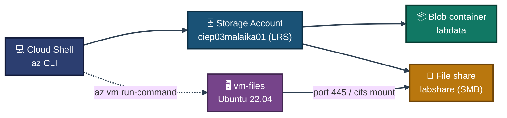
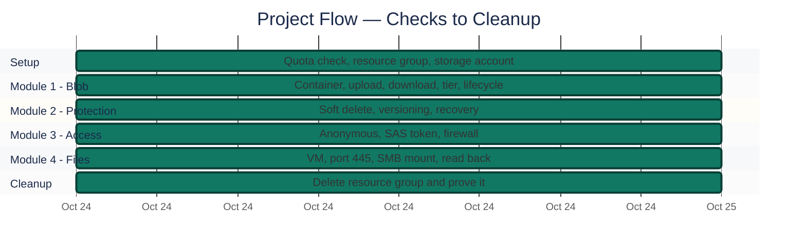
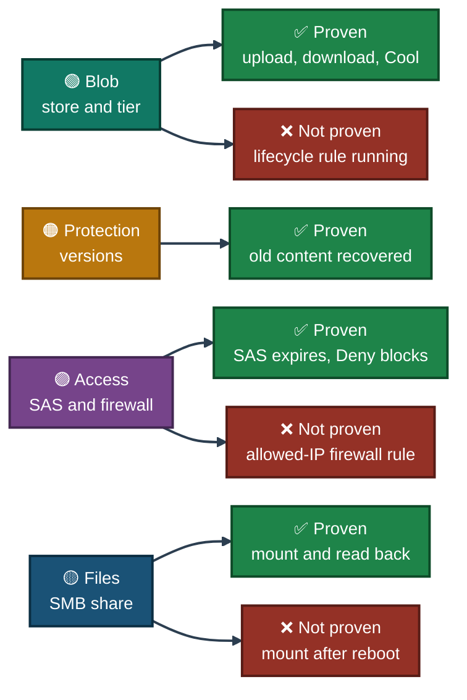
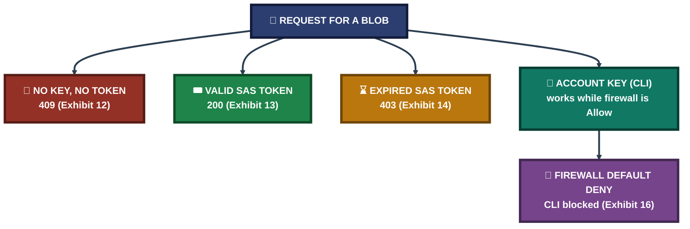

<div align="center">

# 🗄️ Azure Storage Services

**Project 03 of 6 — Cloud Infrastructure Engineering**

Blob Storage, Azure Files and Storage Security (Azure CLI)


One storage account built from the command line and tested in four ways: store and tier data, protect it from deletion, control who can read it (anonymous, SAS token, firewall), and share a folder with a Linux VM over SMB. Each result is backed by a screenshot, and every limit of the lab is written down.

### [📑 Open the visual index](Storage-INDEX.md)

</div>

---

## 📑 Table of Contents

1. [At a Glance](#at-a-glance)
2. [Project Background](#project-background)
3. [Environment](#environment)
4. [Project Flow](#project-flow)
5. [Setup — Checks and Resource Group](#setup)
6. [Blob Storage — Store and Tier Data](#blob)
7. [Data Protection — Soft Delete and Versioning](#protection)
8. [Access Control — Anonymous, SAS and Firewall](#access)
9. [Azure Files — Share on a Linux VM](#files)
10. [Cleanup](#cleanup)
11. [Coverage Snapshot](#coverage-snapshot)
12. [Access Layers](#access-layers)
13. [Challenges & Fixes](#challenges-fixes)
14. [Scope & Limitations](#scope-limitations)
15. [What I Learned](#what-i-learned)
16. [Skills Demonstrated](#skills-demonstrated)
17. [Screenshot Index](#screenshot-index)
18. [Repo Structure](#repo-structure)

---

<a id="at-a-glance"></a>
## 📊 At a Glance

| 🧩 Modules | 🪜 Steps | 🖼️ Screenshots | 🗄️ Storage Services | 🧹 Cleanup |
|:---:|:---:|:---:|:---:|:---:|
| **4** | **26** | **25** | **Blob + Azure Files** | **Group deleted and proven** |

---

<a id="project-background"></a>
## 📖 Project Background

Every cloud workload needs somewhere to keep files. Azure Storage gives object storage (Blob) and a shared network folder (Azure Files) in one account. The risk is in the settings: who can read the data, what happens when a file is deleted, and which networks can reach it. This project builds one account and tests those settings with real commands.

- **Module 1 — Blob Storage:** Create a private container, upload and download a file, move it to the Cool tier, and add a lifecycle rule.
- **Module 2 — Data Protection:** Turn on soft delete and versioning, overwrite a file, delete it, and get the old content back.
- **Module 3 — Access Control:** Show that an anonymous request fails, a time-limited SAS token works and then expires, and the storage firewall blocks the CLI when the default action is Deny.
- **Module 4 — Azure Files:** Create an SMB share, confirm port 445 is reachable from an Azure VM, mount the share on the VM, and read the VM's file back from Cloud Shell.

> [!NOTE]
> Items that I ran but did not screenshot are marked 📝, and the text says which exhibit proves the result. Checks that did not end in a result I could prove are listed in [Scope & Limitations](#scope-limitations).

<div align="center">

### 🧩 Lab Setup at a Glance

<table>
<tr>
<td align="center" valign="top" width="42%">

-0078D4?style=for-the-badge&logo=microsoftazure&logoColor=white)

**Management Machine**<br>
<sub>Azure CLI in the browser<br>Prompt <code>malaika [ ~ ]</code></sub>

</td>
<td align="center" valign="middle" width="16%">

**➜**<br>
<sub>az commands</sub>

</td>
<td align="center" valign="top" width="42%">


**Storage Account (LRS)**<br>
<sub>Container <code>labdata</code><br>File share <code>labshare</code></sub>

</td>
</tr>
<tr>
<td colspan="3" align="center">

**Linux VM <code>vm-files</code>** (Ubuntu 22.04, Standard_B2ls_v2)<br>
<sub>Tests port 445 and mounts the share with SMB</sub>

</td>
</tr>
</table>

</div>

---

<a id="environment"></a>
## 🖧 Environment

| Item | Value |
|---|---|
| **Cloud** | Microsoft Azure (Azure for Students subscription) |
| **Region** | `indiasouthcentral` |
| **Resource Group** | `rg-cie-p03-storage` |
| **Tags** | `project=cie-p03`, `owner=malaika`, `env=lab` |
| **Storage Account** | `ciep03malaika01`, StorageV2, `Standard_LRS`, Hot tier, minimum TLS 1.2, public blob access off |
| **Blob Container** | `labdata` (private) |
| **File Share** | `labshare`, SMB, 5 GiB quota |
| **VM** | `vm-files`, `Standard_B2ls_v2`, Ubuntu 22.04.4 LTS, private IP `10.0.0.4` |
| **Tools** | Azure CLI in Cloud Shell, `curl`, `cifs-utils` on the VM |
| **Work Date** | Oct 24, 2026 |

> [!IMPORTANT]
> Public IP addresses and the subscription ID are blurred in the screenshots. The account key was never typed or pasted by hand in the final mount command (Exhibit 23). It was kept in a shell variable.

### 🗺️ Lab Layout


<p align="center"><em>The diagram shows the lab layout, it is not a screenshot. Facts come from Exhibits 3, 4, 18, 21 and 23.</em></p>

---

<a id="project-flow"></a>
## ⏱️ Project Flow


<p align="center"><em>Colors distinguish each stage — all stages complete. Everything was done on one day. Clock times are left out because only some screenshots show them.</em></p>

---

<a id="setup"></a>
## 🔵 Setup — Checks and Resource Group

**Objective:** Make sure there is enough vCPU quota for one VM, and create a tagged resource group that holds everything in this project.

### Step 1 — Check the vCPU quota ✅

```
az vm list-usage --location indiasouthcentral --query "[?name.value=='cores'].{Used:currentValue, Limit:limit}" -o table
```

<p align="center">
  <br>
  <em>Exhibit 1 — Regional vCPU quota: <code>Used 2</code>, <code>Limit 6</code>. One 2-core VM fits</em>
</p>

### Step 2 — Check name, provider and VM size 📝

I also ran three other checks before building. None has a screenshot in this repo.

```
az storage account check-name --name ciep03malaika01 -o json
az provider show --namespace Microsoft.Storage --query registrationState -o tsv
az vm list-skus --location indiasouthcentral --size Standard_B2ls_v2 --query "[].{Name:name, Restriction:restrictions[0].reasonCode}" -o table
```

- The name check returned `nameAvailable: true` 📝
- The provider check returned `Registered` 📝
- The VM size was listed with no restriction column 📝 (the real proof is Exhibit 18, where the VM was created)

### Step 3 — Create the resource group with tags ✅

```
az group create --name rg-cie-p03-storage --location indiasouthcentral --tags project=cie-p03 owner=malaika env=lab
```

<p align="center">
  <br>
  <em>Exhibit 2 — <code>provisioningState: Succeeded</code> with the three tags (subscription ID blurred)</em>
</p>

---

<a id="blob"></a>
## 🟢 Module 1 — Blob Storage: Store and Tier Data

**Objective:** Create the storage account, put a file in a private container, read it back, and set two cost controls: the Cool tier and a lifecycle rule.

### Step 4 — Create the storage account (LRS) ✅

```
az storage account create --name ciep03malaika01 --resource-group rg-cie-p03-storage --location indiasouthcentral --sku Standard_LRS --kind StorageV2 --access-tier Hot --min-tls-version TLS1_2 --allow-blob-public-access false --tags project=cie-p03 owner=malaika env=lab
```

<p align="center">
  <br>
  <em>Exhibit 3 — <code>az storage account show</code>: <code>Standard_LRS</code>, <code>Succeeded</code>, Hot tier, TLS 1.2, <code>PublicBlob: false</code>, three tags. The long create output was not screenshotted 📝</em>
</p>

### Step 5 — Create a private container ✅

```
az storage container create --account-name ciep03malaika01 --name labdata --public-access off --auth-mode key -o json
```

<p align="center">
  <br>
  <em>Exhibit 4 — <code>"created": true</code>. The yellow text is the CLI saying it fetched the account key itself because <code>--auth-mode key</code> was used</em>
</p>

### Step 6 — Upload a file ✅

```
echo "hello from cie p03" > test1.txt && az storage blob upload --account-name ciep03malaika01 --container-name labdata --name test1.txt --file test1.txt --auth-mode key --only-show-errors -o json
```

<p align="center">
  <br>
  <em>Exhibit 5 — Upload finished at 100%, with an <code>etag</code> and <code>lastModified</code>. <code>request_server_encrypted: true</code>. <code>version_id: null</code> because versioning was not on yet</em>
</p>

### Step 7 — Download the file and read it ✅

```
az storage blob download --account-name ciep03malaika01 --container-name labdata --name test1.txt --file test1-down.txt --auth-mode key --only-show-errors -o none && cat test1-down.txt
```

<p align="center">
  <br>
  <em>Exhibit 6 — The downloaded file contains <code>hello from cie p03</code>, the same text that was uploaded. The file landed on Cloud Shell's own disk</em>
</p>

### Step 8 — Move the blob to the Cool tier ✅

```
az storage blob set-tier --account-name ciep03malaika01 --container-name labdata --name test1.txt --tier Cool --auth-mode key --only-show-errors
```

<p align="center">
  <br>
  <em>Exhibit 7 — <code>az storage blob show</code> reports <code>Tier: Cool</code> for <code>test1.txt</code></em>
</p>

### Step 9 — Add a lifecycle management rule ✅

```
az storage account management-policy create --account-name ciep03malaika01 -g rg-cie-p03-storage --policy '{"rules":[{"enabled":true,"name":"cool-then-delete","type":"Lifecycle","definition":{"filters":{"blobTypes":["blockBlob"],"prefixMatch":["labdata/"]},"actions":{"baseBlob":{"tierToCool":{"daysAfterModificationGreaterThan":30},"delete":{"daysAfterModificationGreaterThan":365}}}}}]}'
```

<p align="center">
  <br>
  <em>Exhibit 8 — Rule <code>cool-then-delete</code> is enabled: Cool after 30 days, delete after 365 days. The rule was created, it was not seen running (see Limitations)</em>
</p>

---

<a id="protection"></a>
## 🟠 Module 2 — Data Protection: Soft Delete and Versioning

**Objective:** Make a delete recoverable, then prove it by getting an old version back.

### Step 10 — Turn on soft delete and versioning ✅

```
az storage account blob-service-properties update --account-name ciep03malaika01 -g rg-cie-p03-storage --enable-delete-retention true --delete-retention-days 7 --enable-versioning true --query "{SoftDelete:deleteRetentionPolicy, Versioning:isVersioningEnabled}" -o json
```

<p align="center">
  <br>
  <em>Exhibit 9 — Soft delete <code>enabled: true</code>, <code>days: 7</code>, and <code>Versioning: true</code>. <code>allowPermanentDelete</code> shows <code>null</code></em>
</p>

### Step 11 — Overwrite the file and list the versions ✅

```
echo "version two" > test1.txt && az storage blob upload --account-name ciep03malaika01 --container-name labdata --name test1.txt --file test1.txt --overwrite true --auth-mode key --only-show-errors -o none && az storage blob list --account-name ciep03malaika01 --container-name labdata --include v --auth-mode key --only-show-errors --query "[].{Name:name, VersionId:versionId, Current:isCurrentVersion}" -o table
```

<p align="center">
  <br>
  <em>Exhibit 10 — Two versions of <code>test1.txt</code>. The old one has the same time as the first upload in Exhibit 5 (17:18:28). The new one is marked <code>Current: True</code></em>
</p>

### Step 12 — Delete the blob, then recover the old version ✅

```
az storage blob delete --account-name ciep03malaika01 --container-name labdata --name test1.txt --auth-mode key --only-show-errors
```

📝 The delete command ran and its output was not saved in the repo. Exhibit 11 shows the result.

```
az storage blob list --account-name ciep03malaika01 --container-name labdata --auth-mode key --only-show-errors -o json && az storage blob download --account-name ciep03malaika01 --container-name labdata --name test1.txt --version-id <OLD_VERSION_ID> --file recovered.txt --auth-mode key --only-show-errors -o none && cat recovered.txt
```

<p align="center">
  <br>
  <em>Exhibit 11 — The normal list is empty (<code>[]</code>), so the blob is gone from view. Downloading the old version by its version ID still returns <code>hello from cie p03</code></em>
</p>

---

<a id="access"></a>
## 🟣 Module 3 — Access Control: Anonymous, SAS and Firewall

**Objective:** Check three ways of reaching blob data: no credentials, a time-limited SAS token, and the storage firewall.

### Step 13 — Request a blob with no credentials ✅

```
echo "sas test file" > sas-test.txt && az storage blob upload --account-name ciep03malaika01 --container-name labdata --name sas-test.txt --file sas-test.txt --auth-mode key --only-show-errors -o none && curl -s -o /dev/null -w "HTTP code: %{http_code}\n" https://ciep03malaika01.blob.core.windows.net/labdata/sas-test.txt
```

<p align="center">
  <br>
  <em>Exhibit 12 — A request with no key and no token returns <code>HTTP code: 409</code>, not 200. The reason for 409 was not investigated</em>
</p>

### Step 14 — Read the blob with a 3-minute SAS token ✅

```
SAS=$(az storage blob generate-sas --account-name ciep03malaika01 --container-name labdata --name sas-test.txt --permissions r --expiry $(date -u -d "+3 minutes" '+%Y-%m-%dT%H:%MZ') --https-only --auth-mode key -o tsv) && curl -s -w "\nHTTP code: %{http_code}\n" "https://ciep03malaika01.blob.core.windows.net/labdata/sas-test.txt?$SAS"
```

<p align="center">
  <br>
  <em>Exhibit 13 — The same blob now returns <code>sas test file</code> and <code>HTTP code: 200</code>. The token is read-only, for one blob, and is stored in <code>$SAS</code>, so it is not printed</em>
</p>

### Step 15 — Use the same token after it expires ✅

```
date -u '+Now (UTC): %Y-%m-%dT%H:%MZ'; curl -s -w "\nHTTP code: %{http_code}\n" "https://ciep03malaika01.blob.core.windows.net/labdata/sas-test.txt?$SAS"
```

<p align="center">
  <br>
  <em>Exhibit 14 — <code>HTTP code: 403</code>, <code>AuthenticationFailed</code>. The server message says the signed expiry time (17:31:00 GMT) is not after the request time (17:31:43)</em>
</p>

📝 A first re-test a few minutes earlier still returned 200, because the token had not expired yet. I then compared the token's expiry time with the clock and repeated the request after expiry. That first re-test and the clock comparison have no screenshot in this repo.

### Step 16 — Turn the storage firewall to Deny ✅

```
az storage account update -n ciep03malaika01 -g rg-cie-p03-storage --default-action Deny --query "{DefaultAction:networkRuleSet.defaultAction, IpRules:networkRuleSet.ipRules}" -o json
```

<p align="center">
  <br>
  <em>Exhibit 15 — <code>DefaultAction: Deny</code> and <code>IpRules: []</code>. No address is allowed</em>
</p>

### Step 17 — Try to list blobs while the firewall is Deny ✅

```
az storage blob list --account-name ciep03malaika01 --container-name labdata --auth-mode key --only-show-errors -o table 2>&1 | cut -c1-150 | head -8
```

<p align="center">
  <br>
  <em>Exhibit 16 — No blob list. The CLI reports that the request may be blocked by the storage account's network rules (the tool's own wording)</em>
</p>

### Step 18 — Set the firewall back to Allow ✅

```
az storage account update -n ciep03malaika01 -g rg-cie-p03-storage --default-action Allow --query "networkRuleSet.defaultAction" -o tsv && sleep 30 && az storage blob list --account-name ciep03malaika01 --container-name labdata --auth-mode key --only-show-errors --query "[].name" -o tsv
```

<p align="center">
  <br>
  <em>Exhibit 17 — <code>Allow</code>, then the list works again and shows <code>sas-test.txt</code></em>
</p>

---

<a id="files"></a>
## 🟡 Module 4 — Azure Files: Share on a Linux VM

**Objective:** Create an SMB file share, reach it from a VM on port 445, mount it, and show that a file written by the VM can be read from a different machine.

### Step 19 — Create the VM ✅

```
az vm create -g rg-cie-p03-storage -n vm-files --image Ubuntu2204 --size Standard_B2ls_v2 --admin-username azureuser --authentication-type ssh --ssh-key-values "<PUBLIC_KEY_TEXT>" --nsg-rule NONE --public-ip-sku Standard --tags project=cie-p03 owner=malaika env=lab --query "{PowerState:powerState, ResourceGroup:resourceGroup, PrivateIp:privateIpAddress}" -o json
```

<p align="center">
  <br>
  <em>Exhibit 18 — <code>PowerState: VM running</code>, private IP <code>10.0.0.4</code>. The command line shows the public key only. The private key stays on my laptop</em>
</p>

### Step 20 — Allow SSH from my own IP only ✅

```
az network nsg rule create -g rg-cie-p03-storage --nsg-name vm-filesNSG -n allow-ssh-myip --priority 100 --direction Inbound --access Allow --protocol Tcp --destination-port-ranges 22 --source-address-prefixes <MY_PUBLIC_IP> --query "{Name:name, Access:access, Port:destinationPortRange, Source:sourceAddressPrefix}" -o json
```

<p align="center">
  <br>
  <em>Exhibit 19 — Rule <code>allow-ssh-myip</code>: Allow, port 22, one source address (my IP, blurred). Before this, the NSG <code>vm-filesNSG</code> had 0 rules 📝</em>
</p>

### Step 21 — Connect over SSH and install SMB tools ✅

From Laptop PowerShell:

```
ssh -i "$HOME\.ssh\cie_p02_key" azureuser@<VM_PUBLIC_IP>
```

<p align="center">
  <br>
  <em>Exhibit 20 — Prompt <code>azureuser@vm-files:~$</code>, Ubuntu 22.04.4 LTS, <code>eth0</code> address <code>10.0.0.4</code> (same as Exhibit 18). The public IP is blurred</em>
</p>

Then on the VM:

```
sudo apt-get update -qq && sudo apt-get install -y -qq cifs-utils && dpkg -l cifs-utils | tail -1
```

📝 This ran and showed `ii cifs-utils` (installed). There is no screenshot for it in this repo. Exhibit 23 is the working proof, because a `cifs` mount needs this package.

### Step 22 — Create the file share ✅

```
az storage share-rm create --storage-account ciep03malaika01 -g rg-cie-p03-storage --name labshare --quota 5 --enabled-protocols SMB --query "{Name:name, QuotaGiB:shareQuota, Protocols:enabledProtocols}" -o json
```

<p align="center">
  <br>
  <em>Exhibit 21 — Share <code>labshare</code>, protocol <code>SMB</code>, quota 5 GiB</em>
</p>

### Step 23 — Test port 445 from the VM ✅

On the VM:

```
timeout 5 bash -c '</dev/tcp/ciep03malaika01.file.core.windows.net/445' && echo "Port 445: OPEN" || echo "Port 445: CLOSED or timed out"
```

<p align="center">
  <br>
  <em>Exhibit 22 — <code>Port 445: OPEN</code> from <code>vm-files</code>. This test ran on the Azure VM, not on my home network</em>
</p>

### Step 24 — Mount the share and write a file ✅

From Cloud Shell, using `az vm run-command`, so the key stays in a variable and nothing secret is printed:

```
K=$(az storage account keys renew -g rg-cie-p03-storage -n ciep03malaika01 --key key1 --query "[?keyName=='key1'].value | [0]" -o tsv) && az vm run-command invoke -g rg-cie-p03-storage -n vm-files --command-id RunShellScript --scripts "hostname; mkdir -p /mnt/labshare; mount -t cifs //ciep03malaika01.file.core.windows.net/labshare /mnt/labshare -o username=ciep03malaika01,password='$K',serverino,vers=3.1.1; echo 'hello from vm-files' > /mnt/labshare/from-vm.txt; ls -l /mnt/labshare; df -hT /mnt/labshare" --query "value[0].message" -o tsv
```

<p align="center">
  <br>
  <em>Exhibit 23 — Hostname <code>vm-files</code>, file <code>from-vm.txt</code> (20 bytes), and <code>df</code> shows type <code>cifs</code>, 5.0G, mounted on <code>/mnt/labshare</code>. <code>[stderr]</code> is empty</em>
</p>

The command first renews `key1`, so any key shown in earlier output no longer works. The prompt here is Cloud Shell's, because the mount ran through `run-command`, not through the SSH window. The hostname line is what shows that it ran on the VM.

### Step 25 — Read the VM's file from Cloud Shell ✅

```
az storage file list --account-name ciep03malaika01 --share-name labshare --auth-mode key --only-show-errors --query "[].{Name:name, Size:properties.contentLength}" -o table && az storage file download --account-name ciep03malaika01 --share-name labshare --path from-vm.txt --dest . --auth-mode key --only-show-errors -o none && cat from-vm.txt
```

<p align="center">
  <br>
  <em>Exhibit 24 — The share lists <code>from-vm.txt</code> (20 bytes). The downloaded content is <code>hello from vm-files</code>, the text the VM wrote in Exhibit 23</em>
</p>

---

<a id="cleanup"></a>
## 🧹 Cleanup

### Step 26 — Delete the project's resource group and prove it ✅

```
az group delete --name rg-cie-p03-storage --yes && az group list --query "[].name" -o tsv
```

<p align="center">
  <br>
  <em>Exhibit 25 — <code>rg-cie-p03-storage</code> is not in the list. The four older resource groups are still there: <code>ForensicsCapstone-RG</code>, <code>osticket-rg</code>, <code>NetworkWatcherRG</code> and <code>sysadmin-labs</code></em>
</p>

This one command removed the storage account, the file share, the VM and everything else in the group. Details are in [`commands/cleanup.md`](commands/cleanup.md).

---

<a id="coverage-snapshot"></a>
## 🌟 Coverage Snapshot

| 🛡️ Area | ✅ Status | 📌 Detail |
|---|---|---|
| Blob upload and download | Tested | Same text came back (Exhibits 5 and 6) |
| Access tier | Tested | `Cool` set and read back (Exhibit 7) |
| Lifecycle rule | Created only | Rule is saved and enabled, its action was not seen (Exhibit 8) |
| Soft delete and versioning | Tested | Two versions, deleted blob, old content recovered (Exhibits 9 to 11) |
| Anonymous access | Tested | Request returned 409, not 200 (Exhibit 12) |
| SAS token | Tested | 200 before expiry, 403 after (Exhibits 13 and 14) |
| Storage firewall | Partly tested | Default Deny blocked the CLI, Allow restored it. No IP allow-rule was tested (Exhibits 15 to 17) |
| Azure Files over SMB | Tested | Port 445 open, mounted, file read back from another machine (Exhibits 22 to 24) |
| Redundancy options | Not tested | Only LRS was built |

### 🧾 What the Evidence Proves



---

<a id="access-layers"></a>
## 🔐 Access Layers

Which request got through at each point of the test


<p align="center"><em>Summary of Exhibits 12 to 17. The SAS requests used <code>curl</code>. The firewall test used the CLI with the account key.</em></p>

---

<a id="challenges-fixes"></a>
## ⚠️ Challenges & Fixes

| ❌ Challenge | ✅ Fix |
|---|---|
| A first re-test of the SAS token still returned 200 📝 | The token had not expired yet. I compared its expiry time with the clock, waited, and repeated the request. Result in Exhibit 14 |
| My first firewall test used a `grep` filter on the error text and printed nothing 📝 | Ran the same command without the filter and read the real message (Exhibit 16) |
| Downloading from the file share failed with `No such file or directory` 📝 | I had given `--dest` a file name, and the tool treated it as a folder. Using `--dest .` worked (Exhibit 24) |
| The account key was printed on screen in two early screenshots 📝 | Those screenshots are not in this repo. I renewed `key1`, and the mount command in Exhibit 23 keeps the key in a variable so nothing is printed |
| The `blob list` table did not show empty columns, so a missing value could not be proven 📝 | Used JSON output where an empty value was the proof (Exhibit 11) |

<sub>📝 = no screenshot of this item is in the repo.</sub>

---

<a id="scope-limitations"></a>
## 🚧 Scope & Limitations

- **Lifecycle rule not seen running:** Exhibit 8 shows the rule exists. It acts after 30 and 365 days, so its effect could not be tested in one day.
- **No allowed-IP firewall rule:** The firewall was tested only with default Deny and default Allow. A rule that allows one address was not added.
- **SSH from a blocked address:** The SSH rule allows one IP. A connection from a different address was not tried.
- **Mount not permanent:** The share was mounted by hand. It was not added to `/etc/fstab`, and a reboot was not tested.
- **Firewall Deny and Azure Files:** Whether the mount works while the firewall is Deny was not tested.
- **Port 445 from outside Azure:** It was tested from the VM only, not from my home network.
- **Azure Files from Windows:** Only a Linux mount was done.
- **Redundancy:** Only LRS was built. Other redundancy options were not created or compared.
- **SAS type:** The SAS token was signed with the account key. A user delegation SAS (Entra ID) was not tried.
- **Cost:** The effect of the Cool tier on the bill was not measured, and no price is claimed.
- **Tags:** Tags were checked on the resource group and the storage account. Whether they were applied to the VM's disk, network card and public IP was not checked.
- **409 response:** I did not look into why the anonymous request returned 409 and not another code.
- **The 📝 items:** Marked in the text, with no screenshot in the repo.

These gaps are marked in the project instead of being hidden, so the results show what was actually proven.

---

<a id="what-i-learned"></a>
## 🧠 What I Learned

- **Check the quota before the VM.** A 2-core VM only fits if the region has 2 cores free. One command tells me before I build.
- **Private by default is a setting, not a promise.** `--public-access off` and `--allow-blob-public-access false` were set when I created the account and the container. The proof was a request without credentials that did not return 200.
- **A SAS token is a key with a clock.** It gave access with 200 and stopped with 403 after its expiry time, with no change on the account.
- **Versioning is what makes a delete recoverable.** With versioning on, an overwrite kept the old content, and I could download it by its version ID even after the blob was deleted.
- **A firewall change takes a short time to apply.** I added a `sleep 30` before testing instead of guessing.
- **Keep secrets out of the terminal output.** Putting the key in a variable and using `az vm run-command` mounted the share without printing the key.
- **Show where a command ran.** The hostname line in Exhibit 23 is the proof that it ran on `vm-files`.
- **A screenshot must show the claim.** If it does not show the result, the item is marked 📝 or goes in Limitations.

---

<a id="skills-demonstrated"></a>
## 🛠️ Skills Demonstrated

- Creating and tagging Azure resources from the Azure CLI
- Building a storage account with a chosen redundancy (LRS), TLS version and public-access setting
- Working with Blob Storage: containers, upload and download, access tiers, lifecycle rules
- Using soft delete and blob versioning to recover deleted data
- Comparing anonymous access, account keys and SAS tokens, and testing SAS expiry with `curl`
- Using the storage firewall and reading its effect
- Creating an Azure Files share and mounting it on Linux over SMB (`cifs`)
- Opening one SSH port to one IP in a network security group
- Running commands on a VM with `az vm run-command`
- Checking vCPU quota before creating a VM
- Cleaning up with a single resource group delete and proving it
- Separating proven results from notes and limits in project documentation

---

<a id="screenshot-index"></a>
## 🖼️ Screenshot Index

| # | File | Shows |
|:---:|---|---|
| 1 | `ss-01-quota-check.PNG` | vCPU quota: 2 used of 6 |
| 2 | `ss-02-resource-group-created.PNG` | Resource group created with tags |
| 3 | `ss-03-storage-account-lrs.PNG` | Storage account settings (LRS, Hot, TLS 1.2) |
| 4 | `ss-04-blob-container-created.PNG` | Container `labdata` created |
| 5 | `ss-05-blob-upload.PNG` | Blob upload result |
| 6 | `ss-06-blob-download.PNG` | Download and content check |
| 7 | `ss-07-access-tier-cool.PNG` | Blob tier set to Cool |
| 8 | `ss-08-lifecycle-rule.PNG` | Lifecycle rule created |
| 9 | `ss-09-soft-delete-versioning.PNG` | Soft delete (7 days) and versioning on |
| 10 | `ss-10-two-versions.PNG` | Two versions after an overwrite |
| 11 | `ss-11-delete-and-recover.PNG` | Empty list after delete, old version recovered |
| 12 | `ss-12-anonymous-request-409.PNG` | Anonymous request returns 409 |
| 13 | `ss-13-sas-token-200.PNG` | SAS token request returns 200 |
| 14 | `ss-14-sas-expired-403.PNG` | Expired SAS token returns 403 |
| 15 | `ss-15-firewall-deny.PNG` | Firewall default action set to Deny |
| 16 | `ss-16-firewall-blocked.PNG` | CLI blocked by network rules |
| 17 | `ss-17-firewall-allow.PNG` | Firewall back to Allow, list works |
| 18 | `ss-18-vm-created.PNG` | VM `vm-files` running |
| 19 | `ss-19-nsg-ssh-rule.PNG` | SSH allowed from one IP (blurred) |
| 20 | `ss-20-ssh-connected.PNG` | SSH session on `vm-files` |
| 21 | `ss-21-azure-files-share.PNG` | File share `labshare` (SMB, 5 GiB) |
| 22 | `ss-22-port-445-open.PNG` | Port 445 open from the VM |
| 23 | `ss-23-share-mounted-via-run-command.PNG` | Share mounted, `from-vm.txt` written |
| 24 | `ss-24-file-read-from-cloud-shell.PNG` | File listed and read from Cloud Shell |
| 25 | `ss-25-cleanup-proof.PNG` | Resource group gone, older groups still there |

---

<a id="repo-structure"></a>
## 📁 Repo Structure

```text
Cloud-Infrastructure-Engineering/
`-- Azure/
    `-- 03-azure-storage-services/
        |-- README.md
        |-- Storage-INDEX.md
        |-- commands/
        |   |-- commands.md
        |   `-- cleanup.md
        `-- Screenshots/
            |-- ss-01-quota-check.PNG
            |-- ss-02-resource-group-created.PNG
            |-- ss-03-storage-account-lrs.PNG
            |-- ss-04-blob-container-created.PNG
            |-- ss-05-blob-upload.PNG
            |-- ss-06-blob-download.PNG
            |-- ss-07-access-tier-cool.PNG
            |-- ss-08-lifecycle-rule.PNG
            |-- ss-09-soft-delete-versioning.PNG
            |-- ss-10-two-versions.PNG
            |-- ss-11-delete-and-recover.PNG
            |-- ss-12-anonymous-request-409.PNG
            |-- ss-13-sas-token-200.PNG
            |-- ss-14-sas-expired-403.PNG
            |-- ss-15-firewall-deny.PNG
            |-- ss-16-firewall-blocked.PNG
            |-- ss-17-firewall-allow.PNG
            |-- ss-18-vm-created.PNG
            |-- ss-19-nsg-ssh-rule.PNG
            |-- ss-20-ssh-connected.PNG
            |-- ss-21-azure-files-share.PNG
            |-- ss-22-port-445-open.PNG
            |-- ss-23-share-mounted-via-run-command.PNG
            |-- ss-24-file-read-from-cloud-shell.PNG
            `-- ss-25-cleanup-proof.PNG
```

<div align="center">

☁️ **[Microsoft Azure](https://azure.microsoft.com)** · 🗄️ **[Azure Storage documentation](https://learn.microsoft.com/azure/storage/)** · 🔐 **[Access Layers](#access-layers)**

</div>
