

# 🗄️ Project 03 — Index
### Azure Storage Services
**Project 03 of 6 — Cloud Infrastructure Engineering**

**Quick guide to every step and screenshot in this project.**

### [📖 Open the full README](README.md)

---

| 🧩 Modules | 🪜 Steps | 🖼️ Screenshots |
|:---:|:---:|:---:|
| **4** | **26** | **25** |

🧩 <b>Lab:</b> one storage account (LRS) · private blob container · Azure Files share · one Ubuntu VM · resource group deleted at the end

---

## 📑 Step Index

| # | Step | Module | Result | Evidence |
|:---:|---|:---:|---|:---:|
| 1 | Check the vCPU quota | 🔵 Setup | 2 used of 6 | [Exhibit 1](#ex1) |
| 2 | Check name, provider, VM size | 🔵 Setup | Run, no screenshot 📝 | — |
| 3 | Create the resource group | 🔵 Setup | `Succeeded`, three tags | [Exhibit 2](#ex2) |
| 4 | Create the storage account | 🟢 Module 1 | `Standard_LRS`, TLS 1.2, no public blob access | [Exhibit 3](#ex3) |
| 5 | Create a private container | 🟢 Module 1 | `labdata` created | [Exhibit 4](#ex4) |
| 6 | Upload a file | 🟢 Module 1 | Upload finished, encrypted on the server | [Exhibit 5](#ex5) |
| 7 | Download and read it | 🟢 Module 1 | Same text came back | [Exhibit 6](#ex6) |
| 8 | Set the Cool tier | 🟢 Module 1 | `Tier: Cool` | [Exhibit 7](#ex7) |
| 9 | Add a lifecycle rule | 🟢 Module 1 | Cool at 30 days, delete at 365 | [Exhibit 8](#ex8) |
| 10 | Soft delete and versioning | 🟠 Module 2 | 7 days, versioning on | [Exhibit 9](#ex9) |
| 11 | Overwrite and list versions | 🟠 Module 2 | Two versions of `test1.txt` | [Exhibit 10](#ex10) |
| 12 | Delete, then recover | 🟠 Module 2 | Old version returned | [Exhibit 11](#ex11) |
| 13 | Request with no credentials | 🟣 Module 3 | HTTP 409, not 200 | [Exhibit 12](#ex12) |
| 14 | Request with a SAS token | 🟣 Module 3 | HTTP 200 | [Exhibit 13](#ex13) |
| 15 | Use the token after expiry | 🟣 Module 3 | HTTP 403 | [Exhibit 14](#ex14) |
| 16 | Firewall default Deny | 🟣 Module 3 | `DefaultAction: Deny` | [Exhibit 15](#ex15) |
| 17 | List blobs while Deny | 🟣 Module 3 | CLI blocked by network rules | [Exhibit 16](#ex16) |
| 18 | Firewall back to Allow | 🟣 Module 3 | List works again | [Exhibit 17](#ex17) |
| 19 | Create the VM | 🟡 Module 4 | `vm-files` running, `10.0.0.4` | [Exhibit 18](#ex18) |
| 20 | SSH rule for my IP only | 🟡 Module 4 | Port 22, one source (blurred) | [Exhibit 19](#ex19) |
| 21 | Connect over SSH | 🟡 Module 4 | Ubuntu 22.04.4 LTS | [Exhibit 20](#ex20) |
| 22 | Create the file share | 🟡 Module 4 | `labshare`, SMB, 5 GiB | [Exhibit 21](#ex21) |
| 23 | Test port 445 from the VM | 🟡 Module 4 | `Port 445: OPEN` | [Exhibit 22](#ex22) |
| 24 | Mount the share, write a file | 🟡 Module 4 | `cifs` mount, `from-vm.txt` | [Exhibit 23](#ex23) |
| 25 | Read the file from Cloud Shell | 🟡 Module 4 | `hello from vm-files` | [Exhibit 24](#ex24) |
| 26 | Delete the resource group | 🧹 Cleanup | Group gone, 4 older groups remain | [Exhibit 25](#ex25) |

---

## 🔵 Setup

Exhibits 1 to 2.

<table>
<tr>
<td align="center" valign="top" width="50%">

<a href="Screenshots/ss-01-quota-check.PNG">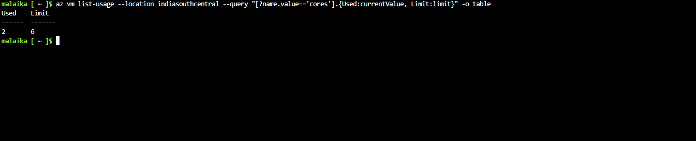</a>
 <b>Exhibit 1 — vCPU quota</b>
 Used 2, Limit 6
</td>
<td align="center" valign="top" width="50%">

<a href="Screenshots/ss-02-resource-group-created.PNG">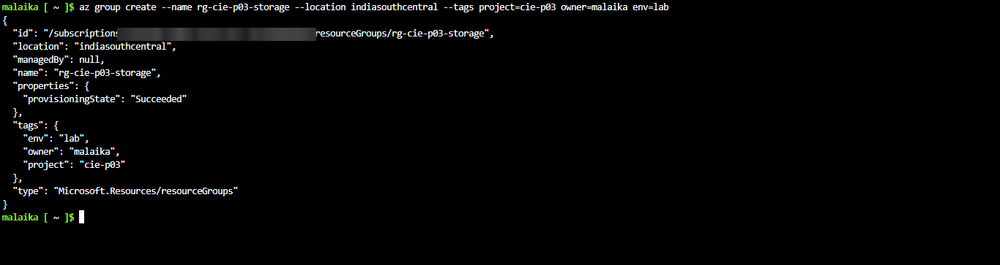</a>
 <b>Exhibit 2 — Resource group</b>
 Succeeded, three tags
</td>
</tr>
</table>

---

## 🟢 Module 1 — Blob Storage

Exhibits 3 to 8.

<table>
<tr>
<td align="center" valign="top" width="50%">

<a href="Screenshots/ss-03-storage-account-lrs.PNG">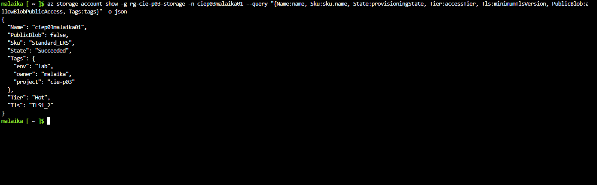</a>
 <b>Exhibit 3 — Storage account</b>
 LRS, Hot, TLS 1.2, public blob off
</td>
<td align="center" valign="top" width="50%">

<a href="Screenshots/ss-04-blob-container-created.PNG">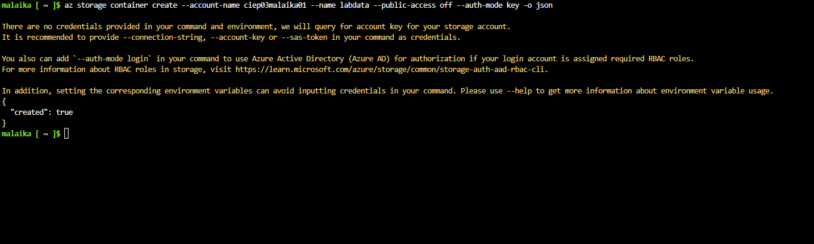</a>
 <b>Exhibit 4 — Container created</b>
 <code>labdata</code>, <code>created: true</code>
</td>
</tr>
<tr>
<td align="center" valign="top" width="50%">

<a href="Screenshots/ss-05-blob-upload.PNG">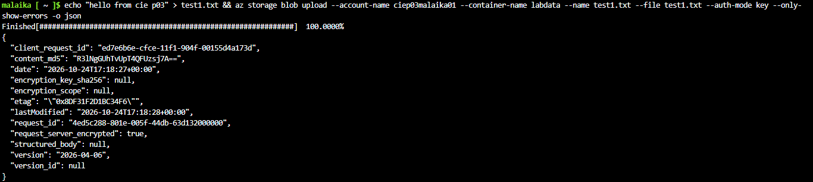</a>
 <b>Exhibit 5 — Blob upload</b>
 Finished at 100%, etag returned
</td>
<td align="center" valign="top" width="50%">

<a href="Screenshots/ss-06-blob-download.PNG">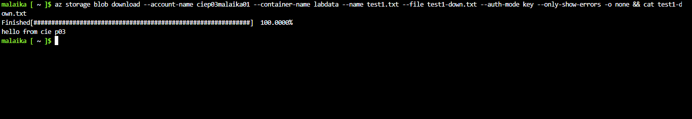</a>
 <b>Exhibit 6 — Blob download</b>
 Content matches the upload
</td>
</tr>
<tr>
<td align="center" valign="top" width="50%">

<a href="Screenshots/ss-07-access-tier-cool.PNG">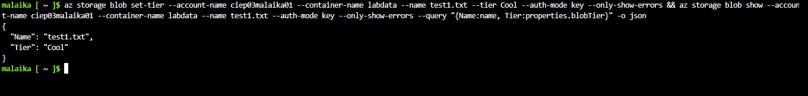</a>
 <b>Exhibit 7 — Cool tier</b>
 <code>Tier: Cool</code>
</td>
<td align="center" valign="top" width="50%">

<a href="Screenshots/ss-08-lifecycle-rule.PNG">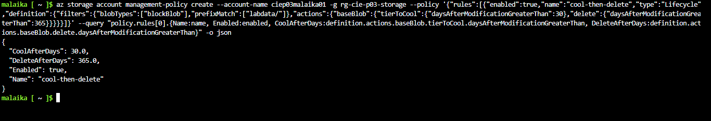</a>
 <b>Exhibit 8 — Lifecycle rule</b>
 30 days to Cool, 365 days to delete
</td>
</tr>
</table>

---

## 🟠 Module 2 — Data Protection

Exhibits 9 to 11.

<table>
<tr>
<td align="center" valign="top" width="50%">

<a href="Screenshots/ss-09-soft-delete-versioning.PNG">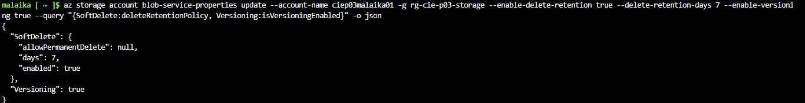</a>
 <b>Exhibit 9 — Soft delete and versioning</b>
 7 days, versioning true
</td>
<td align="center" valign="top" width="50%">

<a href="Screenshots/ss-10-two-versions.PNG">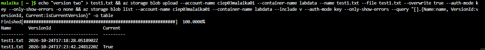</a>
 <b>Exhibit 10 — Two versions</b>
 Old version and the current one
</td>
</tr>
<tr>
<td align="center" valign="top" width="50%">

<a href="Screenshots/ss-11-delete-and-recover.PNG">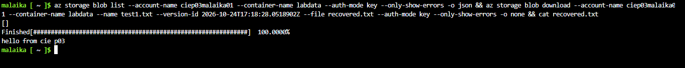</a>
 <b>Exhibit 11 — Delete and recover</b>
 Empty list, old content returned
</td>
<td></td>
</tr>
</table>

---

## 🟣 Module 3 — Access Control

Exhibits 12 to 17.

<table>
<tr>
<td align="center" valign="top" width="50%">

<a href="Screenshots/ss-12-anonymous-request-409.PNG">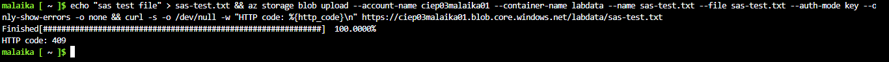</a>
 <b>Exhibit 12 — No credentials</b>
 HTTP 409
</td>
<td align="center" valign="top" width="50%">

<a href="Screenshots/ss-13-sas-token-200.PNG">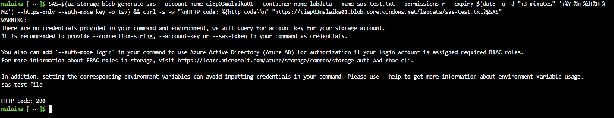</a>
 <b>Exhibit 13 — SAS token works</b>
 HTTP 200
</td>
</tr>
<tr>
<td align="center" valign="top" width="50%">

<a href="Screenshots/ss-14-sas-expired-403.PNG">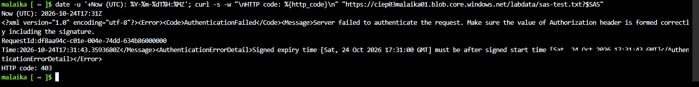</a>
 <b>Exhibit 14 — SAS token expired</b>
 HTTP 403, AuthenticationFailed
</td>
<td align="center" valign="top" width="50%">

<a href="Screenshots/ss-15-firewall-deny.PNG">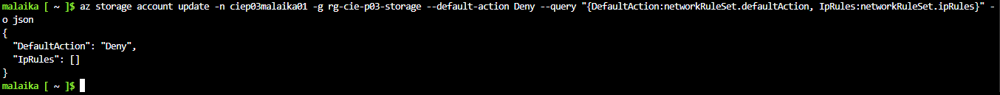</a>
 <b>Exhibit 15 — Firewall Deny</b>
 No IP rules
</td>
</tr>
<tr>
<td align="center" valign="top" width="50%">

<a href="Screenshots/ss-16-firewall-blocked.PNG">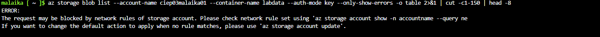</a>
 <b>Exhibit 16 — Request blocked</b>
 CLI reports network rules
</td>
<td align="center" valign="top" width="50%">

<a href="Screenshots/ss-17-firewall-allow.PNG">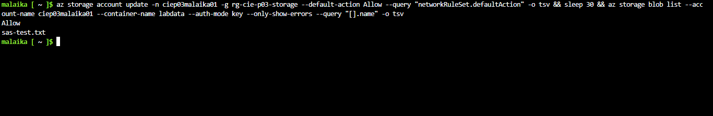</a>
 <b>Exhibit 17 — Firewall Allow</b>
 Blob list works again
</td>
</tr>
</table>

---

## 🟡 Module 4 — Azure Files

Exhibits 18 to 24.

<table>
<tr>
<td align="center" valign="top" width="50%">

<a href="Screenshots/ss-18-vm-created.PNG">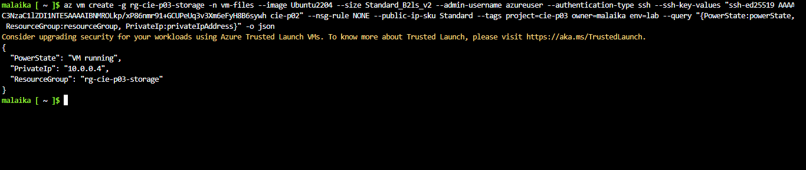</a>
 <b>Exhibit 18 — VM created</b>
 <code>vm-files</code>, private IP 10.0.0.4
</td>
<td align="center" valign="top" width="50%">

<a href="Screenshots/ss-19-nsg-ssh-rule.PNG">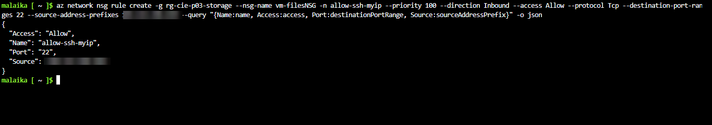</a>
 <b>Exhibit 19 — SSH rule</b>
 Port 22, one source (blurred)
</td>
</tr>
<tr>
<td align="center" valign="top" width="50%">

<a href="Screenshots/ss-20-ssh-connected.PNG">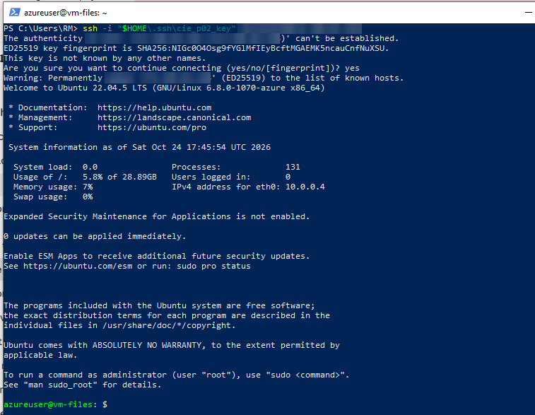</a>
 <b>Exhibit 20 — SSH connected</b>
 Ubuntu 22.04.4 LTS
</td>
<td align="center" valign="top" width="50%">

<a href="Screenshots/ss-21-azure-files-share.PNG">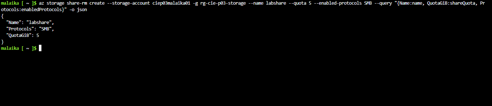</a>
 <b>Exhibit 21 — File share</b>
 <code>labshare</code>, SMB, 5 GiB
</td>
</tr>
<tr>
<td align="center" valign="top" width="50%">

<a href="Screenshots/ss-22-port-445-open.PNG">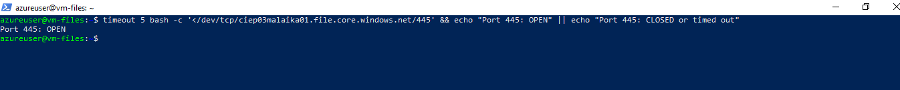</a>
 <b>Exhibit 22 — Port 445</b>
 OPEN from the VM
</td>
<td align="center" valign="top" width="50%">

<a href="Screenshots/ss-23-share-mounted-via-run-command.PNG">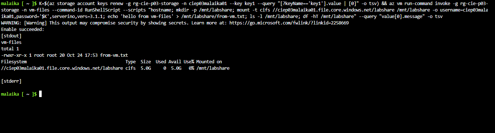</a>
 <b>Exhibit 23 — Share mounted</b>
 <code>cifs</code>, 5.0G, <code>from-vm.txt</code>
</td>
</tr>
<tr>
<td align="center" valign="top" width="50%">

<a href="Screenshots/ss-24-file-read-from-cloud-shell.PNG">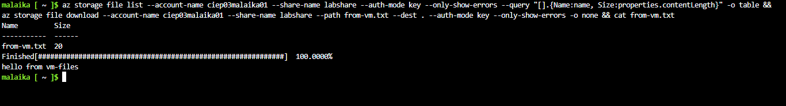</a>
 <b>Exhibit 24 — Read from Cloud Shell</b>
 <code>hello from vm-files</code>
</td>
<td></td>
</tr>
</table>

---

## 🧹 Cleanup

Exhibit 25.

<table>
<tr>
<td align="center" valign="top" width="50%">

<a href="Screenshots/ss-25-cleanup-proof.PNG">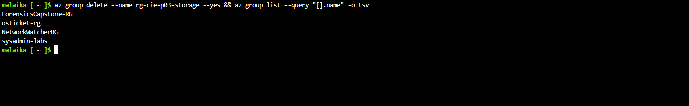</a>
 <b>Exhibit 25 — Cleanup proof</b>
 Project group gone, four older groups remain
</td>
<td></td>
</tr>
</table>

---

## 🎯 Verification Checklist

| Check | Method | Module | Status |
|:---:|---|---|:---:|
| Blob upload and download | Same text returned | Module 1 | ✅ Confirmed |
| Access tier set | `blob show` | Module 1 | ✅ Cool |
| Lifecycle rule exists | `management-policy create` output | Module 1 | ✅ Created |
| Lifecycle rule executes | Needs 30 days | Module 1 | ➖ Not seen |
| Deleted blob recovered | Version ID download | Module 2 | ✅ Confirmed |
| No-credential request fails | `curl` | Module 3 | ✅ 409 |
| SAS works, then expires | `curl` 200 then 403 | Module 3 | ✅ Confirmed |
| Firewall default Deny blocks | CLI error | Module 3 | ✅ Confirmed |
| Firewall allow-IP rule | Not part of this lab | Module 3 | ➖ Not attempted |
| SMB mount and read back | `df`, file list, download | Module 4 | ✅ Confirmed |
| Mount survives reboot | Not part of this lab | Module 4 | ➖ Not attempted |
| Project group deleted | `az group list` | Cleanup | ✅ Confirmed |

> [!NOTE]
> The public IP addresses and the subscription ID are blurred. Items marked 📝 in the README were run but have no screenshot in this repo.

---

[⬆️ Back to top](#top) &nbsp;·&nbsp; [📖 Full README](README.md)

☁️ **[Microsoft Azure](https://azure.microsoft.com)** · 🗄️ **[Azure Storage documentation](https://learn.microsoft.com/azure/storage/)**

