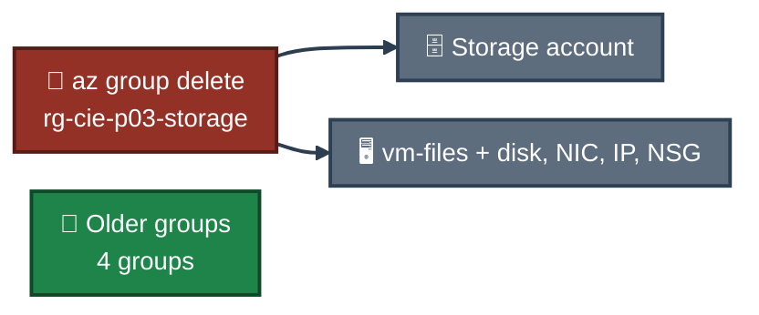

<a id="top"></a>
<div align="center">

# 🧹 Project 03 — Cleanup
### Azure Storage Services
**Project 03 of 6 — Cloud Infrastructure Engineering**


**Cleanup was the last step. Only this project's resource group was deleted. The older groups were not touched.**

### [📖 README](../README.md) &nbsp;·&nbsp; [📑 Visual Index](../Storage-INDEX.md) &nbsp;·&nbsp; [⌨️ Commands](commands.md)

</div>

---

## ⌨️ Command

| 📍 Where | 🖼️ Proof | Result |
|:---:|:---:|---|
| ☁️ Cloud Shell (Bash) | **Exhibit 25** — `Screenshots/ss-25-cleanup-proof.PNG` | project group gone, four older groups remain |

```bash
az group delete --name rg-cie-p03-storage --yes && az group list --query "[].name" -o tsv
```

---

## 🗑️ What This Removed

Everything inside `rg-cie-p03-storage`:

| Resource | Includes |
|---|---|
| 🗄️ Storage account `ciep03malaika01` | container `labdata`, file share `labshare`, lifecycle rule, all blobs and versions |
| 🖥️ VM `vm-files` | OS disk, network card, public IP, network security group `vm-filesNSG` |

The VM and the file share were still in use when the group was deleted. The shared folder was not unmounted first, because the VM was deleted too.


<p align="center"><em>Only the project group is deleted. The older groups are not in the command.</em></p>

---

## ✅ What Proves It

Exhibit 25 shows the list after the delete:

| Resource group | In the list after cleanup? |
|---|:---:|
| `rg-cie-p03-storage` | ✅ Yes (deleted) |
| `ForensicsCapstone-RG` | ✅ Yes |
| `osticket-rg` | ✅ Yes |
| `NetworkWatcherRG` | ✅ Yes |
| `sysadmin-labs` | ✅ Yes |

---

## 🚧 Not Checked

- Whether the storage account name `ciep03malaika01` can be reused right away. I did not try to create it again.
- The vCPU quota after the delete was not checked again, so no claim is made about it.

---

<div align="center">

[⬆️ Back to top](#top) &nbsp;·&nbsp; [📖 README](../README.md) &nbsp;·&nbsp; [⌨️ Commands](commands.md)

</div>
