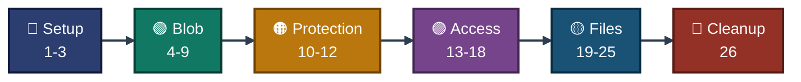

<a id="top"></a>
<div align="center">

# ⌨️ Project 03 — Commands
### Azure Storage Services
**Project 03 of 6 — Cloud Infrastructure Engineering**


**Every command used in this project, in order, with where it ran and which exhibit proves it.**

### [📖 README](../README.md) &nbsp;·&nbsp; [📑 Visual Index](../Storage-INDEX.md) &nbsp;·&nbsp; [🧹 Cleanup](cleanup.md)

</div>

---

## 🧭 How to Read This File

| Mark | Meaning |
|:---:|---|
| ✅ | Ran, and a screenshot in `../Screenshots/` proves the result. The exhibit number is given. |
| 📝 | Ran, but there is no screenshot of it in the repo. The text says which exhibit proves the result, or that nothing proves it. |
| `<...>` | A value that is not kept in the repo (IP address, key text, version ID). |

| 📍 Where it ran | Shown as |
|---|:---:|
| Azure Cloud Shell (Bash), prompt `malaika [ ~ ]` | ☁️ **Cloud Shell** |
| Windows PowerShell on my laptop | 💻 **Laptop** |
| SSH session on `vm-files`, prompt `azureuser@vm-files` | 🖥️ **VM** |

---

## 📊 At a Glance

| 🔵 Setup | 🟢 Blob Storage | 🟠 Data Protection | 🟣 Access Control | 🟡 Azure Files | 🧹 Cleanup |
|:---:|:---:|:---:|:---:|:---:|:---:|
| **Steps 1-3** | **Steps 4-9** | **Steps 10-12** | **Steps 13-18** | **Steps 19-25** | **Step 26** |
| quota, group | account, tier, rule | versions, recover | SAS, firewall | VM, SMB mount | delete group |


<p align="center"><em>Order of the command groups. Step numbers match the README.</em></p>

### 🧰 Commands by Azure Area

| Area | Main commands |
|---|---|
| Resource group | `az group create`, `az group delete`, `az group list` |
| Storage account | `az storage account create / show / update / keys renew`, `az storage account blob-service-properties update`, `az storage account management-policy create` |
| Blob | `az storage container create`, `az storage blob upload / download / set-tier / show / list / delete / generate-sas` |
| Azure Files | `az storage share-rm create`, `az storage file list / download` |
| VM and network | `az vm create / show / run-command invoke`, `az network nsg rule create` |
| Checks | `az vm list-usage`, `az vm list-skus`, `az provider show`, `curl` |

### 🔁 Placeholders

| Placeholder | What it stands for |
|---|---|
| `<PUBLIC_KEY_TEXT>` | Text of my SSH **public** key (`cie_p02_key.pub`). The private key never left my laptop. |
| `<MY_PUBLIC_IP>` | My home public IP at that moment. Not stored in the repo. |
| `<VM_PUBLIC_IP>` | Public IP of `vm-files`. Not stored in the repo. |
| `<OLD_VERSION_ID>` | The older version time shown in Exhibit 10 |

---

## 🔵 Setup &nbsp;·&nbsp; Steps 1-3

### Step 1 — Quota check &nbsp; ✅

| 📍 Where | 🖼️ Proof | Result |
|:---:|:---:|---|
| ☁️ Cloud Shell | **Exhibit 1** | `Used 2`, `Limit 6` |

```bash
az vm list-usage --location indiasouthcentral --query "[?name.value=='cores'].{Used:currentValue, Limit:limit}" -o table
```

### Step 2 — Pre-checks &nbsp; 📝

| 📍 Where | 🖼️ Proof | Result |
|:---:|:---:|---|
| ☁️ Cloud Shell | none (Exhibit 18 proves the VM size) | name free, provider `Registered`, size listed |

```bash
az storage account check-name --name ciep03malaika01 -o json
az provider show --namespace Microsoft.Storage --query registrationState -o tsv
az vm list-skus --location indiasouthcentral --size Standard_B2ls_v2 --query "[].{Name:name, Restriction:restrictions[0].reasonCode}" -o table
```

### Step 3 — Resource group with tags &nbsp; ✅

| 📍 Where | 🖼️ Proof | Result |
|:---:|:---:|---|
| ☁️ Cloud Shell | **Exhibit 2** | `Succeeded`, three tags |

```bash
az group create --name rg-cie-p03-storage --location indiasouthcentral --tags project=cie-p03 owner=malaika env=lab
```

---

## 🟢 Module 1 — Blob Storage &nbsp;·&nbsp; Steps 4-9

### Step 4 — Storage account (LRS) &nbsp; ✅

| 📍 Where | 🖼️ Proof | Result |
|:---:|:---:|---|
| ☁️ Cloud Shell | **Exhibit 3** (the `show` command; the create output is 📝) | `Standard_LRS`, Hot, TLS 1.2, public blob off |

```bash
az storage account create --name ciep03malaika01 --resource-group rg-cie-p03-storage --location indiasouthcentral --sku Standard_LRS --kind StorageV2 --access-tier Hot --min-tls-version TLS1_2 --allow-blob-public-access false --tags project=cie-p03 owner=malaika env=lab
```

```bash
az storage account show -g rg-cie-p03-storage -n ciep03malaika01 --query "{Name:name, Sku:sku.name, State:provisioningState, Tier:accessTier, Tls:minimumTlsVersion, PublicBlob:allowBlobPublicAccess, Tags:tags}" -o json
```

### Step 5 — Private container &nbsp; ✅

| 📍 Where | 🖼️ Proof | Result |
|:---:|:---:|---|
| ☁️ Cloud Shell | **Exhibit 4** | `"created": true` |

```bash
az storage container create --account-name ciep03malaika01 --name labdata --public-access off --auth-mode key -o json
```

### Step 6 — Upload &nbsp; ✅

| 📍 Where | 🖼️ Proof | Result |
|:---:|:---:|---|
| ☁️ Cloud Shell | **Exhibit 5** | Finished 100%, `etag`, encrypted on the server |

```bash
echo "hello from cie p03" > test1.txt && az storage blob upload --account-name ciep03malaika01 --container-name labdata --name test1.txt --file test1.txt --auth-mode key --only-show-errors -o json
```

### Step 7 — Download &nbsp; ✅

| 📍 Where | 🖼️ Proof | Result |
|:---:|:---:|---|
| ☁️ Cloud Shell | **Exhibit 6** | `hello from cie p03` |

```bash
az storage blob download --account-name ciep03malaika01 --container-name labdata --name test1.txt --file test1-down.txt --auth-mode key --only-show-errors -o none && cat test1-down.txt
```

### Step 8 — Access tier to Cool &nbsp; ✅

| 📍 Where | 🖼️ Proof | Result |
|:---:|:---:|---|
| ☁️ Cloud Shell | **Exhibit 7** | `Tier: Cool` |

```bash
az storage blob set-tier --account-name ciep03malaika01 --container-name labdata --name test1.txt --tier Cool --auth-mode key --only-show-errors && az storage blob show --account-name ciep03malaika01 --container-name labdata --name test1.txt --auth-mode key --only-show-errors --query "{Name:name, Tier:properties.blobTier}" -o json
```

### Step 9 — Lifecycle rule &nbsp; ✅

| 📍 Where | 🖼️ Proof | Result |
|:---:|:---:|---|
| ☁️ Cloud Shell | **Exhibit 8** | rule `cool-then-delete`, enabled, 30 and 365 days |

```bash
az storage account management-policy create --account-name ciep03malaika01 -g rg-cie-p03-storage --policy '{"rules":[{"enabled":true,"name":"cool-then-delete","type":"Lifecycle","definition":{"filters":{"blobTypes":["blockBlob"],"prefixMatch":["labdata/"]},"actions":{"baseBlob":{"tierToCool":{"daysAfterModificationGreaterThan":30},"delete":{"daysAfterModificationGreaterThan":365}}}}}]}' --query "policy.rules[0].{Name:name, Enabled:enabled, CoolAfterDays:definition.actions.baseBlob.tierToCool.daysAfterModificationGreaterThan, DeleteAfterDays:definition.actions.baseBlob.delete.daysAfterModificationGreaterThan}" -o json
```

> [!NOTE]
> The rule was created. It acts after 30 and 365 days, so its action was not seen.

---

## 🟠 Module 2 — Data Protection &nbsp;·&nbsp; Steps 10-12

### Step 10 — Soft delete and versioning &nbsp; ✅

| 📍 Where | 🖼️ Proof | Result |
|:---:|:---:|---|
| ☁️ Cloud Shell | **Exhibit 9** | soft delete `enabled: true`, 7 days; `Versioning: true` |

```bash
az storage account blob-service-properties update --account-name ciep03malaika01 -g rg-cie-p03-storage --enable-delete-retention true --delete-retention-days 7 --enable-versioning true --query "{SoftDelete:deleteRetentionPolicy, Versioning:isVersioningEnabled}" -o json
```

### Step 11 — Overwrite and list versions &nbsp; ✅

| 📍 Where | 🖼️ Proof | Result |
|:---:|:---:|---|
| ☁️ Cloud Shell | **Exhibit 10** | two versions of `test1.txt` |

```bash
echo "version two" > test1.txt && az storage blob upload --account-name ciep03malaika01 --container-name labdata --name test1.txt --file test1.txt --overwrite true --auth-mode key --only-show-errors -o none && az storage blob list --account-name ciep03malaika01 --container-name labdata --include v --auth-mode key --only-show-errors --query "[].{Name:name, VersionId:versionId, Current:isCurrentVersion}" -o table
```

### Step 12 — Delete, then recover &nbsp; 📝 + ✅

**12a. Delete the blob** &nbsp; 📝

| 📍 Where | 🖼️ Proof | Result |
|:---:|:---:|---|
| ☁️ Cloud Shell | none (Exhibit 11 shows the result) | blob no longer in the normal list |

```bash
az storage blob delete --account-name ciep03malaika01 --container-name labdata --name test1.txt --auth-mode key --only-show-errors
```

A follow-up list with `--include dv` 📝 still showed both versions.

**12b. Empty list, then recover the old version** &nbsp; ✅

| 📍 Where | 🖼️ Proof | Result |
|:---:|:---:|---|
| ☁️ Cloud Shell | **Exhibit 11** | `[]`, then `hello from cie p03` |

```bash
az storage blob list --account-name ciep03malaika01 --container-name labdata --auth-mode key --only-show-errors -o json && az storage blob download --account-name ciep03malaika01 --container-name labdata --name test1.txt --version-id <OLD_VERSION_ID> --file recovered.txt --auth-mode key --only-show-errors -o none && cat recovered.txt
```

---

## 🟣 Module 3 — Access Control &nbsp;·&nbsp; Steps 13-18

### Step 13 — Request with no credentials &nbsp; ✅

| 📍 Where | 🖼️ Proof | Result |
|:---:|:---:|---|
| ☁️ Cloud Shell | **Exhibit 12** | `HTTP code: 409` (not 200) |

```bash
echo "sas test file" > sas-test.txt && az storage blob upload --account-name ciep03malaika01 --container-name labdata --name sas-test.txt --file sas-test.txt --auth-mode key --only-show-errors -o none && curl -s -o /dev/null -w "HTTP code: %{http_code}\n" https://ciep03malaika01.blob.core.windows.net/labdata/sas-test.txt
```

### Step 14 — SAS token (3 minutes, read only) &nbsp; ✅

| 📍 Where | 🖼️ Proof | Result |
|:---:|:---:|---|
| ☁️ Cloud Shell | **Exhibit 13** | `sas test file`, `HTTP code: 200` |

```bash
SAS=$(az storage blob generate-sas --account-name ciep03malaika01 --container-name labdata --name sas-test.txt --permissions r --expiry $(date -u -d "+3 minutes" '+%Y-%m-%dT%H:%MZ') --https-only --auth-mode key -o tsv) && curl -s -w "\nHTTP code: %{http_code}\n" "https://ciep03malaika01.blob.core.windows.net/labdata/sas-test.txt?$SAS"
```

> [!IMPORTANT]
> Keep the same Cloud Shell session open. `$SAS` only exists in that session. The token is stored in the variable, so it is not printed.

### Step 15 — The same token after expiry

**15a. Re-test before expiry** &nbsp; 📝 &nbsp; (returned 200, the token was still valid)

```bash
curl -s -w "\nHTTP code: %{http_code}\n" "https://ciep03malaika01.blob.core.windows.net/labdata/sas-test.txt?$SAS"
```

**15b. Compare the expiry time with the clock** &nbsp; 📝 &nbsp; (prints only the `se=` part, not the signature)

```bash
echo "Token expiry: $(echo "$SAS" | grep -o 'se=[^&]*')"; echo "Now (UTC):   $(date -u '+%Y-%m-%dT%H:%MZ')"
```

**15c. Re-test after expiry** &nbsp; ✅

| 📍 Where | 🖼️ Proof | Result |
|:---:|:---:|---|
| ☁️ Cloud Shell | **Exhibit 14** | `HTTP code: 403`, `AuthenticationFailed` |

```bash
date -u '+Now (UTC): %Y-%m-%dT%H:%MZ'; curl -s -w "\nHTTP code: %{http_code}\n" "https://ciep03malaika01.blob.core.windows.net/labdata/sas-test.txt?$SAS"
```

### Step 16 — Firewall default action: Deny &nbsp; ✅

| 📍 Where | 🖼️ Proof | Result |
|:---:|:---:|---|
| ☁️ Cloud Shell | **Exhibit 15** | `DefaultAction: Deny`, `IpRules: []` |

```bash
az storage account update -n ciep03malaika01 -g rg-cie-p03-storage --default-action Deny --query "{DefaultAction:networkRuleSet.defaultAction, IpRules:networkRuleSet.ipRules}" -o json
```

### Step 17 — List blobs while the firewall is Deny

**17a. First try, with a `grep` filter** &nbsp; 📝 &nbsp; (printed nothing, so it proved nothing)

```bash
sleep 30; az storage blob list --account-name ciep03malaika01 --container-name labdata --auth-mode key --only-show-errors -o table 2>&1 | grep -o "Code: [A-Za-z]*\|ErrorCode:[A-Za-z]*\|AuthorizationFailure\|not authorized[^.]*" | head -3
```

**17b. Same test without the filter** &nbsp; ✅

| 📍 Where | 🖼️ Proof | Result |
|:---:|:---:|---|
| ☁️ Cloud Shell | **Exhibit 16** | CLI says the request may be blocked by network rules |

```bash
az storage blob list --account-name ciep03malaika01 --container-name labdata --auth-mode key --only-show-errors -o table 2>&1 | cut -c1-150 | head -8
```

### Step 18 — Firewall back to Allow &nbsp; ✅

| 📍 Where | 🖼️ Proof | Result |
|:---:|:---:|---|
| ☁️ Cloud Shell | **Exhibit 17** | `Allow`, then `sas-test.txt` is listed |

```bash
az storage account update -n ciep03malaika01 -g rg-cie-p03-storage --default-action Allow --query "networkRuleSet.defaultAction" -o tsv && sleep 30 && az storage blob list --account-name ciep03malaika01 --container-name labdata --auth-mode key --only-show-errors --query "[].name" -o tsv
```

---

## 🟡 Module 4 — Azure Files &nbsp;·&nbsp; Steps 19-25

### Step 19 — Create the VM

**19a. Quota re-check** &nbsp; 📝 &nbsp; (still 2 used of 6)

```bash
az vm list-usage --location indiasouthcentral --query "[?name.value=='cores'].{Used:currentValue, Limit:limit}" -o table
```

**19b. Copy the public key** &nbsp; 💻 Laptop &nbsp; 📝 &nbsp; (prints nothing; the key text was pasted into the chat as text)

```powershell
Get-Content "$HOME\.ssh\cie_p02_key.pub" | Set-Clipboard
```

**19c. Create the VM** &nbsp; ✅

| 📍 Where | 🖼️ Proof | Result |
|:---:|:---:|---|
| ☁️ Cloud Shell | **Exhibit 18** | `VM running`, private IP `10.0.0.4` |

```bash
az vm create -g rg-cie-p03-storage -n vm-files --image Ubuntu2204 --size Standard_B2ls_v2 --admin-username azureuser --authentication-type ssh --ssh-key-values "<PUBLIC_KEY_TEXT>" --nsg-rule NONE --public-ip-sku Standard --tags project=cie-p03 owner=malaika env=lab --query "{PowerState:powerState, ResourceGroup:resourceGroup, PrivateIp:privateIpAddress}" -o json
```

### Step 20 — SSH allowed from my IP only

**20a. NSG before the rule** &nbsp; 📝 &nbsp; (one NSG, `vm-filesNSG`, 0 rules)

```bash
az network nsg list -g rg-cie-p03-storage --query "[].{Name:name, Rules:length(securityRules)}" -o table
```

**20b. My current public IP** &nbsp; 💻 Laptop &nbsp; 📝 &nbsp; (copied to the clipboard and given as text; not saved anywhere)

```powershell
(Invoke-RestMethod https://api.ipify.org) | Set-Clipboard
```

**20c. Allow SSH from that one IP** &nbsp; ✅

| 📍 Where | 🖼️ Proof | Result |
|:---:|:---:|---|
| ☁️ Cloud Shell | **Exhibit 19** | rule `allow-ssh-myip`, Allow, port 22, one source |

```bash
az network nsg rule create -g rg-cie-p03-storage --nsg-name vm-filesNSG -n allow-ssh-myip --priority 100 --direction Inbound --access Allow --protocol Tcp --destination-port-ranges 22 --source-address-prefixes <MY_PUBLIC_IP> --query "{Name:name, Access:access, Port:destinationPortRange, Source:sourceAddressPrefix}" -o json
```

### Step 21 — Connect to the VM

**21a. VM public IP** &nbsp; ☁️ Cloud Shell &nbsp; 📝 &nbsp; (copied by hand, not kept in the repo)

```bash
az vm show -d -g rg-cie-p03-storage -n vm-files --query publicIps -o tsv
```

**21b. SSH to the VM** &nbsp; ✅

| 📍 Where | 🖼️ Proof | Result |
|:---:|:---:|---|
| 💻 Laptop | **Exhibit 20** | prompt `azureuser@vm-files:~$`, Ubuntu 22.04.4 LTS |

```powershell
ssh -i "$HOME\.ssh\cie_p02_key" azureuser@<VM_PUBLIC_IP>
```

**21c. Install SMB tools** &nbsp; 🖥️ VM &nbsp; 📝 &nbsp; (output showed `ii cifs-utils`)

```bash
sudo apt-get update -qq && sudo apt-get install -y -qq cifs-utils && dpkg -l cifs-utils | tail -1
```

### Step 22 — File share &nbsp; ✅

| 📍 Where | 🖼️ Proof | Result |
|:---:|:---:|---|
| ☁️ Cloud Shell | **Exhibit 21** | `labshare`, `SMB`, 5 GiB |

```bash
az storage share-rm create --storage-account ciep03malaika01 -g rg-cie-p03-storage --name labshare --quota 5 --enabled-protocols SMB --query "{Name:name, QuotaGiB:shareQuota, Protocols:enabledProtocols}" -o json
```

### Step 23 — Port 445 test &nbsp; ✅

| 📍 Where | 🖼️ Proof | Result |
|:---:|:---:|---|
| 🖥️ VM | **Exhibit 22** | `Port 445: OPEN` |

```bash
timeout 5 bash -c '</dev/tcp/ciep03malaika01.file.core.windows.net/445' && echo "Port 445: OPEN" || echo "Port 445: CLOSED or timed out"
```

### Step 24 — Renew the key, mount the share, write a file &nbsp; ✅

| 📍 Where | 🖼️ Proof | Result |
|:---:|:---:|---|
| ☁️ Cloud Shell (runs on the VM through `run-command`) | **Exhibit 23** | hostname `vm-files`, `cifs` mount, `from-vm.txt` (20 bytes) |

```bash
K=$(az storage account keys renew -g rg-cie-p03-storage -n ciep03malaika01 --key key1 --query "[?keyName=='key1'].value | [0]" -o tsv) && az vm run-command invoke -g rg-cie-p03-storage -n vm-files --command-id RunShellScript --scripts "hostname; mkdir -p /mnt/labshare; mount -t cifs //ciep03malaika01.file.core.windows.net/labshare /mnt/labshare -o username=ciep03malaika01,password='$K',serverino,vers=3.1.1; echo 'hello from vm-files' > /mnt/labshare/from-vm.txt; ls -l /mnt/labshare; df -hT /mnt/labshare" --query "value[0].message" -o tsv
```

> [!IMPORTANT]
> The key stays in the variable `$K` and is never printed. The command renews `key1` first, so any key seen in earlier output no longer works.

### Step 25 — Read the VM's file from Cloud Shell

**25a. First attempt** &nbsp; 📝 &nbsp; (failed: `--dest` was a file name and the tool treated it as a folder)

```bash
az storage file download --account-name ciep03malaika01 --share-name labshare --path from-vm.txt --dest from-vm-down.txt --auth-mode key --only-show-errors -o none
```

**25b. The version that worked** &nbsp; ✅

| 📍 Where | 🖼️ Proof | Result |
|:---:|:---:|---|
| ☁️ Cloud Shell | **Exhibit 24** | `from-vm.txt` (20 bytes), content `hello from vm-files` |

```bash
az storage file list --account-name ciep03malaika01 --share-name labshare --auth-mode key --only-show-errors --query "[].{Name:name, Size:properties.contentLength}" -o table && az storage file download --account-name ciep03malaika01 --share-name labshare --path from-vm.txt --dest . --auth-mode key --only-show-errors -o none && cat from-vm.txt
```

---

## 🧹 Cleanup &nbsp;·&nbsp; Step 26

### Step 26 — Delete the project's resource group &nbsp; ✅

| 📍 Where | 🖼️ Proof | Result |
|:---:|:---:|---|
| ☁️ Cloud Shell | **Exhibit 25** | project group gone, four older groups remain |

```bash
az group delete --name rg-cie-p03-storage --yes && az group list --query "[].name" -o tsv
```

Full cleanup notes: [`cleanup.md`](cleanup.md).

---

## 🚫 Not Run in This Project

| Item | Note |
|---|---|
| Key rotation | Done once by hand and once inside Step 24. The first one is not in the repo, because the account key was visible in that output 📝 |
| `/etc/fstab` entry | Not added, so the mount is not permanent |
| Firewall IP allow-rule | Not added. Only default Deny and default Allow were tested |

---

<div align="center">

[⬆️ Back to top](#top) &nbsp;·&nbsp; [📖 README](../README.md) &nbsp;·&nbsp; [📑 Visual Index](../Storage-INDEX.md) &nbsp;·&nbsp; [🧹 Cleanup](cleanup.md)

☁️ **[Microsoft Azure](https://azure.microsoft.com)** · 🗄️ **[Azure Storage documentation](https://learn.microsoft.com/azure/storage/)**

</div>
