<div align="center">

# 🔐 Microsoft Entra ID and Azure RBAC

**Project 04 of 6 — Cloud Infrastructure Engineering**

Identity, access control and guardrails on Azure


A test user and a security group get a built-in role on one resource group. The user's allowed and denied actions are shown in a private browser window. A resource lock and an Azure Policy block actions, a VM with a managed identity reads a Key Vault secret, and everything is cleaned up and proven gone.

### [📑 Open the visual index](Entra-RBAC-INDEX.md) &nbsp;·&nbsp; [⌨️ Commands](commands/commands.md) &nbsp;·&nbsp; [🧹 Cleanup](commands/cleanup.md)

</div>

---

## 📑 Table of Contents

1. [At a Glance](#at-a-glance)
2. [Project Background](#project-background)
3. [Environment](#environment)
4. [Project Flow](#project-flow)
5. [Module 1 — Check and Identity Setup (Steps 1-4)](#module-1)
6. [Module 2 — Role Assignment and Least Privilege (Steps 5-9)](#module-2)
7. [Module 3 — Custom Role, Lock and Policy (Steps 10-13)](#module-3)
8. [Module 4 — Managed Identity and Key Vault (Steps 14-16)](#module-4)
9. [Module 5 — Cleanup (Steps 17-20)](#module-5)
10. [Coverage Snapshot](#coverage-snapshot)
11. [Challenges & Fixes](#challenges-fixes)
12. [Scope & Limitations](#scope-limitations)
13. [What I Learned](#what-i-learned)
14. [Skills Demonstrated](#skills-demonstrated)
15. [Cleanup](#cleanup)
16. [Screenshot Index](#screenshot-index)
17. [Repo Structure](#repo-structure)

---

<a id="at-a-glance"></a>
## 📊 At a Glance

| 🧩 Steps | 🖼️ Screenshots | 👤 Test Users | 🛡️ Guardrails | 🔑 Secret Read by VM |
|:---:|:---:|:---:|:---:|:---:|
| **20** | **18** | **1** | **2** (lock, policy) | **1** (HTTP 200) |

---

<a id="project-background"></a>
## 📖 Project Background

Most cloud problems start with "who is allowed to do what". This project builds that answer in layers on one resource group, and tests each layer with a real allowed or denied result.

- **Identity:** A test user and a security group in Microsoft Entra ID.
- **Access:** The built-in **Reader** role on the group at resource group scope. The test user signs in and can view the group but cannot write a tag.
- **Guardrails:** A `CanNotDelete` lock blocks a delete. An Azure Policy with effect `deny` blocks a resource without a `project` tag.
- **Workload identity:** A VM with a system-assigned managed identity reads a Key Vault secret. No password or key is stored on the VM.
- **Cleanup:** Lock, resource group, user, group and the soft-deleted Key Vault are removed and proven gone.

> [!NOTE]
> A custom role was created and assigned to the group (Exhibit 9), but the test user never used it. Its allowed and denied actions were **not** tested. See [Scope & Limitations](#scope-limitations). Items taken from my own notes, with no screenshot behind them, are marked 📝.

---

<a id="environment"></a>
## 🖧 Environment

| Item | Value |
|---|---|
| **Subscription** | Azure for Students |
| **Region** | `indiasouthcentral` |
| **Directory** | Default Directory (personal Microsoft account), Microsoft Entra ID Free 📝 |
| **Resource group** | `rg-cie-p04-iam`, tags `project=cie-p04`, `owner=malaika`, `env=lab` |
| **Test user** | `CIE P04 Test User` (UPN kept out of the repo) |
| **Group** | `cie-p04-readers` (Security, Assigned, 1 member) |
| **Key Vault** | `kv-cie-p04-malaika`, RBAC mode, soft delete on |
| **VM** | `vm-cie-p04`, `Standard_B2ls_v2`, Ubuntu 22.04, no public IP, no NSG |
| **Tools** | Azure Cloud Shell (Bash), Azure portal, private browser window |
| **Work date** | Oct 24-25, 2026 |

### 🗺️ Access Model

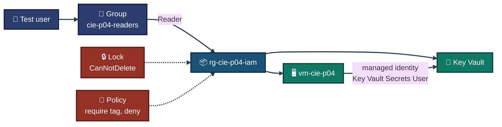
<p align="center"><em>The diagram shows the design. Each arrow is backed by an exhibit below, except the custom role, which is left out because it was not tested.</em></p>

---

<a id="project-flow"></a>
## ⏱️ Project Flow

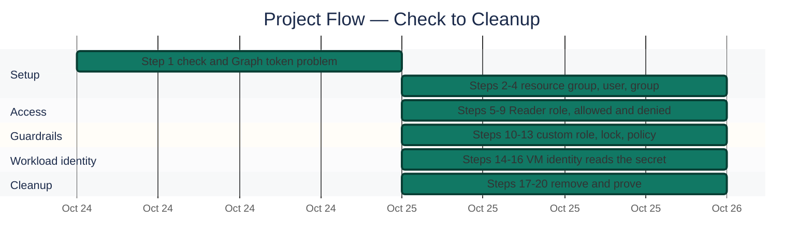
<p align="center"><em>All stages complete. Clock times are left out because most screenshots do not show them.</em></p>

---

<a id="module-1"></a>
## 🔵 Module 1 — Check and Identity Setup (Steps 1-4)

**Objective:** Find out whether this account can create users and groups, then create the resource group, the test user and the group.

### Step 1 — Combined check ✅ 📝

Checked the vCPU quota, the Key Vault name, the provider state and whether users can be created. 📝 The screenshots of the first check attempts show errors and are not kept. Result from my notes: quota `Used 2` of `Limit 6`, Key Vault name `kv-cie-p04-malaika` available, `Microsoft.KeyVault` was `NotRegistered` and was registered, `Microsoft.PolicyInsights` was `Registered`.

Users and groups could **not** be read from Cloud Shell: every `az ad ...` command returned `Timeout waiting for token from portal` for Microsoft Graph, also after `az login --use-device-code`. The portal was used instead.

<p align="center">
  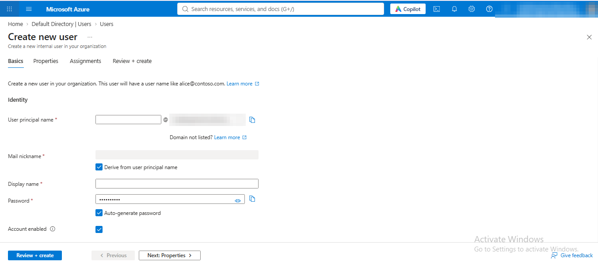<br>
  <em>Exhibit 1 — Entra ID, Users, <code>Create new user</code>: the form opens, so this account can create users in the directory</em>
</p>

### Step 2 — Resource group with tags ✅

```bash
az group create --name rg-cie-p04-iam --location indiasouthcentral --tags project=cie-p04 owner=malaika env=lab
```

<p align="center">
  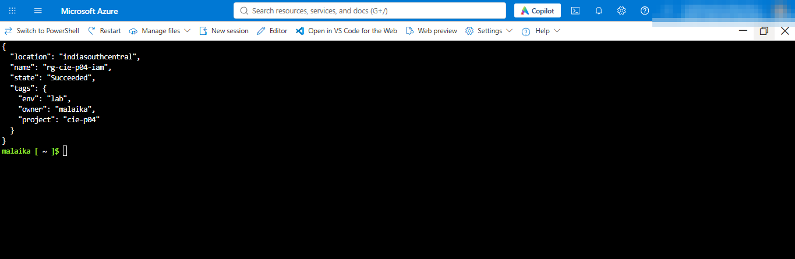<br>
  <em>Exhibit 2 — <code>rg-cie-p04-iam</code>, <code>indiasouthcentral</code>, <code>Succeeded</code>, three tags</em>
</p>

### Step 3 — Test user (portal) ✅

`Microsoft Entra ID`, `Users`, `New user`, `Create new user`. User `CIE P04 Test User`, auto-generated password kept in my own notes and not shown anywhere.

<p align="center">
  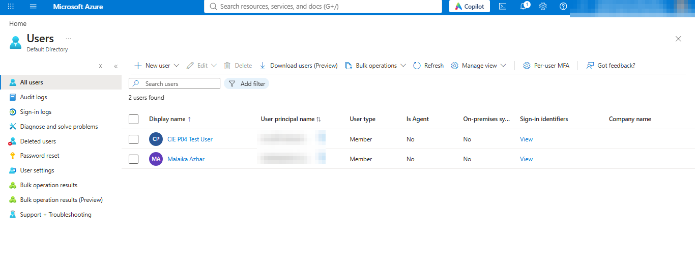<br>
  <em>Exhibit 3 — "2 users found": <code>CIE P04 Test User</code> and my own account, both Member</em>
</p>

### Step 4 — Security group with the user (portal) ✅

Group `cie-p04-readers`, type Security, membership Assigned, one member (the test user). In the `Add members` panel the user appeared in the search but the checkbox was still empty (`Selected (0)`), so the box was ticked (`Selected (1)`) before `Select` and `Create`.

<p align="center">
  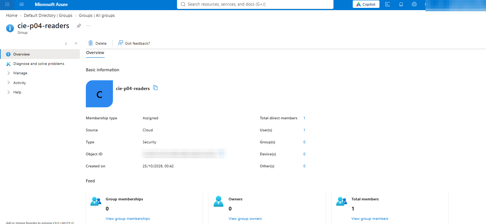<br>
  <em>Exhibit 4 — <code>cie-p04-readers</code>: Assigned, Cloud, Security, <code>Total direct members 1</code>, <code>User(s) 1</code></em>
</p>

---

<a id="module-2"></a>
## 🟢 Module 2 — Role Assignment and Least Privilege (Steps 5-9)

**Objective:** Give the group the built-in Reader role on the resource group, prove the assignment, then show one allowed and one denied action as the test user.

### Steps 5 and 6 — Assign Reader to the group, then verify ✅

```bash
az role assignment create --assignee-object-id "<GROUP_OBJECT_ID>" --assignee-principal-type Group --role "Reader" --scope "/subscriptions/<SUBSCRIPTION_ID>/resourceGroups/rg-cie-p04-iam"
```

The `create` output printed `role: null`, so it proves nothing. The list command is the proof.

<p align="center">
  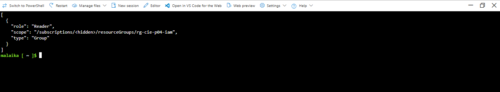<br>
  <em>Exhibit 5 — <code>az role assignment list</code>: role <code>Reader</code>, type <code>Group</code>, scope <code>rg-cie-p04-iam</code></em>
</p>

### Step 7 — Key Vault and a test secret ✅

RBAC mode vault, my own account given `Key Vault Secrets Officer`, then a secret `demo-secret`. The secret value is never printed.

<p align="center">
  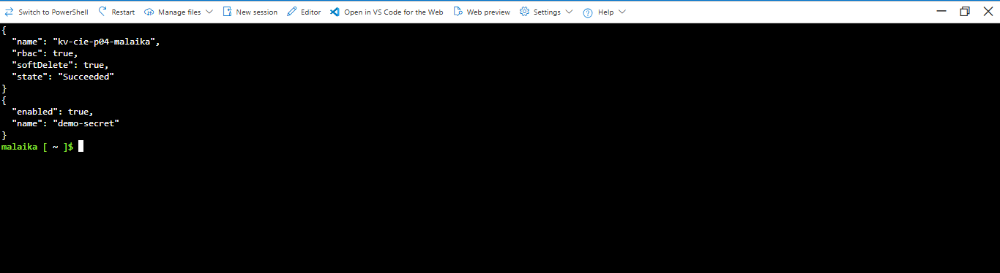<br>
  <em>Exhibit 6 — <code>kv-cie-p04-malaika</code>: <code>rbac: true</code>, <code>softDelete: true</code>, <code>Succeeded</code>; secret <code>demo-secret</code> enabled</em>
</p>

### Step 8 — Allowed action as the test user ✅

Private browser window, signed in as the test user (the first sign-in forced Microsoft Authenticator setup 📝). Resource groups, then `rg-cie-p04-iam`.

<p align="center">
  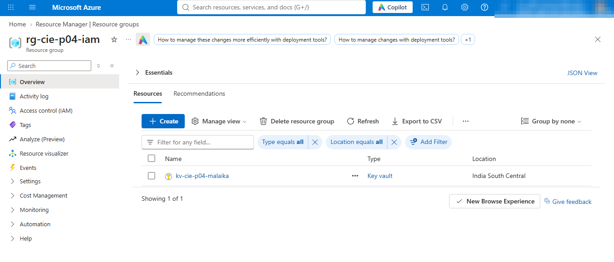<br>
  <em>Exhibit 7 — Signed in as the test user: the resource group opens and shows <code>kv-cie-p04-malaika</code> ("Showing 1 of 1"). The Reader role allows viewing</em>
</p>

### Step 9 — Denied action as the test user ✅

In the same window, `Tags` on the same resource group: add the tag `test : denied` and apply.

<p align="center">
  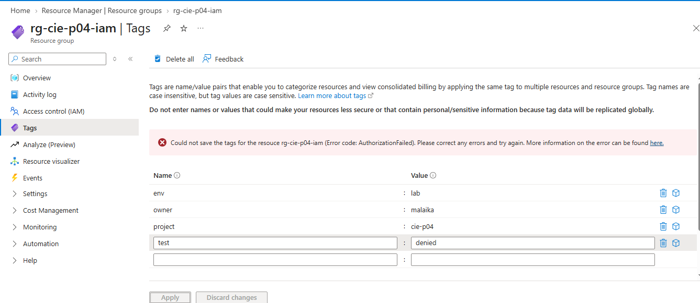<br>
  <em>Exhibit 8 — <code>Could not save the tags for the resource rg-cie-p04-iam (Error code: AuthorizationFailed)</code>. The tag was not saved</em>
</p>

🎯 **Result:** The same user, on the same resource group, could view it (Exhibit 7) and could not write to it (Exhibit 8). That is least privilege from the Reader role.

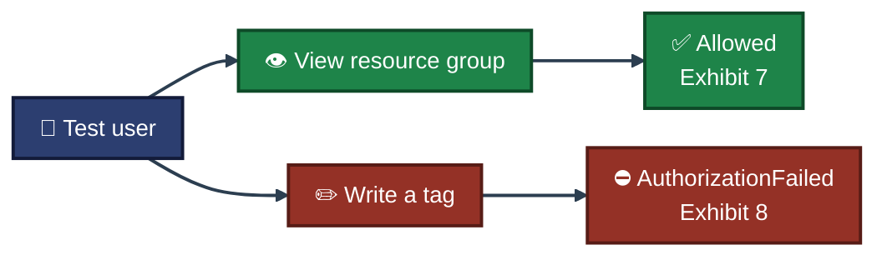

---

<a id="module-3"></a>
## 🟠 Module 3 — Custom Role, Lock and Policy (Steps 10-13)

### Steps 10 and 11 — Custom role, assigned to the group ✅ 📝

Custom role `CIE P04 VM Operator` at resource group scope with three actions: `Microsoft.Compute/virtualMachines/read`, `Microsoft.Compute/virtualMachines/restart/action` and `Microsoft.Resources/subscriptions/resourceGroups/read`. 📝 The creation output is not kept: my display filter replaced the word `resourceGroups` in the third action with `<hidden>`, so the screenshot did not show the real action. The role itself was created with the correct text.

<p align="center">
  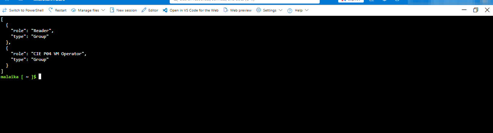<br>
  <em>Exhibit 9 — The group now holds two roles: <code>Reader</code> and <code>CIE P04 VM Operator</code>, both type <code>Group</code></em>
</p>

> [!IMPORTANT]
> Exhibit 9 proves the role exists and is assigned. It does **not** prove what the role allows or blocks, because the test user never used it.

### Step 12 — Resource lock ✅

A `CanNotDelete` lock on the resource group, then an attempt to delete the Key Vault.

<p align="center">
  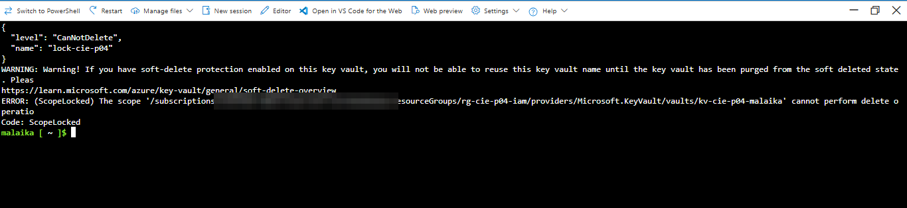<br>
  <em>Exhibit 10 — Lock <code>lock-cie-p04</code> (<code>CanNotDelete</code>) created, then <code>(ScopeLocked) ... cannot perform delete operation</code> on the Key Vault</em>
</p>

### Step 13 — Azure Policy: tag required ✅

The built-in policy **Require a tag on resources** (tag name `project`) was assigned to the resource group as `pol-cie-p04-tag`. 📝 The first test public IP was created **before** the policy was enforced (about four minutes after the assignment) and had no tags. A later attempt to create a second untagged public IP was denied.

<p align="center">
  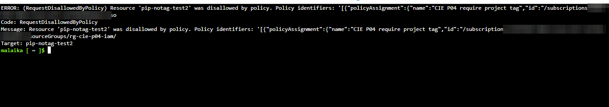<br>
  <em>Exhibit 11 — <code>RequestDisallowedByPolicy</code> for <code>pip-notag-test2</code>, policy assignment <code>CIE P04 require project tag</code>. The subscription ID in the error text is blurred</em>
</p>

🎯 **Result:** The lock stopped a delete (Exhibit 10) and the policy stopped a resource without the required tag (Exhibit 11). The policy took longer than four minutes to start enforcing.

---

<a id="module-4"></a>
## 🟣 Module 4 — Managed Identity and Key Vault (Steps 14-16)

**Objective:** A VM with no public IP, no NSG and no stored credentials reads the Key Vault secret using its own identity.

### Step 14 — VM with a system-assigned identity ✅ 📝

`vm-cie-p04`, `Standard_B2ls_v2`, Ubuntu 22.04, `--public-ip-address ""`, `--nsg ""`, `--assign-identity "[system]"`, all required tags. 📝 The `az vm create` output printed `name: null` and `identity: null` because of my `--query` and is not kept. The VM name and identity type are shown in Exhibit 13, and the resource list in Exhibit 14 has no public IP and no NSG.

### Step 15 — Give the VM identity a role on the vault ✅

`Key Vault Secrets User`, scope the Key Vault, assignee the VM's identity.

<p align="center">
  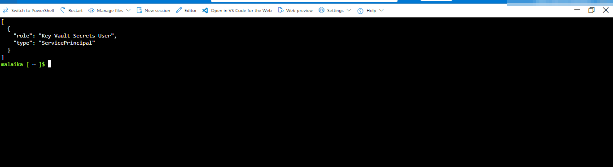<br>
  <em>Exhibit 12 — Role assignments on the Key Vault for the VM identity: <code>Key Vault Secrets User</code>, type <code>ServicePrincipal</code></em>
</p>

### Step 16 — Read the secret from inside the VM ✅

`az vm run-command invoke` runs a script in the VM. The script asks the instance metadata service for a token, then reads `demo-secret`. Only the hostname, the HTTP status and the length of the value are printed.

<p align="center">
  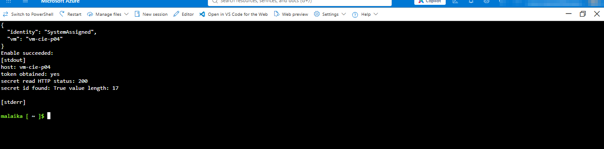<br>
  <em>Exhibit 13 — <code>vm: vm-cie-p04</code>, <code>identity: SystemAssigned</code>, <code>host: vm-cie-p04</code>, <code>token obtained: yes</code>, <code>secret read HTTP status: 200</code>, <code>value length: 17</code></em>
</p>

🎯 **Result:** The VM read the secret with its own identity. No key, password or token was typed or printed. The value length `17` matches the test value, and the value itself is not shown.

---

<a id="module-5"></a>
## 🔴 Module 5 — Cleanup (Steps 17-20)

### Step 17 — Remove the lock and the leftover public IP ✅

The first untagged public IP (`pip-notag-test`) could not be deleted while the lock existed. The lock was removed, then the public IP was deleted.

<p align="center">
  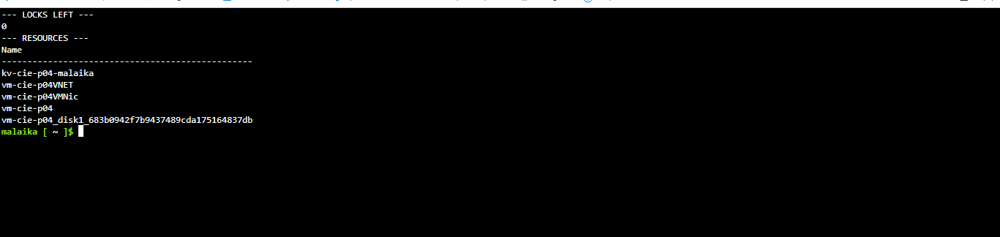<br>
  <em>Exhibit 14 — <code>LOCKS LEFT 0</code>. The resource group holds only the vault, VNET, NIC, VM and disk. There is no public IP and no NSG</em>
</p>

### Steps 18 and 19 — Delete the resource group, the user and the group ✅ 📝

The resource group was deleted before the Step 18 command ran, so that command found no resource group. The policy assignment, the group's role assignments and the vault role assignment were scoped inside the resource group, so they went with it. 📝 The screenshots of that command are not kept.

<p align="center">
  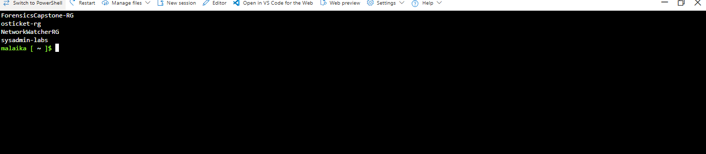<br>
  <em>Exhibit 15 — <code>az group list</code>: only <code>ForensicsCapstone-RG</code>, <code>osticket-rg</code>, <code>NetworkWatcherRG</code> and <code>sysadmin-labs</code>. <code>rg-cie-p04-iam</code> is gone</em>
</p>

The test user and the group were deleted in the portal, because Entra objects are not removed with a resource group.

<p align="center">
  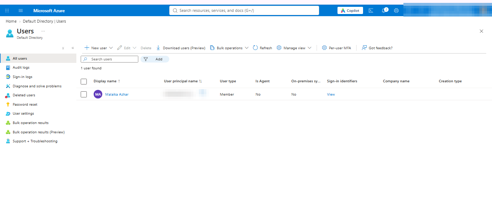<br>
  <em>Exhibit 16 — "1 user found": only my own account. The test user is gone</em>
</p>

<p align="center">
  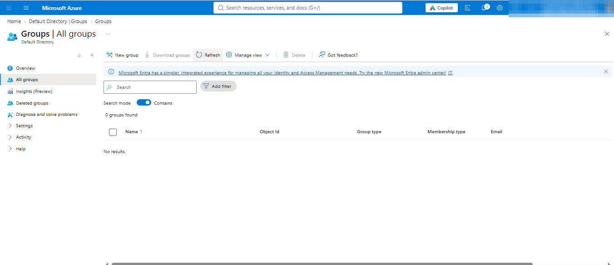<br>
  <em>Exhibit 17 — "0 groups found". <code>cie-p04-readers</code> is gone</em>
</p>

### Step 20 — Purge the soft-deleted Key Vault ✅

<p align="center">
  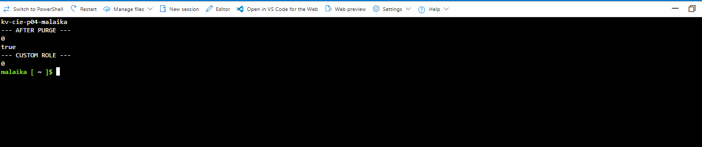<br>
  <em>Exhibit 18 — <code>kv-cie-p04-malaika</code> was in the soft-deleted list; after the purge the list count is <code>0</code>, the name check returns <code>true</code> (name free), and the custom role count is <code>0</code></em>
</p>

---

<a id="coverage-snapshot"></a>
## 🌟 Coverage Snapshot

| 🛡️ Area | ✅ Status | 📌 Detail |
|---|---|---|
| Users and groups | Tested | Created in the portal (Cloud Shell could not get a Graph token) |
| Built-in role (Reader) | Tested | Allowed view and denied write as the test user |
| Custom role | Created and assigned only | The test user never used it |
| Resource lock | Tested | `ScopeLocked` on delete |
| Azure Policy | Tested | `RequestDisallowedByPolicy`, after a delay |
| Managed identity | Tested | VM read the secret, HTTP 200 |
| Cleanup | Tested | Group, user, group, role and vault purge proven |

### 🧾 What the Evidence Proves

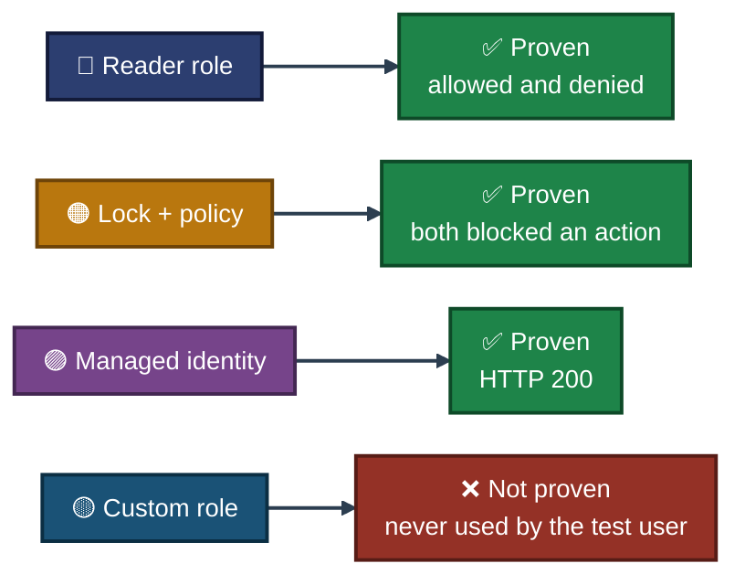

---

<a id="challenges-fixes"></a>
## ⚠️ Challenges & Fixes

| ❌ Challenge | ✅ Fix |
|---|---|
| `az ad user list --top 1` returned `unrecognized arguments` | The option does not exist for these commands, so it was removed |
| `Microsoft.KeyVault` was `NotRegistered` | Registered with `az provider register --wait` before creating the vault |
| Cloud Shell could not get a Microsoft Graph token (`Timeout waiting for token from portal`), also after `az login --use-device-code` | Created and deleted the test user and the group in the portal. The role, lock, policy, VM and vault steps ran from Cloud Shell |
| The test user was forced to set up Microsoft Authenticator at the first sign-in 📝 | Completed the setup on my phone. Deleting the user removes it |
| The `Add members` panel showed `Selected (0)` with the user only found by search | Ticked the checkbox until it showed `Selected (1)`, then created the group (Exhibit 4 shows 1 member) |
| The command used a `PASTE_OBJECT_ID` placeholder and failed with `InvalidPrincipalId` | Pasted the real object ID. Later commands carried the real value |
| `az role assignment create` printed `role: null` and `az vm create` printed `name: null` | Proved the result with `az role assignment list` and with `az vm show` instead |
| The first untagged public IP was created because the policy was not enforced yet 📝 | Waited, then a second untagged public IP was denied (Exhibit 11). The first one was deleted in Step 17 |
| A long `sleep` command was lost when Cloud Shell opened a new session | Re-ran only the test part without the long wait |
| The Step 18 cleanup command ran after the resource group was already deleted | The scoped objects had gone with the group. Exhibits 15 to 18 prove the final state |
| The laptop restarted for updates in the middle of Step 2 | Azure resources are not affected. The step was run again |

<sub>📝 = taken from my notes, no screenshot in this repo shows it.</sub>

---

<a id="scope-limitations"></a>
## 🚧 Scope & Limitations

- **Custom role not exercised:** `CIE P04 VM Operator` was created and assigned (Exhibit 9). The test user never tried a VM restart (which it allows) or a delete (which it does not). Its permissions are not proven.
- **Users and groups from the portal:** Cloud Shell could not get a Microsoft Graph token, so no `az ad` command was run for users or groups.
- **Entra ID Free only:** Conditional Access, Privileged Identity Management and access reviews were not tested.
- **MFA:** The test user was forced into Microsoft Authenticator at the first sign-in. I did not create an MFA policy.
- **Policy timing:** Enforcement started only after more than four minutes. I did not measure the exact time.
- **Deleted user:** I did not check the Entra ID `Deleted users` list after the cleanup.
- **Scope of roles:** All roles were assigned at resource group scope. Subscription scope was not tested.
- **Lab size:** One test user, one group, one VM and one vault.

These gaps are written down instead of hidden, so the results show what was actually proven.

---

<a id="what-i-learned"></a>
## 🧠 What I Learned

- **A role is only proven by using it.** The Reader role has both an allowed result (Exhibit 7) and a denied result (Exhibit 8). The custom role has neither, so it is not claimed.
- **A command's `create` output is not proof.** `role: null` and `name: null` looked like failures. A `list` or `show` command gave the real result.
- **Scope decides what goes with the group.** Role assignments, the policy assignment and the lock sit inside the resource group and went with it. The user and the group live in Entra ID and had to be deleted by hand.
- **A lock blocks a delete, not a create.** The leftover public IP could only be deleted after the lock was removed.
- **Azure Policy needs time.** The first untagged resource was accepted. A later one was denied.
- **A managed identity removes stored credentials.** The VM got a token from the metadata service and read the secret, with no key on the VM.
- **Soft delete reserves the vault name.** The name was free again only after the purge.

---

<a id="skills-demonstrated"></a>
## 🛠️ Skills Demonstrated

- Creating Entra ID users and security groups
- Assigning built-in Azure RBAC roles at resource group scope
- Testing least privilege with an allowed and a denied action as a real user
- Writing a custom role definition and assigning it to a group
- Protecting resources with a `CanNotDelete` lock
- Enforcing tags with an Azure Policy `deny` effect
- Using a system-assigned managed identity to read a Key Vault secret
- Running scripts inside a VM with `az vm run-command` without SSH
- Cleaning up Entra ID objects, locks and a soft-deleted vault, and proving the result

---

<a id="cleanup"></a>
## 🧹 Cleanup

The lock was removed first, the resource group was deleted, the test user and group were deleted in the portal, and the soft-deleted Key Vault was purged. Proof is in Exhibits 14 to 18. Full notes: [`commands/cleanup.md`](commands/cleanup.md).

---

<a id="screenshot-index"></a>
## 🖼️ Screenshot Index

| # | File | Step | Shows |
|:---:|---|:---:|---|
| 1 | `ss-01-create-user-permission-check.png` | 1 | Create new user form opens |
| 2 | `ss-02-resource-group-created.png` | 2 | Resource group with tags |
| 3 | `ss-03-test-user-created.png` | 3 | Users list, 2 users |
| 4 | `ss-04-group-created-one-member.png` | 4 | Group overview, 1 member |
| 5 | `ss-05-reader-role-on-group.png` | 5-6 | Reader assigned to the group |
| 6 | `ss-06-key-vault-and-secret.png` | 7 | Key Vault and `demo-secret` |
| 7 | `ss-07-test-user-allowed-view.png` | 8 | Test user views the resource group |
| 8 | `ss-08-test-user-denied-tag-write.png` | 9 | `AuthorizationFailed` on a tag write |
| 9 | `ss-09-custom-role-assigned.png` | 10-11 | Reader and custom role on the group |
| 10 | `ss-10-lock-blocks-delete.png` | 12 | `ScopeLocked` |
| 11 | `ss-11-policy-denies-untagged.png` | 13 | `RequestDisallowedByPolicy` |
| 12 | `ss-12-vm-identity-keyvault-role.png` | 15 | `Key Vault Secrets User` for the VM identity |
| 13 | `ss-13-vm-reads-secret-identity.png` | 14, 16 | VM reads the secret, HTTP 200 |
| 14 | `ss-14-lock-removed-resources.png` | 17 | No locks, no public IP, no NSG |
| 15 | `ss-15-rg-deleted-older-groups.png` | 19 | Resource group gone |
| 16 | `ss-16-users-after-cleanup.png` | 19 | Test user gone |
| 17 | `ss-17-groups-after-cleanup.png` | 19 | Group gone |
| 18 | `ss-18-key-vault-purged-final.png` | 20 | Vault purged, custom role count 0 |

Email addresses, user principal names, the group object ID, the subscription ID and tenant details are blurred in the screenshots.

---

<a id="repo-structure"></a>
## 📁 Repo Structure

```text
Cloud-Infrastructure-Engineering/
└── Azure/
    └── 04-entra-id-rbac/
        ├── README.md
        ├── Entra-RBAC-INDEX.md
        ├── commands/
        │   ├── commands.md
        │   └── cleanup.md
        └── Screenshots/
            ├── ss-01-create-user-permission-check.png
            ├── ss-02-resource-group-created.png
            ├── ss-03-test-user-created.png
            ├── ss-04-group-created-one-member.png
            ├── ss-05-reader-role-on-group.png
            ├── ss-06-key-vault-and-secret.png
            ├── ss-07-test-user-allowed-view.png
            ├── ss-08-test-user-denied-tag-write.png
            ├── ss-09-custom-role-assigned.png
            ├── ss-10-lock-blocks-delete.png
            ├── ss-11-policy-denies-untagged.png
            ├── ss-12-vm-identity-keyvault-role.png
            ├── ss-13-vm-reads-secret-identity.png
            ├── ss-14-lock-removed-resources.png
            ├── ss-15-rg-deleted-older-groups.png
            ├── ss-16-users-after-cleanup.png
            ├── ss-17-groups-after-cleanup.png
            └── ss-18-key-vault-purged-final.png
```

<div align="center">

☁️ **[Microsoft Azure](https://azure.microsoft.com)** · 🔐 **[Azure RBAC documentation](https://learn.microsoft.com/azure/role-based-access-control/)** · 🔑 **[Managed identities](https://learn.microsoft.com/entra/identity/managed-identities-azure-resources/overview)**

</div>
