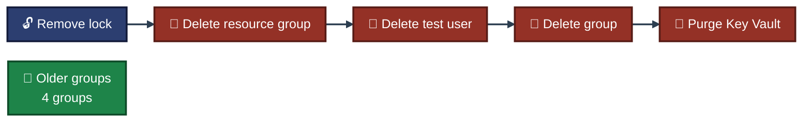

<a id="top"></a>
<div align="center">

# 🧹 Project 04 — Cleanup
### Microsoft Entra ID and Azure RBAC
**Project 04 of 6 — Cloud Infrastructure Engineering**


**This project left objects in three places: the resource group, the directory and the soft-deleted vault. Each one was removed and checked.**

### [📖 README](../README.md) &nbsp;·&nbsp; [📑 Visual Index](../Entra-RBAC-INDEX.md) &nbsp;·&nbsp; [⌨️ Commands](commands.md)

</div>

---

## ⚠️ Traps Planned Before Starting

| Trap | What it means | How it was handled |
|---|---|---|
| 🔒 Lock | A `CanNotDelete` lock blocks deleting anything in the group | Removed first (Step 17) |
| 👤 Entra objects | The test user and the group are in the directory, not in the resource group | Deleted in the portal (Step 19) |
| 🎭 Custom role | A role definition is not a resource inside the group | Checked by name at the end (Step 20) |
| 🔑 Key Vault | Soft delete keeps the vault and reserves its name after the group is deleted | Purged (Step 20) |

---

## ⌨️ Order That Was Run

| # | Step | 📍 Where | 🖼️ Proof | Result |
|:---:|---|:---:|:---:|---|
| 1 | Remove the lock, delete the leftover public IP | ☁️ Cloud Shell | **Exhibit 14** | `LOCKS LEFT 0` |
| 2 | Delete the resource group | ☁️ Cloud Shell | **Exhibit 15** | `rg-cie-p04-iam` gone, four older groups remain |
| 3 | Delete the test user | 🌐 Portal | **Exhibit 16** | "1 user found" |
| 4 | Delete the group | 🌐 Portal | **Exhibit 17** | "0 groups found" |
| 5 | Purge the Key Vault, check the custom role | ☁️ Cloud Shell | **Exhibit 18** | vault count `0`, name free, custom role `0` |

```bash
az lock delete --name lock-cie-p04 --resource-group rg-cie-p04-iam --only-show-errors
az group delete --name rg-cie-p04-iam --yes --only-show-errors && az group list --query "[].name" -o tsv
az keyvault purge --name kv-cie-p04-malaika --only-show-errors
```


<p align="center"><em>The older groups are not in any command.</em></p>

---

## 🗑️ What This Removed

| Where it lived | Objects | Removed by |
|---|---|---|
| Resource group `rg-cie-p04-iam` | Key Vault, `vm-cie-p04` with its disk, NIC and VNET, the lock, the policy assignment, the role assignments on the group, the VM identity's role assignment | Resource group delete |
| Directory | `CIE P04 Test User`, `cie-p04-readers` | Portal delete |
| Soft-deleted vaults | `kv-cie-p04-malaika` | `az keyvault purge` |
| Subscription | custom role `CIE P04 VM Operator` | Went with the resource group (its only assignable scope). Exhibit 18 shows count `0` |

📝 The Step 18 command (delete the policy assignment, the role assignments and the custom role by name) was run after the resource group was already deleted. It returned `ResourceGroupNotFound`, so nothing in that command did the removing. The end state is proven by Exhibits 15 and 18, not by that command.

---

## ✅ What Proves It

| Check | Exhibit | Shows |
|---|:---:|---|
| No lock left | 14 | `LOCKS LEFT 0`; the group held only the vault, VNET, NIC, VM and disk |
| Resource group gone | 15 | `rg-cie-p04-iam` is not in the list |
| Older groups intact | 15 | `ForensicsCapstone-RG`, `osticket-rg`, `NetworkWatcherRG`, `sysadmin-labs` |
| Test user gone | 16 | "1 user found", only my own account |
| Group gone | 17 | "0 groups found" |
| Vault purged | 18 | Soft-deleted count `0`, name check `true` |
| Custom role gone | 18 | Count `0` |

---

## 🚧 Not Checked

- The Entra ID `Deleted users` list. I did not open it, so I make no claim about how long the deleted user stays there.
- The role assignment and policy assignment lists, by name, before the resource group delete. They were removed with the group and are not shown by a screenshot.
- Billing. No cost figures were checked.

---

<div align="center">

[⬆️ Back to top](#top) &nbsp;·&nbsp; [📖 README](../README.md) &nbsp;·&nbsp; [⌨️ Commands](commands.md)

</div>
