

# 📊 Project 05 — Index
### Azure Monitor and Log Analytics
**Project 05 of 06 — Cloud Infrastructure Engineering**

**Quick guide to every step and screenshot in this project.**

### [📖 Open the full README](README.md)

---

| 🧩 Modules | 🖼️ Screenshots |
|:---:|:---:|
| **4** | **20** |

🧩 <b>Lab:</b> Ubuntu VM in India South Central · Log Analytics workspace, DCR and log alert in UAE North · one CPU alert and one failed-login alert fired

---

## 📑 Step Index

| # | Step | Module | Result | Evidence |
|:---:|---|:---:|---|:---:|
| 1 | Check providers, quota and VM size | 🔵 Module 1 | Providers `Registered`, 2 of 6 vCPUs used | [Exhibit 1](#ex1) |
| 2 | Create the workspace | 🔵 Module 1 | 30 day retention, 0.023 GB daily cap | [Exhibit 2](#ex2) |
| 3 | Create the VM | 🔵 Module 1 | `vm-cie-p05` running, no public IP | [Exhibit 3](#ex3) |
| 4 | Install Azure Monitor Agent | 🔵 Module 1 | Extension `Succeeded`, version 1.45 | [Exhibit 4](#ex4) |
| 5 | Decide the region, create the DCR | 🟠 Module 2 | DCR in `uaenorth`, linked to the VM | [Exhibit 5](#ex5), [Exhibit 6](#ex6) |
| 6 | Generate failed SSH logins | 🟠 Module 2 | 5 `Invalid user` lines in `auth.log` | [Exhibit 7](#ex7) |
| 7 | Wait for the data | 🟠 Module 2 | Heartbeat 10, Perf 24, Syslog 14 rows | [Exhibit 8](#ex8) |
| 8 | Query the failed logins | 🟠 Module 2 | 5 `baduser` rows found | [Exhibit 9](#ex9) |
| 9 | Create action group and CPU alert | 🟢 Module 3 | Average CPU > 50, window 5 min | [Exhibit 10](#ex10) |
| 10 | Load the CPU, wait for the alert | 🟢 Module 3 | Alert `Fired` at 22:34:44 UTC | [Exhibit 11](#ex11) |
| 11 | Check the alert e-mail | 🟢 Module 3 | Activated e-mail, value 59.698 | [Exhibit 12](#ex12), [Exhibit 13](#ex13) |
| 12 | Create the log alert | 🟢 Module 3 | Every 5 min, window 10 min | [Exhibit 14](#ex14) |
| 13 | Trigger the log alert | 🟢 Module 3 | Alert `Fired` at 23:39:14 UTC | [Exhibit 15](#ex15) |
| 14 | Build and save the workbook | 🟣 Module 4 | `wb-cie-p05` with ten rows | [Exhibit 16](#ex16), [Exhibit 17](#ex17) |
| 15 | Delete both workspaces | 🟣 Module 4 | No workspace left in the group | [Exhibit 18](#ex18) |
| 16 | Delete the resource group | 🟣 Module 4 | `group exists: false` | [Exhibit 19](#ex19) |
| 17 | Check for leftovers | 🟣 Module 4 | Nothing left in the subscription | [Exhibit 20](#ex20) |

---

## 🔵 Module 1 — Workspace, VM and Agent

Exhibits 1 to 4.

<table>
<tr>
<td align="center" valign="top" width="50%">

<a href="Screenshots/ss-01-combined-check.png">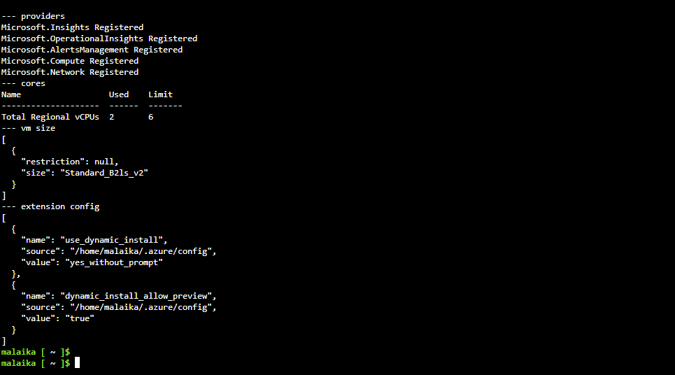</a>
 <b>Exhibit 1 — Step 1 check</b>
 Providers, quota, VM size
</td>
<td align="center" valign="top" width="50%">

<a href="Screenshots/ss-02-workspace-created.png">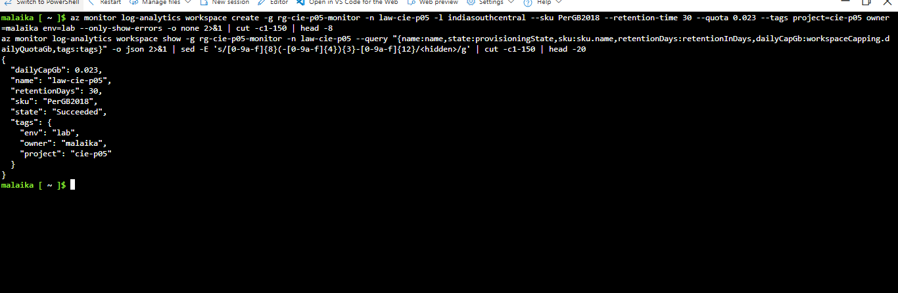</a>
 <b>Exhibit 2 — First workspace</b>
 30 days, 0.023 GB cap
</td>
</tr>
<tr>
<td align="center" valign="top" width="50%">

<a href="Screenshots/ss-03-vm-created.png">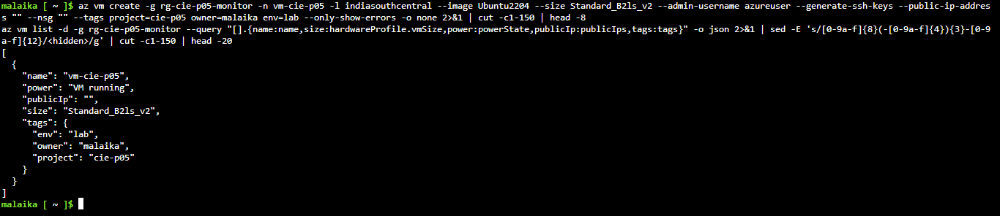</a>
 <b>Exhibit 3 — Linux VM</b>
 Running, no public IP
</td>
<td align="center" valign="top" width="50%">

<a href="Screenshots/ss-04-azure-monitor-agent.png">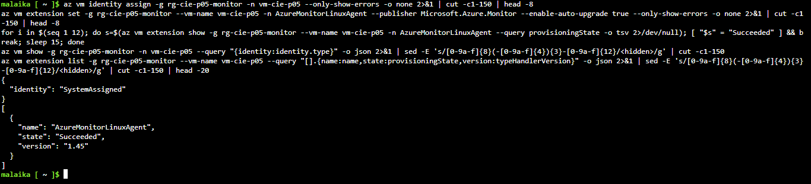</a>
 <b>Exhibit 4 — Azure Monitor Agent</b>
 Identity and extension
</td>
</tr>
</table>

---

## 🟠 Module 2 — Region Decision and Data Collection

Exhibits 5 to 9.

<table>
<tr>
<td align="center" valign="top" width="50%">

<a href="Screenshots/ss-05-allowed-regions-decision.png">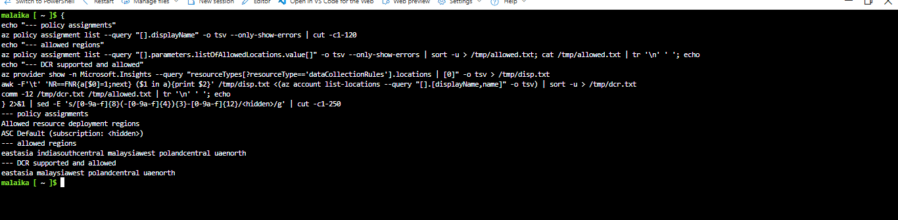</a>
 <b>Exhibit 5 — Region decision</b>
 Policy list and DCR regions
</td>
<td align="center" valign="top" width="50%">

<a href="Screenshots/ss-06-dcr-and-association.png">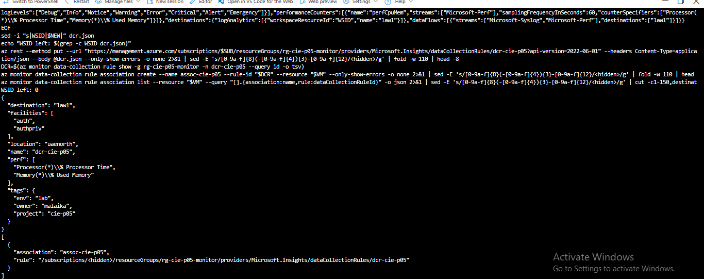</a>
 <b>Exhibit 6 — DCR and association</b>
 Rule in uaenorth, linked to VM
</td>
</tr>
<tr>
<td align="center" valign="top" width="50%">

<a href="Screenshots/ss-07-failed-ssh-logins.png">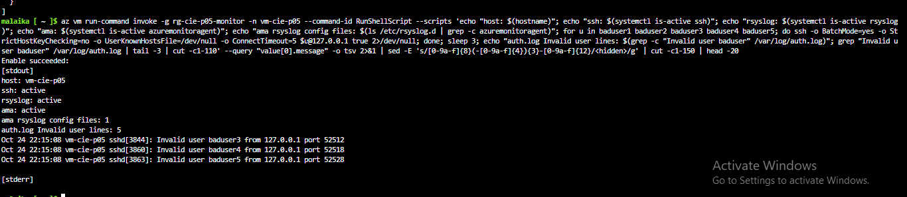</a>
 <b>Exhibit 7 — Failed SSH logins</b>
 Services active, 5 log lines
</td>
<td align="center" valign="top" width="50%">

<a href="Screenshots/ss-08-heartbeat-syslog-perf.png">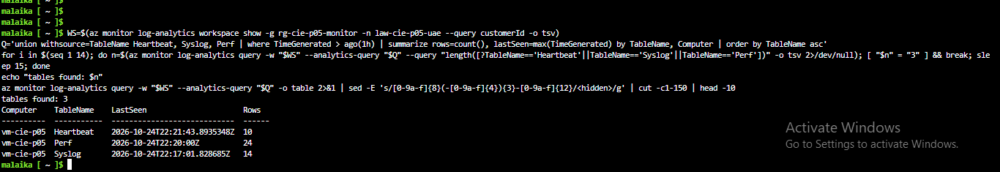</a>
 <b>Exhibit 8 — Tables with data</b>
 Heartbeat, Syslog, Perf
</td>
</tr>
<tr>
<td align="center" valign="top" width="50%">

<a href="Screenshots/ss-09-failed-login-query.png">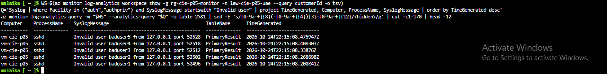</a>
 <b>Exhibit 9 — Failed-login query</b>
 Five baduser rows
</td>
<td width="50%"></td>
</tr>
</table>

---

## 🟢 Module 3 — Alerts and Notifications

Exhibits 10 to 15.

<table>
<tr>
<td align="center" valign="top" width="50%">

<a href="Screenshots/ss-10-action-group-metric-alert.png">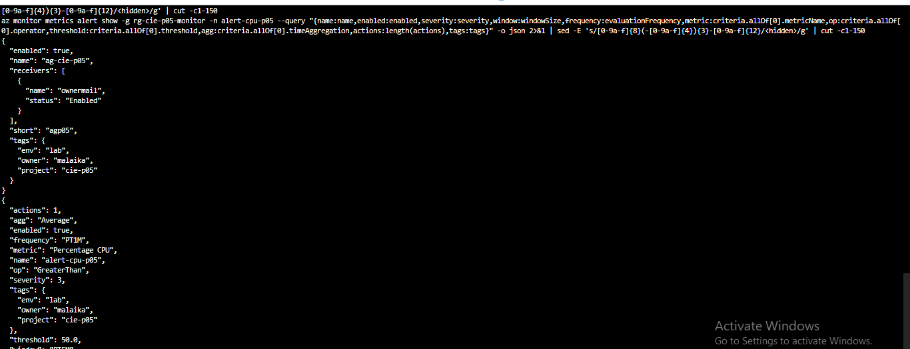</a>
 <b>Exhibit 10 — Action group and CPU alert</b>
 Receiver and rule values
</td>
<td align="center" valign="top" width="50%">

<a href="Screenshots/ss-11-metric-alert-fired.png">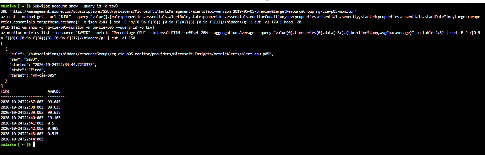</a>
 <b>Exhibit 11 — CPU alert fired</b>
 Fired, CPU near 99.6 %
</td>
</tr>
<tr>
<td align="center" valign="top" width="50%">

<a href="Screenshots/ss-12-alert-email-triggered.png">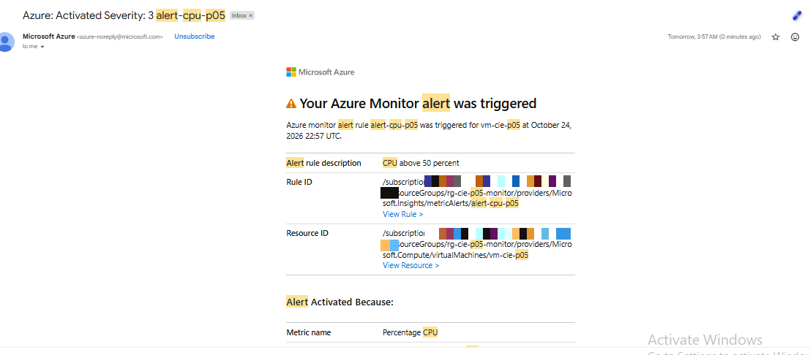</a>
 <b>Exhibit 12 — Alert e-mail</b>
 Activated, 22:57 UTC
</td>
<td align="center" valign="top" width="50%">

<a href="Screenshots/ss-13-alert-email-details.png">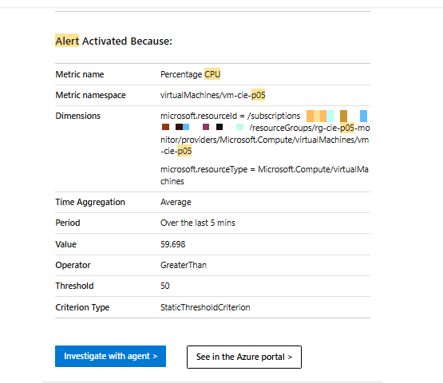</a>
 <b>Exhibit 13 — Alert e-mail details</b>
 Value 59.698 over 5 min
</td>
</tr>
<tr>
<td align="center" valign="top" width="50%">

<a href="Screenshots/ss-14-log-alert-rule.png">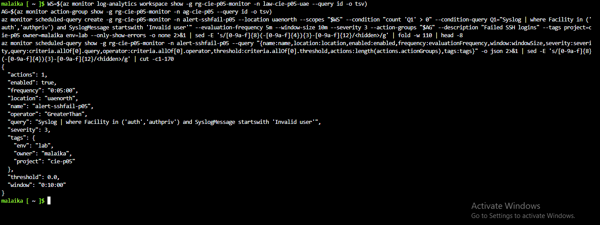</a>
 <b>Exhibit 14 — Log alert rule</b>
 Every 5 min, window 10 min
</td>
<td align="center" valign="top" width="50%">

<a href="Screenshots/ss-15-log-alert-fired.png">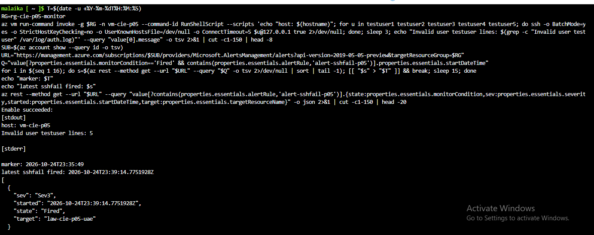</a>
 <b>Exhibit 15 — Log alert fired</b>
 23:39:14 UTC
</td>
</tr>
</table>

---

## 🟣 Module 4 — Workbook and Cleanup

Exhibits 16 to 20.

<table>
<tr>
<td align="center" valign="top" width="50%">

<a href="Screenshots/ss-16-workbook-query.png">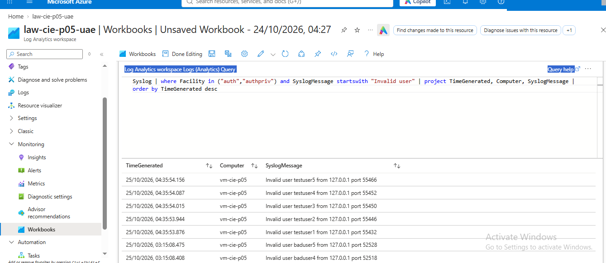</a>
 <b>Exhibit 16 — Workbook query</b>
 Unsaved, rows from the VM
</td>
<td align="center" valign="top" width="50%">

<a href="Screenshots/ss-17-workbook-saved.png">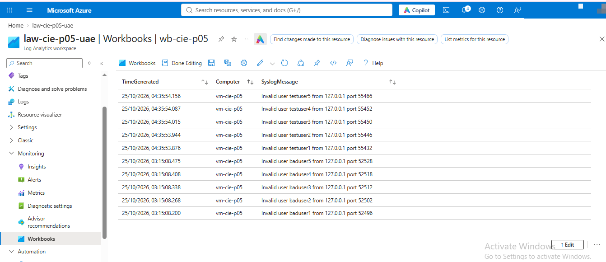</a>
 <b>Exhibit 17 — Workbook saved</b>
 <code>wb-cie-p05</code>
</td>
</tr>
<tr>
<td align="center" valign="top" width="50%">

<a href="Screenshots/ss-18-workspaces-deleted.png">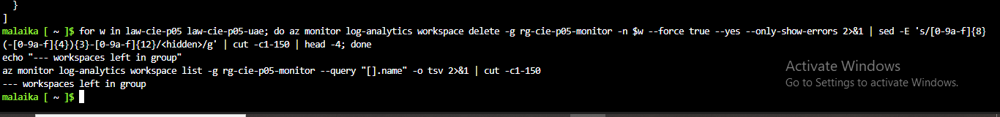</a>
 <b>Exhibit 18 — Workspaces deleted</b>
 Force delete, none left
</td>
<td align="center" valign="top" width="50%">

<a href="Screenshots/ss-19-group-deleted.png">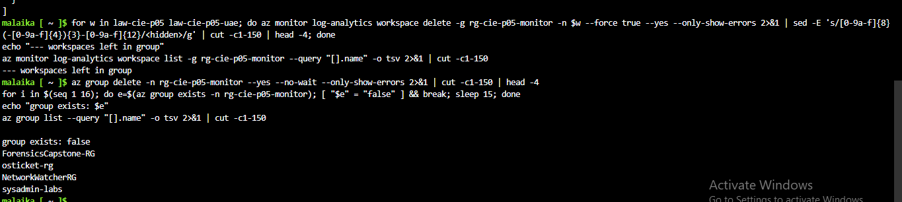</a>
 <b>Exhibit 19 — Group deleted</b>
 Four older groups remain
</td>
</tr>
<tr>
<td align="center" valign="top" width="50%">

<a href="Screenshots/ss-20-final-proof.png">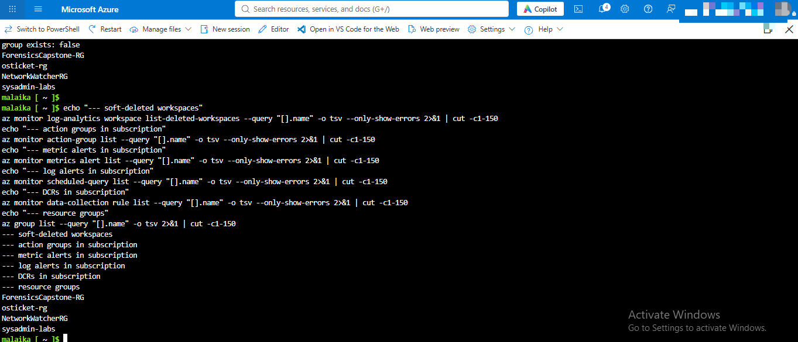</a>
 <b>Exhibit 20 — Final proof</b>
 No leftovers in subscription
</td>
<td width="50%"></td>
</tr>
</table>

---

## 🎯 Verification Checklist

| Check | Method | Module | Status |
|:---:|---|---|:---:|
| Providers, quota and VM size | Check command | Module 1 | ✅ Confirmed |
| Workspace with retention and cap | `workspace show` | Module 1 | ✅ 30 days, 0.023 GB |
| VM without public IP | `az vm list -d` | Module 1 | ✅ Confirmed |
| Azure Monitor Agent installed | `az vm extension list` | Module 1 | ✅ `Succeeded` |
| DCR linked to the VM | DCR show, association list | Module 2 | ✅ Confirmed |
| Failed logins generated | `auth.log` count in the VM | Module 2 | ✅ 5 lines |
| Data in Heartbeat, Syslog, Perf | KQL poll | Module 2 | ✅ 10, 14 and 24 rows |
| Failed-login query | KQL on `Syslog` | Module 2 | ✅ 5 rows |
| Action group and CPU alert | `show` commands | Module 3 | ✅ Confirmed |
| CPU alert fired | Alerts Management API | Module 3 | ✅ `Fired` |
| Alert e-mail received | Gmail | Module 3 | ✅ Activated e-mail (second fire) |
| Log alert rule | `scheduled-query show` | Module 3 | ✅ Confirmed |
| Log alert fired | Alerts Management API | Module 3 | ✅ `Fired` |
| Workbook saved | Azure portal | Module 4 | ✅ `wb-cie-p05` |
| Nothing left after cleanup | Subscription-wide lists | Module 4 | ✅ Confirmed |
| Real attacker IPs observed | Not part of this lab | Module 2 | ➖ Not shown |

> [!NOTE]
> The failed logins and the CPU load were started inside my own VM. The subscription ID and my e-mail address are blurred in the screenshots. Portal and Gmail times are UTC+5; server and API times are UTC.

---

[⬆️ Back to top](#top) &nbsp;·&nbsp; [📖 Full README](README.md)

☁️ **[Azure Monitor](https://learn.microsoft.com/azure/azure-monitor/)** · 🗄️ **[Log Analytics](https://learn.microsoft.com/azure/azure-monitor/logs/log-analytics-overview)**

