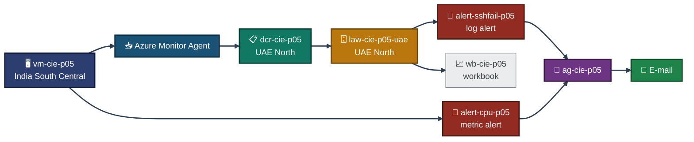
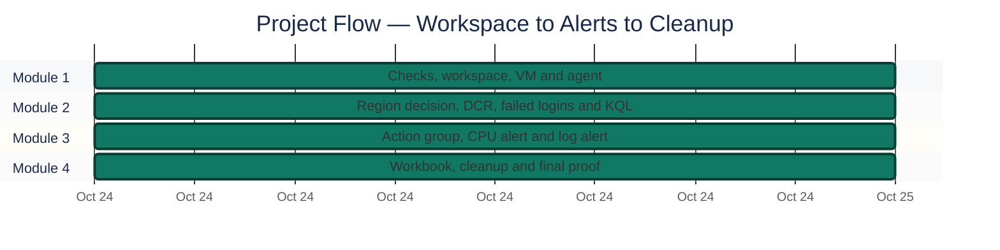
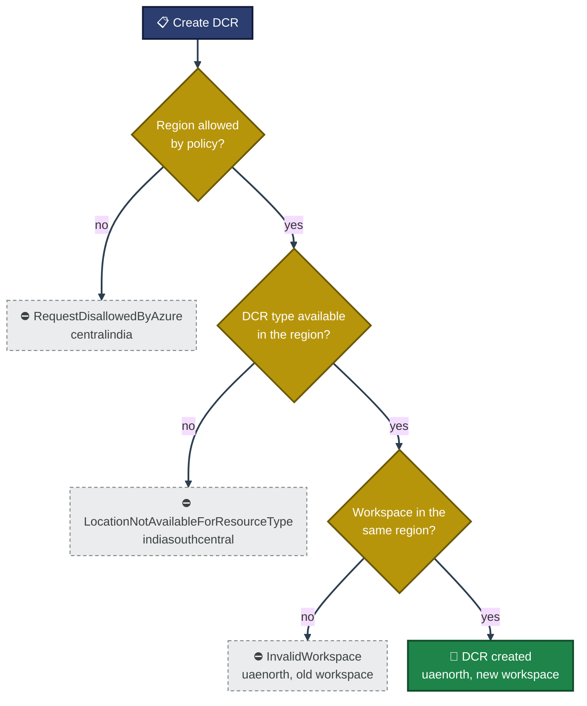
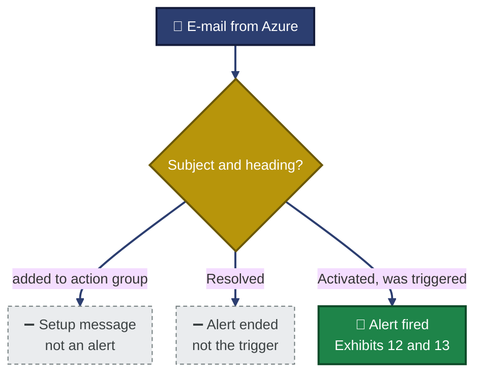

<div align="center">

# 📊 Azure Monitor and Log Analytics

**Project 05 of 06 — Cloud Infrastructure Engineering**

Monitoring a Linux VM with Azure Monitor Agent, Log Analytics, KQL, alerts and a workbook


One Ubuntu VM sends its SSH logs and CPU data to a Log Analytics workspace. Failed logins are found with KQL, a CPU alert and a log alert both fire, and a workbook shows the data. Every result has a screenshot, and every gap is written down.

### [📑 Open the visual index](Monitor-INDEX.md)

</div>

---

## 📑 Table of Contents

1. [At a Glance](#at-a-glance)
2. [Project Background](#project-background)
3. [Environment](#environment)
4. [Project Flow](#project-flow)
5. [Module 1 — Workspace, VM and Agent](#module-1)
6. [Module 2 — Region Decision and Data Collection](#module-2)
7. [Module 3 — Alerts and Notifications](#module-3)
8. [Module 4 — Workbook and Cleanup](#module-4)
9. [Command Reference](#command-reference)
10. [Project Summary](#project-summary)
11. [Challenges & Fixes](#challenges-fixes)
12. [Scope & Limitations](#scope-limitations)
13. [What I Learned](#what-i-learned)
14. [Skills Demonstrated](#skills-demonstrated)
15. [Cleanup](#cleanup)
16. [Screenshot Index](#screenshot-index)
17. [Repo Structure](#repo-structure)

---

<a id="at-a-glance"></a>
## 📊 At a Glance

| 🧩 Modules | 🪜 Steps | 🖼️ Screenshots | 🔔 Alert Rules | 📡 Tables With Data | 💰 Cost |
|:---:|:---:|:---:|:---:|:---:|:---:|
| **4** | **17** | **20** | **2** | **3** | **Student credits** |

---

<a id="project-background"></a>
## 📖 Project Background

A server that nobody watches fails quietly. Azure Monitor collects logs and metrics, Log Analytics stores them, and alert rules tell a person when something crosses a limit. This project builds that chain on one VM and proves each link with data from the VM itself.

- **Module 1 — Workspace, VM and Agent:** Create a workspace with a short retention and a small daily cap, create a Linux VM, install Azure Monitor Agent.
- **Module 2 — Region Decision and Data Collection:** Pick a region that the subscription policy and the Azure resource types both allow, create a Data Collection Rule, generate failed SSH logins, and find them with KQL.
- **Module 3 — Alerts and Notifications:** Create an action group, a CPU metric alert and a log alert on failed logins, make both fire, and receive the e-mail.
- **Module 4 — Workbook and Cleanup:** Save a workbook with the failed-login query, then delete everything and prove nothing is left.

> [!NOTE]
> The failed logins come from the VM itself (`ssh` to `127.0.0.1` with made-up user names), not from a real attacker. The CPU load was started inside the VM. Items taken from my notes or from text I pasted into the chat, with no screenshot in this repo, are marked 📝.

<div align="center">

### 🧩 Lab at a Glance

<table>
<tr>
<td align="center" valign="top" width="42%">


**Source**<br>
<sub>Ubuntu 22.04, Standard_B2ls_v2<br>India South Central, no public IP</sub>

</td>
<td align="center" valign="middle" width="16%">

**➜**<br>
<sub>logs and metrics</sub>

</td>
<td align="center" valign="top" width="42%">


**Log Analytics**<br>
<sub>UAE North, 30 day retention<br>0.023 GB daily cap</sub>

</td>
</tr>
</table>

</div>

---

<a id="environment"></a>
## 🖧 Environment

| Item | Value |
|---|---|
| **Subscription** | Azure for Students |
| **Resource group** | `rg-cie-p05-monitor` (created in `indiasouthcentral`) |
| **VM** | `vm-cie-p05`, `Standard_B2ls_v2`, `Ubuntu2204`, user `azureuser`, no public IP, no NSG |
| **Agent** | `AzureMonitorLinuxAgent` 1.45, system-assigned identity |
| **Workspace** | `law-cie-p05-uae` in `uaenorth` (first workspace `law-cie-p05` in `indiasouthcentral` was replaced, see Challenges) |
| **Data Collection Rule** | `dcr-cie-p05` in `uaenorth`, association `assoc-cie-p05` |
| **Alert rules** | `alert-cpu-p05` (metric), `alert-sshfail-p05` (log, in `uaenorth`) |
| **Action group** | `ag-cie-p05`, short name `agp05`, one e-mail receiver |
| **Workbook** | `wb-cie-p05` |
| **Work date** | Oct 24, 2026 (UTC) |

> [!IMPORTANT]
> The subscription has an Azure Policy "Allowed resource deployment regions" that allows `eastasia`, `indiasouthcentral`, `malaysiawest`, `polandcentral` and `uaenorth` (Exhibit 5). Data Collection Rules and log alert rules are not available in `indiasouthcentral`. A Data Collection Rule must also be in the same location as its workspace. That is why the workspace, the DCR and the log alert are in `uaenorth` while the VM stays in `indiasouthcentral`.

### 🗺️ Architecture


<p align="center"><em>Built from Exhibits 3, 4, 6, 10, 14 and 17. The diagram shows the design, it is not a screenshot.</em></p>

---

<a id="project-flow"></a>
## ⏱️ Project Flow


<p align="center"><em>All stages complete. Clock times are left out because most screenshots do not show them.</em></p>

---

<a id="module-1"></a>
## 🔵 Module 1 — Workspace, VM and Agent

**Objective:** Check the subscription, then create a workspace, a VM and the agent that will send data.

### Step 1 — Check providers, quota and VM size ✅

<p align="center">
  <br>
  <em>Exhibit 1 — Step 1 check: five providers <code>Registered</code>, Total Regional vCPUs 2 used of 6, <code>Standard_B2ls_v2</code> with <code>restriction: null</code>, both extension settings set</em>
</p>

### Step 2 — Create the resource group and workspace ✅

The first try with a 4 day retention was rejected (see Challenges). 30 days was accepted.

<p align="center">
  <br>
  <em>Exhibit 2 — First workspace <code>law-cie-p05</code>: <code>Succeeded</code>, <code>PerGB2018</code>, retention 30 days, daily cap 0.023 GB, three tags</em>
</p>

### Step 3 — Create the Linux VM ✅

<p align="center">
  <br>
  <em>Exhibit 3 — <code>vm-cie-p05</code>: <code>Standard_B2ls_v2</code>, <code>VM running</code>, empty public IP, three tags</em>
</p>

### Step 4 — Assign an identity and install Azure Monitor Agent ✅

<p align="center">
  <br>
  <em>Exhibit 4 — Identity <code>SystemAssigned</code> and extension <code>AzureMonitorLinuxAgent</code> <code>Succeeded</code>, version 1.45</em>
</p>

🎯 **Result:** The VM runs without a public IP and has Azure Monitor Agent in state `Succeeded`.

### 🔍 Analyst Note — How This Would Be Handled in Production

*General practice, not a lab result.*

- **Step 1:** Choose retention and the daily cap from the data volume and the cost limit. A small cap stops ingestion for the rest of the day when it is reached.
- **Step 2:** Use a managed identity for the agent, never stored credentials.
- **Step 3:** Check policy and quota before creating anything, so nothing has to be built twice.

---

<a id="module-2"></a>
## 🟠 Module 2 — Region Decision and Data Collection

**Objective:** Find a region that policy and resource types both allow, tell the agent what to collect, and prove the data arrives.

### Step 5 — Decide the region and create the Data Collection Rule ✅

The DCR first failed with `LocationNotAvailableForResourceType` in `indiasouthcentral`, then with `RequestDisallowedByAzure` in `centralindia`. Instead of trying regions one by one, I read the policy's allowed list and intersected it with the regions that support Data Collection Rules.

<p align="center">
  <br>
  <em>Exhibit 5 — Policy <code>Allowed resource deployment regions</code> allows five regions; four of them also support Data Collection Rules (<code>eastasia malaysiawest polandcentral uaenorth</code>)</em>
</p>

A DCR in `uaenorth` still failed with `InvalidWorkspace`, because the workspace was in `indiasouthcentral` and Azure needs the same location. A second workspace `law-cie-p05-uae` was created in `uaenorth` 📝 (its values `Succeeded`, `uaenorth`, 30 days, 0.023 GB were printed in a pasted command output, with no screenshot in this repo). Then the DCR and the association worked:

<p align="center">
  <br>
  <em>Exhibit 6 — <code>dcr-cie-p05</code> in <code>uaenorth</code>: facilities <code>auth</code> and <code>authpriv</code>, CPU and memory counters, destination <code>law1</code>; association <code>assoc-cie-p05</code> points to the rule</em>
</p>

| Field | Value |
|---|---|
| DCR | `dcr-cie-p05`, location `uaenorth` |
| Syslog facilities | `auth`, `authpriv` |
| Performance counters | `Processor(*)\% Processor Time`, `Memory(*)\% Used Memory` |
| Destination | `law1` (the new workspace) |
| Association | `assoc-cie-p05`, rule `dcr-cie-p05` |

### Step 6 — Generate failed SSH logins inside the VM ✅

`az vm run-command` ran five `ssh` attempts to `127.0.0.1` as `baduser1` to `baduser5`.

<p align="center">
  <br>
  <em>Exhibit 7 — Inside the VM: <code>ssh</code>, <code>rsyslog</code> and <code>ama</code> all <code>active</code>, 1 AMA rsyslog config file, 5 <code>Invalid user</code> lines in <code>auth.log</code></em>
</p>

### Step 7 — Wait for the data and count the rows ✅

A polling loop re-ran a KQL query until Heartbeat, Syslog and Perf all had rows.

<p align="center">
  <br>
  <em>Exhibit 8 — Rows for <code>vm-cie-p05</code>: Heartbeat 10, Perf 24, Syslog 14; <code>tables found: 3</code></em>
</p>

### Step 8 — Find the failed logins with KQL ✅

<p align="center">
  <br>
  <em>Exhibit 9 — KQL result: five <code>Invalid user baduser1</code> to <code>baduser5</code> rows from <code>sshd</code>, all at 22:15:08 UTC</em>
</p>

🎯 **Result:** The agent sends Heartbeat, Perf and Syslog data to the workspace, and the five failed logins are found with one query.

| Table | Rows (last hour) | Last seen (UTC) |
|---|:---:|---|
| Heartbeat | 10 | 22:21:43 |
| Perf | 24 | 22:20:00 |
| Syslog | 14 | 22:17:01 |

### 🗺️ What Decides the Region


<p align="center"><em>Green is the working path (Exhibits 5 and 6). Dashed boxes are the three errors met on the way, written in Challenges. They have no screenshot in this repo.</em></p>

### 🔍 Analyst Note — How This Would Be Handled in Production

*General practice, not a lab result.*

- **Step 1:** Read the policy that limits regions and check which resource types exist there before choosing a region.
- **Step 2:** Collect only the facilities and counters that a detection or an alert needs. Everything collected is billed.
- **Step 3:** Failed logins in `auth.log` are the first signal of password guessing. A query like Exhibit 9, grouped by source IP, is the usual next step.

---

<a id="module-3"></a>
## 🟢 Module 3 — Alerts and Notifications

**Objective:** Notify a person when CPU is high or when failed logins appear, and prove the alert fired and the e-mail arrived.

### Step 9 — Create the action group and the CPU metric alert ✅

<p align="center">
  <br>
  <em>Exhibit 10 — Action group <code>ag-cie-p05</code> (receiver <code>ownermail</code> Enabled) and alert <code>alert-cpu-p05</code>: Average <code>Percentage CPU</code> GreaterThan 50, window PT5M, frequency PT1M, severity 3</em>
</p>

### Step 10 — Load the CPU and wait for the alert ✅

A command inside the VM ran two busy loops for up to 10 minutes. A polling loop on the Alerts Management API waited for a `Fired` alert.

<p align="center">
  <br>
  <em>Exhibit 11 — Alert <code>Fired</code>, Sev3, started 2026-10-24 22:34:44 UTC, target <code>vm-cie-p05</code>; the CPU average was about 99.6 % from 22:37 to 22:39, then 19.1 % and about 0.5 %</em>
</p>

### Step 11 — Check the alert e-mail ✅

The first e-mail that arrived after I verified the address was the "added to action group" message. It does not prove an alert. A second fire at 22:57 UTC (from a second load run 📝, whose command screenshot is not in this repo) produced a real alert e-mail:

<p align="center">
  <br>
  <em>Exhibit 12 — E-mail <code>Azure: Activated Severity: 3 alert-cpu-p05</code>: triggered for <code>vm-cie-p05</code> at 22:57 UTC (subscription ID blurred)</em>
</p>

<p align="center">
  <br>
  <em>Exhibit 13 — Same e-mail, lower part: Percentage CPU, Average, over the last 5 minutes, value 59.698, GreaterThan, threshold 50</em>
</p>

> [!NOTE]
> The e-mail shown is for the second fire (22:57 UTC). The first fire at 22:34 UTC is in Exhibit 11, and I found no e-mail for it. The address was verified after that fire. I did not prove this is the reason.

### Step 12 — Create the log alert on failed logins ✅

<p align="center">
  <br>
  <em>Exhibit 14 — <code>alert-sshfail-p05</code> in <code>uaenorth</code>: enabled, every 5 minutes over 10 minutes, severity 3, query on <code>Invalid user</code>, GreaterThan 0.0, one action group, three tags</em>
</p>

### Step 13 — Generate new failed logins and wait for the log alert ✅

<p align="center">
  <br>
  <em>Exhibit 15 — 5 new failed logins (<code>testuser1</code> to <code>testuser5</code>); <code>alert-sshfail-p05</code> alert <code>Fired</code> at 23:39:14 UTC, Sev3, target <code>law-cie-p05-uae</code> (marker 23:35:49 UTC)</em>
</p>

🎯 **Result:** Both alert rules fired on real data from the VM, and the CPU alert reached the inbox.

| Rule | Type | Condition | Fired (UTC) |
|---|---|---|---|
| `alert-cpu-p05` | Metric | Average `Percentage CPU` > 50, window 5 min | 22:34:44 and 22:57 |
| `alert-sshfail-p05` | Log | Count of `Invalid user` rows > 0, every 5 min over 10 min | 23:39:14 |

### 🗺️ What Counts as Proof of an Alert


<p align="center"><em>Azure sends three kinds of e-mail around an alert. Only the Activated one shows the alert fired.</em></p>

### 🔍 Analyst Note — How This Would Be Handled in Production

*General practice, not a lab result.*

- **Step 1:** Set the threshold and window from normal behaviour, so a short spike does not page anyone.
- **Step 2:** Send alerts to a shared mailbox or a team channel, not one person.
- **Step 3:** Test every alert once with real data, as done here, before relying on it.

---

<a id="module-4"></a>
## 🟣 Module 4 — Workbook and Cleanup

**Objective:** Show the failed-login data in a saved workbook, then delete everything and prove nothing is left.

### Step 14 — Build and save the workbook ✅

The query ran in the workbook editor first:

<p align="center">
  <br>
  <em>Exhibit 16 — Workbook editor (still unsaved) with the query and its first rows from <code>vm-cie-p05</code> (<code>testuser</code> and <code>baduser</code> logins); portal times are UTC+5</em>
</p>

The first Save failed with `RequestDisallowedByAzure` because the location was not in the policy list. After choosing a location from the dropdown, the save worked 📝 (the location chosen is not visible in any screenshot).

<p align="center">
  <br>
  <em>Exhibit 17 — Workbook saved as <code>wb-cie-p05</code> with ten rows (<code>testuser1</code> to <code>5</code>, <code>baduser1</code> to <code>5</code>)</em>
</p>

### Step 15 — Delete both workspaces permanently ✅

Workspaces were deleted before the group so that none stays in the soft-deleted state.

<p align="center">
  <br>
  <em>Exhibit 18 — Both workspaces deleted with <code>--force true</code>; no workspace left in the group</em>
</p>

### Step 16 — Delete the resource group ✅

<p align="center">
  <br>
  <em>Exhibit 19 — <code>group exists: false</code>; four older groups remain</em>
</p>

### Step 17 — Check that nothing is left in the subscription ✅

<p align="center">
  <br>
  <em>Exhibit 20 — No soft-deleted workspace, action group, metric alert, log alert or DCR in the subscription; same four groups</em>
</p>

🎯 **Result:** The group is gone, and no soft-deleted workspace, action group, alert rule or Data Collection Rule remains in the subscription.

### 🔍 Analyst Note — How This Would Be Handled in Production

*General practice, not a lab result.*

- **Step 1:** Keep workbooks and queries in source control, so they can be rebuilt.
- **Step 2:** Plan deletion order. A workspace deleted with its group can stay soft-deleted and block its name.

---

<a id="command-reference"></a>
## 🧰 Command Reference

All commands were run in Azure Cloud Shell (Bash). The full text is in `commands/commands.md`.

| # | Command | Used In | Purpose |
|:---:|---|---|---|
| 1 | `az provider show` / `az vm list-usage` / `az vm list-skus` | Step 1 | Providers, vCPU quota, VM size |
| 2 | `az monitor log-analytics workspace create` | Step 2 | Workspace with retention and daily cap |
| 3 | `az vm create` | Step 3 | VM without public IP |
| 4 | `az vm identity assign` / `az vm extension set` | Step 4 | Identity and Azure Monitor Agent |
| 5 | `az policy assignment list` / `az provider show` | Step 5 | Allowed regions and DCR regions |
| 6 | `az rest --method put` / `az monitor data-collection rule association create` | Step 5 | DCR and association |
| 7 | `az vm run-command invoke` | Steps 6 and 10 | Failed logins and CPU load inside the VM |
| 8 | `az monitor log-analytics query` | Steps 7 and 8 | KQL from the CLI |
| 9 | `az monitor action-group create` / `az monitor metrics alert create` | Step 9 | Action group and CPU alert |
| 10 | `az rest --method get` (Alerts Management) | Steps 10 and 13 | Wait for a `Fired` alert |
| 11 | `az monitor scheduled-query create` | Step 12 | Log alert |
| 12 | `az monitor log-analytics workspace delete --force true` | Step 15 | Permanent delete |
| 13 | `az group delete` / `az group list` | Steps 16 and 17 | Group delete and proof |

---

<a id="project-summary"></a>
## 📝 Project Summary

| Part | Tooling | Key Finding |
|---|---|---|
| Workspace | `az monitor log-analytics` | 30 day retention accepted, 4 days rejected for `PerGB2018`; daily cap 0.023 GB |
| Collection | Azure Monitor Agent, DCR | Heartbeat, Syslog and Perf rows arrived for `vm-cie-p05` |
| Detection | KQL on `Syslog` | Five `Invalid user` rows found for five simulated logins |
| Metric alert | `az monitor metrics alert` | Fired at 22:34:44 UTC with CPU near 99.6 %, e-mail for the second fire received |
| Log alert | `az monitor scheduled-query` | Fired at 23:39:14 UTC after five new failed logins |
| Workbook | Azure portal | Saved with ten rows from the VM |
| Cleanup | `az group delete`, force workspace delete | Nothing left in the subscription |

---

<a id="challenges-fixes"></a>
## ⚠️ Challenges & Fixes

| ❌ Challenge | ✅ Fix |
|---|---|
| 📝 A 4 day retention was rejected with `InvalidParameter` ("property doesn't match the SKU limits") | Used 30 days, which was accepted (Exhibit 2). I do not claim 30 is the smallest allowed value |
| 📝 DCR creation in `indiasouthcentral` failed with `LocationNotAvailableForResourceType` | Listed the regions that support DCRs (Exhibit 5) |
| 📝 DCR creation in `centralindia` failed with `RequestDisallowedByAzure` (region policy) | Read the policy's allowed list and chose from the regions in both lists (Exhibit 5) |
| 📝 DCR in `uaenorth` failed with `InvalidWorkspace`: the workspace was in a different location | Created a second workspace in `uaenorth` and pointed the DCR to it (Exhibit 6) |
| 📝 Cloud Shell opened a new session and the DCR JSON file was gone, and `az rest` returned `UnsupportedMediaType` | Re-created the file in the same command and added `--headers Content-Type=application/json` |
| 📝 The first KQL check failed with `SyntaxError` because `last` is a reserved word | Renamed the column to `lastSeen` (Exhibit 8) |
| 📝 A log alert command failed with `unrecognized arguments: --window-duration` | Looked up the real name with `-h` and used `--window-size` |
| 📝 The log alert failed with `LocationNotAvailableForResourceType` in `indiasouthcentral` | Created it with `--location uaenorth` (Exhibit 14) |
| 📝 The Alerts API once returned a fired count of 1 but an empty list | Ran the list query again, which showed the alert (Exhibit 11). I do not know the reason |
| 📝 The first e-mails were "added to action group" and "Resolved", not the alert | Ran the load again and waited for the Activated e-mail (Exhibits 12 and 13) |
| 📝 The first workbook save failed with `RequestDisallowedByAzure` | Saved again with a location from the dropdown (Exhibit 17) |

<sub>📝 = no screenshot in this repo shows it. The error screens were left out on purpose.</sub>

---

<a id="scope-limitations"></a>
## 🚧 Scope & Limitations

- **Simulated attack:** The failed logins and the CPU load were started inside the VM. No real attacker IP was observed.
- **Two workspaces:** Exhibit 2 shows the first workspace, which was replaced. The values of the second workspace come from pasted output 📝.
- **Workbook location not visible:** The save dialog is not in a screenshot.
- **Cross-region setup:** The VM is in `indiasouthcentral` and the DCR in `uaenorth`. Data arrived (Exhibit 8), but I did not test other combinations.
- **Time zones:** Server and API times are UTC. Portal and Gmail times are UTC+5.
- **Lab size:** One VM, one workspace, one e-mail receiver.

These gaps are marked in the project instead of being hidden, so the results show what was actually proven.

---

<a id="what-i-learned"></a>
## 🧠 What I Learned

- **Check policy and region support first.** Three different location errors cost many steps. Reading the policy's allowed list and the supported regions once is faster than trying regions.
- **Resources that depend on each other need the same location.** A DCR and its workspace must match.
- **Check CLI argument names before using them.** `az <command> -h` takes seconds, a wrong argument costs a step.
- **Only the Activated e-mail proves an alert.** "Added to action group" and "Resolved" e-mails look similar.
- **Poll instead of guessing.** Log ingestion and alert evaluation take minutes, so a loop that waits for the result is better than a fixed sleep.
- **A screenshot must show the claim.** A cut-off result is not proof.

---

<a id="skills-demonstrated"></a>
## 🛠️ Skills Demonstrated

- Creating a Log Analytics workspace with retention and a daily cap
- Installing Azure Monitor Agent and writing a Data Collection Rule with Syslog and performance counters
- Reading an Azure Policy region list and choosing a region from it
- Writing KQL to find failed SSH logins
- Creating an action group, a metric alert and a log alert, and proving that both fire
- Running commands inside a VM with `az vm run-command`
- Building and saving a workbook
- Deleting resources in the right order and proving the subscription is clean

---

<a id="cleanup"></a>
## 🧹 Cleanup

Both workspaces were force deleted, then the group was deleted, then the subscription was checked for leftovers (Exhibits 18, 19 and 20). The commands are in `commands/cleanup.md`.

---

<a id="screenshot-index"></a>
## 🖼️ Screenshot Index

| # | File | Shows |
|:---:|---|---|
| 1 | `ss-01-combined-check.png` | Step 1 check — Providers, quota, VM size |
| 2 | `ss-02-workspace-created.png` | First workspace — 30 days, 0.023 GB cap |
| 3 | `ss-03-vm-created.png` | Linux VM — Running, no public IP |
| 4 | `ss-04-azure-monitor-agent.png` | Azure Monitor Agent — Identity and extension |
| 5 | `ss-05-allowed-regions-decision.png` | Region decision — Policy list and DCR regions |
| 6 | `ss-06-dcr-and-association.png` | DCR and association — Rule in uaenorth, linked to VM |
| 7 | `ss-07-failed-ssh-logins.png` | Failed SSH logins — Services active, 5 log lines |
| 8 | `ss-08-heartbeat-syslog-perf.png` | Tables with data — Heartbeat, Syslog, Perf |
| 9 | `ss-09-failed-login-query.png` | Failed-login query — Five baduser rows |
| 10 | `ss-10-action-group-metric-alert.png` | Action group and CPU alert — Receiver and rule values |
| 11 | `ss-11-metric-alert-fired.png` | CPU alert fired — Fired, CPU near 99.6 % |
| 12 | `ss-12-alert-email-triggered.png` | Alert e-mail — Activated, 22:57 UTC |
| 13 | `ss-13-alert-email-details.png` | Alert e-mail details — Value 59.698 over 5 min |
| 14 | `ss-14-log-alert-rule.png` | Log alert rule — Every 5 min, window 10 min |
| 15 | `ss-15-log-alert-fired.png` | Log alert fired — 23:39:14 UTC |
| 16 | `ss-16-workbook-query.png` | Workbook query — Unsaved, rows from the VM |
| 17 | `ss-17-workbook-saved.png` | Workbook saved — wb-cie-p05 |
| 18 | `ss-18-workspaces-deleted.png` | Workspaces deleted — Force delete, none left |
| 19 | `ss-19-group-deleted.png` | Group deleted — Four older groups remain |
| 20 | `ss-20-final-proof.png` | Final proof — No leftovers in subscription |

---

<a id="repo-structure"></a>
## 📁 Repo Structure

```text
Cloud-Infrastructure-Engineering/
`-- Azure/
    `-- 05-azure-monitor-log-analytics/
        |-- README.md
        |-- Monitor-INDEX.md
        |-- commands/
        |   |-- commands.md
        |   `-- cleanup.md
        `-- Screenshots/
        |-- ss-01-combined-check.png
        |-- ss-02-workspace-created.png
        |-- ss-03-vm-created.png
        |-- ss-04-azure-monitor-agent.png
        |-- ss-05-allowed-regions-decision.png
        |-- ss-06-dcr-and-association.png
        |-- ss-07-failed-ssh-logins.png
        |-- ss-08-heartbeat-syslog-perf.png
        |-- ss-09-failed-login-query.png
        |-- ss-10-action-group-metric-alert.png
        |-- ss-11-metric-alert-fired.png
        |-- ss-12-alert-email-triggered.png
        |-- ss-13-alert-email-details.png
        |-- ss-14-log-alert-rule.png
        |-- ss-15-log-alert-fired.png
        |-- ss-16-workbook-query.png
        |-- ss-17-workbook-saved.png
        |-- ss-18-workspaces-deleted.png
        |-- ss-19-group-deleted.png
        |-- ss-20-final-proof.png
```

<div align="center">

☁️ **[Azure Monitor](https://learn.microsoft.com/azure/azure-monitor/)** · 🗄️ **[Log Analytics](https://learn.microsoft.com/azure/azure-monitor/logs/log-analytics-overview)** · 📋 **[Data Collection Rules](https://learn.microsoft.com/azure/azure-monitor/essentials/data-collection-rule-overview)** · 🔔 **[Alerts](https://learn.microsoft.com/azure/azure-monitor/alerts/alerts-overview)**

</div>
