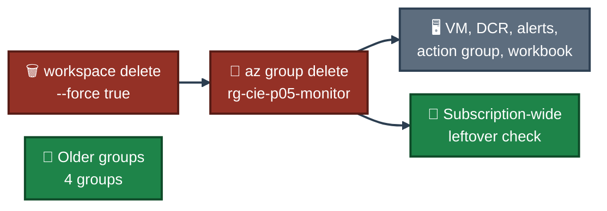

<a id="top"></a>
<div align="center">

# 🧹 Project 05 — Cleanup
### Azure Monitor and Log Analytics
**Project 05 of 06 — Cloud Infrastructure Engineering**


**Cleanup was the last part. Only this project's resource group and its workspaces were deleted. The older groups were not touched.**

### [📖 README](../README.md) &nbsp;·&nbsp; [📑 Visual Index](../Monitor-INDEX.md) &nbsp;·&nbsp; [⌨️ Commands](commands.md)

</div>

---

## ⌨️ Commands

| 📍 Where | Step | 🖼️ Proof | Result |
|:---:|:---:|:---:|---|
| ☁️ Cloud Shell (Bash) | 15 | **Exhibit 18** — `Screenshots/ss-18-workspaces-deleted.png` | both workspaces force deleted, none left in the group |
| ☁️ Cloud Shell (Bash) | 16 | **Exhibit 19** — `Screenshots/ss-19-group-deleted.png` | `group exists: false`, four older groups remain |
| ☁️ Cloud Shell (Bash) | 17 | **Exhibit 20** — `Screenshots/ss-20-final-proof.png` | no leftovers in the subscription |

```bash
# Step 15 — workspaces first, with --force, so none stays soft-deleted
for w in law-cie-p05 law-cie-p05-uae; do az monitor log-analytics workspace delete -g rg-cie-p05-monitor -n $w --force true --yes --only-show-errors; done
az monitor log-analytics workspace list -g rg-cie-p05-monitor --query "[].name" -o tsv
```

```bash
# Step 16 — the resource group
az group delete -n rg-cie-p05-monitor --yes --no-wait --only-show-errors
for i in $(seq 1 16); do e=$(az group exists -n rg-cie-p05-monitor); [ "$e" = "false" ] && break; sleep 15; done
echo "group exists: $e"
az group list --query "[].name" -o tsv
```

```bash
# Step 17 — leftovers across the whole subscription
az monitor log-analytics workspace list-deleted-workspaces --query "[].name" -o tsv --only-show-errors
az monitor action-group list --query "[].name" -o tsv --only-show-errors
az monitor metrics alert list --query "[].name" -o tsv --only-show-errors
az monitor scheduled-query list --query "[].name" -o tsv --only-show-errors
az monitor data-collection rule list --query "[].name" -o tsv --only-show-errors
az group list --query "[].name" -o tsv
```

---

## 🗑️ What This Removed

Everything inside `rg-cie-p05-monitor`:

| Resource | Includes |
|---|---|
| 🗄️ Workspaces `law-cie-p05` and `law-cie-p05-uae` | all collected Heartbeat, Syslog and Perf data (force deleted before the group) |
| 🖥️ VM `vm-cie-p05` | the VM and the disk and network resources created with it, Azure Monitor Agent, the association `assoc-cie-p05` |
| 📋 Data Collection Rule `dcr-cie-p05` | in `uaenorth` |
| 🔔 Alert rules | `alert-cpu-p05` (metric) and `alert-sshfail-p05` (log) |
| 📣 Action group `ag-cie-p05` | one e-mail receiver |
| 📈 Workbook `wb-cie-p05` | the saved query |


<p align="center"><em>Workspaces go first so none stays in the soft-deleted state. The older groups are not in any command.</em></p>

---

## ✅ What Proves It

Exhibits 18 to 20:

| Check | Result |
|---|:---:|
| Workspaces left in `rg-cie-p05-monitor` after Step 15 | ✅ None |
| `group exists` after Step 16 | ✅ `false` |
| Soft-deleted workspaces in the subscription | ✅ None |
| Action groups, metric alerts, log alerts, Data Collection Rules | ✅ None |

| Resource group | In the list after cleanup? |
|---|:---:|
| `rg-cie-p05-monitor` | ❌ No (deleted) |
| `ForensicsCapstone-RG` | ✅ Yes |
| `osticket-rg` | ✅ Yes |
| `NetworkWatcherRG` | ✅ Yes |
| `sysadmin-labs` | ✅ Yes |

---

## 🚧 Not Checked

- Whether the workspace names `law-cie-p05` and `law-cie-p05-uae` can be reused right away. I did not try to create them again.
- The cost shown in billing. No claim is made about it.

---

<div align="center">

[⬆️ Back to top](#top) &nbsp;·&nbsp; [📖 README](../README.md) &nbsp;·&nbsp; [⌨️ Commands](commands.md)

</div>
