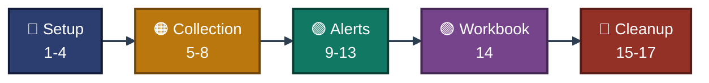

<a id="top"></a>
<div align="center">

# ⌨️ Project 05 — Commands
### Azure Monitor and Log Analytics
**Project 05 of 06 — Cloud Infrastructure Engineering**


**Every command used in this project, in order, with where it ran and which exhibit proves it.**

### [📖 README](../README.md) &nbsp;·&nbsp; [📑 Visual Index](../Monitor-INDEX.md) &nbsp;·&nbsp; [🧹 Cleanup](cleanup.md)

</div>

---

## 🧭 How to Read This File

| Mark | Meaning |
|:---:|---|
| ✅ | Ran, and a screenshot in `../Screenshots/` proves the result. The exhibit number is given. |
| 📝 | Ran, but there is no screenshot of it in the repo. The text says which exhibit proves the result, or that nothing proves it. |
| `<...>` | A value that is not kept in the repo (e-mail address). |

| 📍 Where it ran | Shown as |
|---|:---:|
| Azure Cloud Shell (Bash), prompt `malaika [ ~ ]` | ☁️ **Cloud Shell** |
| Inside `vm-cie-p05`, started from Cloud Shell with `az vm run-command` | 🖥️ **VM** |
| Azure portal in the browser | 🌐 **Portal** |
| Gmail in the browser | 📧 **Gmail** |

Command output was piped through `sed` (to hide GUIDs) and `cut` or `fold` (to shorten lines) when it was run. Those filters are left out here to keep the commands readable.

---

## 📊 At a Glance

| 🔵 Setup | 🟠 Collection | 🟢 Alerts | 🟣 Workbook | 🧹 Cleanup |
|:---:|:---:|:---:|:---:|:---:|
| **Steps 1-4** | **Steps 5-8** | **Steps 9-13** | **Step 14** | **Steps 15-17** |
| checks, workspace, VM, agent | region, DCR, logins, KQL | action group, two alerts, e-mail | workbook | delete, proof |


<p align="center"><em>Order of the command groups. Step numbers match the README.</em></p>

### 🧰 Commands by Azure Area

| Area | Main commands |
|---|---|
| Checks | `az provider show / register`, `az vm list-usage`, `az vm list-skus`, `az policy assignment list` |
| Resource group and VM | `az group create / delete / list`, `az vm create / show / list / run-command invoke`, `az vm identity assign`, `az vm extension set / show / list` |
| Log Analytics | `az monitor log-analytics workspace create / show / delete / list-deleted-workspaces`, `az monitor log-analytics query` |
| Data Collection | `az rest --method put` (DCR), `az monitor data-collection rule show / list`, `az monitor data-collection rule association create / list` |
| Alerts | `az monitor action-group create / show`, `az monitor metrics alert create / show`, `az monitor scheduled-query create / show`, `az rest --method get` (Alerts Management), `az monitor metrics list` |

### 🔁 Placeholders

| Placeholder | What it stands for |
|---|---|
| `<ALERT_EMAIL>` | The e-mail address that receives the alerts. Not stored in the repo. |

---

## 🔵 Setup &nbsp;·&nbsp; Steps 1-4

### Step 1 — Check providers, quota and VM size &nbsp; ✅

| 📍 Where | 🖼️ Proof | Result |
|:---:|:---:|---|
| ☁️ Cloud Shell | **Exhibit 1** | five providers `Registered`, `Used 2`, `Limit 6`, size without restriction |

```bash
az config set extension.use_dynamic_install=yes_without_prompt extension.dynamic_install_allow_preview=true --only-show-errors
P="Microsoft.Insights Microsoft.OperationalInsights Microsoft.AlertsManagement Microsoft.Compute Microsoft.Network"
for p in $P; do s=$(az provider show -n $p --query registrationState -o tsv); [ "$s" != "Registered" ] && az provider register -n $p --only-show-errors; done
for i in $(seq 1 10); do n=$(for p in $P; do az provider show -n $p --query registrationState -o tsv; done | grep -vc Registered); [ "$n" = "0" ] && break; sleep 15; done
for p in $P; do echo "$p $(az provider show -n $p --query registrationState -o tsv)"; done
az vm list-usage -l indiasouthcentral --query "[?name.value=='cores'].{name:name.localizedValue,used:currentValue,limit:limit}" -o table
az vm list-skus -l indiasouthcentral --size Standard_B2ls_v2 --query "[].{size:name,restriction:restrictions[0].reasonCode}" -o json
az config get extension --only-show-errors
```

### Step 2 — Resource group and first workspace

**2a. First try with 4 days of retention** &nbsp; 📝 &nbsp; (failed: `InvalidParameter`, retention does not match the SKU limits)

```bash
az group create -n rg-cie-p05-monitor -l indiasouthcentral --tags project=cie-p05 owner=malaika env=lab --only-show-errors -o none
az monitor log-analytics workspace create -g rg-cie-p05-monitor -n law-cie-p05 -l indiasouthcentral --sku PerGB2018 --retention-time 4 --quota 0.023 --tags project=cie-p05 owner=malaika env=lab --only-show-errors -o none
```

**2b. Same command with 30 days** &nbsp; ✅

| 📍 Where | 🖼️ Proof | Result |
|:---:|:---:|---|
| ☁️ Cloud Shell | **Exhibit 2** | `Succeeded`, `PerGB2018`, 30 days, cap 0.023 GB, three tags |

```bash
az monitor log-analytics workspace create -g rg-cie-p05-monitor -n law-cie-p05 -l indiasouthcentral --sku PerGB2018 --retention-time 30 --quota 0.023 --tags project=cie-p05 owner=malaika env=lab --only-show-errors -o none
az monitor log-analytics workspace show -g rg-cie-p05-monitor -n law-cie-p05 --query "{name:name,state:provisioningState,sku:sku.name,retentionDays:retentionInDays,dailyCapGb:workspaceCapping.dailyQuotaGb,tags:tags}" -o json
```

### Step 3 — Linux VM without a public IP &nbsp; ✅

| 📍 Where | 🖼️ Proof | Result |
|:---:|:---:|---|
| ☁️ Cloud Shell | **Exhibit 3** | `VM running`, `Standard_B2ls_v2`, empty public IP, three tags |

```bash
az vm create -g rg-cie-p05-monitor -n vm-cie-p05 -l indiasouthcentral --image Ubuntu2204 --size Standard_B2ls_v2 --admin-username azureuser --generate-ssh-keys --public-ip-address "" --nsg "" --tags project=cie-p05 owner=malaika env=lab --only-show-errors -o none
az vm list -d -g rg-cie-p05-monitor --query "[].{name:name,size:hardwareProfile.vmSize,power:powerState,publicIp:publicIps,tags:tags}" -o json
```

### Step 4 — Identity and Azure Monitor Agent &nbsp; ✅

| 📍 Where | 🖼️ Proof | Result |
|:---:|:---:|---|
| ☁️ Cloud Shell | **Exhibit 4** | `SystemAssigned`, extension `Succeeded`, version 1.45 |

```bash
az vm identity assign -g rg-cie-p05-monitor -n vm-cie-p05 --only-show-errors -o none
az vm extension set -g rg-cie-p05-monitor --vm-name vm-cie-p05 -n AzureMonitorLinuxAgent --publisher Microsoft.Azure.Monitor --enable-auto-upgrade true --only-show-errors -o none
for i in $(seq 1 12); do s=$(az vm extension show -g rg-cie-p05-monitor --vm-name vm-cie-p05 -n AzureMonitorLinuxAgent --query provisioningState -o tsv 2>/dev/null); [ "$s" = "Succeeded" ] && break; sleep 15; done
az vm show -g rg-cie-p05-monitor -n vm-cie-p05 --query "{identity:identity.type}" -o json
az vm extension list -g rg-cie-p05-monitor --vm-name vm-cie-p05 --query "[].{name:name,state:provisioningState,version:typeHandlerVersion}" -o json
```

---

## 🟠 Module 2 — Region Decision and Data Collection &nbsp;·&nbsp; Steps 5-8

### Step 5 — Region decision, second workspace, DCR and association

**5a. Allowed regions and DCR regions** &nbsp; ✅

| 📍 Where | 🖼️ Proof | Result |
|:---:|:---:|---|
| ☁️ Cloud Shell | **Exhibit 5** | five allowed regions, four of them support DCRs |

```bash
az policy assignment list --query "[].displayName" -o tsv --only-show-errors
az policy assignment list --query "[].parameters.listOfAllowedLocations.value[]" -o tsv --only-show-errors | sort -u > /tmp/allowed.txt
az provider show -n Microsoft.Insights --query "resourceTypes[?resourceType=='dataCollectionRules'].locations | [0]" -o tsv > /tmp/disp.txt
awk -F'\t' 'NR==FNR{a[$0]=1;next} ($1 in a){print $2}' /tmp/disp.txt <(az account list-locations --query "[].[displayName,name]" -o tsv) | sort -u > /tmp/dcr.txt
comm -12 /tmp/dcr.txt /tmp/allowed.txt
```

> [!NOTE]
> Before this check, three DCR attempts failed 📝: in `indiasouthcentral` with `LocationNotAvailableForResourceType`, in `centralindia` with `RequestDisallowedByAzure`, and in `uaenorth` with `InvalidWorkspace` (the workspace was in a different location). A first look at the supported-region list also ran 📝 (its output was cut).

**5b. Second workspace in `uaenorth`** &nbsp; 📝 &nbsp; (the printed values, `Succeeded`, `uaenorth`, 30 days, 0.023 GB, were pasted as text, not as a screenshot)

```bash
az monitor log-analytics workspace create -g rg-cie-p05-monitor -n law-cie-p05-uae -l uaenorth --sku PerGB2018 --retention-time 30 --quota 0.023 --tags project=cie-p05 owner=malaika env=lab --only-show-errors -o none
```

**5c. DCR and association** &nbsp; ✅

| 📍 Where | 🖼️ Proof | Result |
|:---:|:---:|---|
| ☁️ Cloud Shell | **Exhibit 6** | DCR in `uaenorth`, facilities `auth` and `authpriv`, association `assoc-cie-p05` |

```bash
az config set extension.use_dynamic_install=yes_without_prompt extension.dynamic_install_allow_preview=true --only-show-errors
NEW=$(az monitor log-analytics workspace show -g rg-cie-p05-monitor -n law-cie-p05-uae --query id -o tsv) && VM=$(az vm show -g rg-cie-p05-monitor -n vm-cie-p05 --query id -o tsv) && SUB=$(az account show --query id -o tsv)
cat > dcr.json <<'JSON'
{"location":"uaenorth","kind":"Linux","tags":{"project":"cie-p05","owner":"malaika","env":"lab"},"properties":{"dataSources":{"syslog":[{"name":"syslogAuth","streams":["Microsoft-Syslog"],"facilityNames":["auth","authpriv"],"logLevels":["Debug","Info","Notice","Warning","Error","Critical","Alert","Emergency"]}],"performanceCounters":[{"name":"perfCpuMem","streams":["Microsoft-Perf"],"samplingFrequencyInSeconds":60,"counterSpecifiers":["Processor(*)\\% Processor Time","Memory(*)\\% Used Memory"]}]},"destinations":{"logAnalytics":[{"workspaceResourceId":"WSID","name":"law1"}]},"dataFlows":[{"streams":["Microsoft-Syslog","Microsoft-Perf"],"destinations":["law1"]}]}}
JSON
sed -i "s|WSID|$NEW|" dcr.json
az rest --method put --url "https://management.azure.com/subscriptions/$SUB/resourceGroups/rg-cie-p05-monitor/providers/Microsoft.Insights/dataCollectionRules/dcr-cie-p05?api-version=2022-06-01" --headers Content-Type=application/json --body @dcr.json --only-show-errors -o none
DCR=$(az monitor data-collection rule show -g rg-cie-p05-monitor -n dcr-cie-p05 --query id -o tsv)
az monitor data-collection rule association create --name assoc-cie-p05 --rule-id "$DCR" --resource "$VM" --only-show-errors -o none
az monitor data-collection rule show -g rg-cie-p05-monitor -n dcr-cie-p05 --query "{name:name,location:location,facilities:dataSources.syslog[0].facilityNames,perf:dataSources.performanceCounters[0].counterSpecifiers,destination:destinations.logAnalytics[0].name,tags:tags}" -o json
az monitor data-collection rule association list --resource "$VM" --query "[].{association:name,rule:dataCollectionRuleId}" -o json
```

> [!NOTE]
> An earlier run of this step lost `dcr.json` because Cloud Shell had opened a new session, and `az rest` once returned `UnsupportedMediaType` without the `Content-Type` header 📝. The command above is the self-contained version.

### Step 6 — Failed SSH logins inside the VM &nbsp; ✅

| 📍 Where | 🖼️ Proof | Result |
|:---:|:---:|---|
| 🖥️ VM (through `run-command`) | **Exhibit 7** | `ssh`, `rsyslog`, `ama` active, 5 `Invalid user` lines |

```bash
az vm run-command invoke -g rg-cie-p05-monitor -n vm-cie-p05 --command-id RunShellScript --scripts 'echo "host: $(hostname)"; echo "ssh: $(systemctl is-active ssh)"; echo "rsyslog: $(systemctl is-active rsyslog)"; echo "ama: $(systemctl is-active azuremonitoragent)"; echo "ama rsyslog config files: $(ls /etc/rsyslog.d | grep -c azuremonitoragent)"; for u in baduser1 baduser2 baduser3 baduser4 baduser5; do ssh -o BatchMode=yes -o StrictHostKeyChecking=no -o UserKnownHostsFile=/dev/null -o ConnectTimeout=5 $u@127.0.0.1 true 2>/dev/null; done; sleep 3; echo "auth.log Invalid user lines: $(grep -c "Invalid user baduser" /var/log/auth.log)"; grep "Invalid user baduser" /var/log/auth.log | tail -3 | cut -c1-110' --query "value[0].message" -o tsv
```

### Step 7 — Wait for Heartbeat, Syslog and Perf

**7a. First try** &nbsp; 📝 &nbsp; (failed: `SyntaxError`, `last` is a reserved word in KQL)

```bash
Q='union withsource=TableName Heartbeat, Syslog, Perf | where TimeGenerated > ago(1h) | summarize rows=count(), last=max(TimeGenerated) by TableName, Computer | order by TableName asc'
```

**7b. Column renamed to `lastSeen`** &nbsp; ✅

| 📍 Where | 🖼️ Proof | Result |
|:---:|:---:|---|
| ☁️ Cloud Shell | **Exhibit 8** | `tables found: 3`, Heartbeat 10, Perf 24, Syslog 14 rows |

```bash
WS=$(az monitor log-analytics workspace show -g rg-cie-p05-monitor -n law-cie-p05-uae --query customerId -o tsv)
Q='union withsource=TableName Heartbeat, Syslog, Perf | where TimeGenerated > ago(1h) | summarize rows=count(), lastSeen=max(TimeGenerated) by TableName, Computer | order by TableName asc'
for i in $(seq 1 14); do n=$(az monitor log-analytics query -w "$WS" --analytics-query "$Q" --query "length([?TableName=='Heartbeat'||TableName=='Syslog'||TableName=='Perf'])" -o tsv 2>/dev/null); [ "$n" = "3" ] && break; sleep 15; done
echo "tables found: $n"
az monitor log-analytics query -w "$WS" --analytics-query "$Q" -o table
```

### Step 8 — Failed-login query &nbsp; ✅

| 📍 Where | 🖼️ Proof | Result |
|:---:|:---:|---|
| ☁️ Cloud Shell | **Exhibit 9** | five rows, `baduser1` to `baduser5`, `sshd`, 22:15:08 UTC |

```bash
WS=$(az monitor log-analytics workspace show -g rg-cie-p05-monitor -n law-cie-p05-uae --query customerId -o tsv)
Q='Syslog | where Facility in ("auth","authpriv") and SyslogMessage startswith "Invalid user" | project TimeGenerated, Computer, ProcessName, SyslogMessage | order by TimeGenerated desc'
az monitor log-analytics query -w "$WS" --analytics-query "$Q" -o table
```

---

## 🟢 Module 3 — Alerts and Notifications &nbsp;·&nbsp; Steps 9-13

### Step 9 — Action group and CPU metric alert &nbsp; ✅

| 📍 Where | 🖼️ Proof | Result |
|:---:|:---:|---|
| ☁️ Cloud Shell | **Exhibit 10** | receiver `ownermail` Enabled, `GreaterThan` 50, `PT5M`, `PT1M`, severity 3 |

```bash
E="<ALERT_EMAIL>"
VM=$(az vm show -g rg-cie-p05-monitor -n vm-cie-p05 --query id -o tsv)
az monitor action-group create -g rg-cie-p05-monitor -n ag-cie-p05 --short-name agp05 --action email ownermail "$E" --tags project=cie-p05 owner=malaika env=lab --only-show-errors -o none
az monitor metrics alert create -g rg-cie-p05-monitor -n alert-cpu-p05 --scopes "$VM" --condition "avg Percentage CPU > 50" --window-size 5m --evaluation-frequency 1m --severity 3 --action ag-cie-p05 --description "CPU above 50 percent" --tags project=cie-p05 owner=malaika env=lab --only-show-errors -o none
az monitor action-group show -g rg-cie-p05-monitor -n ag-cie-p05 --query "{name:name,short:groupShortName,enabled:enabled,receivers:emailReceivers[].{name:name,status:status},tags:tags}" -o json
az monitor metrics alert show -g rg-cie-p05-monitor -n alert-cpu-p05 --query "{name:name,enabled:enabled,severity:severity,window:windowSize,frequency:evaluationFrequency,metric:criteria.allOf[0].metricName,op:criteria.allOf[0].operator,threshold:criteria.allOf[0].threshold,agg:criteria.allOf[0].timeAggregation,actions:length(actions),tags:tags}" -o json
```

### Step 10 — CPU load and wait for the alert

**10a. Start the load and poll** &nbsp; 📝 &nbsp; (`host: vm-cie-p05`, `load processes: 2`; after 4 minutes `fired alerts: 0`, then one run showed a count of 1 with an empty list)

```bash
SUB=$(az account show --query id -o tsv)
az vm run-command invoke -g rg-cie-p05-monitor -n vm-cie-p05 --command-id RunShellScript --scripts 'echo "host: $(hostname)"; for i in 1 2; do setsid nohup timeout 600 sh -c "while :; do :; done" >/dev/null 2>&1 & done; sleep 2; echo "load processes: $(pgrep -xc timeout)"' --query "value[0].message" -o tsv
URL="https://management.azure.com/subscriptions/$SUB/providers/Microsoft.AlertsManagement/alerts?api-version=2019-05-05-preview&targetResourceGroup=rg-cie-p05-monitor"
for i in $(seq 1 16); do n=$(az rest --method get --url "$URL" --query "length(value[?properties.essentials.monitorCondition=='Fired'])" -o tsv 2>/dev/null); [ "${n:-0}" -ge 1 ] && break; sleep 15; done
echo "fired alerts: ${n:-0}"
```

**10b. Alert list and CPU values** &nbsp; ✅

| 📍 Where | 🖼️ Proof | Result |
|:---:|:---:|---|
| ☁️ Cloud Shell | **Exhibit 11** | `Fired`, `Sev3`, started 22:34:44 UTC, CPU near 99.6 % |

```bash
SUB=$(az account show --query id -o tsv)
URL="https://management.azure.com/subscriptions/$SUB/providers/Microsoft.AlertsManagement/alerts?api-version=2019-05-05-preview&targetResourceGroup=rg-cie-p05-monitor"
az rest --method get --url "$URL" --query "value[].{rule:properties.essentials.alertRule,state:properties.essentials.monitorCondition,sev:properties.essentials.severity,started:properties.essentials.startDateTime,target:properties.essentials.targetResourceName}" -o json
VMID=$(az vm show -g rg-cie-p05-monitor -n vm-cie-p05 --query id -o tsv)
az monitor metrics list --resource "$VMID" --metric "Percentage CPU" --interval PT1M --offset 20M --aggregation Average --query "value[0].timeseries[0].data[-8:].{time:timeStamp,avgCpu:average}" -o table
```

### Step 11 — Alert e-mail &nbsp; ✅

| 📍 Where | 🖼️ Proof | Result |
|:---:|:---:|---|
| 📧 Gmail | **Exhibits 12 and 13** | `Azure: Activated Severity: 3 alert-cpu-p05`, triggered at 22:57 UTC, value 59.698 |

No command. The first e-mails were "added to action group" and "Resolved" 📝; only the Activated e-mail proves a fired alert. The second fire at 22:57 UTC came from a second load run 📝 (no screenshot of that command).

### Step 12 — Log alert on failed logins

**12a. First try** &nbsp; 📝 &nbsp; (failed: `unrecognized arguments: --window-duration 10m`)

```bash
az monitor scheduled-query create -g rg-cie-p05-monitor -n alert-sshfail-p05 --scopes "$WS" --condition "count 'Q1' > 0" --condition-query Q1="Syslog | where Facility in ('auth','authpriv') and SyslogMessage startswith 'Invalid user'" --evaluation-frequency 5m --window-duration 10m --severity 3 --action-groups "$AG" --description "Failed SSH logins" --tags project=cie-p05 owner=malaika env=lab --only-show-errors -o none
```

**12b. Look up the argument names** &nbsp; 📝 &nbsp; (`--window-size` is the real name)

```bash
az monitor scheduled-query create -h 2>&1 | grep -iE "^\s+--(window|evaluation|condition|action|scopes|severity|description|tags|skip)"
az extension list --query "[].{name:name,version:version}" -o table
```

**12c. With `--window-size`** &nbsp; 📝 &nbsp; (failed: `LocationNotAvailableForResourceType` in `indiasouthcentral`)

**12d. With `--location uaenorth`** &nbsp; ✅

| 📍 Where | 🖼️ Proof | Result |
|:---:|:---:|---|
| ☁️ Cloud Shell | **Exhibit 14** | `uaenorth`, enabled, `0:05:00`, `0:10:00`, severity 3, threshold 0.0 |

```bash
az config set extension.use_dynamic_install=yes_without_prompt extension.dynamic_install_allow_preview=true --only-show-errors
WS=$(az monitor log-analytics workspace show -g rg-cie-p05-monitor -n law-cie-p05-uae --query id -o tsv)
AG=$(az monitor action-group show -g rg-cie-p05-monitor -n ag-cie-p05 --query id -o tsv)
az monitor scheduled-query create -g rg-cie-p05-monitor -n alert-sshfail-p05 --location uaenorth --scopes "$WS" --condition "count 'Q1' > 0" --condition-query Q1="Syslog | where Facility in ('auth','authpriv') and SyslogMessage startswith 'Invalid user'" --evaluation-frequency 5m --window-size 10m --severity 3 --action-groups "$AG" --description "Failed SSH logins" --tags project=cie-p05 owner=malaika env=lab --only-show-errors -o none
az monitor scheduled-query show -g rg-cie-p05-monitor -n alert-sshfail-p05 --query "{name:name,location:location,enabled:enabled,frequency:evaluationFrequency,window:windowSize,severity:severity,query:criteria.allOf[0].query,operator:criteria.allOf[0].operator,threshold:criteria.allOf[0].threshold,actions:length(actions.actionGroups),tags:tags}" -o json
```

### Step 13 — New failed logins and wait for the log alert &nbsp; ✅

| 📍 Where | 🖼️ Proof | Result |
|:---:|:---:|---|
| 🖥️ VM, then ☁️ Cloud Shell | **Exhibit 15** | 5 `testuser` lines, alert `Fired` at 23:39:14 UTC |

```bash
T=$(date -u +%Y-%m-%dT%H:%M:%S)
RG=rg-cie-p05-monitor
az vm run-command invoke -g $RG -n vm-cie-p05 --command-id RunShellScript --scripts 'echo "host: $(hostname)"; for u in testuser1 testuser2 testuser3 testuser4 testuser5; do ssh -o BatchMode=yes -o StrictHostKeyChecking=no -o UserKnownHostsFile=/dev/null -o ConnectTimeout=5 $u@127.0.0.1 true 2>/dev/null; done; sleep 3; echo "Invalid user testuser lines: $(grep -c "Invalid user testuser" /var/log/auth.log)"' --query "value[0].message" -o tsv
SUB=$(az account show --query id -o tsv)
URL="https://management.azure.com/subscriptions/$SUB/providers/Microsoft.AlertsManagement/alerts?api-version=2019-05-05-preview&targetResourceGroup=$RG"
Q="value[?properties.essentials.monitorCondition=='Fired' && contains(properties.essentials.alertRule,'alert-sshfail-p05')].properties.essentials.startDateTime"
for i in $(seq 1 16); do s=$(az rest --method get --url "$URL" --query "$Q" -o tsv 2>/dev/null | sort | tail -1); [[ "$s" > "$T" ]] && break; sleep 15; done
echo "marker: $T"
echo "latest sshfail fired: $s"
az rest --method get --url "$URL" --query "value[?contains(properties.essentials.alertRule,'alert-sshfail-p05')].{state:properties.essentials.monitorCondition,sev:properties.essentials.severity,started:properties.essentials.startDateTime,target:properties.essentials.targetResourceName}" -o json
```

---

## 🟣 Module 4 — Workbook &nbsp;·&nbsp; Step 14

### Step 14 — Build and save the workbook &nbsp; ✅

| 📍 Where | 🖼️ Proof | Result |
|:---:|:---:|---|
| 🌐 Portal | **Exhibits 16 and 17** | query shows rows from `vm-cie-p05`, workbook saved as `wb-cie-p05` |

Portal steps: workspace `law-cie-p05-uae`, Workbooks, Empty, Add query (Logs, Log Analytics, this workspace), time range last 24 hours, Run Query, Done Editing, Save as `wb-cie-p05` in `rg-cie-p05-monitor`. The first Save failed with `RequestDisallowedByAzure` 📝; the second Save used a location from the dropdown (the location is not visible in a screenshot).

```kusto
Syslog | where Facility in ("auth","authpriv") and SyslogMessage startswith "Invalid user" | project TimeGenerated, Computer, SyslogMessage | order by TimeGenerated desc
```

---

## 🧹 Cleanup &nbsp;·&nbsp; Steps 15-17

### Step 15 — Delete both workspaces &nbsp; ✅

| 📍 Where | 🖼️ Proof | Result |
|:---:|:---:|---|
| ☁️ Cloud Shell | **Exhibit 18** | no workspace left in the group |

```bash
for w in law-cie-p05 law-cie-p05-uae; do az monitor log-analytics workspace delete -g rg-cie-p05-monitor -n $w --force true --yes --only-show-errors; done
az monitor log-analytics workspace list -g rg-cie-p05-monitor --query "[].name" -o tsv
```

### Step 16 — Delete the project's resource group &nbsp; ✅

| 📍 Where | 🖼️ Proof | Result |
|:---:|:---:|---|
| ☁️ Cloud Shell | **Exhibit 19** | `group exists: false`, four older groups remain |

```bash
az group delete -n rg-cie-p05-monitor --yes --no-wait --only-show-errors
for i in $(seq 1 16); do e=$(az group exists -n rg-cie-p05-monitor); [ "$e" = "false" ] && break; sleep 15; done
echo "group exists: $e"
az group list --query "[].name" -o tsv
```

### Step 17 — Check for leftovers in the subscription &nbsp; ✅

| 📍 Where | 🖼️ Proof | Result |
|:---:|:---:|---|
| ☁️ Cloud Shell | **Exhibit 20** | every list is empty, four older groups remain |

```bash
az monitor log-analytics workspace list-deleted-workspaces --query "[].name" -o tsv --only-show-errors
az monitor action-group list --query "[].name" -o tsv --only-show-errors
az monitor metrics alert list --query "[].name" -o tsv --only-show-errors
az monitor scheduled-query list --query "[].name" -o tsv --only-show-errors
az monitor data-collection rule list --query "[].name" -o tsv --only-show-errors
az group list --query "[].name" -o tsv
```

Full cleanup notes: [`cleanup.md`](cleanup.md).

---

## 🚫 Not Run in This Project

| Item | Note |
|---|---|
| Real attacker traffic | The failed logins came from the VM itself (`127.0.0.1`) |
| Linux performance alerts besides CPU | Only CPU was used for the metric alert |
| Workbook sharing or export | The workbook was saved, not shared |

---

<div align="center">

[⬆️ Back to top](#top) &nbsp;·&nbsp; [📖 README](../README.md) &nbsp;·&nbsp; [📑 Visual Index](../Monitor-INDEX.md) &nbsp;·&nbsp; [🧹 Cleanup](cleanup.md)

☁️ **[Microsoft Azure](https://azure.microsoft.com)** · 📊 **[Azure Monitor documentation](https://learn.microsoft.com/azure/azure-monitor/)**

</div>
