<a id="top"></a>
<div align="center">

# ⚖️ Azure Standard Load Balancer

**Project 06 of 06 — Cloud Infrastructure Engineering**

Standard Load Balancer, Public IP, Backend Pool, Health Probe, Two Ubuntu Web Servers, Failover Test


Two Ubuntu web servers with no public IP sit behind one Standard Load Balancer. Each server shows its own page, so I can see which one answered. I stop one server, check that the same address still works from the other, start it again, and check that it returns. Every result has a screenshot unless it is marked 📝. The two servers never alternated in my browser, and the metrics charts stayed empty. Both gaps are written down.

### [📑 Open the visual index](LoadBalancer-INDEX.md)

</div>

---

## 📑 Table of Contents

1. [At a Glance](#at-a-glance)
2. [Project Overview](#project-overview)
3. [Objectives](#objectives)
4. [Architecture Diagram](#architecture-diagram)
5. [Prerequisites](#prerequisites)
6. [Environment](#environment)
7. [Project Flow](#project-flow)
8. [Module 1 — Checks and Resource Group](#module-1)
9. [Module 2 — VNet and NSG](#module-2)
10. [Module 3 — Web Servers](#module-3)
11. [Module 4 — Load Balancer](#module-4)
12. [Module 5 — Tests, Failover and Cleanup](#module-5)
13. [Verification Steps](#verification-steps)
14. [Coverage Snapshot](#coverage-snapshot)
15. [Project Summary](#project-summary)
16. [Common Mistakes](#common-mistakes)
17. [Challenges & Fixes](#challenges-fixes)
18. [Troubleshooting](#troubleshooting)
19. [Scope & Limitations](#scope-limitations)
20. [What I Learned](#what-i-learned)
21. [Skills Demonstrated](#skills-demonstrated)
22. [Cleanup](#cleanup)
23. [Screenshot Index](#screenshot-index)
24. [Repo Structure](#repo-structure)

---

<a id="at-a-glance"></a>
## 📊 At a Glance

| 🧩 Modules | 🖼️ Screenshots | 🖥️ VMs Built | 🌐 Public IPs | 🔁 Failover Test | 🧹 Resource Group |
|:---:|:---:|:---:|:---:|:---:|:---:|
| **5** | **15** | **2** | **1 (load balancer only)** | **Done** | **Deleted** |

---

<a id="project-overview"></a>
## 📖 Project Overview

A single web server is a single point of failure. A load balancer gives users one address and sends each new connection to a server that is currently healthy. This project builds that setup on Azure with the Portal only and proves each part with a screenshot.

- **One entry point:** Only the load balancer has a public IP. The two web servers have none.
- **Two servers:** `vm-web-01` and `vm-web-02` run nginx. Each serves a page with its own name.
- **Health check:** A probe on HTTP port 80 decides which server can receive traffic.
- **Failover test:** I stop `vm-web-01`, load the same address, and get `vm-web-02`. Then I start `vm-web-01` and it answers again.
- **Cost control:** Small VM size, one resource group, everything deleted at the end.

VM creation, VNet and NSG basics are covered in Projects 01 and 02 of this repo, so they are kept short here.

> [!NOTE]
> The two servers **did not alternate** while both were up. Every request I made before the stop returned `vm-web-01`. Only the failover to `vm-web-02` and the return of `vm-web-01` were captured. The load balancer metrics charts also stayed empty. See [Scope & Limitations](#scope-limitations). Items taken from my own notes, with no screenshot behind them in this repo, are marked 📝.

---

<a id="objectives"></a>
## 🎯 Objectives

- Build a VNet, one subnet and one NSG that allows HTTP only.
- Create two Ubuntu VMs with **no public IP**.
- Install nginx and give each VM a page that shows its name.
- Create a Standard Load Balancer with a public frontend, a backend pool, an HTTP health probe and a TCP 80 rule.
- Show that the load balancer address returns a server page.
- Stop one VM and show that the same address still works from the other.
- Start the VM again and show that it returns to healthy.
- Delete only this project's resource group and show that older groups remain.

---

<a id="architecture-diagram"></a>
## 🧩 Architecture Diagram

<div align="center">

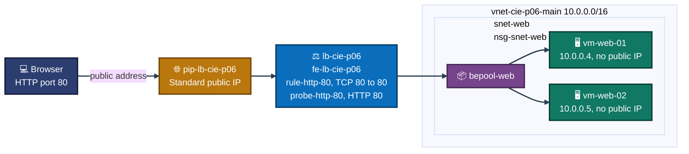
<em>Names and private addresses come from Exhibits 2, 6, 7 and 8. The diagram shows the design, it is not a screenshot.</em>

</div>

---

<a id="prerequisites"></a>
## ✅ Prerequisites

| Need | Detail |
|---|---|
| Azure subscription | Azure for Students (Exhibit 2) |
| Region | India South Central |
| Access | Azure Portal only. No CLI, PowerShell, Terraform or Bicep |
| vCPU room | 2 VMs of `Standard_B2ls_v2` need 4 vCPUs |
| Browser | Any browser. The test uses plain HTTP, so the browser shows "Not secure" |

**If the vCPU quota is short** (this did not happen in this lab, both VMs were created without an error):

- Use a 1-vCPU size such as `Standard_B1s` for both VMs.
- Deallocate or delete VMs left over from older projects. A VM that is only stopped still counts. A deallocated one does not.
- Request a quota increase on the Quotas page. Student subscriptions may refuse it.

---

<a id="environment"></a>
## 🖧 Environment

| Item | Value |
|---|---|
| **Subscription** | Azure for Students (Exhibit 2) |
| **Region** | `indiasouthcentral` (shown as India South Central) |
| **Resource Group** | `rg-cie-p06-load-balancer` (deleted at the end) |
| **VM Size** | `Standard_B2ls_v2`, 2 vCPUs, 4 GiB (Exhibit 5) |
| **OS Image** | Ubuntu 24.04 (Exhibit 4) |
| **Admin User** | `azureuser`, SSH key only 📝 |
| **Web Server** | nginx, installed through Run command 📝 |
| **Tools** | Azure Portal, Run command, Chrome |
| **Tags (every resource)** | `project=cie-p06`, `owner=malaika`, `env=lab` |
| **Work Date** | Oct 25, 2026 (VM creation time, Exhibits 4 and 5) |

### 🗺️ Address Plan

| Resource | Address | Notes |
|---|---|---|
| `vnet-cie-p06-main` | `10.0.0.0/16` | Exhibit 2 |
| `snet-web` + `nsg-snet-web` | `10.0.0.0/24` 📝 | Exhibit 2 shows one subnet. The VM addresses below fall inside it |
| `vm-web-01` | `10.0.0.4` | Exhibit 7, no public IP |
| `vm-web-02` | `10.0.0.5` | Exhibit 7, no public IP |
| `pip-lb-cie-p06` | blurred | Standard public IP for the load balancer only |

> [!IMPORTANT]
> The load balancer's public IP, the subscription ID, my email and my tenant name are blurred in the screenshots. The VMs have no SSH rule and no public IP, so I reached them only through Run command, which is free and needs no open port. No private key is stored in this repo. Older groups (`sysadmin-labs`, `osticket-rg`, `ForensicsCapstone-RG`, `NetworkWatcherRG`) were not touched.

---

<a id="project-flow"></a>
## ⏱️ Project Flow

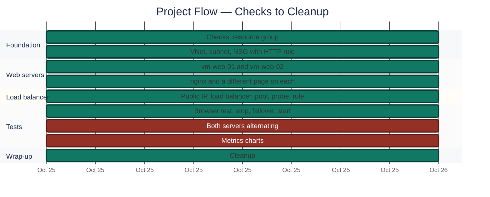
<p align="center"><em>The chart shows order, not clock times. The red bars mark what I could not show.</em></p>

---

<a id="module-1"></a>
## 🔵 Module 1 — Checks and Resource Group

**Objective:** Check that two VMs can fit in the vCPU quota, then create the tagged resource group.

### Step 1 — vCPU and VM size check 📝

**Run in:** Azure Portal (Quotas, and Subscriptions, Usage + quotas)

Both pages showed **no data** for India South Central, so I could not read the limit or the usage. The VM list showed one older VM, `lab-server` in `sysadmin-labs`, in the state *Stopped (deallocated)*, which holds no vCPUs. I picked `Standard_B2ls_v2` (2 vCPUs each, 4 in total), the size that already worked in Project 01. Both VMs were created without a quota error (Exhibits 4 and 5). No screenshot of these pages is kept.

### Step 2 — Resource group ✅

**Run in:** Azure Portal (Resource groups, Create)

| Setting | Value |
|---|---|
| Name | `rg-cie-p06-load-balancer` |
| Region | India South Central |
| Tags | `project=cie-p06`, `owner=malaika`, `env=lab` |

<p align="center">
  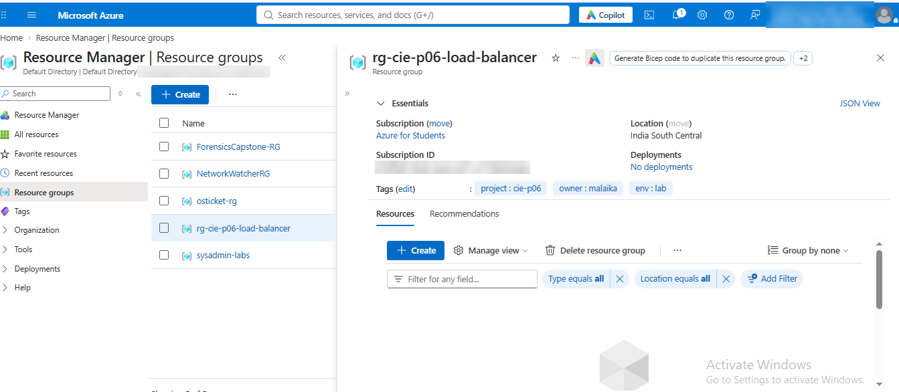<br>
  <em>Exhibit 1 — <code>rg-cie-p06-load-balancer</code> in India South Central with the three tags and no deployments yet. The subscription ID, my email and tenant name are blurred</em>
</p>

---

<a id="module-2"></a>
## 🟠 Module 2 — VNet and NSG

**Objective:** Build the network the servers live in and allow only HTTP into it.

### Step 3 — VNet and subnet ✅

**Run in:** Azure Portal (Virtual networks, Create)

| Setting | Value |
|---|---|
| Name | `vnet-cie-p06-main` |
| Address space | `10.0.0.0/16` |
| Subnet | `snet-web`, `10.0.0.0/24` 📝 |
| Bastion, Firewall, DDoS plan | Off 📝 |
| Tags | `project`, `owner`, `env` |

The creation review page showed *Private subnet: Enabled*, which would block outbound internet from the VMs. I unticked it on the existing subnet. I did not verify the save on screen. The nginx install later downloaded its packages, so outbound access worked 📝.

<p align="center">
  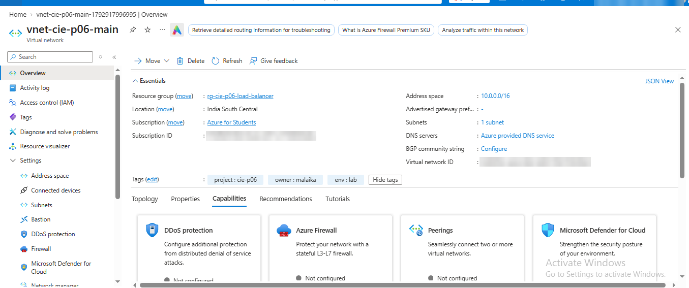<br>
  <em>Exhibit 2 — <code>vnet-cie-p06-main</code>, address space <code>10.0.0.0/16</code>, one subnet, three tags. The subscription ID and network ID are blurred</em>
</p>

### Step 4 — NSG with an HTTP rule ✅

**Run in:** Azure Portal (Network security groups, Create, then Inbound security rules)

| Setting | Value |
|---|---|
| Name | `nsg-snet-web` |
| Rule | `allow-http-80`, priority 100, TCP, port 80, Any to Any, Allow |
| Attached to | `snet-web` 📝 |
| SSH rule | None. The VMs are reached through Run command |

The NSG does nothing until it is attached to the subnet. The attachment page showed `snet-web`, but that screenshot is not kept 📝.

<p align="center">
  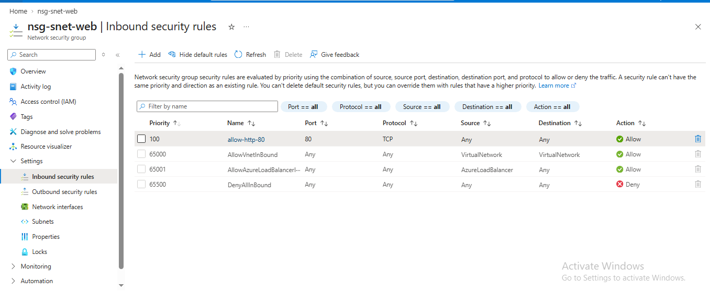<br>
  <em>Exhibit 3 — <code>allow-http-80</code> at priority 100, TCP port 80, Allow. The default rules <code>AllowVnetInBound</code>, <code>AllowAzureLoadBalancerInBound</code> and <code>DenyAllInBound</code> are listed below it</em>
</p>

---

<a id="module-3"></a>
## 🟢 Module 3 — Web Servers

**Objective:** Create two private VMs and give each one its own web page.

### Step 5 — vm-web-01 created ✅

**Run in:** Azure Portal (Virtual machines, Create)

| Setting | Value |
|---|---|
| Name | `vm-web-01` |
| Image and size | Ubuntu 24.04, `Standard_B2ls_v2` |
| Network | `vnet-cie-p06-main`, `snet-web` |
| Public IP | None |
| NIC network security group | None. The subnet NSG applies |
| Public inbound ports | None 📝 |
| Load balancing option | None. The VM joins the pool from the load balancer |

<p align="center">
  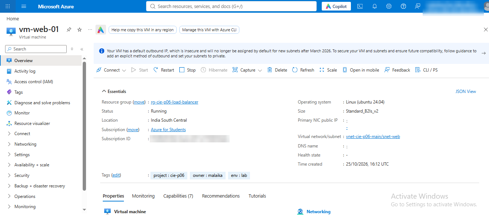<br>
  <em>Exhibit 4 — <code>vm-web-01</code> Running, <code>Standard_B2ls_v2</code>, Ubuntu 24.04, public IP shown as "-", subnet <code>snet-web</code>, three tags, created 16:12 UTC. The subscription ID and my email are blurred</em>
</p>

### Step 6 — vm-web-02 created ✅

**Run in:** Azure Portal (Virtual machines, Create)

Same settings as `vm-web-01`, with the name `vm-web-02`.

<p align="center">
  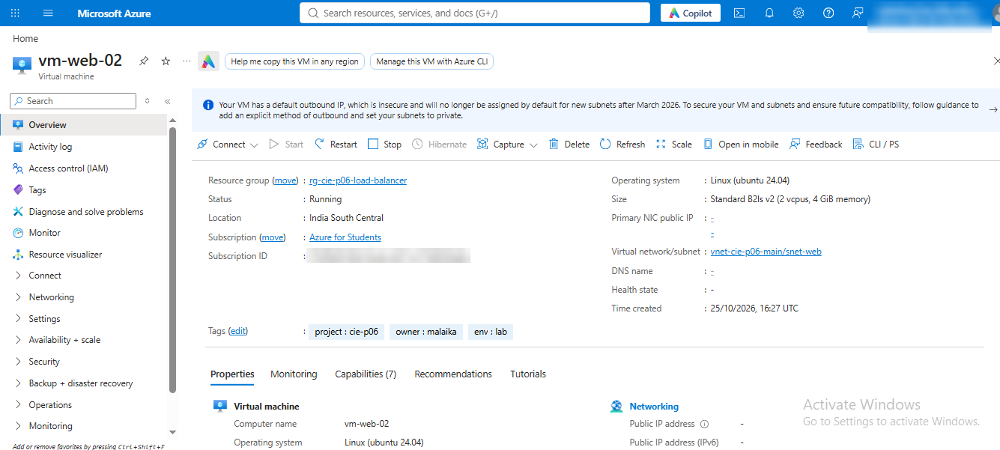<br>
  <em>Exhibit 5 — <code>vm-web-02</code> Running, same size and subnet, no public IP, three tags, created 16:27 UTC</em>
</p>

### Step 7 — nginx and a page on each server 📝

**Run in:** Azure Portal (each VM, Operations, Run command, RunShellScript)

I used Run command because the VMs have no public IP and no SSH port is open, and it costs nothing. On `vm-web-01`:

```
apt-get update -y && apt-get install -y nginx && echo "<h1>vm-web-01</h1>" > /var/www/html/index.nginx-debian.html && systemctl enable --now nginx && curl -s localhost
```

On `vm-web-02`, the same script with `vm-web-02` in the page text. Each output ended with its own page text when tested from inside the VM. The package download worked, so outbound internet was available. No screenshot of these outputs is kept. The pages are proven through the load balancer in Exhibits 9 and 11.

---

<a id="module-4"></a>
## 🟣 Module 4 — Load Balancer

**Objective:** Put one public address in front of both servers and tell it how to check them.

### Step 8 — Public IP 📝

**Run in:** Azure Portal (Public IP addresses, Create)

`pip-lb-cie-p06`: Standard SKU, Regional, static, three tags, not attached to anything until the load balancer was created. The first review failed because the **Name** field was empty. I typed the name and it created. No screenshot is kept.

### Step 9 — Load balancer created ✅

**Run in:** Azure Portal (Load balancers, Create)

| Setting | Value |
|---|---|
| Name | `lb-cie-p06` |
| SKU, type, tier | Standard, Public, Regional |
| Frontend | `fe-lb-cie-p06` on the existing `pip-lb-cie-p06` |
| Backend pool | `bepool-web` |
| Health probe | `probe-http-80` |
| Rule | `rule-http-80` |
| Outbound rules | None |

The first Create did not produce a load balancer. The resource group list showed no `lb-cie-p06` and still listed 5 deployments, so I redid the wizard and pasted its review summary before the second Create 📝. The deployment-success page was missed, so Exhibit 6 is the proof the load balancer exists.

<p align="center">
  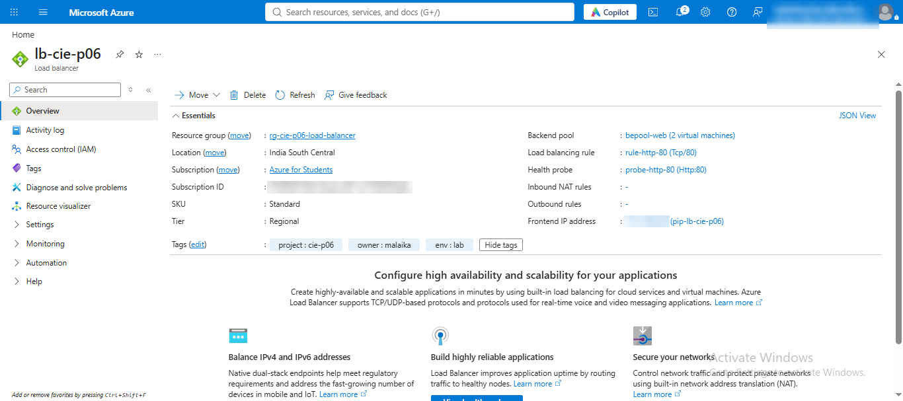<br>
  <em>Exhibit 6 — <code>lb-cie-p06</code>: Standard, Regional, backend pool <code>bepool-web</code> (2 virtual machines), rule <code>rule-http-80</code> (Tcp/80), probe <code>probe-http-80</code> (Http:80), outbound rules "-", three tags. The frontend IP value, subscription ID and my email are blurred</em>
</p>

### Step 10 — Backend pool ✅

**Run in:** Azure Portal (`lb-cie-p06`, Settings, Backend pools)

The pool uses the network cards of the two VMs.

<p align="center">
  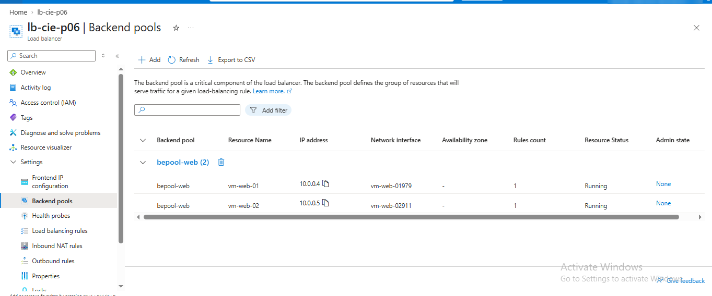<br>
  <em>Exhibit 7 — <code>bepool-web (2)</code>: <code>vm-web-01</code> at 10.0.0.4 and <code>vm-web-02</code> at 10.0.0.5, rules count 1, both Running</em>
</p>

### Step 11 — Health probe and rule ✅

**Run in:** Azure Portal (`lb-cie-p06`, Settings, Health probes, and Load balancing rules)

| Setting | Value |
|---|---|
| Probe | `probe-http-80`, HTTP, port 80, path `/`, interval 5 seconds |
| Rule | `rule-http-80`, TCP, frontend port 80, backend port 80, probe `probe-http-80` |
| Session persistence | None 📝 |

The rule form left **Backend port** empty. I typed 80 before saving 📝.

<p align="center">
  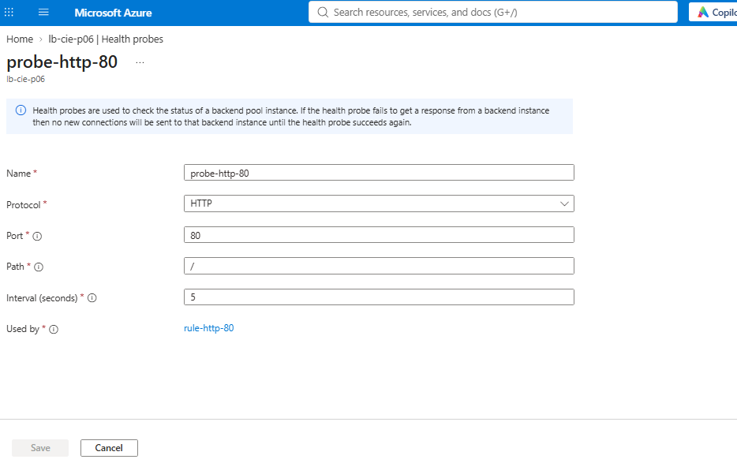<br>
  <em>Exhibit 8 — <code>probe-http-80</code>: HTTP, port 80, path <code>/</code>, interval 5 seconds, used by <code>rule-http-80</code></em>
</p>

---

<a id="module-5"></a>
## 🟡 Module 5 — Tests, Failover and Cleanup

**Objective:** Prove traffic flows, survives a stopped server, and recovers.

### Step 12 — Browser test through the load balancer ✅

**Run in:** Browser (address bar, plain HTTP)

The page answered with `vm-web-01`. The browser shows *Not secure* because no HTTPS is configured. Typing the address into the search box instead of the address bar opened a web search, which I discarded. I refreshed three times and each answer was `vm-web-01` 📝.

<p align="center">
  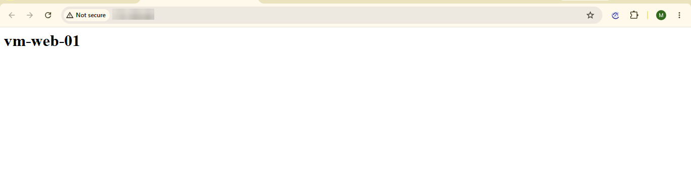<br>
  <em>Exhibit 9 — the load balancer address returns <code>vm-web-01</code>. The address is blurred</em>
</p>

### Step 13 — vm-web-01 stopped ✅

**Run in:** Azure Portal (`vm-web-01`, Stop)

<p align="center">
  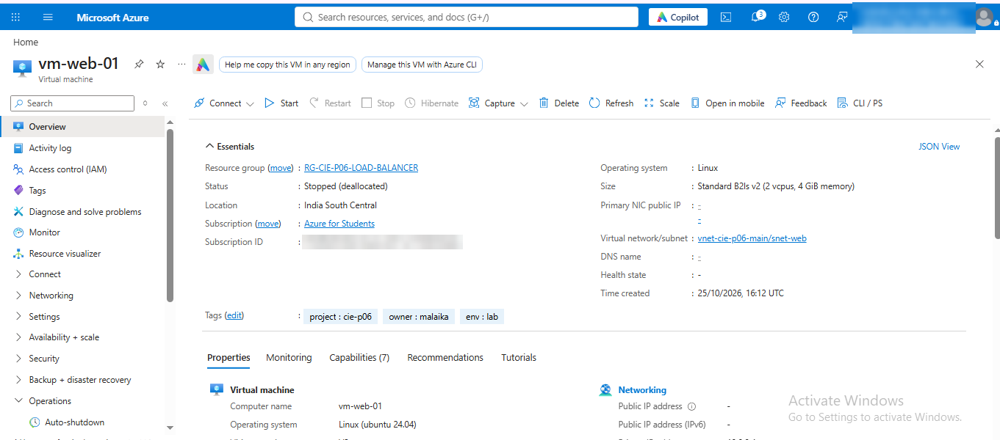<br>
  <em>Exhibit 10 — <code>vm-web-01</code> status Stopped (deallocated). The subscription ID and my email are blurred</em>
</p>

### Step 14 — Failover to vm-web-02 ✅

**Run in:** Browser (same address)

With `vm-web-01` stopped, the same address returned `vm-web-02`. This is the first time `vm-web-02` answered.

<p align="center">
  <br>
  <em>Exhibit 11 — the same address now returns <code>vm-web-02</code>, taken while <code>vm-web-01</code> was stopped</em>
</p>

### Step 15 — vm-web-01 started again ✅

**Run in:** Azure Portal (`vm-web-01`, Start)

<p align="center">
  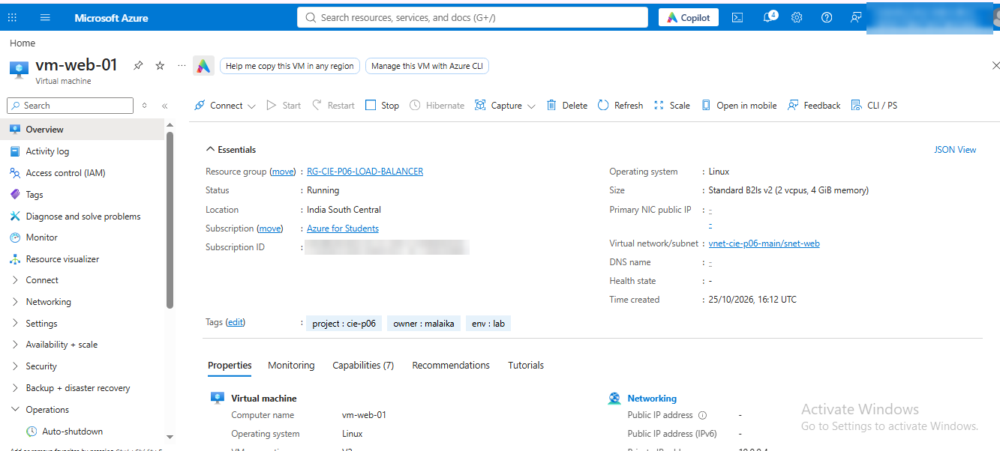<br>
  <em>Exhibit 12 — <code>vm-web-01</code> back to <code>Running</code></em>
</p>

### Step 16 — vm-web-01 answers again ✅

**Run in:** Browser (same address)

Right after the start, several refreshes still returned only `vm-web-02` 📝. After waiting, `vm-web-01` answered again. I did not measure how long it took.

<p align="center">
  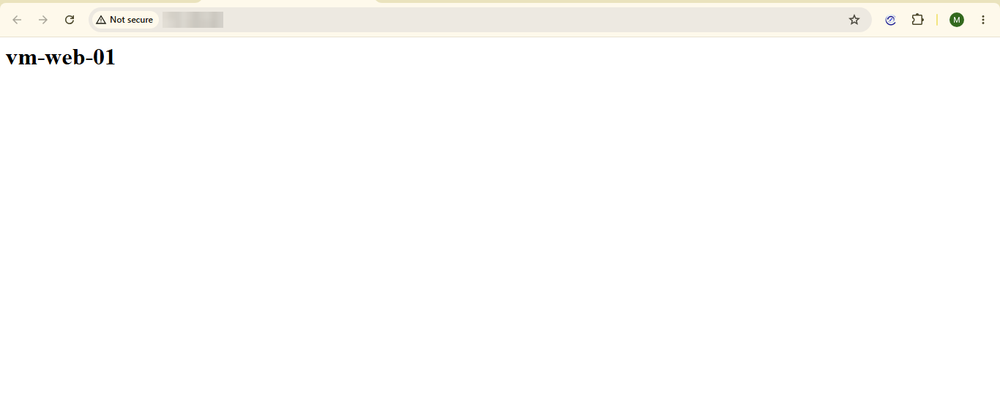<br>
  <em>Exhibit 13 — the same address returns <code>vm-web-01</code> again after the restart</em>
</p>

### Step 17 — Rule health status ✅

**Run in:** Azure Portal (`lb-cie-p06`, Settings, Load balancing rules, Health status, View details)

The metrics charts stayed empty, so this page is the health proof. The *Insights* map showed a grey "?" next to `vm-web-01`, which is not a health state, so I did not use it either 📝.

<p align="center">
  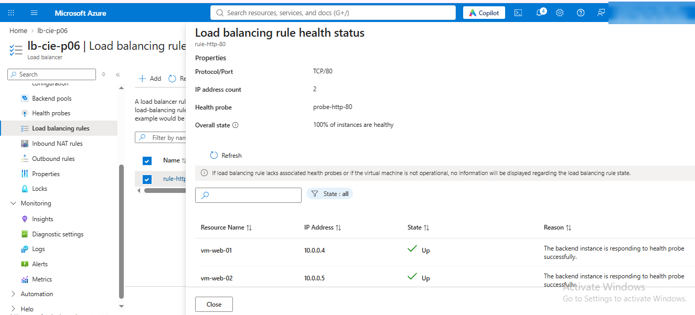<br>
  <em>Exhibit 14 — <code>rule-http-80</code>: TCP/80, 2 addresses, probe <code>probe-http-80</code>, "100% of instances are healthy", <code>vm-web-01</code> Up and <code>vm-web-02</code> Up. Taken after the restart</em>
</p>

### Step 18 — Cleanup ✅

**Run in:** Azure Portal (Resource groups, `rg-cie-p06-load-balancer`, Delete resource group)

Only this project's group was deleted. Steps are in [`commands/cleanup.md`](commands/cleanup.md).

<p align="center">
  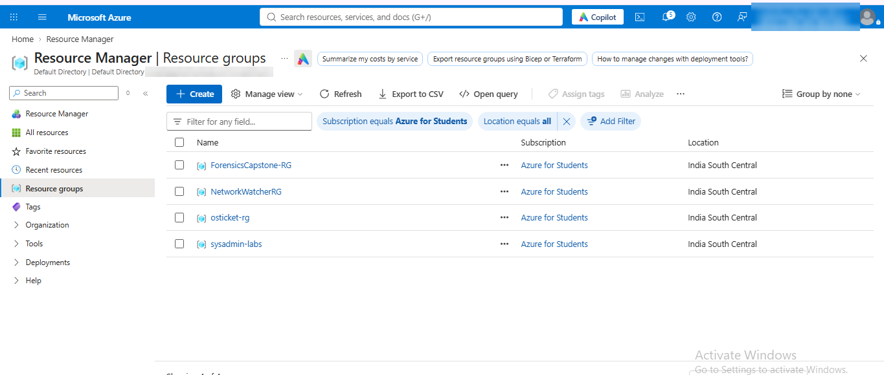<br>
  <em>Exhibit 15 — the resource group list: <code>ForensicsCapstone-RG</code>, <code>NetworkWatcherRG</code>, <code>osticket-rg</code> and <code>sysadmin-labs</code>. <code>rg-cie-p06-load-balancer</code> is gone</em>
</p>

---

<a id="verification-steps"></a>
## 🔎 Verification Steps

| Check | Where | Result | Exhibit |
|---|---|---|:---:|
| Tags on the resource group | Portal | Three tags present | 1 |
| VNet and address space | Portal | `10.0.0.0/16`, one subnet | 2 |
| HTTP allowed in | NSG rules | `allow-http-80` at priority 100 | 3 |
| VMs have no public IP | VM overview | Public IP shows "-" on both | 4, 5 |
| Both VMs in the pool | Backend pools | `10.0.0.4` and `10.0.0.5` | 7 |
| Probe settings | Health probes | HTTP, 80, `/`, 5 seconds | 8 |
| Traffic reaches a server | Browser | `vm-web-01` answers | 9 |
| VM stopped | VM overview | Stopped (deallocated) | 10 |
| Failover | Browser | `vm-web-02` answers | 11 |
| VM started | VM overview | Running | 12 |
| Recovery | Browser | `vm-web-01` answers again | 13 |
| Both servers healthy | Rule health status | 100% healthy, both Up | 14 |
| Project group deleted | Resource groups | Gone, four older groups remain | 15 |

---

<a id="coverage-snapshot"></a>
## 🌟 Coverage Snapshot

| 🛡️ Area | ✅ Status | 📌 Detail |
|---|---|---|
| Private servers | Tested | No public IP on either VM (Exhibits 4, 5) |
| Backend pool | Tested | Two network cards in `bepool-web` (Exhibit 7) |
| Health probe settings | Tested | HTTP 80, path `/`, 5 seconds (Exhibit 8) |
| Traffic through the load balancer | Tested | Both pages seen through one address (Exhibits 9, 11) |
| Failover | Tested | Stopped `vm-web-01`, `vm-web-02` answered |
| Recovery | Tested | `vm-web-01` answered again and shows Up (Exhibits 13, 14) |
| Both servers alternating | **Not shown** | Every request before the stop returned `vm-web-01` |
| Unhealthy state while stopped | **Not captured** | No probe status screenshot during the stop |
| Metrics charts | **Not shown** | Charts stayed empty |
| HTTPS | Not built | HTTP only |

### 🧾 What the Evidence Proves

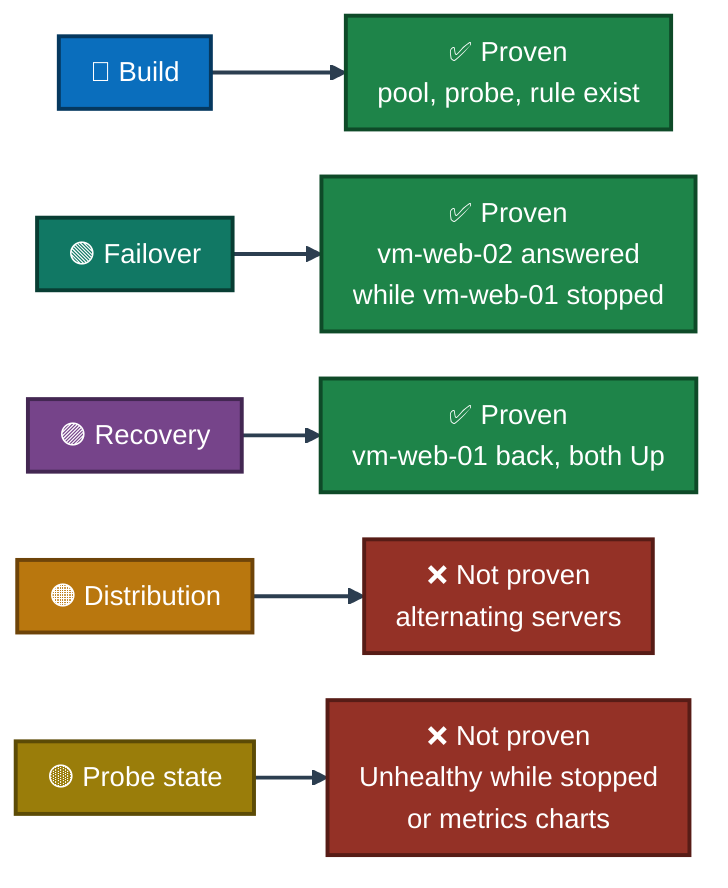

---

<a id="project-summary"></a>
## 📝 Project Summary

| Area | Tooling | Key Finding |
|---|---|---|
| Network | VNet, subnet, NSG (Portal) | One subnet, HTTP allowed in, no SSH rule |
| Web servers | Two Ubuntu VMs, nginx | No public IP, page shows the server name |
| Load balancing | Standard Load Balancer | One public address, pool of two, probe on HTTP 80 |
| Failover | Portal Stop and Start | Stopped `vm-web-01`, same address returned `vm-web-02` |
| Health | Rule health status page | Both servers Up, 100% healthy after the restart |
| Cleanup | Portal resource group delete | One group removed, four older groups remain |

---

<a id="common-mistakes"></a>
## 🚫 Common Mistakes

- **Clicking Create before reading the review page.** The VM wizard defaulted to a new VNet, a new subnet and a new public IP. Reading the summary caught it.
- **Leaving the default SSH port rule on a VM.** The wizard offered SSH (22) open to all addresses. Set Public inbound ports to None for private servers.
- **Typing tags as one sentence.** A tag needs a name box and a value box. `owner and malaika` in one box is wrong.
- **Forgetting the NSG rule or the attachment.** An NSG that is not attached to the subnet changes nothing, and without a port 80 rule the default deny blocks the page.
- **Leaving Backend port empty** in the load balancing rule form.
- **Typing the address in the search box.** It runs a web search. Use the address bar.
- **Using HTTPS.** Only HTTP port 80 is configured, so `https://` will not connect.
- **Trusting a grey "?" or an empty chart as proof.** Use the rule health status page.

---

<a id="challenges-fixes"></a>
## ⚠️ Challenges & Fixes

| ❌ Challenge | ✅ Fix |
|---|---|
| VM wizard review showed a new VNet, a new subnet and a new public IP 📝 | Switched to `vnet-cie-p06-main`, `snet-web` and Public IP None before Create |
| VM wizard had SSH (22) open to all addresses 📝 | Set Public inbound ports to None |
| Tags typed as `owner and malaika` in one box 📝 | Retyped name and value in separate boxes |
| Public IP review failed because Name was empty 📝 | Typed `pip-lb-cie-p06` |
| Creation review showed *Private subnet: Enabled* 📝 | Unticked it on the subnet. The nginx install then reached the internet |
| First load balancer Create left no load balancer in the resource group 📝 | Redid the wizard and checked the review text before Create (Exhibit 6) |
| Rule form had an empty Backend port 📝 | Typed 80 |
| Outbound rule panel opened by mistake 📝 | Closed it. Exhibit 6 shows no outbound rule |
| Address typed into the search box ran a Google search 📝 | Used the address bar (Exhibit 9) |
| Metrics charts empty for 30 minutes, 4 hours and 24 hours, with and without the backend address filter 📝 | Used the rule health status page (Exhibit 14) |
| Insights map showed a grey "?" for `vm-web-01` 📝 | Not used as proof. Waited, then loaded the page again (Exhibit 13) |

<sub>📝 = taken from my notes, no screenshot in this repo shows it.</sub>

---

<a id="troubleshooting"></a>
## 🛠️ Troubleshooting

| Symptom | What to check | What I saw |
|---|---|---|
| Browser shows a web search page | Is the address in the address bar? | Search page when typed in the search box 📝 |
| Browser says *Not secure* | Is it plain HTTP? | Expected, no HTTPS is built (Exhibit 9) |
| Page does not load | Rule health status, NSG port 80 rule | Rule and probe configured (Exhibits 3, 8, 14) |
| Only one server answers | Rule health status: are both Up? | Both Up (Exhibit 14). Alternation was not shown |
| After a VM start, the old server does not answer yet | VM is Running, then refresh after a wait | Several refreshes returned only `vm-web-02`, then `vm-web-01` came back 📝 |
| Metrics chart is empty | Use the rule health status page instead | Charts stayed empty 📝 |
| VM creation fails on quota | Smaller size, or deallocate old VMs | Not triggered in this lab |

---

<a id="scope-limitations"></a>
## 🚧 Scope & Limitations

- **Both servers alternating was not shown.** Every request before the stop returned `vm-web-01` 📝. Only failover and recovery were captured. A possible reason is that a browser reuses one connection, but I did not test that.
- **No Unhealthy state captured.** There is no probe status screenshot while `vm-web-01` was stopped. Exhibit 14 was taken after the restart.
- **Metrics charts stayed empty.** *Health Probe Status* and *Data Path Availability* showed no data for 30 minutes, 4 hours and 24 hours 📝. No chart is in this repo.
- **Recovery time not measured.** I know `vm-web-01` needed some time after the start, not how long.
- **Only `vm-web-01` was stopped.** Stopping `vm-web-02`, or both, was not tested.
- **No deployment-success screenshot.** Exhibit 6 shows the load balancer exists.
- **Session persistence and idle timeout** are not shown in a repo screenshot. Session persistence was left at None 📝.
- **Run without a repo screenshot:** the quota check, public IP creation, NSG attachment to the subnet and the nginx install 📝.
- **Screenshots carry no clock times,** so the order of Exhibits 9 to 14 comes from the lab sequence.
- **Outbound access** relied on the default outbound IP. No outbound rule or NAT gateway was built.
- **HTTP only.** No HTTPS, certificate or custom domain.
- **By design, not built:** Bastion, Application Gateway, availability zones and autoscaling.

These gaps are marked instead of hidden, so the results show what was actually proven.

---

<a id="what-i-learned"></a>
## 🧠 What I Learned

- **A load balancer is four parts that work together.** The frontend IP, the backend pool, the probe and the rule are separate objects. The overview lists all of them (Exhibit 6).
- **Only the front door needs a public IP.** The VMs show "-" for public IP and are still reachable through the load balancer (Exhibits 4, 5, 9).
- **The pool holds network cards, not VM names.** `10.0.0.4` and `10.0.0.5` are the private addresses (Exhibit 7).
- **The probe decides who gets traffic.** `probe-http-80` checks every 5 seconds, and the rule health page lists each server as Up or Down (Exhibits 8, 14).
- **A subnet NSG must allow the port.** Without `allow-http-80` the default deny would drop the page (Exhibit 3).
- **A stopped server leaves the rotation.** The same address returned `vm-web-02` while `vm-web-01` was deallocated (Exhibit 11).
- **Recovery is not instant.** After the start, `vm-web-01` needed time before it answered again 📝.
- **Read the review page.** It caught a new VNet, a public IP and a missing name before anything was created.
- **Know which screen is proof.** A grey "?" and an empty chart prove nothing. The rule health status page does.
- **Make the evidence safe to publish.** The public IP, subscription ID, email and tenant name are blurred.

---

<a id="skills-demonstrated"></a>
## 🛠️ Skills Demonstrated

- Building a VNet, subnet and NSG in the Azure Portal
- Creating private VMs with no public IP
- Configuring a Standard Load Balancer: frontend, backend pool, health probe and rule
- Installing nginx and serving a different page on each server with Run command
- Testing failover by stopping and starting a VM
- Reading rule health status to confirm which servers are Up
- Tagging every resource and deleting only this project's resource group
- Writing down what was not proven

---

<a id="cleanup"></a>
## 🧹 Cleanup

Only `rg-cie-p06-load-balancer` was deleted, which removes the load balancer, public IP, NSG, VNet, both VMs and their disks, network cards and SSH keys together. Exhibit 15 shows the group is gone and `sysadmin-labs`, `osticket-rg`, `ForensicsCapstone-RG` and `NetworkWatcherRG` remain. The steps are in [`commands/cleanup.md`](commands/cleanup.md).

---

<a id="screenshot-index"></a>
## 🖼️ Screenshot Index

| # | File | Shows |
|:---:|---|---|
| 1 | `ss-01-rg-created.png` | Resource group with 3 tags |
| 2 | `ss-02-vnet-created.png` | VNet `10.0.0.0/16`, one subnet |
| 3 | `ss-03-nsg-http-rule.png` | `allow-http-80` rule, priority 100 |
| 4 | `ss-04-vm-web-01.png` | `vm-web-01` running, no public IP |
| 5 | `ss-05-vm-web-02.png` | `vm-web-02` running, no public IP |
| 6 | `ss-06-lb-overview.png` | Load balancer with pool, rule and probe |
| 7 | `ss-07-backend-pool.png` | Both VMs in `bepool-web` |
| 8 | `ss-08-health-probe.png` | HTTP probe, port 80, 5 seconds |
| 9 | `ss-09-browser-vm-web-01.png` | Load balancer address returns `vm-web-01` |
| 10 | `ss-10-vm-web-01-stopped.png` | `vm-web-01` stopped (deallocated) |
| 11 | `ss-11-browser-vm-web-02-failover.png` | Same address returns `vm-web-02` |
| 12 | `ss-12-vm-web-01-started.png` | `vm-web-01` running again |
| 13 | `ss-13-browser-vm-web-01-back.png` | `vm-web-01` answers again |
| 14 | `ss-14-rule-health-status.png` | 100% healthy, both servers Up |
| 15 | `ss-15-cleanup-rg-list.png` | Project group gone, four older groups remain |

---

<a id="repo-structure"></a>
## 📁 Repo Structure

```text
Cloud-Infrastructure-Engineering/
`-- Azure/
    `-- 06-load-balancer/
        |-- README.md
        |-- LoadBalancer-INDEX.md
        |-- commands/
        |   `-- cleanup.md
        `-- Screenshots/
            |-- ss-01-rg-created.png
            |-- ss-02-vnet-created.png
            |-- ss-03-nsg-http-rule.png
            |-- ss-04-vm-web-01.png
            |-- ss-05-vm-web-02.png
            |-- ss-06-lb-overview.png
            |-- ss-07-backend-pool.png
            |-- ss-08-health-probe.png
            |-- ss-09-browser-vm-web-01.png
            |-- ss-10-vm-web-01-stopped.png
            |-- ss-11-browser-vm-web-02-failover.png
            |-- ss-12-vm-web-01-started.png
            |-- ss-13-browser-vm-web-01-back.png
            |-- ss-14-rule-health-status.png
            `-- ss-15-cleanup-rg-list.png
```

---

<div align="center">

[⬆️ Back to top](#top) &nbsp;·&nbsp; [📑 Visual Index](LoadBalancer-INDEX.md) &nbsp;·&nbsp; [🧹 Cleanup](commands/cleanup.md)

☁️ **[Microsoft Azure](https://azure.microsoft.com)** · ⚖️ **[Azure Load Balancer documentation](https://learn.microsoft.com/azure/load-balancer/)**

</div>
