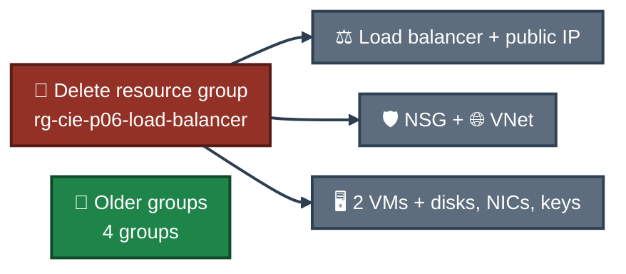

# 🧹 Project 06 — Cleanup
### Azure Standard Load Balancer
**Project 06 of 6 — Cloud Infrastructure Engineering**

**Cleanup was the last step. Only this project's resource group was deleted. The older groups were not touched.**

### [📖 README](../README.md) &nbsp;·&nbsp; [📑 Visual Index](../LoadBalancer-INDEX.md) &nbsp;·&nbsp; [⌨️ Commands](commands.md)

---

## 🖱️ Portal Steps

This project used the Azure Portal only, so cleanup has no command. The steps are:

| # | 📍 Where | Action |
|:---:|:---:|---|
| 1 | ☁️ Azure Portal | Search **Resource groups** and open the list |
| 2 | ☁️ Azure Portal | Open `rg-cie-p06-load-balancer` and check that no other project's resource is in it |
| 3 | ☁️ Azure Portal | Click **Delete resource group** |
| 4 | ☁️ Azure Portal | Type the exact group name `rg-cie-p06-load-balancer` to confirm |
| 5 | ☁️ Azure Portal | Click **Delete**, then **Delete** again on the confirmation box |
| 6 | ☁️ Azure Portal | Reopen **Resource groups** and check the list |

| 🖼️ Proof | Result |
|:---:|---|
| **Exhibit 15** — `Screenshots/ss-15-cleanup-rg-list.png` | project group gone, four older groups remain |

---

## 🗑️ What This Removed

Everything inside `rg-cie-p06-load-balancer`. The delete pane listed 12 resources 📝 (that screenshot is not kept in this repo):

| Resource | Includes |
|---|---|
| ⚖️ Load balancer `lb-cie-p06` | frontend `fe-lb-cie-p06`, pool `bepool-web`, probe `probe-http-80`, rule `rule-http-80` |
| 🌐 Public IP `pip-lb-cie-p06` | the only public IP in the project |
| 🛡️ NSG `nsg-snet-web` | rule `allow-http-80` |
| 🌐 VNet `vnet-cie-p06-main` | subnet `snet-web` |
| 🖥️ VMs `vm-web-01`, `vm-web-02` | OS disks, network cards, SSH key resources |

Both VMs were running when the group was deleted, and the load balancer was still using them.

<em>Only the project group is deleted. The older groups were never selected.</em>

---

## ✅ What Proves It

Exhibit 15 shows the list after the delete:

| Resource group | In the list after cleanup? |
|---|:---:|
| `rg-cie-p06-load-balancer` | ✅ Yes |
| `ForensicsCapstone-RG` | ✅ Yes |
| `NetworkWatcherRG` | ✅ Yes |
| `osticket-rg` | ✅ Yes |
| `sysadmin-labs` | ✅ Yes |

---

[⬆️ Back to top](#top) &nbsp;·&nbsp; [📖 README](../README.md) &nbsp;·&nbsp; [📑 Visual Index](../LoadBalancer-INDEX.md) &nbsp;·&nbsp; [⌨️ Commands](commands.md)

