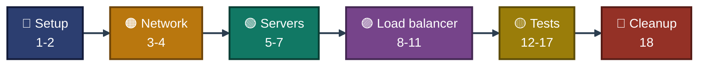

<a id="top"></a>
<div align="center">

# ⌨️ Project 06 — Commands
### Azure Standard Load Balancer
**Project 06 of 06 — Cloud Infrastructure Engineering**


**Every step of this project in order, with where it ran, the settings used, and which exhibit proves it.**

### [📖 README](../README.md) &nbsp;·&nbsp; [📑 Visual Index](../LoadBalancer-INDEX.md) &nbsp;·&nbsp; [🧹 Cleanup](cleanup.md)

</div>

---

## 🧭 How to Read This File

This project was built in the **Azure Portal**. No Azure CLI, PowerShell, Terraform or Bicep was used. The only commands are the two shell scripts in Step 7, which ran inside the VMs through **Run command**. Every other step is listed as portal settings.

| Mark | Meaning |
|:---:|---|
| ✅ | Ran, and a screenshot in `../Screenshots/` proves the result. The exhibit number is given. |
| 📝 | Ran, but there is no screenshot of it in the repo. |

| 📍 Where it ran | Shown as |
|---|:---:|
| Azure Portal in the browser | 🌐 **Portal** |
| Inside each VM, started from the portal with Run command (`RunShellScript`) | 🖥️ **VM** |
| Browser address bar, plain HTTP | 💻 **Browser** |

---

## 📊 At a Glance

| 🔵 Setup | 🟠 Network | 🟢 Servers | 🟣 Load Balancer | 🟡 Tests | 🧹 Cleanup |
|:---:|:---:|:---:|:---:|:---:|:---:|
| **Steps 1-2** | **Steps 3-4** | **Steps 5-7** | **Steps 8-11** | **Steps 12-17** | **Step 18** |
| quota check, resource group | VNet, subnet, NSG | two VMs, nginx | public IP, pool, probe, rule | browser, stop, failover, start, health | delete group, proof |


<p align="center"><em>Order of the steps. Step numbers match the README.</em></p>

### 🧰 Tools by Step

| Area | Where in the portal |
|---|---|
| Resource group | Resource groups, Create / Delete resource group |
| Network | Virtual networks, Create. Network security groups, Create, Inbound security rules |
| Web servers | Virtual machines, Create. Each VM, Operations, Run command, RunShellScript |
| Load balancer | Public IP addresses, Create. Load balancers, Create. Backend pools, Health probes, Load balancing rules |
| Tests | VM Stop and Start. Browser. Load balancing rules, Health status |

---

## 🔵 Setup &nbsp;·&nbsp; Steps 1-2

### Step 1 — vCPU quota and VM size &nbsp; 📝

| 📍 Where | 🖼️ Proof | Result |
|:---:|:---:|---|
| 🌐 Portal (Quotas, Subscriptions, Usage + quotas) | none kept | pages showed no data, `Standard_B2ls_v2` chosen |

Both pages showed no data for India South Central. The VM list showed one older VM, `lab-server` in `sysadmin-labs`, as *Stopped (deallocated)*, which holds no vCPUs. Both project VMs were created without a quota error (Exhibits 4 and 5).

### Step 2 — Resource group &nbsp; ✅

| 📍 Where | 🖼️ Proof | Result |
|:---:|:---:|---|
| 🌐 Portal (Resource groups, Create) | **Exhibit 1** | `rg-cie-p06-load-balancer`, India South Central, three tags |

| Setting | Value |
|---|---|
| Name | `rg-cie-p06-load-balancer` |
| Region | India South Central |
| Tags | `project=cie-p06`, `owner=malaika`, `env=lab` |

---

## 🟠 Network &nbsp;·&nbsp; Steps 3-4

### Step 3 — VNet and subnet &nbsp; ✅

| 📍 Where | 🖼️ Proof | Result |
|:---:|:---:|---|
| 🌐 Portal (Virtual networks, Create) | **Exhibit 2** | `10.0.0.0/16`, one subnet, three tags |

| Setting | Value |
|---|---|
| Name | `vnet-cie-p06-main` |
| Address space | `10.0.0.0/16` |
| Subnet | `snet-web`, `10.0.0.0/24` 📝 |
| Bastion, Firewall, DDoS plan | Off 📝 |
| Private subnet | Unticked on the subnet so the VMs can reach the internet 📝 |

### Step 4 — NSG with an HTTP rule &nbsp; ✅

| 📍 Where | 🖼️ Proof | Result |
|:---:|:---:|---|
| 🌐 Portal (Network security groups, Create, Inbound security rules) | **Exhibit 3** | `allow-http-80`, priority 100, TCP 80, Allow |

| Setting | Value |
|---|---|
| Name | `nsg-snet-web` |
| Rule | `allow-http-80`, priority 100, TCP, port 80, Any to Any, Allow |
| Attached to | `snet-web` 📝 |
| SSH rule | None. The VMs are reached through Run command |

---

## 🟢 Servers &nbsp;·&nbsp; Steps 5-7

### Step 5 — vm-web-01 &nbsp; ✅

| 📍 Where | 🖼️ Proof | Result |
|:---:|:---:|---|
| 🌐 Portal (Virtual machines, Create) | **Exhibit 4** | Running, `Standard_B2ls_v2`, Ubuntu 24.04, no public IP |

| Setting | Value |
|---|---|
| Name | `vm-web-01` |
| Image and size | Ubuntu 24.04, `Standard_B2ls_v2` |
| Network | `vnet-cie-p06-main`, `snet-web` |
| Public IP | None |
| NIC network security group | None. The subnet NSG applies |
| Public inbound ports | None 📝 |
| Load balancing option | None. The VM joins the pool from the load balancer |
| Tags | `project`, `owner`, `env` |

### Step 6 — vm-web-02 &nbsp; ✅

| 📍 Where | 🖼️ Proof | Result |
|:---:|:---:|---|
| 🌐 Portal (Virtual machines, Create) | **Exhibit 5** | Running, same size and subnet, no public IP |

Same settings as `vm-web-01`, with the name `vm-web-02`.

### Step 7 — nginx and a page on each server &nbsp; 📝

| 📍 Where | 🖼️ Proof | Result |
|:---:|:---:|---|
| 🖥️ VM (Run command, `RunShellScript`) | none kept | nginx installed, page shows the server name. Proven through the load balancer in Exhibits 9 and 11 |

On `vm-web-01`:

```bash
apt-get update -y && apt-get install -y nginx && echo "<h1>vm-web-01</h1>" > /var/www/html/index.nginx-debian.html && systemctl enable --now nginx && curl -s localhost
```

On `vm-web-02`, the same script with `vm-web-02` in the page text:

```bash
apt-get update -y && apt-get install -y nginx && echo "<h1>vm-web-02</h1>" > /var/www/html/index.nginx-debian.html && systemctl enable --now nginx && curl -s localhost
```

Each output ended with its own page text. The package download worked, so outbound internet was available.

---

## 🟣 Load Balancer &nbsp;·&nbsp; Steps 8-11

### Step 8 — Public IP &nbsp; 📝

| 📍 Where | 🖼️ Proof | Result |
|:---:|:---:|---|
| 🌐 Portal (Public IP addresses, Create) | none kept | `pip-lb-cie-p06` created |

| Setting | Value |
|---|---|
| Name | `pip-lb-cie-p06` |
| SKU, tier, assignment | Standard, Regional, static |
| Tags | `project`, `owner`, `env` |

### Step 9 — Load balancer &nbsp; ✅

| 📍 Where | 🖼️ Proof | Result |
|:---:|:---:|---|
| 🌐 Portal (Load balancers, Create) | **Exhibit 6** | Standard, Regional, pool, rule and probe listed |

| Setting | Value |
|---|---|
| Name | `lb-cie-p06` |
| SKU, type, tier | Standard, Public, Regional |
| Frontend | `fe-lb-cie-p06` on the existing `pip-lb-cie-p06` |
| Backend pool | `bepool-web` |
| Health probe | `probe-http-80` |
| Rule | `rule-http-80` |
| Outbound rules | None |

The first Create did not produce a load balancer, so the wizard was redone and its review text checked before the second Create 📝.

### Step 10 — Backend pool &nbsp; ✅

| 📍 Where | 🖼️ Proof | Result |
|:---:|:---:|---|
| 🌐 Portal (`lb-cie-p06`, Settings, Backend pools) | **Exhibit 7** | `10.0.0.4` and `10.0.0.5` in `bepool-web` |

### Step 11 — Health probe and rule &nbsp; ✅

| 📍 Where | 🖼️ Proof | Result |
|:---:|:---:|---|
| 🌐 Portal (`lb-cie-p06`, Settings, Health probes and Load balancing rules) | **Exhibit 8** | HTTP, port 80, path `/`, 5 seconds |

| Setting | Value |
|---|---|
| Probe | `probe-http-80`, HTTP, port 80, path `/`, interval 5 seconds |
| Rule | `rule-http-80`, TCP, frontend port 80, backend port 80, probe `probe-http-80` |
| Session persistence | None 📝 |

---

## 🟡 Tests &nbsp;·&nbsp; Steps 12-17

### Step 12 — Browser test through the load balancer &nbsp; ✅

| 📍 Where | 🖼️ Proof | Result |
|:---:|:---:|---|
| 💻 Browser (address bar, `http://`) | **Exhibit 9** | `vm-web-01` answers |

The browser shows *Not secure* because the lab uses plain HTTP.

### Step 13 — Stop vm-web-01 &nbsp; ✅

| 📍 Where | 🖼️ Proof | Result |
|:---:|:---:|---|
| 🌐 Portal (`vm-web-01`, Stop) | **Exhibit 10** | Stopped (deallocated) |

### Step 14 — Failover to vm-web-02 &nbsp; ✅

| 📍 Where | 🖼️ Proof | Result |
|:---:|:---:|---|
| 💻 Browser (same address) | **Exhibit 11** | `vm-web-02` answers |

### Step 15 — Start vm-web-01 &nbsp; ✅

| 📍 Where | 🖼️ Proof | Result |
|:---:|:---:|---|
| 🌐 Portal (`vm-web-01`, Start) | **Exhibit 12** | Running again |

### Step 16 — vm-web-01 answers again &nbsp; ✅

| 📍 Where | 🖼️ Proof | Result |
|:---:|:---:|---|
| 💻 Browser (same address) | **Exhibit 13** | `vm-web-01` answers again |

Right after the start the old server needed a short wait before it answered again 📝.

### Step 17 — Rule health status &nbsp; ✅

| 📍 Where | 🖼️ Proof | Result |
|:---:|:---:|---|
| 🌐 Portal (`lb-cie-p06`, Load balancing rules, Health status, View details) | **Exhibit 14** | 100% healthy, both servers Up |

---

## 🧹 Cleanup &nbsp;·&nbsp; Step 18

### Step 18 — Delete the project's resource group &nbsp; ✅

| 📍 Where | 🖼️ Proof | Result |
|:---:|:---:|---|
| 🌐 Portal (Resource groups, `rg-cie-p06-load-balancer`, Delete resource group) | **Exhibit 15** | project group gone, four older groups remain |

Full cleanup notes: [`cleanup.md`](cleanup.md).

---

<div align="center">

[⬆️ Back to top](#top) &nbsp;·&nbsp; [📖 README](../README.md) &nbsp;·&nbsp; [📑 Visual Index](../LoadBalancer-INDEX.md) &nbsp;·&nbsp; [🧹 Cleanup](cleanup.md)

☁️ **[Microsoft Azure](https://azure.microsoft.com)** · ⚖️ **[Azure Load Balancer documentation](https://learn.microsoft.com/azure/load-balancer/)**

</div>
