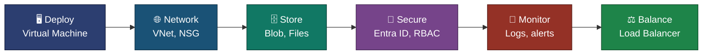
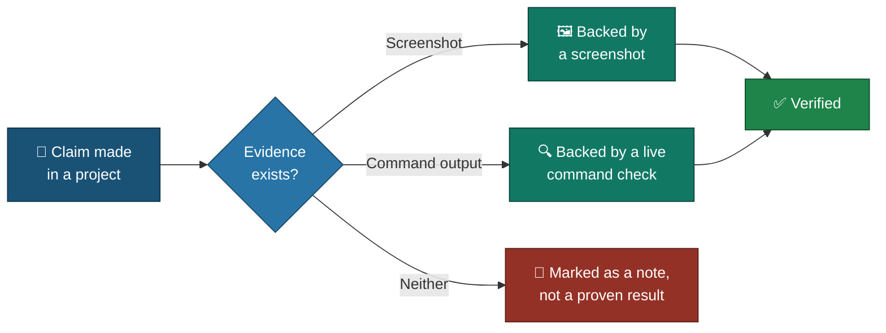

# 🧭 Executive Summary
### Cloud Infrastructure Engineering — Azure

**A one-page read of what this portfolio proves — deploy, network, store, secure, monitor, balance.**

### [📖 Open the full README](README.md)

---

| 🧩 Projects | 🖼️ Screenshots | 🖥 VMs Built | 🌍 Regions | 🔔 Alerts Fired | 🧱 Resource Groups |
|:---:|:---:|:---:|:---:|:---:|:---:|
| **6** | **145** | **8** | **2** | **2** | **6** |

---

## 🧩 The Six Projects, One Thread

---

## 📂 Project Summary

<table>
<tr>
<td width="50%" valign="top">

**🖥️ 01 — VM Deployment & Administration**
`Azure CLI` `Ubuntu 24.04` `SSH key` `ext4` `fstab`

Deployed an Ubuntu VM with key-based SSH, mounted a 4 GB data disk by UUID, resized the VM and compared the stopped and deallocated states.

**Status:** ✅ Complete
[README](./Azure/01-vm-deployment-administration/README.md) · [Index](./Azure/01-vm-deployment-administration/VM-INDEX.md)

</td>
<td width="50%" valign="top">

**🌐 02 — Azure Virtual Networking**
`VNet` `NSG` `Peering` `Network Watcher`

Built a VNet with two subnets and two NSGs, limited SSH to one address, blocked and then allowed the same traffic, and created a VNet peering.

**Status:** ✅ Complete
[README](./Azure/02-azure-virtual-networking/README.md) · [Index](./Azure/02-azure-virtual-networking/Virtual-Networking-INDEX.md)

</td>
</tr>
<tr>
<td width="50%" valign="top">

**🗄️ 03 — Azure Storage Services**
`Blob` `Azure Files` `SAS` `Soft delete`

Stored and tiered blobs, recovered a deleted file, tested anonymous, SAS and firewall access, and mounted an Azure Files share on a Linux VM.

**Status:** ✅ Complete
[README](./Azure/03-azure-storage-services/README.md) · [Index](./Azure/03-azure-storage-services/Storage-INDEX.md)

</td>
<td width="50%" valign="top">

**🔐 04 — Entra ID & RBAC**
`Entra ID` `RBAC` `Policy` `Key Vault`

Gave a group the Reader role, tested allowed and denied actions as a real user, added a lock and a policy, and read a secret with a managed identity.

**Status:** ✅ Complete
[README](./Azure/04-entra-id-rbac/README.md) · [Index](./Azure/04-entra-id-rbac/Entra-RBAC-INDEX.md)

</td>
</tr>
<tr>
<td width="50%" valign="top">

**📡 05 — Azure Monitor & Log Analytics**
`Azure Monitor Agent` `KQL` `Alerts` `Workbook`

Sent VM logs and CPU data to Log Analytics, found failed SSH logins with KQL, made a metric alert and a log alert fire, and saved a workbook.

**Status:** ✅ Complete
[README](./Azure/05-azure-monitor-log-analytics/README.md) · [Index](./Azure/05-azure-monitor-log-analytics/Monitor-INDEX.md)

</td>
<td width="50%" valign="top">

**⚖️ 06 — Standard Load Balancer**
`Load Balancer` `nginx` `Health probe` `Failover`

Put two private web servers behind one public address, stopped one on purpose, and watched the other answer, then brought the first back.

**Status:** ✅ Complete
[README](./Azure/06-load-balancer/README.md) · [Index](./Azure/06-load-balancer/LoadBalancer-INDEX.md)

</td>
</tr>
</table>

---

## 🔎 How a Claim Gets Verified

<em>This is the rule every project follows, applied to the checks below.</em>

---

## 🎯 Verification Snapshot

| Check | Status |
|---|:---:|
| Data disk mounted by UUID and still mounted after a reboot | ✅ |
| Resize proven from inside the VM (memory 3.8Gi → 7.7Gi) | ✅ |
| NSG deny gave `curl` exit 28, allow gave exit 0, IP flow verify named the rule | ✅ |
| SAS token returned 200 before expiry and 403 after | ✅ |
| Deleted blob recovered from an older version | ✅ |
| Reader role allowed a view and denied a write as a real user | ✅ |
| Lock and policy each blocked an action | ✅ |
| VM read a Key Vault secret with a managed identity (HTTP 200) | ✅ |
| Metric alert and log alert both fired, Activated e-mail received | ✅ |
| Failover shown: `vm-web-02` answered while `vm-web-01` was stopped | ✅ |
| Cleanup proven with a final-state screenshot (Projects 02 to 06) | ✅ |

> [!NOTE]
> This is a summary only — full methodology and screenshots for each project live in that project's own README.

---

[⬆️ Back to top](#top) &nbsp;·&nbsp; [📖 Full README](README.md)

