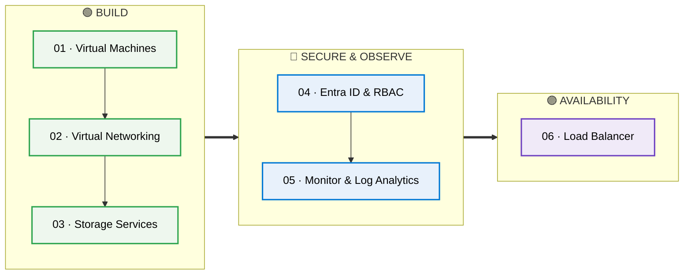
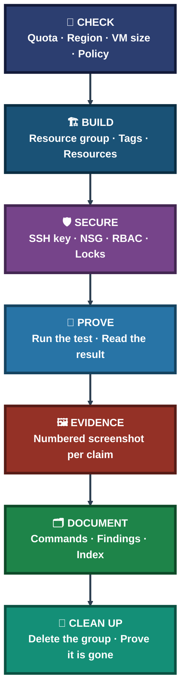

<a id="top"></a>
<div align="center">

# ☁️ Cloud Infrastructure Engineering

**Malaika Azhar · Azure Portfolio**

**Virtual Machines → Networking → Storage → Identity → Monitoring → Load Balancing**

Six hands-on Azure labs, each built from the command line or the portal and backed by numbered screenshot evidence — every project written around what was actually run and what was actually observed.


### [📂 Jump to the projects](#portfolio-map)

</div>

---

## 📑 Table of Contents

1. [At a Glance](#at-a-glance)
2. [About This Repository](#about)
3. [Environment & Tools](#environment)
4. [Portfolio Map](#portfolio-map)
5. [Azure Projects](#azure-projects)
6. [Coverage Snapshot](#coverage-snapshot)
7. [Lab Lifecycle](#lifecycle)
8. [Verification, Not Assumption](#verification)
9. [Highlights in Numbers](#highlights)
10. [Challenges & Fixes](#challenges-fixes)
11. [Scope & Limitations](#scope-limitations)
12. [What I Learned](#what-i-learned)
13. [Skills Demonstrated](#skills-demonstrated)
14. [Repo Structure](#repo-structure)

---

<a id="at-a-glance"></a>
## 📊 At a Glance

| ☁️ Cloud | 🧩 Projects | 🖼️ Screenshots | 📑 Visual Indexes | 🌍 Regions Used |
|:---:|:---:|:---:|:---:|:---:|
| **Azure** | **6** | **145** | **6** | **2** |

---

<a id="about"></a>
## 📖 About This Repository

This repository is one cloud portfolio told in six steps. It starts with a single Linux VM taken through its full lifecycle, then adds the layers a real workload needs: a network around it, storage beside it, identity and guardrails over it, monitoring on it, and a load balancer in front of it.

- **Compute:** Deploy an Ubuntu VM with SSH key authentication, attach and mount a data disk, resize it, and compare the stopped and deallocated states.
- **Networking:** Build a VNet with two subnets and NSGs, limit SSH to one address, block and then allow the same traffic, and create a VNet peering.
- **Storage:** Store and tier blobs, recover deleted data, control access with anonymous requests, SAS tokens and the storage firewall, and mount an Azure Files share over SMB.
- **Identity:** Assign RBAC roles to a group, test allowed and denied actions as a real user, add a lock and a policy, and read a Key Vault secret with a managed identity.
- **Monitoring:** Send VM logs and metrics to Log Analytics, find failed logins with KQL, and make a metric alert and a log alert fire.
- **Availability:** Put two private web servers behind a Standard Load Balancer and test failover.

<div align="center">

### 🧩 How Each Project Is Laid Out

<table>
<tr>
<td align="center" valign="top" width="24%">

**📖 README.md**<br>
<sub>Objective, modules,<br>findings, lessons</sub>

</td>
<td align="center" valign="middle" width="5%">

**➜**

</td>
<td align="center" valign="top" width="24%">

**📑 INDEX.md**<br>
<sub>Visual index and<br>exhibit grid</sub>

</td>
<td align="center" valign="middle" width="5%">

**➜**

</td>
<td align="center" valign="top" width="20%">

**⌨️ commands/**<br>
<sub>Commands and<br>cleanup steps</sub>

</td>
<td align="center" valign="middle" width="5%">

**➜**

</td>
<td align="center" valign="top" width="17%">

**🖼️ Screenshots/**<br>
<sub>Numbered evidence,<br>ss-01 onward</sub>

</td>
</tr>
</table>

</div>

---

<a id="environment"></a>
## 🖧 Environment & Tools

| Area | Tools Used |
|---|---|
| **Cloud & Subscription** | Microsoft Azure, Azure for Students subscription, regions `indiasouthcentral` and `uaenorth` |
| **Compute** | Ubuntu 22.04 and 24.04 LTS VMs (`Standard_B2ls_v2`, resized to `Standard_B2s_v2` in Project 01), managed disks |
| **Networking** | VNet, subnets, NSGs, public and private IPs, VNet peering, Network Watcher IP flow verify, Standard Load Balancer |
| **Storage** | Blob Storage, Azure Files (SMB), soft delete, versioning, SAS tokens, storage firewall |
| **Identity & Governance** | Microsoft Entra ID Free, Azure RBAC, custom role, resource lock, Azure Policy, Key Vault, managed identity |
| **Monitoring** | Azure Monitor Agent, Log Analytics, Data Collection Rule, KQL, metric and log alerts, action group, workbook |
| **Client & Automation** | Azure CLI in Cloud Shell, Azure Portal, Windows PowerShell with OpenSSH, `az vm run-command`, `curl`, `cifs-utils`, nginx |

---

<a id="portfolio-map"></a>
## 🗺️ Portfolio Map



| Folder | Contents |
|---|---|
| [`Azure`](Azure) | 6 Azure projects, each with README, visual INDEX, commands and screenshots |

---

<a id="azure-projects"></a>
## ☁️ Azure Projects

**Goal:** Build one Azure capability per project, from a single VM to a load-balanced pair, and prove each result with a screenshot. Browse the [Azure section README](Azure/README.md) for the overview.

**Status legend:** ✅ Complete

### 🟢 Compute & Network

| # | Project | Status | Highlights |
|:---:|---|:---:|---|
| **01** | [VM Deployment & Administration](Azure/01-vm-deployment-administration) · [Index](Azure/01-vm-deployment-administration/VM-INDEX.md) | ✅ | Ubuntu 24.04 VM, SSH key login, 4 GB data disk mounted by UUID, resize, stopped vs deallocated, boot diagnostics |
| **02** | [Azure Virtual Networking](Azure/02-azure-virtual-networking) · [Index](Azure/02-azure-virtual-networking/Virtual-Networking-INDEX.md) | ✅ | VNet with 2 subnets and 2 NSGs, SSH limited to one IP, deny then allow the same traffic, IP flow verify; VNet peering created |

### 🔵 Storage & Identity

| # | Project | Status | Highlights |
|:---:|---|:---:|---|
| **03** | [Azure Storage Services](Azure/03-azure-storage-services) · [Index](Azure/03-azure-storage-services/Storage-INDEX.md) | ✅ | Blob tiering, soft delete and versioning recovery, SAS token 200 then 403, firewall Deny, Azure Files mounted over SMB |
| **04** | [Entra ID & RBAC](Azure/04-entra-id-rbac) · [Index](Azure/04-entra-id-rbac/Entra-RBAC-INDEX.md) | ✅ | Reader role allowed and denied as a real user, lock and policy blocked actions, VM read a Key Vault secret with HTTP 200 |

### 🟣 Monitoring & Availability

| # | Project | Status | Highlights |
|:---:|---|:---:|---|
| **05** | [Azure Monitor & Log Analytics](Azure/05-azure-monitor-log-analytics) · [Index](Azure/05-azure-monitor-log-analytics/Monitor-INDEX.md) | ✅ | Failed SSH logins found with KQL, CPU alert and log alert both fired, workbook saved |
| **06** | [Standard Load Balancer](Azure/06-load-balancer) · [Index](Azure/06-load-balancer/LoadBalancer-INDEX.md) | ✅ | 2 private nginx servers behind 1 public IP, failover and recovery shown|

---

<a id="coverage-snapshot"></a>
## 📈 Coverage Snapshot

| ☁️ Domain | 📌 Where It Appears | ✅ What Was Demonstrated |
|---|---|---|
| Virtual Machines | Projects 01, 05, 06 | Deployment, SSH keys, disks, resize, power states, nginx servers |
| Virtual Networking | Projects 02, 06 | VNet, subnets, NSGs, public vs private IP, jump host, peering links |
| Storage | Project 03 | Blob, tiers, soft delete, versioning, SAS, firewall, Azure Files over SMB |
| Identity & Access | Project 04 | Entra users and groups, RBAC, custom role, managed identity, Key Vault |
| Governance & Guardrails | Project 04 | `CanNotDelete` lock, Azure Policy deny, tagging standard across all projects |
| Monitoring & Alerting | Project 05 | Azure Monitor Agent, DCR, KQL, metric alert, log alert, workbook |
| Availability | Project 06 | Standard Load Balancer, backend pool, health probe, failover test |
| Cost Hygiene | Projects 01–06 | Naming and tagging standard, one resource group per project, cleanup section in every project |

---

<a id="lifecycle"></a>
## 🧭 Lab Lifecycle

How every project in the portfolio runs — from the first check to the last cleanup



---

<a id="verification"></a>
## ✅ Verification, Not Assumption

A recurring rule across the portfolio: a step is not done until it has been proven with direct evidence.

| Check | Method | Where |
|---|---|---|
| Data disk survives a reboot | Mounted by UUID in `/etc/fstab`, tested with `umount` then `mount -a`; the device names swapped after reboot and the mount still worked | Project 01 |
| A resize really happened | `free -h` inside the guest: 3.8Gi before, 7.7Gi after | Project 01 |
| An NSG rule really blocks | `curl` exit code 28 with the deny rule, exit code 0 after it was changed to allow, plus Network Watcher IP flow verify naming the rule | Project 02 |
| A SAS token really expires | HTTP 200 before expiry, HTTP 403 after | Project 03 |
| A deleted blob is recoverable | Old content downloaded by its version ID after the blob was deleted | Project 03 |
| A role does what it says | Allowed view and denied tag write, tested as a real signed-in test user | Project 04 |
| A managed identity needs no stored secret | The VM read the Key Vault secret and got HTTP 200 | Project 04 |
| An alert truly fired | The Activated e-mail, not just "added to action group" or "Resolved" | Project 05 |
| Failover works | Same public address answered from `vm-web-02` while `vm-web-01` was stopped | Project 06 |
| Cleanup is complete | Resource group listing and final-state screenshots after deletion | Projects 02–06 |

---

<a id="highlights"></a>
## 🔢 Highlights in Numbers

Figures below are taken directly from the project READMEs.

| Project | Highlight |
|:---:|---|
| Project 01 | **31** screenshots; **4 GB** data disk; **2** VM sizes; resize changed memory (**3.8Gi → 7.7Gi**) but not vCPUs (**2** both) |
| Project 02 | **36** screenshots; **2** VMs and **2** NSGs; deny gave `curl` exit **28**, allow gave exit **0** |
| Project 03 | **25** screenshots; SAS token returned **200** before expiry and **403** after |
| Project 04 | **18** screenshots; **2** guardrails (lock, policy); Key Vault secret read with HTTP **200** |
| Project 05 | **20** screenshots; **2** alert rules fired; **5** failed-login rows found; CPU near **99.6 %** |
| Project 06 | **15** screenshots; **2** private web servers behind **1** public IP; probe every **5** seconds |
| Portfolio | **6** projects totalling **145** screenshots |

---

<a id="challenges-fixes"></a>
## 🔧 Challenges & Fixes

| ❌ Challenge | ✅ Fix |
|---|---|
| The first SSH key pair asked for a passphrase and failed with `Permission denied (publickey)` (Project 01) | Created a second key pair and added its public key from the portal |
| SSH through a jump host failed because the key was not used for the first hop (Project 02) | Switched to `ProxyCommand` so both hops get the key |
| A regional vCPU quota stopped the peering test VM (Project 02) | Checked the quota error and deallocated another VM; the peering links themselves were still created |
| The storage account key appeared on screen in two early screenshots (Project 03) | Left those screenshots out, renewed `key1`, and kept the key in a shell variable afterwards |
| Cloud Shell could not get a Microsoft Graph token (Project 04) | Created and deleted the test user and group in the portal; everything else ran from Cloud Shell |
| Azure Policy did not enforce straight away (Project 04) | Waited, and the next untagged resource was denied |
| Region policy and Data Collection Rule locations clashed across three errors (Project 05) | Read the policy's allowed list once, then built the workspace, DCR and log alert in `uaenorth` |
| The VM wizard defaults would have opened SSH to all addresses and created a new VNet (Project 06) | Caught them on the review page and set public inbound ports to None |

---

<a id="scope-limitations"></a>
## 🧱 Scope & Limitations

Each project is complete within the scope it states. The limits of that scope are listed here:

- **Project 01:** SSH was open to all addresses for the whole lab, the NSG came from the portal wizard, and the billing difference between stopped and deallocated was not tested.
- **Project 02:** Both peering links were created, but **no traffic was sent across** because the test VM failed on a core quota. The NSG test covers one flow only, and the SSH restriction was tested from one other source.
- **Project 03:** The lifecycle rule exists but its effect could not be seen in one day. No allowed-IP firewall rule was tested, the share was mounted by hand (not in `/etc/fstab`), and only LRS was built.
- **Project 04:** The custom role was created and assigned but never used by the test user, so its permissions are not claimed. Only Entra ID Free was used.
- **Project 05:** The failed logins and CPU load were started inside the VM, so no real attacker was observed. The VM, workspace and DCR sit in two regions.
- **Project 06:** The two servers never alternated in the browser, no Unhealthy state was captured while a server was stopped, the metrics charts stayed empty, and the lab is HTTP only.
- **📝 Marker:** Items taken from notes with no screenshot in the repo are marked 📝 in the text.
- **Screenshots:** Public IPs, subscription and tenant IDs, e-mail addresses and keys are blurred or kept out of the repo.

These limits are marked here instead of hidden, so the portfolio reflects exactly what was done.

---

<a id="what-i-learned"></a>
## 🧠 What I Learned

- **Check quota, region and policy before building.** A short check up front is cheaper than a failed deployment halfway through.
- **A device name is not an identity.** Disks swapped names after a reboot; the UUID in `/etc/fstab` kept the right one mounted.
- **An NSG does nothing until it is attached.** The subnet association changed the traffic, not the creation of the group.
- **A blocked port shows up as a timeout.** `curl` exit code 28 means no answer, and IP flow verify names the rule behind it.
- **A SAS token is a key with a clock.** It worked, then stopped, with no change on the account.
- **A role is only proven by using it.** The Reader role has both an allowed and a denied result.
- **A managed identity removes stored credentials.** The VM read a secret with no key on it.
- **Resources that depend on each other need the same location.** A Data Collection Rule and its workspace must match.
- **Only the Activated e-mail proves an alert.** Similar-looking e-mails prove nothing.
- **Only the front door needs a public IP.** The web servers stayed private and were still reachable through the load balancer.
- **A screenshot must show the claim.** If it does not show the result, it does not go into the results.

---

<a id="skills-demonstrated"></a>
## 🛠️ Skills Demonstrated

- Deploying and administering Ubuntu VMs on Azure with SSH key authentication, data disks, resizing and power states
- Using Azure Cloud Shell and the Azure CLI for groups, tags, disks, networks, storage, policy and monitoring
- Designing an address plan and building VNets, subnets, NSGs, jump-host access and VNet peering
- Verifying network rules with `ping`, `curl` and Network Watcher IP flow verify
- Building storage with Blob tiers, lifecycle rules, soft delete, versioning, SAS tokens and the storage firewall
- Mounting an Azure Files share on Linux over SMB (`cifs`)
- Creating Entra ID users and groups, assigning RBAC roles and writing a custom role definition
- Enforcing guardrails with resource locks and Azure Policy `deny`
- Using a system-assigned managed identity to read a Key Vault secret
- Installing Azure Monitor Agent, writing Data Collection Rules and querying logs with KQL
- Creating action groups, metric alerts and log alerts, and proving that they fire
- Configuring a Standard Load Balancer with a backend pool, health probe and rule, and testing failover
- Running scripts inside a VM with `az vm run-command` without opening SSH
- Applying a naming and tagging standard and cleaning up with a proven resource group delete
- Writing clear technical documentation backed by screenshot evidence

---

<a id="repo-structure"></a>
## 📁 Repo Structure

```text
Cloud-Infrastructure-Engineering/
|-- README.md
|-- LICENSE
|-- .gitignore
`-- Azure/
    |-- README.md
    |-- 01-vm-deployment-administration/
    |-- 02-azure-virtual-networking/
    |-- 03-azure-storage-services/
    |-- 04-entra-id-rbac/
    |-- 05-azure-monitor-log-analytics/
    `-- 06-load-balancer/
```

Inside every project folder:

```text
NN-project-name/
|-- README.md
|-- <Project>-INDEX.md
|-- commands/
|   |-- commands.md
|   `-- cleanup.md
`-- Screenshots/
    `-- ss-01 ... ss-NN
```

> [!NOTE]
> Project 06 keeps only `commands/cleanup.md`, because it was built in the Azure Portal rather than from a command list.

<div align="center">

☁️ **[Microsoft Azure](https://azure.microsoft.com)** · 📚 **[Azure CLI documentation](https://learn.microsoft.com/cli/azure/)** · 🔐 **[Azure RBAC](https://learn.microsoft.com/azure/role-based-access-control/)** · 📊 **[Azure Monitor](https://learn.microsoft.com/azure/azure-monitor/)** · ⚖️ **[Load Balancer](https://learn.microsoft.com/azure/load-balancer/)** · 🧭 **[Back to top](#top)**

</div>
