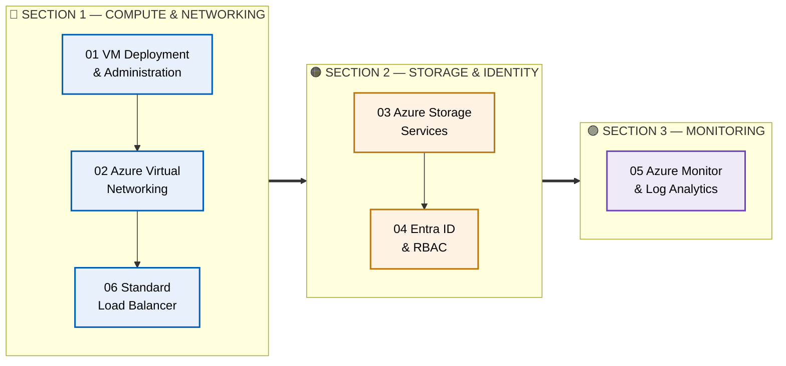

<div align="center">

# ☁️ Azure Cloud Infrastructure Labs

**Malaika Azhar · Cloud Infrastructure Engineering Portfolio**

**Compute → Networking → Storage → Identity → Monitoring → Load Balancing**

Six hands-on Azure labs, each built from scratch in its own resource group, proven with numbered screenshots, and deleted at the end. Every lab is written around what was actually run, what was actually observed, and what was honestly left out.


### [📂 Jump to the labs](#portfolio-map) &nbsp;·&nbsp; [📋 Executive Summary](EXECUTIVE-SUMMARY%20.md) &nbsp;·&nbsp; [⬅️ Repo Home](../README.md)

</div>

---

## 📑 Table of Contents

1. [At a Glance](#at-a-glance)
2. [About This Folder](#about)
3. [Environment & Tools](#environment)
4. [Portfolio Map](#portfolio-map)
5. [Section 1 — Compute & Networking](#section-1)
6. [Section 2 — Storage & Identity](#section-2)
7. [Section 3 — Monitoring](#section-3)
8. [Coverage Snapshot](#coverage-snapshot)
9. [Lab Life Cycle](#life-cycle)
10. [Verification, Not Assumption](#verification)
11. [Highlights in Numbers](#highlights)
12. [Challenges & Fixes](#challenges-fixes)
13. [Scope & Limitations](#scope-limitations)
14. [What I Learned](#what-i-learned)
15. [Skills Demonstrated](#skills-demonstrated)
16. [Repo Structure](#repo-structure)

---

<a id="at-a-glance"></a>
## 📊 At a Glance

| 🧩 Sections | 🧪 Labs | 🖼️ Screenshots | ☁️ Subscription | 📍 Region | 🧹 Cleanup |
|:---:|:---:|:---:|:---:|:---:|:---:|
| **3** | **6** | **145** | **Azure for Students** | **India South Central** | **Last step of every lab** |

---

<a id="about"></a>
## 📖 About This Folder

This folder is one Azure portfolio told in three steps. It starts with the machines and the network around them, moves into storage and identity, and finishes with monitoring. Later labs reuse the habits of the earlier ones: one resource group per lab, tags on every resource, and a screenshot for every claim.

- **Section 1 — Compute & Networking:** a Linux VM through its full life cycle, a custom virtual network with NSGs and peering, and a Standard Load Balancer with failover.
- **Section 2 — Storage & Identity:** Blob Storage and Azure Files with their security layers, and Entra ID with RBAC, a lock, a policy and a managed identity.
- **Section 3 — Monitoring:** Azure Monitor and Log Analytics with a data collection rule, KQL, two kinds of alert and a workbook.

> [!NOTE]
> Every lab states plainly where something was left out or only partly finished, and why. A documented gap with a diagnosed cause is more useful than a result that only looks clean.

<div align="center">

### 🧩 How Each Lab Is Laid Out

<table>
<tr>
<td align="center" valign="top" width="22%">

**📖 README.md**<br>
<sub>Objective, steps,<br>findings, limitations</sub>

</td>
<td align="center" valign="middle" width="5%">

**➜**

</td>
<td align="center" valign="top" width="22%">

**🗂️ INDEX.md**<br>
<sub>Step index, exhibit grid,<br>verification checklist</sub>

</td>
<td align="center" valign="middle" width="5%">

**➜**

</td>
<td align="center" valign="top" width="22%">

**⌨️ commands/**<br>
<sub>commands.md and<br>cleanup.md</sub>

</td>
<td align="center" valign="middle" width="5%">

**➜**

</td>
<td align="center" valign="top" width="19%">

**🖼️ Screenshots/**<br>
<sub>Numbered evidence,<br>ss-01 onward</sub>

</td>
</tr>
</table>

</div>

---

<a id="environment"></a>
## 🖧 Environment & Tools

| Area | Tools Used |
|---|---|
| **Platform** | Microsoft Azure, Azure for Students subscription, India South Central |
| **Compute** | Ubuntu 22.04 and 24.04 VMs, `Standard_B2ls_v2` (resized to `Standard_B2s_v2` in Lab 01), managed data disks, SSH key authentication |
| **Networking** | VNets, subnets, NSGs, VNet peering, Network Watcher IP flow verify, Standard Load Balancer, health probe |
| **Storage** | Blob Storage, access tiers, soft delete, versioning, SAS tokens, storage firewall, Azure Files over SMB |
| **Identity & Security** | Microsoft Entra ID, built-in and custom RBAC roles, resource lock, Azure Policy, Key Vault, managed identity |
| **Monitoring** | Azure Monitor, Log Analytics, Azure Monitor Agent, data collection rule, KQL, metric and log alerts, workbook |
| **Shells & Tools** | Azure Portal, Azure CLI in Cloud Shell, Windows PowerShell with OpenSSH, Run command, `curl`, `cifs-utils`, nginx |

---

<a id="portfolio-map"></a>
## 🗺️ Portfolio Map



| Section | Labs | Contents |
|:---:|---|---|
| **1** | 01, 02, 06 | VM life cycle, virtual networking, load balancing |
| **2** | 03, 04 | Storage services, identity and access control |
| **3** | 05 | Logging, alerting and workbooks |

---

<a id="section-1"></a>
## 🔵 Section 1 — Compute & Networking

**Goal:** Build the machines and the network around them, then put a load balancer in front.

**Status legend:** ✅ Complete within the scope each lab states. Limits are documented in the lab and under [Scope & Limitations](#scope-limitations).

| # | Lab | Status | Highlights |
|:---:|---|:---:|---|
| **01** | [VM Deployment & Administration](01-vm-deployment-administration) · [📑 Index](01-vm-deployment-administration/VM-INDEX.md) | ✅ | One Ubuntu 24.04 VM, key-based SSH, 4 GB data disk mounted by UUID, resize, stop and deallocate, boot diagnostics. 31 screenshots |
| **02** | [Azure Virtual Networking](02-azure-virtual-networking) · [📑 Index](02-azure-virtual-networking/Virtual-Networking-INDEX.md) | ✅ | VNet with 2 subnets and one NSG each, one public and one private-only VM, a rule that blocks then allows the same traffic, IP flow verify, 2 peering links. 36 screenshots |
| **06** | [Standard Load Balancer](06-load-balancer) · [📑 Index](06-load-balancer/LoadBalancer-INDEX.md) | ✅ | Two private nginx servers behind one public address, HTTP probe, `vm-web-02` answered while `vm-web-01` was stopped, then both Up at 100% healthy. 15 screenshots |

---

<a id="section-2"></a>
## 🟠 Section 2 — Storage & Identity

**Goal:** Store data safely and control who can reach it and what they may do.

| # | Lab | Status | Highlights |
|:---:|---|:---:|---|
| **03** | [Azure Storage Services](03-azure-storage-services) · [📑 Index](03-azure-storage-services/Storage-INDEX.md) | ✅ | One storage account built from the CLI: tiers, soft delete and versioning, anonymous vs SAS vs firewall access, Azure Files mounted on a Linux VM. 25 screenshots |
| **04** | [Entra ID & RBAC](04-entra-id-rbac) · [📑 Index](04-entra-id-rbac/Entra-RBAC-INDEX.md) | ✅ | Test user and group with a built-in role, allowed and denied actions in a private window, a lock and a policy deny, and a VM reading a Key Vault secret with a managed identity (HTTP 200). 18 screenshots |

---

<a id="section-3"></a>
## 🟣 Section 3 — Monitoring

**Goal:** Collect logs from a VM, query them, and get alerted when something happens.

| # | Lab | Status | Highlights |
|:---:|---|:---:|---|
| **05** | [Azure Monitor & Log Analytics](05-azure-monitor-log-analytics) · [📑 Index](05-azure-monitor-log-analytics/Monitor-INDEX.md) | ✅ | Workspace, Azure Monitor Agent, data collection rule, failed-login KQL query, CPU metric alert and log alert both fired with e-mail, workbook saved. 20 screenshots |

---

<a id="coverage-snapshot"></a>
## 🌟 Coverage Snapshot

| ☁️ Domain | 📌 Where It Appears | ✅ What Was Demonstrated |
|---|---|---|
| Virtual Machines | Labs 01, 02, 06 | Private and public VMs, SSH keys, data disks, resize, power states |
| Networking | Labs 02, 06 | VNets, subnets, NSGs, peering, IP flow verify, load balancing |
| Storage | Lab 03 | Blob tiers, data protection, SAS, firewall, Azure Files |
| Identity & Access | Lab 04 | Entra ID users and groups, RBAC, custom role, managed identity |
| Governance & Secrets | Lab 04 | Resource lock, Azure Policy deny, Key Vault secret read |
| Monitoring & Alerting | Lab 05 | Log Analytics, DCR, KQL, metric and log alerts, workbook |
| High Availability | Lab 06 | Health probe, failover, recovery |
| Cleanup & Cost Control | Labs 01–06 | One resource group per lab, deleted at the end |

---

<a id="life-cycle"></a>
## 🧭 Lab Life Cycle

How every lab in this folder is run, from the first resource to the last delete

```mermaid
flowchart LR
    Bld["🔵 BUILD<br/>Resource group · resources"]:::c1
    Cfg["🟠 CONFIGURE<br/>Network · access · agents · rules"]:::c2
    Ver["🟢 VERIFY<br/>One screenshot per result"]:::c3
    Trb["🟣 TROUBLESHOOT<br/>Errors recorded with the fix"]:::c4
    Cln["🧹 CLEAN UP<br/>Delete only this lab's group"]:::c5

    Bld --> Cfg --> Ver --> Trb --> Cln

    classDef c1 fill:#2C3E70,stroke:#131B3A,stroke-width:4px,color:#FFFFFF,font-weight:bold
    classDef c2 fill:#B9770E,stroke:#6E4409,stroke-width:4px,color:#FFFFFF,font-weight:bold
    classDef c3 fill:#117864,stroke:#083D33,stroke-width:4px,color:#FFFFFF,font-weight:bold
    classDef c4 fill:#76448A,stroke:#432752,stroke-width:4px,color:#FFFFFF,font-weight:bold
    classDef c5 fill:#943126,stroke:#571C16,stroke-width:4px,color:#FFFFFF,font-weight:bold

    linkStyle default stroke:#2C3E50,stroke-width:3px
```



---

<a id="verification"></a>
## ✅ Verification, Not Assumption

A recurring rule across the labs: a step is not done until it has been proven with direct evidence.

| Check | Method | Where |
|---|---|---|
| Data disk is really 4 GB | The CLI size column was empty, so `lsblk` inside the VM confirmed it | Lab 01 |
| NSG blocks, then allows | Same flow tested twice, with Network Watcher IP flow verify | Lab 02 |
| SAS token really expires | Compared its expiry time with the clock, waited, repeated the request | Lab 03 |
| Role assignment worked | Command printed `role: null`, so `az role assignment list` proved it | Lab 04 |
| Policy is enforced | A second untagged public IP was denied | Lab 04 |
| Alert really fired | Alert list from the Alerts Management API, plus the Activated e-mail | Lab 05 |
| Failover works | Stopped `vm-web-01`, same address returned `vm-web-02`, then rule health showed both Up | Lab 06 |
| Cleanup worked | Resource group list after the delete, with older groups still present | Labs 02, 06 |

---

<a id="highlights"></a>
## 🔢 Highlights in Numbers

Figures below are taken directly from the lab READMEs.

| Lab | Highlight |
|:---:|---|
| Lab 01 | **31** screenshots; **4 GB** data disk; VM resized **B2ls_v2 → B2s_v2** |
| Lab 02 | **36** screenshots; **2** subnets, **2** NSGs, **2** peering links; **5** modules |
| Lab 03 | **26** steps in **4** modules; **25** screenshots; Blob + Azure Files |
| Lab 04 | **20** steps; **18** screenshots; **2** guardrails (lock, policy); secret read returned **HTTP 200** |
| Lab 05 | **17** steps; **20** screenshots; Heartbeat **10**, Syslog **14**, Perf **24** rows in the workspace; **5** failed-login rows returned by KQL |
| Lab 06 | **18** steps; **15** screenshots; **100%** of instances healthy, **2** servers Up |
| Folder | **6** labs, **145** screenshots |

---

<a id="challenges-fixes"></a>
## ⚠️ Challenges & Fixes

| ❌ Challenge | ✅ Fix |
|---|---|
| First SSH key asked for a passphrase and failed with `Permission denied (publickey)` (Lab 01) | Created a second key pair and added its public key from the portal |
| `ssh -J` jump host failed because the key was not used for the first hop (Lab 02) | Used `ProxyCommand` so both hops get the key |
| First SAS re-test still returned 200 (Lab 03) | The token had not expired yet. Compared its expiry with the clock, waited and repeated |
| Cloud Shell could not get a Microsoft Graph token (Lab 04) | Created the test user and group in the portal. Roles, lock, policy, VM and vault ran from Cloud Shell |
| DCR creation failed in `indiasouthcentral` and `centralindia` (Lab 05) | Listed the regions the policy allows and the DCR supports, then used `uaenorth` |
| First load balancer Create left no load balancer in the group (Lab 06) | Redid the wizard and checked the review text before Create |

---

<a id="scope-limitations"></a>
## 🚧 Scope & Limitations

Each lab is complete within the scope it states. The limits of that scope are listed here:

- **Lab 01:** SSH was open to all addresses, and the lab has no backup, monitoring or high availability. Cost was not measured.
- **Lab 02:** `vm-peer` failed on a core quota (limit 6, usage 6), so no traffic was sent across the peering. Only the two links are shown. The NSG test covers one flow.
- **Lab 03:** The lifecycle rule exists but its effect was not seen. The share was mounted by hand, not made permanent, and only LRS redundancy was built.
- **Lab 04:** The custom role was created and assigned but not exercised by the test user. Entra ID Free only, and roles were assigned at resource group scope.
- **Lab 05:** The failed logins came from the VM itself (`127.0.0.1`), not from real attacker traffic. Only CPU was used for the metric alert, and the workbook was saved, not shared.
- **Lab 06:** Portal only, with plain HTTP. Bastion, Application Gateway, availability zones and autoscaling are outside the lab by design.
- **All labs:** Items marked 📝 ran but have no screenshot in the repo. Subscription ID, e-mail, tenant name and public IPs are blurred.

These limits are marked here instead of hidden, so the portfolio reflects exactly what was done.

---

<a id="what-i-learned"></a>
## 🧠 What I Learned

- **A success message is not proof.** When a command printed `role: null`, the real answer came from listing the assignment.
- **Quota and region are design inputs.** A core limit of 6 and a region without DCR support each changed what could be built.
- **Policies take time.** Enforcement started only after several minutes, so a first test can look like it failed.
- **Only the front door needs a public IP.** The load balancer's servers had none and were still reachable.
- **Secrets stay out of screenshots.** After a key was printed on screen, it was renewed and the command rewritten to keep it in a variable.
- **Read the review page before Create.** It caught a new VNet, a public IP and a missing name before anything was created.
- **A stopped server leaves the rotation.** The same address served the other VM until the first one returned.
- **Document blockers honestly.** A gap with a diagnosed cause holds up better under review than a result that only looks clean.

---

<a id="skills-demonstrated"></a>
## 🛠️ Skills Demonstrated

- Deploying and administering Linux VMs: SSH keys, data disks, resizing, power states, boot diagnostics
- Designing VNets, subnets and NSGs, and testing them with Network Watcher IP flow verify
- Configuring VNet peering
- Building Blob Storage and Azure Files, and securing them with soft delete, versioning, SAS tokens and firewall rules
- Managing identity and access with Microsoft Entra ID, RBAC, resource locks and Azure Policy
- Reading a Key Vault secret from a VM with a managed identity
- Collecting and querying logs with Azure Monitor, Log Analytics and KQL, with metric and log alerts
- Configuring a Standard Load Balancer with a health probe and testing failover
- Working in the Azure Portal, Azure CLI, Cloud Shell and Run command
- Documenting every lab with commands, numbered screenshots, an index and a cleanup record

---

<a id="repo-structure"></a>
## 📁 Repo Structure

```text
Cloud-Infrastructure-Engineering/
`-- Azure/
    |-- README.md
    |-- EXECUTIVE-SUMMARY .md
    |-- 01-vm-deployment-administration/
    |   |-- README.md
    |   |-- VM-INDEX.md
    |   |-- commands/
    |   `-- Screenshots/
    |-- 02-azure-virtual-networking/
    |   |-- README.md
    |   |-- Virtual-Networking-INDEX.md
    |   |-- commands/
    |   `-- Screenshots/
    |-- 03-azure-storage-services/
    |   |-- README.md
    |   |-- Storage-INDEX.md
    |   |-- commands/
    |   `-- Screenshots/
    |-- 04-entra-id-rbac/
    |   |-- README.md
    |   |-- Entra-RBAC-INDEX.md
    |   |-- commands/
    |   `-- Screenshots/
    |-- 05-azure-monitor-log-analytics/
    |   |-- README.md
    |   |-- Monitor-INDEX.md
    |   |-- commands/
    |   `-- Screenshots/
    `-- 06-load-balancer/
        |-- README.md
        |-- LoadBalancer-INDEX.md
        |-- commands/
        `-- Screenshots/
```

<div align="center">

☁️ **[Microsoft Azure](https://azure.microsoft.com)** · 📚 **[Azure documentation](https://learn.microsoft.com/azure/)** · 🔐 **[Microsoft Entra](https://learn.microsoft.com/entra/)** · 📊 **[Azure Monitor](https://learn.microsoft.com/azure/azure-monitor/)**

</div>
